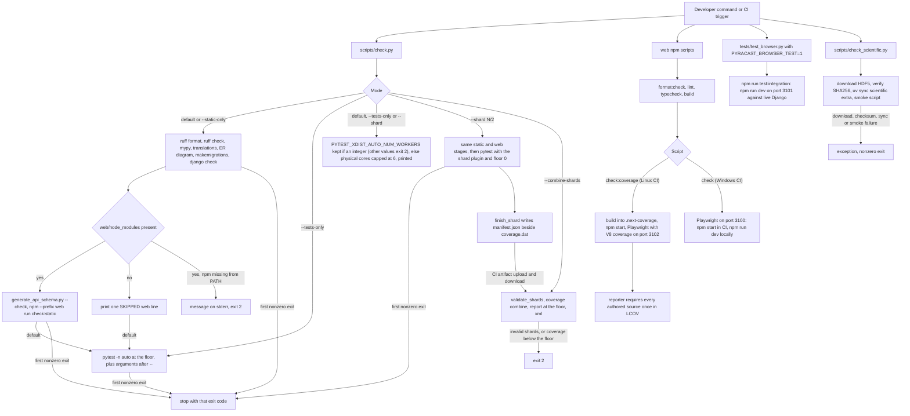

# Run the backend and frontend quality gate locally and in CI

A developer runs `scripts/check.py`, the `web` npm scripts or `scripts/check_scientific.py`; GitHub Actions runs the same commands on push to `main`, pull requests, merge groups and manual dispatch. The outcome is a pass or a nonzero exit, a 100% Python branch-coverage floor, frontend LCOV and the uploaded coverage artifacts that Sonar consumes. No production data or tenant is involved; tests build their own fixtures in a throwaway test database.

## Entry points

- `scripts/check.py` `main`: default run, `--shard INDEX/COUNT --shard-output DIR`, or `--combine-shards DIR...`; `--static-only` or `--tests-only` select stages, and arguments after `--` go to pytest unchanged (pass `--no-cov` with a test selection, since the floor applies to the whole suite). `web_npm` decides whether the web stages run. Pytest settings live in the native `[tool.pytest]` table of `pyproject.toml` (`strict = true`, list `addopts`, `faulthandler_timeout = 300`). `scripts/pytest_shard.py` is its pytest plugin (`pytest_collection_modifyitems`) and manifest validator (`validate_shards`, `finish_shard`).
- `web/package.json` scripts: `check` (static + `test`), `check:coverage` (static + `test:coverage`), `check:static` (format:check, lint, typecheck, build), `test:integration`, `api:generate`. `scripts/generate_api_schema.py --check` compares a fresh schema and types with the committed files. Configs: `web/playwright.config.ts`, `web/playwright.integration.config.ts`, `web/eslint.config.mjs`; coverage in `web/testing/run-coverage.mjs`, `coverage-options.ts`, `coverage-reporter.ts`.
- `tests/test_browser.py` `test_browser_against_live_django`: the only automated runner of the real-backend Playwright suite in `web/integration/` (a developer can also call `npm run test:integration` by hand with the `BROWSER_*` variables).
- `scripts/check_scientific.py` `main`: probe of the optional `scientific` extra (pvlib, h5py, HDF5); optional as a dependency, but CI runs it on every run.
- `tests/conftest.py`: registers the Hypothesis profiles `gate` (derandomized, no deadline, no example database), loaded unless `HYPOTHESIS_PROFILE` names another, and `explore` (randomized, 2000 examples) for local searches with `--hypothesis-profile=explore`.
- `.github/workflows/ci.yml`: `verify_ubuntu` (whole `check.py`), `verify_windows_shards` (two `--shard` runs) then `verify_windows` (`--combine-shards`), `web_ubuntu` (`generate_api_schema.py --check`, `check:coverage`) and `web_windows` (the same with `check`), `scientific` (both OS), `audit` (`pip-audit`), `sonar`. Before `check.py` the verify jobs start a non-durable PostgreSQL (`start_postgres.py --non-durable`, as do the web jobs) and RabbitMQ, run `pyracast migrate`, `migrate --check` and `pyracast check`. The `deployment` job belongs to the release pipeline flow.

## Sequence

## Data

| Table | R/W | What |
| --- | --- | --- |
| application schema (CI) | W | CI runs `pyracast migrate` on `PGDATABASE=pyracast` before the gate; `makemigrations --check` may read `django_migrations` when the database is reachable. |
| test databases | W then drop | pytest-django creates and drops its own test database for `default` on the server named by `PG*` variables; `auth_cache` sets `TEST.MIRROR = "default"`, so it uses that database and gets none of its own. `tests/settings.py` adds `synchronous_commit=off` to the shared session options, so test commits do not wait for the WAL flush. |
| `coverage.dat`, `manifest.json`, `collection-<worker>.json` | W then R | Per-shard coverage data and test inventory in `--shard-output`; read by `--combine-shards`. |
| `coverage.xml`, `web/coverage/lcov.info` | W | Backend and frontend coverage, uploaded for Sonar by `ci.yml` (Linux only; the Windows combine writes `coverage.xml` but does not upload it). |
| `test-results/pytest.xml` | W | JUnit XML and `--durations=25` from every verify job, uploaded for 7 days. |
| `web/test-results`, `web/integration-results`, `web/coverage/test-results` | W | Playwright traces and `error-context.md`, the upload step always runs; traces exist only for failed tests. |

## Authorization

None for users. Privilege boundaries: workflow `permissions: contents: read` and `persist-credentials: false`; every action pinned by commit SHA; `PYRACAST_SECRET_KEY` is a CI-only constant; the Linux RabbitMQ password is random per run and masked; `sonar` runs only when `SONAR_ENABLED` is `true`, never for merge groups, Dependabot or fork pull requests (they receive no token); `check_scientific.py` trusts the HDF5 download only through a pinned SHA256.

## Failure paths

| Condition | Result |
| --- | --- |
| Any `check.py` step exits nonzero | That exit code is returned at once; later steps do not run. |
| Coverage below `fail_under` (default run) | pytest-cov failure from `--cov-fail-under`. |
| Bad `--shard` value, `--shard` with `--combine-shards`, `--shard` without `--shard-output` or the reverse | argparse error, exit 2. |
| `--static-only` with `--tests-only`, `--shard` or pytest arguments; `--combine-shards` with a stage selection or pytest arguments | argparse error, exit 2, before any stage runs. |
| `web/node_modules` exists but `npm` is not on PATH | Message on stderr, exit 2 before any stage runs. |
| A stage exits nonzero | `Failed <stage> in <seconds>s (exit <code>)`; a passing stage prints `Finished <stage> in <seconds>s`. |
| `--shard-output` directory already exists | Uncaught `FileExistsError` traceback before any step runs. |
| `PYTEST_XDIST_AUTO_NUM_WORKERS` set to a value `int()` rejects | Message on stderr, exit 2 before any step runs. |
| Unknown pytest configuration key | `ERROR: Unknown config option` at startup under `strict = true`, exit 4; no test runs. |
| Unregistered marker or duplicate parametrize id | Collection error under `strict = true`; no test runs. |
| A test runs longer than 300 s | `faulthandler_timeout` prints every thread's stack (also from xdist workers); the run continues. |
| Selected shard is empty | `pytest.UsageError` "The test shard is empty". |
| xdist workers collected different shards | `finish_shard` raises `ValueError` after the tests passed; no `manifest.json`. |
| Missing, duplicate, foreign or empty-coverage shard on combine | "Invalid test shards: ..." on stderr, exit 2. |
| Combined coverage below the floor | `coverage report` exit 2, no `coverage.xml`. |
| Fresh schema or types differ from the committed files, or a committed file is missing or not valid JSON | `generate_api_schema.py --check` names each stale file and the fix command `npm --prefix web run api:generate`, exit 1 (a semantic `openapi.json` difference is reported before Node runs). |
| `npx`, `openapi-typescript` or prettier fails during `--check` | Its stderr and exit code (1 when `npx` is missing). |
| New advisory in npm or Python dependencies | `npm audit --audit-level=low` or `pip-audit --strict` fails the job without a code change. |
| Playwright test fails in CI (main config) | Retried twice; a test that passes only on a retry is flaky and fails the job (`failOnFlakyTests`). The integration config has no retries. |
| `test.only` left in a spec in CI | `forbidOnly` fails both configurations. |
| Mocked suite exceeds 15 min, integration suite exceeds 200 s | Playwright's `globalTimeout` stops the run and reports the unfinished tests; the 240 s `subprocess.TimeoutExpired` of `test_browser.py` remains the outer limit. |
| `check_scientific.py` on another OS, failed download, bad checksum, missing `uv`, failed sync or smoke assertion | `RuntimeError`, `URLError` or `CalledProcessError` (smoke assertions fail inside the child interpreter). |
| Sonar enabled but token, project key or organization missing | "Missing Sonar configuration: ..." and the job fails. |

## Rules and invariants

- Property tests are reproducible: the `gate` profile derives examples from the test itself, so every shard, worker and rerun checks the same cases; a counterexample found with `explore` is pinned with `@example`, and no line is covered only by a property test.
- The floor has one source, `tool.coverage.report.fail_under` in `pyproject.toml`. Shards run with floor 0; only the combine step enforces it.
- Worker count: `check.py` keeps an explicit integer `PYTEST_XDIST_AUTO_NUM_WORKERS` (it refuses any other value, which xdist would ignore in favour of every physical core) and otherwise sets it to the physical core count (logical count when psutil cannot tell) capped at 6, printing the value; CI pins 2. Shard mode replaces `addopts` through `-o` without the `--cov-report` entries, and `strict = true` still applies there.
- Only throwaway CI clusters run without `fsync`; a developer cluster keeps it on, and test sessions only relax `synchronous_commit`.
- `selected_nodes` keeps all tests of one file in one shard and balances by test count. `validate_shards` recomputes the partition and requires one shared inventory and one `run_identity` (SHA, run id, attempt, platform, Python).
- Windows runs the static steps in every shard job and the combine job needs only the shard artifacts of the same attempt. Linux runs one unsharded `check.py`; `uv build` and the wheel import check run on Linux and in Windows shard 1.
- `check:coverage` runs on Linux and `check` on Windows. Only coverage mode builds `.next-coverage` and asserts production-only CSP behaviour in `web/tests/security-headers.spec.ts`.
- Normal mode starts `npm start` in CI (the build from `check:static`) and `npm run dev` locally; coverage mode always builds and starts; the integration suite always uses `npm run dev` with `.next-integration`. Ports 3100, 3102 and 3101 keep suites apart.
- The web stages run only when `web/node_modules` exists; otherwise `check.py` prints one `SKIPPED web` line, and with it but without `npm` it fails and proves nothing about the web. They run `check:static`, not the Playwright suites.
- The real-backend suite is skipped unless `PYRACAST_BROWSER_TEST=1`. `check.py` does not set it but passes its environment through, so a developer who exports it runs the suite inside the pytest step.
- `tests/settings.py` fixes every settings-derived `PYRACAST_*` value in `os.environ` before importing `pyracast.settings`, and empties `PYRACAST_OPEN_METEO_API_KEY`, which `runtime` reads at call time, so neither the shell nor a local `.env` changes test settings, runtime provider configuration or the environment subprocess tests inherit; `PG*`, `PYRACAST_RABBITMQ_URL`, the live-test gates and the shard variables stay external.
- Frontend coverage has no percentage floor: the reporter fails only when an authored source is missing or duplicated in LCOV or no line has a hit. CI cancels superseded runs per ref (`concurrency`); Sonar needs `verify_ubuntu` and `web_ubuntu`.

## Tests

- `tests/test_pytest_shard.py`: shard parsing, partition, six aggregate rejections (missing, duplicate, overlap, inventory, identity, missing coverage), worker mismatch, the `--help` entrypoint, and a real two-shard xdist run merged through `check.main` (shards run by direct pytest calls, not `check.py --shard`).
- `tests/test_quality_gate.py`: the worker count passed to every gate command (capped, fallback, explicit value kept) and its printed line; the gate covers every static `ci.yml` command except `migrate`; the web skip line and the failure when `npm` is missing beside `web/node_modules`; `--static-only`, `--tests-only`, pytest arguments after `--` (also in shard mode), contradictory modes, per-stage timing and the stop at the first failing stage.
- `tests/test_api_schema_generation.py`: generation ignores local configuration, the runtime cookie name; `--check` reports a semantically or only formatting-wise stale `openapi.json` and stale `schema.d.ts` without writing them, reports a missing or unparsable committed file as stale, accepts current files, and returns the exit code of a missing `npx` or a failing Node tool (Node calls replaced by fakes).
- `tests/test_session_cookies.py`: under the cookie names and `Secure` flags of `pyracast.settings` without `PYRACAST_DEBUG` both `Set-Cookie` headers carry `Secure`, `Path=/` and no `Domain`.
- `tests/test_start_postgres.py`: `--non-durable` adds the three server options on Windows (`pg_ctl -o`) and Linux (`postgres -c` after the image) and is off by default.
- `tests/test_test_settings.py`: both database aliases report `synchronous_commit = off`; a hostile `.env` and shell environment leave the test settings unchanged.
- `tests/test_translations.py`: `compile_catalogs` (the translations step) and the committed catalogs.
- `tests/test_er_diagram.py`: `generate_er_diagram` generation, `--check` against temporary files, and the direct entrypoint without a database.
- `web/tests/coverage-paths.spec.ts`: `sourcePath` and `authoredSource`.
- Gaps: the real `npx` calls of `generate_api_schema.py --check` run only in CI and in a local gate with `web/node_modules`; `validate_shards` count mismatch, empty `coverage.dat` and non-object manifests are untested; `check_scientific.py`, `coverage-reporter.ts`, `ci.yml` and `eslint.config.mjs` have no test; the committed `docs/DATA_MODEL.md` is guarded only by the `check.py` step.
