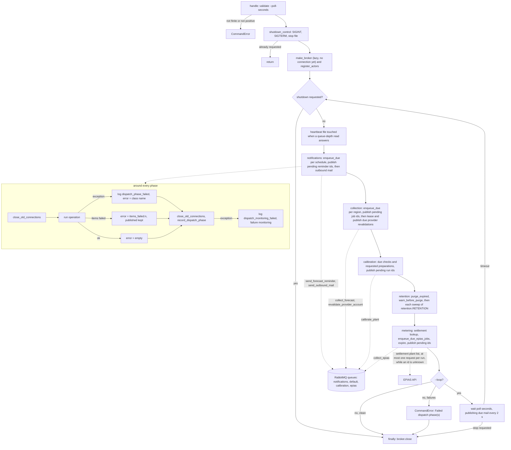

# Dispatcher scheduling and publishing cycle

A single long-running `pyracast dispatch --loop` process, started by Docker Compose in production and by the local launcher in development, repeats one cycle of five isolated phases: notifications, collection, calibration, retention and metering. Four phases create due rows in PostgreSQL and publish the ids of ready or lease-expired rows to RabbitMQ; retention only purges. Each phase's attempt, success, failure code, duration and published count is upserted into `DispatcherStatus` and logged as `dispatch_phase_finished`; the health check and the admin Overview and Operations screens read the phase status.

## Entry points

- Command: `pyracast dispatch [--loop] [--poll-seconds N] [--stop-file PATH] [--heartbeat-file PATH]` (`src/pyracast/orchestration/management/commands/dispatch.py` `Command.handle`; the `pyracast` script is `pyracast.cli.main`, a Django management entry). The default interval is `background.deadlines.DISPATCH_POLL_SECONDS` (30 s). Without `--loop` it runs one cycle and raises `CommandError` if any phase failed.
- Cycle: `pyracast.orchestration.dispatcher.run`, with phases built from the job kinds of `orchestration.kinds` (`dispatcher.phases`).
- Production actor: `deploy/compose.yaml` service `dispatcher` runs `pyracast dispatch --loop --poll-seconds 30 --heartbeat-file /tmp/dispatcher-heartbeat` (`restart: on-failure:5`, `stop_grace_period: 660s`, waits for healthy `postgres` and `rabbitmq`). Its healthcheck turns unhealthy when the heartbeat file is older than 300 s (60 s interval, 3 retries). `deploy/install-release.sh` stops it first, before the workers, api and web; `deploy/smoke.sh` runs one-shot `pyracast dispatch` in the api container while the dispatcher service is also running.
- Development actor: `scripts/dev.py` role `dispatcher` runs `django dispatch --loop` and appends `--stop-file .dev/dispatcher.stop`.
- Phase operations: `pyracast.notifications.runtime.dispatch_notifications`, `pyracast.forecasts.runtime.dispatch_collections` with `pyracast.forecasts.revalidation.dispatch_revalidations` (`dispatcher._collection`), `pyracast.plants.runtime.dispatch_calibrations`, the retention steps in `dispatcher._retention` (`trash.purge_expired`, `purge_warning.warn_before_purge`, then the sweeps of `pyracast.retention.RETENTION`), `pyracast.metering.runtime.dispatch_epias`.
- Status write: `orchestration.dispatcher.record_dispatch_phase`. Readers (other flows): `orchestration.delivery_health` via `check_delivery_health` (run by `deploy/watchdog.py`) and via the admin Overview and Operations screens (`pyracast.platform_admin.read_models`), read-only `DispatcherStatusAdmin`.
- Screen: none. No HTTP endpoint triggers or controls the dispatcher.

## Sequence

## Data

| Table | R/W | What |
| --- | --- | --- |
| `forecasts_dispatcherstatus` | W | One row per phase, upserted after the phase: `attempted_at`, `succeeded_at` only on success, `last_error` = failure code or empty, `duration_ms`, `published` (ids sent; null for retention or a raising phase) |
| `notifications_reminderschedule`, `connections_sitebinding`, `connections_provideraccount`, `accounts_membership`, `account_emailaddress`, `forecasts_forecastsnapshot` | R | Enabled schedules, binding eligibility, effective recipients, latest published snapshot pinned to a new delivery |
| `accounts_tenant`, `notifications_notificationsettings`, `regions_region` | lock | Per slot: tenant, recipient-limit row (pk 1, created if missing), region |
| `notifications_notificationdelivery`, `notifications_deliveryrecipient` | R/W | One delivery per schedule slot created with its frozen recipients (`skipped` with the refusal code when recipients are invalid, missing or over the limit, or `missed_schedule` when over 2 h late); ready ids selected |
| `notifications_outboundmail` | R/W | Expired mail ended as `skipped`/`expired`; due mail selected and stamped `published_at` (again only after a minute); retention deletes ended mail 7 days after `finished_at`, and the mail of the closed invitations it deletes |
| `regions_region`, `forecasts_collectionschedule`, `connections_sitebinding`, `connections_provideraccount` | R / lock | Collection eligibility and timing; the region row is locked per region |
| `connections_provideraccount` | R/W | Collection: accounts whose `revalidation_due_at` has passed are locked `FOR UPDATE SKIP LOCKED` and leased (`revalidation_due_at = now + LEASE`); an unpublished lease is due again at once |
| `forecasts_collectionjob` | R/W | Forecast and estimated-actuals jobs created or re-armed (`stale` to `pending`), older waiting forecasts marked `stale`/`forecast_superseded`; ready ids selected |
| `plants_plant`, `plants_calibrationrun`, `plants_plantevent` | R/W | `next_calibration_check_at` and `calibration_preparation_due_at` advanced or cleared; run and `calibration_scheduled` event created, or `calibration_automatic_skipped` event; pending or lease-expired run ids selected. Inputs read: see `calibration-automation` |
| `accounts_tenant`, `regions_region`, `auth_user`, `accounts_membership` | lock | Calibration: tenant, region, plant, then the enabling user and their admin membership |
| `metering_epiasconnection`, `metering_epiascollectionjob` | R/W | `settlement_plant_id` and `settlement_checked_at` stored, jobs created (including repair of terminal slots); jobs past `retry_until` set `failed`/`retry_window_expired`; ready ids selected |
| `regions_region`, `plants_plant`, `plants_plantconfiguration`, `forecasts_collectionschedule` | R / lock | Metering eligibility and night window; region and plant rows locked per connection |
| Trashed regions and their plants, `django_session` and `usersessions_usersession`, abandoned sign-ups, `accounts_workspaceinvitation` | W | Hard delete by the retention phase: the trash purge (see `trash-retention-purge`), sessions at expiry and device rows without a session, active sign-ups that never signed in with their own empty workspaces 7 days after `date_joined`, invitations 90 days after they closed; `regions_region.purge_warning_sent_at` stamped with warning mail enqueued for the workspace administrators |
| `notifications_notificationdelivery` | W | Retention clears `prepared_message` of ended deliveries 90 days after `scheduled_for`; the row, its typed metadata and its recipients stay |

## Authorization

- No user or HTTP boundary: the process runs with the application database role (`pyracast_app` in production) and touches all tenants. It trusts only database state.
- Eligibility is rechecked inside each phase under row locks: approved, current and validated binding for collection (`connections.currency.binding_is_current`), `binding_can_notify` and recipient limits for reminders, `_authorized` for calibration (otherwise `authorization_revoked` skip), `configuration_is_current` and `enabled` for metering.
- A plant has no trash of its own; its region (location) is the boundary. Regions in the trash are excluded from the collection, notification and calibration pending-id queries and from scheduling. `pending_epias_ids` has no trash filter: the worker's claim decides whether a published job is still current.
- Viewing `DispatcherStatus` requires the platform admin site (active staff superuser with MFA evidence: `DispatcherStatusAdmin`, Overview, Operations); the admin is read-only and no write path exists outside the command.

## Failure paths

| Condition | Result |
| --- | --- |
| `--poll-seconds` not finite or <= 0 | `CommandError` "--poll-seconds must be positive and finite", exit non-zero, no broker created |
| Stop requested before start | Returns immediately; nothing scheduled or published |
| SIGINT, SIGTERM or stop file during a cycle | Flag only; the cycle finishes its remaining phases, then the loop ends, the broker is closed and the process exits 0 |
| Any phase raises | Log `dispatch_phase_failed phase=<name> error_type=<class> origin=<module>:<line>:<function>`; `last_error=<class>`, `succeeded_at` kept; later phases still run |
| Items of a phase fail (a region, reminder schedule, calibration plant, connection, purged region, reclaimed sign-up) | The failure is logged as `<event> item=<kind>:<id> error_type origin` and the item backed off (process-local 15 minutes for schedules, connections and regions, a stored later check for calibration plants, none for collection regions); other items and pending-id publication continue; the phase records `items_failed:<n>` with its published count, collection `collection_regions_failed:<n>` |
| A retention step or the reminder step raises something other than item failures | The phase ends there (later retention steps, or the mail step, do not run); the failure code is the exception class. Item failures of a retention step never skip the later steps; their counts add up to `items_failed:<n>` |
| Pending-id read or send fails | Collection logs `collection_publish_failed` and keeps its scheduling error as the recorded error, else the exception class; a failed revalidation publication logs `revalidation_publish_failed` and records the collection error or its own class name, keeping the collection's published count. After a scheduling failure the other phases log `<phase>_publish_failed` and record the scheduling error with a null published count |
| EPIAS settlement list fails or credentials are missing | Logged as `epias_settlement_lookup_failed code=<code>`; the next lookup is an hour later; the phase succeeds |
| EIC unknown or ambiguous | `settlement_plant_id` stays null and `settlement_checked_at` is stamped, so the next lookup is a day later |
| RabbitMQ unreachable | Startup still succeeds (connection opens on first send). The heartbeat is not touched, so the container is unhealthy within `BROKER_OUTAGE_RESTART` (8 minutes) and the watchdog restarts it. An unreadable queue depth publishes anyway (`queue_depth_unavailable`): the send reconnects or fails the phase, and a phase with nothing to send records success |
| Queue holds 1,000 or more messages | Publication to it is skipped (`publication_skipped queue=... depth=...`); ids stay in the database |
| Broker send fails mid-phase | Remaining ids of that phase unsent; rows stay ready and are re-sent next cycle |
| PostgreSQL session lost | Phase records `OperationalError`, or `items_failed:<n>` when the loss hit a per-item step; `close_old_connections` reconnects before the status write and the next phase |
| Status write fails | Log `dispatch_monitoring_failed`; counted as failure `monitoring`; nothing persisted |
| One-shot run with any failure | All five phases run, broker closed, then `CommandError` "Failed dispatch phase(s): ..." |
| Loop with persistent failures | Process never exits; only `DispatcherStatus` and logs show it; `check_delivery_health` fails |
| Phase row missing, `last_error` set, or no success within max lag (5 min default) | `delivery_health` lists it in `unhealthy_dispatch_phases` |

## Rules and invariants

- Fixed phase order with email first, so provider, calibration or purge work never delays reminder publication within a cycle; a slow cycle still delays the next cycle's reminders. Outbound mail, which waits for a code in an open browser, is also published every 2 s between cycles; a failure there is logged (`mail_publication_failed`) and the wait goes on.
- Publishing is not a state change: every cycle re-sends up to 100 oldest ready ids per queue, whether or not they are already queued, except mail, which is stamped `published_at` and re-sent after a minute, and provider revalidation, which sends every due account once with its lease. Delivery is at-least-once; workers deduplicate through `claim` leases. A queue at 1,000 messages receives nothing until it drains. The writes in the publishing steps are the metering expiry, the mail expiry and stamp, and the revalidation lease.
- Ready means due (`available_at`) and waiting (`pending` or `retry`), or running or sending with an expired lease; collection also includes throttled retries whose provider cooldown was cleared. EPIAS jobs have no `retry` status.
- The scheduler re-arms a stale forecast job of the latest slot unless its `last_error` is `quota_exhausted` (the binding's day bound) or `schedule_disabled`; those end the slot.
- No singleton lock: concurrent dispatchers are tolerated through row locks (`select_for_update` on tenant, region, plant, connection) and unique keys `collectionjob_binding_endpoint_scheduled_for_uniq`, `notificationdelivery_schedule_scheduled_for_uniq`, `calibrationrun_plant_uniq` (one pending or running run per plant) and `epiascollectionjob_slot_uniq`. The settlement lookup happens before the connection lock and `settlement_checked_at` is stamped only afterwards under it, so concurrent dispatchers can each call EPIAS for the same connection in the same cycle.
- Lock orders: notifications tenant, recipient-limit row, region; calibration tenant, region, plant, enabling user, membership; collection region, then the due provider accounts (skipping locked ones); metering region, plant, connection; trash purge region, plants, provider accounts; sign-up reclaim addresses, provider identities, account, then its workspaces; invitation sweep the mail of its invitations, then the invitations (an invitation whose mail a worker holds waits for a later cycle).
- Shutdown is checked only between cycles and while waiting (0.1 s polling): a started cycle completes all five phases. Compose allows 660 s.
- Recorded `attempted_at` is the phase end time, not its start; error codes are class names, `items_failed:<n>` or `collection_regions_failed:<n>`, never messages (provider responses and broker URLs are not logged).
- Bounds per cycle: 100 ids per queue, 100 due calibration plants and 100 requested preparations, 100 regions purged within a 200-statement budget (a region over it resumes first next cycle), 100 purge warnings, and `retention.SWEEP_BATCH` (500) rows per retention sweep, oldest first, each logged as `retention_swept rows=<kind> count=<n>`. Collection, notification and metering scheduling scan every approved region, enabled schedule and enabled connection with no batch limit.
- Database sessions use `lock_timeout=5s` and `statement_timeout=60s`. The metering settlement lookup is an EPIAS call outside any transaction (5 s connect, 20 s read per request, 30 s body) and is not recorded in any request ledger.
- The health check's 5-minute lag must exceed a full cycle plus the poll interval; a slow cycle marks every phase stale.

## Tests

- `tests/test_dispatch_resilience.py`: phase failure does not suppress later phases and one-shot raises; monitoring failure; loop recovers after a failed cycle; duration and published count; the mail purge beside failing retention steps; region count and first cause of a collection failure; mail published between cycles.
- `tests/test_retention_sweeps.py`: the retention table and its periods, every sweep run with its cutoff and batch despite failed items, bounded oldest-first sweeps of invitations, mail and rendered reminder mail, an invitation whose mail a worker holds passed over. `tests/test_account_retention.py`: sessions and abandoned sign-ups.
- `tests/test_dispatch_isolation.py`: real phases against PostgreSQL and a stub broker; a failing plant, region purge or connection does not stop the others or publication and is backed off; the purge budget resumes; one settlement list request per run and a short retry after a failed lookup.
- `tests/test_dispatch_heartbeat.py`: the heartbeat is renewed only after the broker answers. `tests/test_dispatch_recovery.py`: real PostgreSQL session termination and reconnection, `DispatcherStatus` rows written.
- `tests/test_runtime.py`: `dispatch` schedules before sending and repeats pending ids; command modes; non-finite interval; SIGTERM during a cycle; shutdown or existing stop file before the first cycle; repeat until stop. `tests/test_job_kinds.py`: phase order and one stored phase per job kind.
- `tests/test_worker_runtime.py`: queue depth limit, unreadable depth, lost broker connection. `tests/test_operations_contracts.py`: the dispatcher heartbeat age against the delivery lag.
- `tests/test_shutdown_process.py` (dispatch by signal on POSIX, by stop file everywhere), `tests/test_shutdown.py`, `tests/test_dev_launcher.py`.
- Phase publication against a stub broker: `tests/test_notifications_runtime.py`, `tests/test_calibration_runtime.py`, `tests/test_metering_runtime.py`.
- Phase internals: `tests/test_collection_dispatch_isolation.py`, `tests/test_notification_schedule_isolation.py`, `tests/test_notification_recipient_validation.py`, `tests/test_calibration_automation.py` (concurrent dispatchers), `tests/test_plant_training.py`, `tests/test_metering_nightly.py`; status reading in `tests/test_delivery_health.py`.
- Gaps: no test covers duplicate amplification while workers are down or cycle duration against the health lag. No Playwright coverage (no UI).
