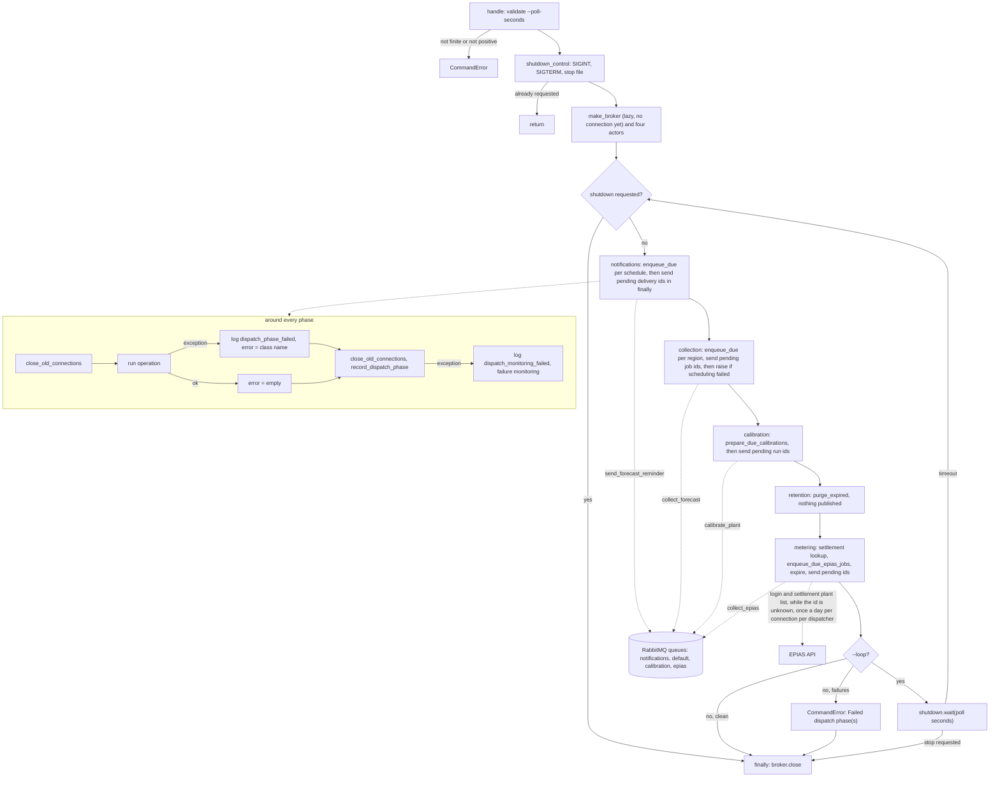

# Dispatcher scheduling and publishing cycle

A single long-running `pyracast dispatch --loop` process, started by Docker Compose in production and by the local launcher in development, repeats one cycle of five isolated phases: notifications, collection, calibration, retention and metering. Four phases create due rows in PostgreSQL and publish the ids of ready or lease-expired rows to RabbitMQ; retention only purges. Each phase's attempt, success, failure code, duration and published count is upserted into `DispatcherStatus` and logged as `dispatch_phase_finished`, which the health check and the admin Overview and Operations screens read.

## Entry points

- Command: `pyracast dispatch [--loop] [--poll-seconds N] [--stop-file PATH]` (`src/pyracast/forecasts/management/commands/dispatch.py` `Command.handle`; the `pyracast` script is `pyracast.cli.main`, a Django management entry). Without `--loop` it runs one cycle and raises `CommandError` if any phase failed.
- Production actor: `deploy/compose.yaml` service `dispatcher` runs `pyracast dispatch --loop --poll-seconds 30` (`restart: on-failure:5`, `stop_grace_period: 660s`, waits for healthy `postgres` and `rabbitmq`, no healthcheck of its own). `deploy/install-release.sh` stops it after gateway, api and web and before the workers; `deploy/smoke.sh` runs one-shot `pyracast dispatch` in the api container while the dispatcher service is also running.
- Development actor: `scripts/dev.py` role `dispatcher` runs `django dispatch --loop` with the 60 s default and appends `--stop-file .dev/dispatcher.stop`.
- Phase operations: `pyracast.notifications.runtime.dispatch_notifications`, `pyracast.runtime.dispatch`, `pyracast.plants.runtime.dispatch_calibrations`, `pyracast.trash.purge_expired`, `pyracast.metering.runtime.dispatch_epias`.
- Status write: `pyracast.forecasts.monitoring.record_dispatch_phase`. Readers (other flows): `delivery_health` via `check_delivery_health` (run by `deploy/watchdog.py`) and via the admin Overview, `admin_workspace.operations_context`, read-only `DispatcherStatusAdmin`.
- Screen: none. No HTTP endpoint triggers or controls the dispatcher.

## Sequence

## Data

| Table | R/W | What |
| --- | --- | --- |
| `forecasts_dispatcherstatus` | W | One row per phase, upserted after the phase: `attempted_at`, `succeeded_at` only on success, `last_error` = failure code or empty, `duration_ms`, `published` (ids sent; null for retention or a raising phase) |
| `notifications_reminderschedule`, `connections_sitebinding`, `connections_provideraccount`, `accounts_membership`, `account_emailaddress`, `forecasts_forecastsnapshot` | R | Enabled schedules, binding eligibility, effective recipients, latest published snapshot pinned to a new delivery |
| `accounts_tenant`, `notifications_notificationsettings`, `regions_region` | lock | Per slot: tenant, recipient-limit row (pk 1, created if missing), region |
| `notifications_notificationdelivery` | R/W | One delivery per schedule slot created (`skipped`/`missed_schedule` when over 2 h late); ready ids selected |
| `regions_region`, `forecasts_collectionschedule`, `connections_sitebinding`, `connections_provideraccount` | R / lock | Collection eligibility and timing; the region row is locked per region |
| `forecasts_collectionjob` | R/W | Forecast and estimated-actuals jobs created or re-armed (`stale` to `pending`), older pending forecasts marked `stale`/`forecast_superseded`; ready ids selected |
| `plants_plant`, `plants_calibrationrun`, `plants_plantevent` | R/W | `next_calibration_check_at` advanced; run and `calibration_scheduled` event created, or `calibration_automatic_skipped` event; pending or lease-expired run ids selected. Inputs read: see `calibration-automation` |
| `accounts_tenant`, `regions_region`, `auth_user`, `accounts_membership` | lock | Calibration: tenant, region, plant, then the enabling user and their admin membership |
| `metering_epiasconnection`, `metering_epiascollectionjob` | R/W | `settlement_plant_id` and `settlement_checked_at` stored, jobs created; jobs past `retry_until` set `failed`/`retry_window_expired`; ready ids selected |
| `regions_region`, `plants_plant`, `plants_plantconfiguration`, `forecasts_collectionschedule` | R / lock | Metering eligibility and night window; region and plant rows locked per connection |
| region and plant archives | W | Hard delete by the retention phase, see `trash-retention-purge` |

## Authorization

- No user or HTTP boundary: the process runs with the application database role (`pyracast_app` in production) and touches all tenants. It trusts only database state.
- Eligibility is rechecked inside each phase under row locks: approved, current and validated binding for collection (`forecasts.jobs.binding_is_current`), `binding_can_notify` and recipient limits for reminders, `_authorized` for calibration (otherwise `authorization_revoked` skip), `configuration_is_current` and `enabled` for metering.
- Trashed regions are excluded from the collection and notification pending-id queries, trashed plants and regions from the calibration one. `pending_epias_ids` has no trash filter: jobs of a trashed plant are still published and the worker supersedes them at claim.
- Viewing `DispatcherStatus` requires the platform admin site (active staff superuser with verified MFA: `DispatcherStatusAdmin`, Overview, Operations); the admin is read-only and no write path exists outside the command.

## Failure paths

| Condition | Result |
| --- | --- |
| `--poll-seconds` not finite or <= 0 | `CommandError` "--poll-seconds must be positive and finite", exit non-zero, no broker created |
| Stop requested before start | Returns immediately; nothing scheduled or published |
| SIGINT, SIGTERM or stop file during a cycle | Flag only; the cycle finishes its remaining phases, then the loop ends, the broker is closed and the process exits 0 |
| Any phase raises | Log `dispatch_phase_failed phase=<name> error_type=<class> origin=<module>:<line>:<function>`; `last_error=<class>`, `succeeded_at` kept; later phases still run |
| One region or reminder schedule fails to schedule | Other regions or schedules continue; pending ids still sent; the collection phase records `collection_regions_failed:<count>` with its published count, the notification phase `NotificationSchedulingError` |
| Calibration or metering scheduling raises | Nothing is published to that queue this cycle; the first failing plant or connection also stops the rest |
| EPIAS lookup fails, EIC unknown or ambiguous, or EPIAS credentials missing | `EpiasError` swallowed without a log; `settlement_checked_at` is still stamped, so the next lookup is a day later; phase succeeds |
| RabbitMQ unreachable | Startup still succeeds (connection opens on first send). A phase with ids to send records `ConnectionClosed`; a phase with nothing to send records success |
| Broker send fails mid-phase | Remaining ids of that phase unsent; rows stay ready and are re-sent next cycle |
| PostgreSQL session lost | Phase records `OperationalError`, or its scheduling error class when the loss hit a per-item step; `close_old_connections` reconnects before the status write and the next phase |
| Status write fails | Log `dispatch_monitoring_failed`; counted as failure `monitoring`; nothing persisted |
| One-shot run with any failure | All five phases run, broker closed, then `CommandError` "Failed dispatch phase(s): ..." |
| Loop with persistent failures | Process never exits; only `DispatcherStatus` and logs show it; `check_delivery_health` fails |
| Phase row missing, `last_error` set, or no success within max lag (5 min default) | `delivery_health` lists it in `unhealthy_dispatch_phases` |

## Rules and invariants

- Fixed phase order with email first, so provider, calibration or purge work never delays reminder publication within a cycle; a slow cycle still delays the next cycle's reminders.
- Publishing is not a state change: every cycle re-sends up to 100 oldest ready ids per queue, whether or not they are already queued. Delivery is at-least-once; workers deduplicate through `claim` leases. No queue TTL or max length bounds the duplicates. The only write in a pending-id query is the metering expiry.
- Ready means due (`available_at`, `next_attempt_at`) and waiting, or running with an expired lease; collection also includes throttled retries whose provider cooldown was cleared.
- No singleton lock: concurrent dispatchers are tolerated through row locks (`select_for_update` on tenant, region, plant, connection) and unique keys `unique_collection_slot`, `unique_reminder_group_slot`, `plant_one_pending_calibration`, `epias_unique_collection_slot`. The settlement lookup decision and EPIAS call happen before the connection lock and `settlement_checked_at` is stamped only afterwards under it, so concurrent dispatchers can each call EPIAS for the same connection in the same cycle.
- Lock orders: notifications tenant, recipient-limit row, region; calibration tenant, region, plant, enabling user, membership; collection region; metering region, plant, connection; retention region, plants, provider accounts.
- Per-item isolation exists only in collection (per region) and notifications (per schedule); calibration, metering and retention abort the phase on the first failing item.
- Shutdown is checked only between cycles and while waiting (0.1 s polling): a started cycle completes all five phases. Compose allows 660 s.
- Recorded `attempted_at` is the phase end time, not its start; error codes are class names only, never messages (provider responses and broker URLs are not logged).
- Bounds per cycle: 100 ids per queue, 100 due calibration plants, 100 regions plus 100 plants purged. Collection, notification and metering scheduling scan every approved region, enabled schedule and enabled connection with no batch limit.
- Database sessions use `lock_timeout=5s` and `statement_timeout=60s`. The metering settlement lookup is an EPIAS call outside any transaction (5 s connect, 20 s read per request) and is not recorded in any request ledger.
- The health check's 5-minute lag must exceed a full cycle plus the poll interval; a slow cycle marks every phase stale.

## Tests

- `tests/test_dispatch_resilience.py`: phase failure does not suppress later phases and one-shot raises; monitoring failure; loop recovers after a failed cycle; error messages not logged.
- `tests/test_dispatch_recovery.py`: real PostgreSQL session termination and reconnection, `DispatcherStatus` rows written.
- `tests/test_runtime.py`: `dispatch` schedules before sending and repeats pending ids; command modes; non-finite interval; SIGTERM during a cycle; shutdown or existing stop file before the first cycle; repeat until stop. `tests/test_trash_boundaries.py`: phase order.
- `tests/test_shutdown_process.py` (dispatch by signal on POSIX, by stop file everywhere), `tests/test_shutdown.py`, `tests/test_dev_launcher.py`.
- Phase publication against a stub broker: `tests/test_notifications_runtime.py`, `tests/test_calibration_runtime.py`, `tests/test_metering_runtime.py`.
- Phase internals: `tests/test_collection_dispatch_isolation.py`, `tests/test_notification_schedule_isolation.py`, `tests/test_notification_recipient_validation.py`, `tests/test_calibration_automation.py` (concurrent dispatchers), `tests/test_plant_training.py`, `tests/test_metering_nightly.py`; status reading in `tests/test_delivery_health.py`.
- Gaps: every command test mocks all or most phases; no test runs the five real phases against PostgreSQL and a stub broker. Untested: calibration or metering scheduling failure suppressing publication, one failing plant or connection blocking the rest, an unreachable broker (including success recorded with nothing to send), publication of EPIAS jobs for trashed plants, duplicate amplification while workers are down, cycle duration versus health lag. No Playwright coverage (no UI).
