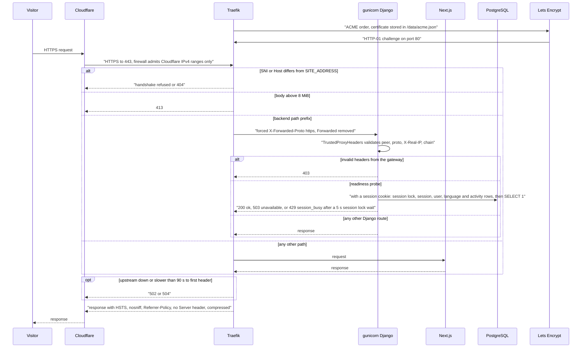

# Edge gateway, TLS and the API process entry

Every production request arrives at one Traefik container that terminates TLS (Let's Encrypt, HTTP-01), forces the forwarding headers Django relies on, caps request bodies and routes by path: `/api`, `/admin`, `/static/` and `/health/` go to Django under gunicorn, everything else to Next.js. The outcome is either a proxied response with a validated client identity, or an early refusal (redirect, 404, 413, 502, 504, or a Django 403 for broken proxy headers).

## Entry points

- `deploy/compose.yaml` service `gateway`: all static Traefik settings as `TRAEFIK_*` variables (file provider with `watch` off), fixed address `172.30.80.2`, host ports 80 (`web`, `:8080`) and 443 (`websecure`, `:8443`), unpublished `health` entrypoint `:8082` serving the ping that `/traefik healthcheck` uses.
- `deploy/routes.yml`: routers `backend` (priority 100) and `frontend` (priority 10), middlewares `security`, `body-limit`, `compression`, and TLS options (TLS 1.2 minimum, strict SNI). `{{ env "SITE_ADDRESS" }}` is the only Host accepted.
- `deploy/gateway/Dockerfile`, `go.mod`, `go.sum`, `pkg/config/dynamic/ext/ext.go`: build upstream Traefik (`v3.7.19`, declared as a Go `tool`) into a distroless image (user 10001). The `ext` module is a local stub that a `replace` directive resolves; lock files are regenerated through the Dockerfile target `lockfiles`.
- `deploy/gunicorn_conf.py` (copied to `/app/gunicorn.conf.py` by the root `Dockerfile`) and `src/pyracast/wsgi.py` `application`: the backend image `CMD` is `gunicorn --config /app/gunicorn.conf.py pyracast.wsgi:application`.
- `src/pyracast/accounts/middleware.py` `TrustedProxyHeaders` (first middleware), `src/pyracast/production.py` (WhiteNoise static) and `src/pyracast/health.py` `live` and `ready` (public through the gateway; `ready` is also the `api` container healthcheck and the GCP uptime check in `infra/terraform/monitoring.tf`).
- Operator: `deploy/install-release.sh` (stops the old `gateway api web`, starts the new stack, readiness curl through the gateway with `--resolve`), `deploy/smoke.sh` (CI and release test with `deploy/compose.smoke.yaml` and `deploy/tls.smoke.yml`), `infra/terraform/main.tf` firewall rules, `infra/terraform/templates/startup.sh.tftpl` (`/var/lib/pyracast/gateway` owned by 10001).

## Sequence

## Data

The gateway reads and writes no table, and the `ready` view itself runs only `SELECT 1`. The Django middleware chain (`MIDDLEWARE` in `src/pyracast/settings.py`) still runs for every backend path, `/health/` included: a request with a well-formed session cookie takes the session advisory lock (`SessionRequestSerialization`) and loads `django_session` and `auth_user`; for an authenticated user `RequestLanguage` reads `accounts_userlanguagepreference`, `SessionLifetime` may write `last_activity_at` into `django_session`, and allauth activity tracking (`USERSESSIONS_TRACK_ACTIVITY`) may update `usersessions_usersession`. Persistent gateway state is `acme.json` in `${DATA_ROOT}/gateway`.

## Authorization

- Network: the GCP firewall `google_compute_firewall.https` admits tcp 443 from the 15 Cloudflare IPv4 ranges only; `google_compute_firewall.acme` admits tcp 80 from anywhere. Traefik itself does not filter peers: `forwardedHeaders.trustedIPs` on `websecure` only decides whose forwarding headers it keeps.
- Gateway: `Host(SITE_ADDRESS)` router rules, strict SNI, TLS 1.2 minimum; the `security` middleware deletes `Forwarded`, forces `X-Forwarded-Proto: https`, blanks `Server` and sets HSTS (max-age only), nosniff and `Referrer-Policy: same-origin`; `ALIASHEADERSSTRATEGY=delete` drops underscore and dot aliases of forwarding headers (asserted by the smoke test only).
- Django: `TrustedProxyHeaders` deletes every `X-Forwarded-*`, `Forwarded`, `X-Real-IP`, `CF-Connecting-IP(v6)`, `True-Client-IP` and `CF-IPCountry` header unless the socket peer is in `PYRACAST_TRUSTED_PROXY_CIDRS` (`172.30.80.2/32`). For that peer it requires proto `http`/`https` and a non-empty `X-Real-IP`, then sets `X-Real-IP` to the last `X-Forwarded-For` entry, or to the entry before it when the last one is in `PYRACAST_TRUSTED_UPSTREAM_PROXY_CIDRS`; `CF-IPCountry` survives only when that last entry is a Cloudflare address. `SECURE_PROXY_SSL_HEADER` and allauth's `X-Real-IP` client header read the result. `ALLOWED_HOSTS` is `SITE_ADDRESS,localhost,127.0.0.1`. No route-level authentication here; session, CSRF and tenant checks belong to the flows behind the routes.

## Failure paths

| Condition | Result |
| --- | --- |
| Plain HTTP to port 80 | Traefik redirect to HTTPS (`:443`), except ACME challenges |
| TLS handshake with unknown SNI, or TLS below 1.2 | Handshake refused (`sniStrict`, `minVersion`) |
| Host not equal to `SITE_ADDRESS` | Traefik 404, no router |
| Request body above 8388608 bytes (both routers) | 413 from the `buffering` middleware |
| Invalid socket peer address (any peer); or peer is the gateway but `X-Forwarded-Proto` is not http/https, `X-Real-IP` is empty or the `X-Forwarded-For` chain is missing or malformed | Django 403 (`PermissionDenied`), also for `/static/` and `/health/` |
| api or web unreachable, or no response header within 90 s | Traefik 502 or 504 |
| Any backend path, `/health/` included, with a well-formed session cookie whose session lock is held for more than 5 s | 429 `session_busy` with `Retry-After: 1` |
| `/health/ready/` cannot reach PostgreSQL | 503 body `unavailable`; the `api` healthcheck fails, so `compose up` does not start `gateway` (`depends_on` healthy) |
| `PYRACAST_DEBUG=1` with `production`, invalid `PYRACAST_PUBLIC_ORIGIN`, or proxy trust without CIDRs | `ImproperlyConfigured` at settings import or first middleware load |

## Rules and invariants

- The Cloudflare range list exists twice and is synced by hand: `x-cloudflare-proxies` in `deploy/compose.yaml` (IPv4 and IPv6, used for both Traefik `trustedIPs` and Django `PYRACAST_TRUSTED_UPSTREAM_PROXY_CIDRS`) and `source_ranges` in `infra/terraform/main.tf` (IPv4 only; the subnet is `IPV4_ONLY`). `test_origin_firewall_admits_exactly_the_gateway_trusted_ipv4_ranges` checks IPv4 agreement; IPv6 ranges remain manually maintained in Compose.
- Gateway address `172.30.80.2` is the trust anchor: the network `ip_range` starts at `.128`, so no other container is assigned it dynamically. Change it in the Compose address, `PYRACAST_TRUSTED_PROXY_CIDRS`, `deploy/compose.smoke.yaml` and `smoke.sh` together.
- Client identity is the address just before the Cloudflare edge; a visitor inside a Cloudflare range stays the client and no extra hops are skipped. gunicorn trusts no forwarded header itself (`forwarded_allow_ips` and `secure_scheme_headers` empty); access logs record method, path, status and duration only. `SECURE_SSL_REDIRECT` is on in production; `SECURE_REDIRECT_EXEMPT` keeps `health/live/` and `health/ready/` reachable over plain HTTP for the in-container healthcheck.
- Capacity is one gthread worker with two threads. Traefik `responseHeaderTimeout` (90 s) equals gunicorn `timeout` and `graceful_timeout`; entrypoint read timeout is 30 s, write and idle 120 s. The 8 MiB gateway cap sits 1 MiB above the 7 MiB `MAX_UPLOAD_BYTES` of historical upload; bodies above 1 MiB (`memRequestBodyBytes`) leave memory, presumably for Traefik's temp directory, the 32 MiB `/tmp` tmpfs (not verified).

## Tests

- `deploy/smoke.sh` (CI `ci.yml` and `release.yml`): TLS chain and hostname, untrusted-CA failure, `/`, `/static/admin/css/base.css`, `/health/ready/`, HSTS and nosniff headers, HTTP redirect, 413 at 8 MiB plus one byte, forged forwarding headers on `/health/ready/` and, with alias headers, on the smoke-only `header-probe` router, a simulated Cloudflare socket peer, gateway user 10001, the anonymous `/api/session/` JSON, a wrong-password sign-in refused with 400 through the backend router and the `/app/` workspace app shell through the frontend router.
- `tests/test_operations_contracts.py`: the backend router covers every top-level Django prefix and `STATIC_URL`; Traefik's response header timeout is at least gunicorn `timeout`; gunicorn and Traefik graceful periods fit their Compose stop grace periods; the body limit exceeds `MAX_UPLOAD_BYTES` and the smoke probes one byte over it; the gateway's trusted ranges equal the API's upstream ranges and their IPv4 part equals the Terraform HTTPS firewall; the trust anchor is the gateway's static address outside the dynamic `ip_range`.
- `tests/test_account_security.py`: `TrustedProxyHeaders` (chains, untrusted peers, invalid peer address, missing CIDRs, public origin, rate-limit separation); `tests/test_language.py` (country header); `tests/test_health.py` (live, ready, 503, 405, production DEBUG guard, static storage); `tests/test_api.py` `test_entrypoints` (wsgi `application` is callable).
- Gaps: no Playwright coverage (none applies); smoke never requests `/admin/` through Traefik and sends the 413 body only to the backend router; nothing tests ACME issuance.
