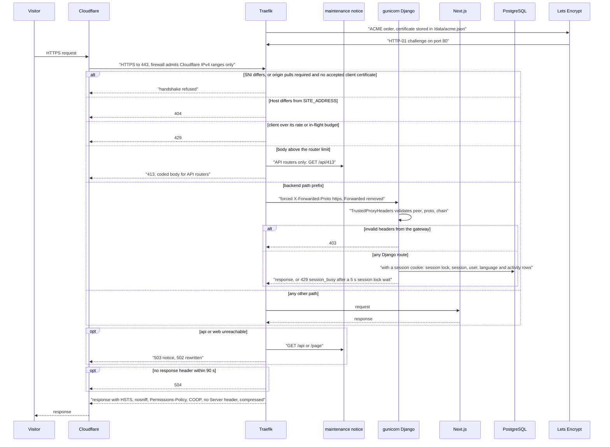

# Edge gateway, TLS and the API process entry

Every production request arrives at one Traefik container that terminates TLS (Let's Encrypt, HTTP-01), forces the forwarding headers Django relies on, rate-limits and caps request bodies per client and router, and routes by path: `/api`, `/admin`, `/static/` and `/health/` go to Django under gunicorn, everything else to Next.js. The outcome is either a proxied response with a validated client identity, or an early refusal (redirect, 404, 413, 429, a 503 maintenance notice, 504, or a Django 403 for broken proxy headers).

## Entry points

- `deploy/compose.yaml` service `gateway`: all static Traefik settings as `TRAEFIK_*` variables (file provider with `watch` off), fixed address `172.30.80.2`, host ports 80 (`web`, `:8080`), 443 (`websecure`, `:8443`) and loopback-only `127.0.0.1:8443` (`local`, `:8444`, used by the installer, watchdog and reset tool), and an unpublished `health` entrypoint `:8082` serving the ping that `/traefik healthcheck` uses. It depends only on service `maintenance` (the backend image running `pyracast.maintenance`), never on api or web.
- `deploy/routes.yml`: routers `api` (`/api`), `authentication` (`/api/auth/`, priority 110), `admin`, `backend` (`/static/`, `/health/`) and `frontend` (priority 10), all on `websecure` and `local`; middlewares `security`, `client-rate`, `authentication-rate`, `client-in-flight`, `api-refusals`, three body limits, `maintenance-api`, `maintenance-page`, `compression`; TLS options `default` and `edge`. `{{ env "SITE_ADDRESS" }}` is the only Host accepted.
- `deploy/gateway/Dockerfile`, `go.mod`, `go.sum`, `pkg/config/dynamic/ext/ext.go`: build upstream Traefik (`v3.7.19`, declared as a Go `tool`) into a distroless image (user 10001). The `ext` module is a local stub that a `replace` directive resolves; lock files are regenerated through the Dockerfile target `lockfiles`.
- `src/pyracast/maintenance.py` `Notice`: the notice service behind the `errors` middlewares.
- `deploy/gunicorn_conf.py` (copied to `/app/gunicorn.conf.py` by the root `Dockerfile`) and `src/pyracast/wsgi.py` `application`: the backend image `CMD` is `gunicorn --config /app/gunicorn.conf.py pyracast.wsgi:application`.
- `src/pyracast/proxy.py` `TrustedProxyHeaders` (first middleware), `src/pyracast/accounts/session_lock.py` `SessionRequestSerialization`, `src/pyracast/production.py` (WhiteNoise static) and `src/pyracast/health.py` `live` and `ready` (public through the gateway; `live` is the `api` container healthcheck, `ready` gates installs and is the GCP uptime check in `infra/terraform/monitoring.tf`).
- Operator: `deploy/install-release.sh` (starts the new `maintenance gateway` before api and web stop, probes `/health/ready/` on the loopback entrypoint; with `ORIGIN_PULL=required` it first runs `deploy/edge_gate.py`, a `/health/live/` request through the public edge), `deploy/watchdog.py`, `deploy/probe_origin_pull.py`, `deploy/smoke.sh` (CI and release test with `deploy/compose.smoke.yaml` and `deploy/tls.smoke.yml`), `infra/terraform/main.tf` firewall rules, `infra/terraform/templates/startup.sh.tftpl` (`/var/lib/pyracast/gateway` owned by 10001).

## Sequence

## Data

The gateway reads and writes no table, and `ready` itself runs only `SELECT 1`. The Django middleware chain (`MIDDLEWARE` in `src/pyracast/settings.py`) still runs for every backend path, `/health/` included: a request with a well-formed session cookie takes the session advisory lock and loads `django_session` and `auth_user`; for a signed-in user it also reads account state and `accounts_userlanguagepreference`, and `SessionLifetime` may write `django_session` and `usersessions_usersession`. Persistent gateway state is `acme.json` in `${DATA_ROOT}/gateway`.

## Authorization

- Network: the GCP firewall `google_compute_firewall.https` admits tcp 443 from the 15 Cloudflare IPv4 ranges only; `google_compute_firewall.acme` admits tcp 80 from anywhere. Traefik itself does not filter peers: `forwardedHeaders.trustedIPs` on `websecure` only decides whose forwarding headers it keeps.
- Gateway: `Host(SITE_ADDRESS)` router rules, strict SNI, TLS 1.2 minimum. TLS option `edge` on `websecure` carries the Authenticated Origin Pulls setting: `RequireAndVerifyClientCert` with the authority in `/etc/traefik/origin-pull-ca.pem` only when `ORIGIN_PULL=required` (the host names `origin_pull_ca`), else `NoClientCert` with the placeholder `deploy/origin-pull-off.pem`; the `local` entrypoint never asks for a certificate. The `security` middleware blanks `Forwarded` and the client-address request header, forces `X-Forwarded-Proto: https`, blanks `Server` and sets HSTS (`max-age` only), nosniff, `Permissions-Policy` and `Cross-Origin-Opener-Policy`; The applications own CSP and Referrer-Policy. `ALIASHEADERSSTRATEGY=delete` drops underscore and dot aliases of forwarding headers.
- Per-client limits key on `X-Forwarded-For` depth 1 (Cloudflare appends the visitor; IPv6 by /64): `client-rate` (average 20/s, burst 100) and `client-in-flight` (32) on every router, `authentication-rate` (30 per minute, burst 20) additionally on `authentication`.
- Django: `TrustedProxyHeaders` deletes every `X-Forwarded-*`, `Forwarded`, `X-Real-IP`, `CF-Connecting-IP(v6)`, `True-Client-IP`, `CF-IPCountry` and `X-Pyracast-Client-IP` header unless the socket peer is in `PYRACAST_TRUSTED_PROXY_CIDRS` (`172.30.80.2/32`). For that peer it requires proto `http`/`https` and a usable chain, then writes the client into `X-Pyracast-Client-IP` (the header allauth reads): the last `X-Forwarded-For` entry, or the entry before it when the last is a Cloudflare address (without upstream CIDRs, `X-Real-IP`); `CF-IPCountry` survives only when that last entry is a Cloudflare address. `SECURE_PROXY_SSL_HEADER` reads the proto. `ALLOWED_HOSTS` is `SITE_ADDRESS,localhost,127.0.0.1`. No route-level authentication here; session, CSRF and tenant checks belong to the flows behind the routes.

## Failure paths

| Condition | Result |
| --- | --- |
| Plain HTTP to port 80 | Traefik redirect to HTTPS (`:443`), except ACME challenges |
| TLS handshake with unknown SNI, TLS below 1.2, or (origin pulls required) no certificate or one from another authority | Handshake refused (`sniStrict`, `minVersion`, `clientAuthType`) |
| Host not equal to `SITE_ADDRESS` | Traefik 404, no router |
| A client above its rate or in-flight budget on a router | Traefik 429 |
| Body above the router limit: 2621440 bytes (`api`, `authentication`), 8388608 (`admin`), 1048576 (`backend`, `frontend`) | 413 from the `buffering` middleware; on the API routers the notice service answers `{"code": "request_too_large", ...}` |
| Invalid socket peer address (any peer); or peer is the gateway but `X-Forwarded-Proto` is not http/https or the forwarded chain is missing or malformed | Django 403 (`PermissionDenied`; code `invalid_proxy_headers` for the gateway case), also for `/static/` and `/health/` |
| api or web unreachable (Traefik would answer 502) | 503 from the notice service with `Retry-After: 60`: the coded `maintenance` JSON on backend routers unless the request accepts HTML, else a self-refreshing HTML page (frontend router always) |
| No response header from api or web within 90 s | Traefik 504 |
| Any backend path, `/health/` included, with a well-formed session cookie whose session lock is held for more than 5 s | `/admin/` paths and navigation GETs outside `/api/`: no-store HTML 503 (a GET reloads once); every other request: 429 `session_busy` with `Retry-After: 1` |
| `/health/ready/` cannot reach PostgreSQL | 503 body `unavailable`; install and the uptime check fail, the `api` liveness check does not |
| `PYRACAST_DEBUG=1` with `production`, invalid `PYRACAST_PUBLIC_ORIGIN`, or proxy trust without CIDRs | `ImproperlyConfigured` at settings import or first middleware load |

## Rules and invariants

- The Cloudflare range list exists twice and is synced by hand: `x-cloudflare-proxies` in `deploy/compose.yaml` (IPv4 and IPv6, used for both Traefik `trustedIPs` and Django `PYRACAST_TRUSTED_UPSTREAM_PROXY_CIDRS`) and `source_ranges` in `infra/terraform/main.tf` (IPv4 only; the subnet is `IPV4_ONLY`). `test_origin_firewall_admits_exactly_the_gateway_trusted_ipv4_ranges` checks IPv4 agreement only.
- Gateway address `172.30.80.2` is the trust anchor: the network `ip_range` starts at `.128`, so no other container is assigned it dynamically. Change it in the Compose address, `PYRACAST_TRUSTED_PROXY_CIDRS`, `deploy/compose.smoke.yaml` and `smoke.sh` together.
- The application never answers 502 or 413, so each one at the gateway is Traefik's own refusal and the `errors` middlewares can rewrite it; the applications' own 429 answers pass unchanged on `api` and `authentication` because `api-refusals` handles 413 only.
- Client identity is the address just before the Cloudflare edge; a visitor inside a Cloudflare range stays the client and no extra hops are skipped. gunicorn trusts no forwarded header itself (`forwarded_allow_ips` and `secure_scheme_headers` empty); access logs record method, path, status and duration only. `SECURE_SSL_REDIRECT` is on in production; `SECURE_REDIRECT_EXEMPT` keeps `health/live/` and `health/ready/` reachable over plain HTTP for the in-container healthcheck.
- Capacity is one gthread worker with two threads. Traefik `responseHeaderTimeout` (90 s) is at least gunicorn `timeout`; gunicorn `keepalive` (120 s) exceeds Traefik's 90 s reuse of idle backend connections, so the gateway closes them first. Entrypoint read timeout is 30 s, write and idle 120 s. The 8 MiB admin cap sits 1 MiB above the 7 MiB `MAX_UPLOAD_BYTES` of historical upload; the API cap equals Django's `DATA_UPLOAD_MAX_MEMORY_SIZE` default.
- With origin pulls required, availability is a request through the edge (`edge_gate.py` retries and ends at once on a Cloudflare challenge of the host), and the watchdog reports `pyracast_origin_pull_unenforced` when port 443 does not refuse a handshake without a certificate. It warns `pyracast_certificate_expiring` when the certificate on the loopback entrypoint has under a quarter of its lifetime left.

## Tests

- `deploy/smoke.sh` (CI job `deployment`): TLS chain and hostname, exact transport headers, HTTP redirect, 413 one byte over each router's limit, forged and alias forwarding headers on the smoke-only `header-probe` router, a simulated Cloudflare peer, each router's rate and in-flight budget, the loopback entrypoint, the maintenance notice, and origin pulls with an accepted, a missing, another and an unloadable authority.
- `tests/test_operations_contracts.py`: routers cover every top-level Django prefix and `STATIC_URL`; timeouts, keepalive and grace periods agree; body limits and their smoke probes; rate and in-flight settings; the notice only for 502, with the gateway depending on `maintenance` alone; the transport-header split with Next.js; the `edge` TLS option, loopback entrypoint and edge gate; the firewall and trust-anchor agreement.
- `tests/test_proxy.py` (`TrustedProxyHeaders`), `tests/test_session_serialization.py` (bounded wait, busy answers), `tests/test_maintenance_notice.py`, `tests/test_edge_gate.py`, `tests/test_probe_origin_pull.py`, `tests/test_language.py` (country header), `tests/test_health.py` (live, ready, 503, 405, production DEBUG guard), `tests/test_api.py` `test_entrypoints` (wsgi `application` is callable).
- Gaps: no Playwright coverage (none applies); nothing tests ACME issuance.
