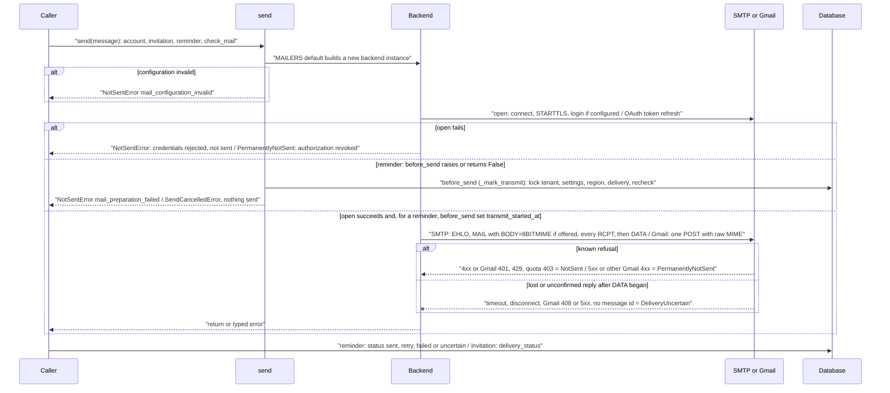

# Email transport: SMTP and Gmail backends

Every outgoing mail is built by a caller and handed to one entry point, `pyracast.mail.send.send`, which opens the mailer `MAILERS["default"]` selected by `PYRACAST_EMAIL_BACKEND` at settings import. The API process sends account mail (allauth codes, security notices) and workspace invitations synchronously after the database commit; the notifications worker sends reminders. The outcome is typed: accepted, `NotSentError` (known not sent, retryable), `PermanentlyNotSentError`, or `DeliveryUncertainError`, each with one `MailFailure` code. Reminders persist the code; invitations store accepted, failed or uncertain. Nothing verifies delivery after the fact.

## Entry points

- Settings `src/pyracast/settings.py` (`_email_backend`, `MAILERS`, `DEFAULT_FROM_EMAIL`): `smtp` (default), `gmail`, or `console` (needs `PYRACAST_DEBUG=1`, otherwise `ImproperlyConfigured` at import). `PYRACAST_EMAIL_SSL=1` alone selects implicit TLS; a non-integer `PYRACAST_EMAIL_PORT` is `ImproperlyConfigured`. The Gmail sender is `PYRACAST_FROM_EMAIL`.
- Package `src/pyracast/mail/`: entry point, outcome types, wire policy, SMTP and Gmail backends.
- Account mail: `pyracast.accounts.adapters.AccountAdapter.send_mail` (`transaction.on_commit`, then `send`; flow `account-mail-notifications`).
- Invitation mail: `pyracast.accounts.invitations.invite_workspace_member` inner `deliver` (`on_commit`, `send`), reached by `POST /api/tenants/{tenant_id}/invitations/`.
- Reminder mail: `pyracast.notifications.runtime.deliver_notification` (actor `send_forecast_reminder`, queue `notifications`, `max_retries=0`) to `process_notification` to `send(message, before_send=...)`.
- Command `pyracast check_mail`: without arguments opens and closes the transport without sending; `--send-to ADDRESS` sends one reminder-shaped test mail (HTML, text and an XLSX attachment). Exit code per `MailFailure` (`docs/DEPLOYMENT.md`). `deploy/install-release.sh` runs the probe after a healthy release and prints a warning on failure.
- Deploy check `pyracast.accounts.checks.check_authentication_mail_delivery` (`accounts.E001`), run by `check --deploy` in `deploy/install-release.sh` and `deploy/smoke.sh`. Outcomes are shown in `web/src/components/workspace-members.tsx` (invitation failed or uncertain hint) and on the admin Operations page ("Email delivery" table).

## Sequence

## Data

| Table | R/W | What |
|---|---|---|
| `accounts_workspaceinvitation` | W | `delivery_status` set to `accepted`, `failed` or `uncertain` in the `on_commit` hook (default `pending`) |
| `notifications_notificationdelivery` | R/W | Reminder only: `recipients`, `message_token` (stable `Message-ID`), `transmit_started_at`, `status`, `last_error`, `sent_at`, `available_at`, `attempts`, lease fields (owned by `reminder-delivery`) |
| `accounts_tenant`, `notifications_notificationsettings`, `regions_region` | R (row lock) | `_mark_transmit` locks them before writing the transmit marker |

## Authorization

- The transport has no caller check: it sends whatever the caller built. Authorization is the caller's: `require_workspace_admin` in `invite_workspace_member`, allauth flows for account mail, the tenant and region lock plus recipient recheck in `_mark_transmit` for reminders.
- Gmail enforces one sender: `_send` refuses a message whose `From` differs from `DEFAULT_FROM_EMAIL` and the token response must carry exactly the `gmail.send` scope. Console backend is refused unless `DEBUG` is on.

## Failure paths

| Condition | Result |
|---|---|
| Unknown backend name, `console` without `PYRACAST_DEBUG=1`, or a non-integer port | `ImproperlyConfigured` at settings import, process does not start |
| Production check: no SMTP or Gmail backend, sender not a valid mailbox or at `localhost`, SMTP host empty or loopback, SMTP port outside 1 to 65535, SMTP without TLS or SSL, or options the backend refuses (both TLS modes, invalid Gmail sender, timeout at or below 0) | `accounts.E001`, `check --deploy` fails, release stops |
| Backend construction fails at send time | `NotSentError` `mail_configuration_invalid`; reminder retried |
| SMTP connect or TLS error / authentication 4xx / authentication 5xx | `NotSentError` `mail_not_sent` / `mail_not_sent` / `mail_credentials_rejected` |
| Gmail token endpoint unreachable / `invalid_grant` / other token failure or wrong scope | `NotSentError` `mail_not_sent` / `PermanentlyNotSentError` `mail_authorization_revoked` / `NotSentError` `mail_credentials_rejected` |
| SMTP 4xx on MAIL, any RCPT or DATA; disconnect before DATA | `NotSentError`, retry; DATA is never sent after a refused recipient |
| SMTP 5xx on MAIL, all RCPT or DATA, invalid address or header, unsupported command | `PermanentlyNotSentError` `mail_rejected` |
| SMTP disconnect or timeout after DATA began, or a final reply outside 400-599 | `DeliveryUncertainError` `mail_outcome_uncertain` |
| Gmail 401 / 429 or quota 403 / other 403 / other 4xx except 408 | `mail_credentials_rejected` / `mail_rate_limited` (both retryable) / `mail_sender_forbidden` / `mail_rejected` (both permanent) |
| Gmail connect error; 408, 5xx, read or write timeout, 200 without message id | `NotSentError`; `DeliveryUncertainError` |
| Message without recipient, or backend count other than 1 | `NotSentError` |
| Reminder: unclassified exception before / after the transmit marker | Retry with `mail_not_sent` / `uncertain` with `mail_outcome_uncertain`; warning `notification_send_failed` |
| Account mail raises inside `on_commit` | ERROR log `account_mail_failed` with template, user id, error class and code only; the view answers as on success, no retry |
| Invitation: `NotSentError` / any other exception | `delivery_status` `failed` / `uncertain` with a warning naming the invitation and code or class; response still 201 |

## Rules and invariants

- `send` builds a fresh backend for every message, so no connection or OAuth token is shared between threads or messages; Gmail refreshes a token for every mail (two HTTP calls).
- Wire bytes: CRLF line ends; `Content-Type` is never folded into encoded-words (RFC 2047 section 5); non-ASCII subjects use encoded-words of at most 75 characters and attachment names keep RFC 2231. SMTP sends an 8-bit body only to a server that advertises 8BITMIME and declares `BODY=8BITMIME`, else 7-bit transfer encodings. Reminders carry `Message-ID: <reminder.{message_token}@{sender domain}>`.
- Reminder open-before-authorize: the connection is opened outside any database transaction, then `_mark_transmit` rechecks authority under locks and writes `transmit_started_at`. After that marker an interruption is `uncertain` and never resent.
- Reminder recipients travel as BCC: SMTP puts them in the envelope only, Gmail adds a `Bcc` header because it routes by headers.
- Retry budget for known non-sends: at most 8 attempts, delay `60 * 2^(attempt-1)` seconds capped at 1800 plus 0-30 s jitter, and only while the retry time is before `scheduled_for + 2 hours`. The delivery health check counts recent `failed` or `uncertain` reminders and `mail_credentials_rejected` or `mail_authorization_revoked` as mail authentication failures.
- All timeouts are 15 s (SMTP socket, httpx per operation). Account and invitation sends block the HTTP request for that long per step.

## Tests

- `tests/test_mail_wire.py` (bytes on both transports through a loopback SMTP server and a recorded Gmail request: unfolded attachment type, encoded-word length, RFC 2231 name, 8BITMIME negotiation, `check_mail --send-to`), `tests/test_mail_outcomes.py` (outcome per error class and SMTP phase; reminder, invitation and account mail outcomes), `tests/test_mail_configuration.py` (deploy check, settings parsing, `check_mail` exit codes), `tests/test_smtp_mail.py`, `tests/test_gmail_mail.py`, `tests/test_reminder_message_id.py`, `tests/test_notification_transmission.py`, `tests/test_account_mail_failures.py`, `tests/test_environment.py`.
- Gaps: no live Gmail or provider SMTP; no Playwright test touches mail (browser tests mock the API).
