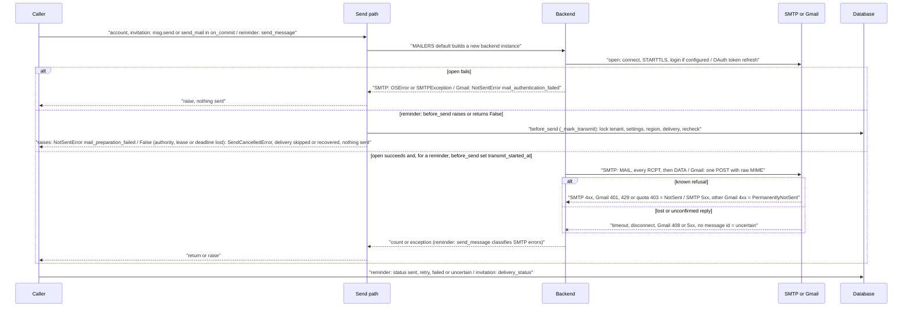

# Email transport: SMTP and Gmail backends

Every outgoing mail is built by a caller and handed to one Django mailer, `MAILERS["default"]`, selected by `PYRACAST_EMAIL_BACKEND` at settings import. The API process sends account mail (allauth codes, security notices) and workspace invitations synchronously after the database commit; the notifications worker sends reminders. The outcome is a transport result (accepted, known not sent, permanently rejected, uncertain) that only the reminder path classifies and persists in full; invitations store only accepted or uncertain. Nothing verifies delivery after the fact.

## Entry points

- Settings `src/pyracast/settings.py` (`_email_backend`, `MAILERS`, `DEFAULT_FROM_EMAIL`): `smtp` (default), `gmail`, or `console` (needs `PYRACAST_DEBUG=1`, otherwise `ImproperlyConfigured` at import).
- Backends `pyracast.smtp.EmailBackend` (Django SMTP backend with a hand-written `_send`) and `pyracast.gmail.EmailBackend` (OAuth refresh plus `users.messages.send` over httpx); error classes in `pyracast.mail_delivery`: `NotSentError` (has `code`, default `mail_not_sent`), its subclass `PermanentlyNotSentError`, and the separate `DeliveryUncertainError`.
- Account mail: `pyracast.accounts.adapters.AccountAdapter.send_mail` (`transaction.on_commit`, then allauth `msg.send()` through Django's deprecated `get_connection`).
- Invitation mail: `pyracast.accounts.invitations.invite_workspace_member` inner `deliver` (`on_commit`, `django.core.mail.send_mail`), reached by `POST /api/tenants/{tenant_id}/invitations/` (`WorkspaceInvitationsView.post`).
- Reminder mail: `pyracast.notifications.runtime.deliver_notification` (actor `send_forecast_reminder`, queue `notifications`, `max_retries=0`) to `process_notification` to `pyracast.notifications.mail.send_message`.
- Deploy check `pyracast.accounts.checks.check_authentication_mail_delivery` (`accounts.E001`), run by `pyracast check --deploy --fail-level WARNING` in `deploy/install-release.sh` and `deploy/smoke.sh`. Django's stock `sendtestemail` command is available but nothing calls or documents it; outcomes are shown in `web/src/components/workspace-members.tsx` (invitation `deliveryUncertain` hint) and on the admin Operations page (`operations_context` in `src/pyracast/admin_workspace.py`, "Email delivery" table: latest 20 reminder deliveries with status, accepted time, attempts and last error).

## Sequence

## Data

| Table | R/W | What |
|---|---|---|
| `accounts_workspaceinvitation` | W | `delivery_status` set to `accepted` or `uncertain` in the `on_commit` hook (default `pending`) |
| `notifications_notificationdelivery` | R/W | Reminder only: `recipients`, `transmit_started_at`, `status`, `last_error`, `sent_at`, `available_at`, `attempts`, lease fields (owned by `reminder-delivery`) |
| `accounts_tenant`, `notifications_notificationsettings`, `regions_region` | R (row lock) | `_mark_transmit` locks them before writing the transmit marker |

## Authorization

- The transport has no caller check: it sends whatever the caller built. Authorization is the caller's: `require_workspace_admin` in `invite_workspace_member`, allauth flows for account mail, the tenant and region lock plus recipient recheck in `_mark_transmit` for reminders.
- Gmail enforces one sender: `_send` refuses a message whose `From` differs from the configured sender and the token response must carry exactly the `gmail.send` scope. Console backend is refused unless `DEBUG` is on; the deploy check refuses non-production mail when `DEBUG` is off.

## Failure paths

| Condition | Result |
|---|---|
| Unknown backend name, or `console` without `PYRACAST_DEBUG=1` | `ImproperlyConfigured` at settings import, process does not start |
| Production check: not SMTP with a host or complete Gmail OAuth with sender equal to `DEFAULT_FROM_EMAIL`, or sender without `@` or at `localhost` | `accounts.E001`, `check --deploy` fails, release stops |
| Gmail options invalid (sender, empty credential, timeout at or below 0) or SMTP `use_tls` with `use_ssl` | Raised on first mailer construction, not at startup; reminder: outside the open guard, so delivery `uncertain` `mail_outcome_uncertain` and never resent |
| Open fails: any `SMTPException`, `OSError` or Gmail token failure | Reminder: `NotSentError`, `mail_authentication_failed` for SMTP auth error or any Gmail open failure, else `mail_not_sent`; retried |
| SMTP 4xx on MAIL, DATA or HELO, or RCPT refusals with at least one 4xx | `NotSentError`, retry |
| SMTP 5xx on the same steps (all RCPT codes 5xx), or `SMTPNotSupportedError` after open | `PermanentlyNotSentError`, delivery `failed` with `mail_rejected` |
| SMTP reply outside 400-599, timeout or disconnect during transaction | Plain exception, delivery `uncertain` with `mail_outcome_uncertain` |
| Gmail 401 / 429 or quota 403 / connect, connect-timeout or pool-timeout error | `NotSentError` with `mail_authentication_failed` / `mail_rate_limited` / `mail_not_sent` |
| Gmail other 4xx except 408, or a `From` other than the sender | `PermanentlyNotSentError` |
| Gmail 408, 5xx, other non-200, read or write timeout, 200 without message id | `DeliveryUncertainError`, delivery `uncertain` |
| Backend returns count other than 1, or message has no recipient | `NotSentError` |
| `before_send` raises / returns False | `NotSentError` `mail_preparation_failed` / `SendCancelledError`, nothing sent |
| Account mail raises inside `on_commit` | Caught in the deferred send: ERROR log `account_mail_failed` with template prefix, user id, error class and `NotSentError` code only; the allauth view answers as on success, no retry (`account-mail-notifications`) |
| Invitation mail raises / returns other than 1 | Warning log with invitation id only, then `delivery_status` `uncertain` / `delivery_status` `uncertain` without a log; response still 201 |

## Rules and invariants

- `mail.mailers["default"]` (and the deprecated `get_connection`) returns a fresh backend every call, so no connection or OAuth token is shared between threads or messages. Gmail therefore refreshes a token for every mail (two HTTP calls).
- Reminder open-before-authorize: the connection is opened outside any database transaction, then `_mark_transmit` rechecks authority under locks and writes `transmit_started_at`. After that marker an interruption is `uncertain` and never resent.
- SMTP `_send` sends DATA only if every RCPT is accepted, so a rejected recipient cannot cause a partial send; a 421 closes the connection instead of `RSET`. Reminder recipients travel as BCC: SMTP puts them in the envelope only, Gmail adds a `Bcc` header because it routes by headers.
- Retry budget for known non-sends: at most 8 attempts, delay `60 * 2^(attempt-1)` seconds capped at 1800 plus 0-30 s jitter, and only while the retry time is before `scheduled_for + 2 hours`. The delivery health check counts recent `failed` or `uncertain` reminders and, by name, only the `mail_authentication_failed` code. Account mail leaves no record, only the `account_mail_failed` log line on failure; invitation mail stores only `delivery_status` (`accepted` or `uncertain`), which the health check does not count.
- All timeouts are 15 s (SMTP socket, httpx per operation). Account and invitation sends block the HTTP request for that long per step.

## Tests

- `tests/test_smtp_mail.py` (SMTP envelope, reset, 421, silent rejection), `tests/test_gmail_mail.py` (scope, retry classes, fail_silently, signup through Gmail, deploy check), `tests/test_notification_mail.py` (`send_message` classification at the real Django backend, independent backends), `tests/test_notification_transmission.py` (authority at transmission, through the `sender` seam), `tests/test_account_security.py` (`accounts.E001`), `tests/test_environment.py` (backend selection, console and unknown backend refused), `tests/test_workspaces.py` (invitation `accepted` and `uncertain`), `tests/test_transactional_mail.py` (templates), `tests/test_account_mail_failures.py` (account mail failing inside the API request, SMTP and Gmail error classes).
- Gaps: SMTP tests patch `smtplib.SMTP`, no real or local SMTP server; no live Gmail; no test for the default `localhost` SMTP host passing the deploy check; no test for a construction error in the reminder path; no Playwright test touches mail (browser tests mock the API).
