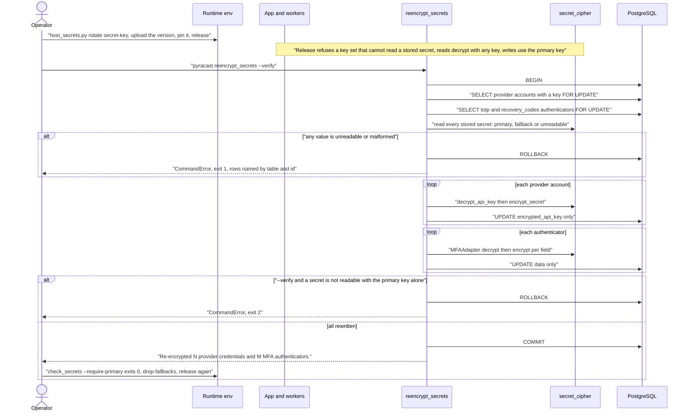

# Rotate the application key and re-encrypt stored secrets

An operator promotes a new `PYRACAST_SECRET_KEY` with `deploy/host_secrets.py rotate secret-key`, which keeps the previous key first in `PYRACAST_SECRET_KEY_FALLBACKS`, releases that runtime secret version, and runs `pyracast reencrypt_secrets --verify`. In one transaction the command rewrites every provider API key and every TOTP and recovery-code payload under the new primary key and proves each readable with it alone. Once `pyracast check_secrets --require-primary` exits 0, `host_secrets.py drop-fallbacks` removes the old key and another release applies that. Every release refuses a key set that cannot read a stored secret. There is no screen, endpoint or scheduled job; broker and database password rotation are separate manual procedures.

## Entry points

- Command `pyracast reencrypt_secrets [--verify]`: `pyracast.accounts.management.commands.reencrypt_secrets` `Command.handle`, which calls the module function `reencrypt_secrets`, through the `pyracast` console script (`pyracast.cli` `main`). Actor: operator, locally or in the `api` container on the VM (`docs/DEPLOYMENT.md`, "Key rotation").
- Command `pyracast check_secrets [--require-primary]` (`pyracast.accounts.management.commands.check_secrets`): reads only. Exit 0 when every stored secret decrypts, 1 when one is unreadable or malformed or only one of the two secret tables exists, 2 with `--require-primary` when one still needs a fallback key. `deploy/install-release.sh` runs it without the flag, with the release's staged secrets, before maintenance. Both commands share `pyracast.accounts.stored_secrets`.
- `deploy/host_secrets.py rotate secret-key` and `drop-fallbacks` edit the local runtime secret file (flow `secret-provisioning`).
- Passive decrypt paths that make the fallback window work: `pyracast.connections.secrets` `decrypt_api_key` (used by `pyracast.providers` `_request` on every Solcast call) and `pyracast.accounts.mfa` `MFAAdapter.decrypt` (wired by `MFA_ADAPTER` in `pyracast.settings`, on every TOTP or recovery-code check).
- Writers that always use the running process's primary key: `encrypt_secret` from `pyracast.connections.operations` `create_account` and `rotate_secret`, and `MFAAdapter.encrypt` from allauth TOTP activation and recovery-code generation.
- Shared cipher: `pyracast.encryption` `secret_cipher`. Settings source: `PYRACAST_SECRET_KEY` and `PYRACAST_SECRET_KEY_FALLBACKS` in `pyracast.settings`, delivered through `deploy/runtime_secrets.py` into `runtime.env`.

## Sequence

## Data

| Table | R/W | What |
|---|---|---|
| `connections_provideraccount` | R/W | Every row with a non-empty `encrypted_api_key`, enabled or not, is locked and rewritten (`encrypted:v1:` plus Fernet token). `credential_revision`, cooldown and quota columns are untouched. |
| `mfa_authenticator` | R/W | `type` totp: `data.secret`. `type` recovery_codes: `data.migrated_codes` items when present, otherwise `data.seed` (`mfa:v1:` plus token). `used_mask`, `viewed_at` and other keys are copied unchanged. WebAuthn rows are not selected. |

## Authorization

- None in the application: the trust boundary is shell access to the host or container. There is no operator identity, confirmation, audit event or security-log entry.
- Database: `deploy/bootstrap.sql` grants the runtime role `pyracast_app` `SELECT, INSERT, UPDATE, DELETE` through default privileges on tables created by `pyracast_owner`. No owner role is required.
- Tenancy is not involved: both tables are global, not per workspace.

## Failure paths

| Condition | Result |
|---|---|
| Old key missing from fallbacks, wrong key, corrupted token, MFA value without `mfa:v1:`, plaintext that is not UTF-8, or a malformed shape (TOTP without a string `secret`, recovery row without `seed` or a list of `migrated_codes`) | Checked before any write: `CommandError` "Unreadable or malformed secrets: <table> <id>, ...", exit 1, full rollback, rows named, no value echoed |
| Decrypted provider key does not match the 1 to 1024 printable ASCII rule | Same message naming the row, exit 1 |
| `--verify` and a rewritten secret is not readable with the primary key alone | "Not readable with the primary key alone: ...", exit 2, full rollback |
| Database error; a row lock held elsewhere longer than `lock_timeout=5s`; a statement over `statement_timeout=60s` | Not mapped: raw traceback, transaction rolled back |
| Empty `PYRACAST_SECRET_KEY` | Django `ImproperlyConfigured` at the first row inside the transaction: raw traceback and rollback |
| No rows to rewrite | Exit 0 with "Re-encrypted 0 provider credentials and 0 MFA authenticators." |
| `check_secrets` with neither secret table, or a release's `check_secrets` fails | Exit 0 "No stored secrets: the tables do not exist yet."; with one table only, exit 1. A failing release stops before maintenance; the serving release and its secrets are unchanged |
| Fallback removed before a successful run | Provider calls raise `ProviderError("invalid_provider_secret")`; TOTP and recovery verification raises `PermissionDenied`, so staff and superusers, who must have TOTP, cannot sign in |

## Rules and invariants

- All-or-nothing: one `transaction.atomic` over both tables; the exception handler deliberately maps errors to a fixed message that names rows but no secret text. Provider rows are locked before authenticator rows, and every secret is proved readable under those locks before the first write.
- The command rewrites every row, including rows already under the primary key, so a rerun is safe.
- Row locks block every writer that locks a provider account and the account locks of sign-in and credential writes (`accounts.processes.account_state`) until commit; a blocked writer fails after `lock_timeout=5s`. A process still running the old primary key can write old-key ciphertext after the run, which breaks once the fallback is removed. Restart every container (`api`, `worker`, `notifications`, `dispatcher`) with the new key before running.
- Domain separation: provider and MFA keys use different HKDF `info` contexts, so ciphertexts are not interchangeable. The first key in `secret_cipher` encrypts, every key may decrypt; `primary_only` reads with the first key alone.
- Unlike `rotate_secret`, no `credential_revision` increment and no `AuditEvent`, so bindings validated against the revision stay valid and a 401 block tied to `authentication_failed_revision` stays in place.
- Rewriting authenticator `data` changes the credential state of every account with an authenticator (`accounts.processes.account_state` digests everything but `used_mask` and `viewed_at`), so their pending sign-in and code steps and recent reauthentications end.
- `PYRACAST_SECRET_KEY_FALLBACKS` is split on whitespace; keys containing spaces are not supported. `SECRET_KEY` also feeds Django's session auth hash and the historical-upload preview signature; both accept fallbacks, and the command does not touch them.

## Tests

- `tests/test_secret_reencryption.py` (end-to-end rotation of provider key, TOTP and both recovery-code layouts; rollback with a corrupted TOTP and no echo of the value), `tests/test_secret_checks.py` (`check_secrets`, malformed rows named without values, `--require-primary`, `--verify` and its rollback), `tests/test_host_secrets.py` (`rotate secret-key`, `drop-fallbacks`).
- `deploy/test-release.sh` mode `check-secrets` pins that a failing `check_secrets` ends the release before maintenance.
- Gaps: no test through the `pyracast` console script or real `docker compose exec`; no case that `reencrypt_secrets` leaves a WebAuthn row untouched; no lock or concurrent-writer case; no empty-`SECRET_KEY` case; no deployment-level test that `PYRACAST_SECRET_KEY_FALLBACKS` survives `runtime_files`.
