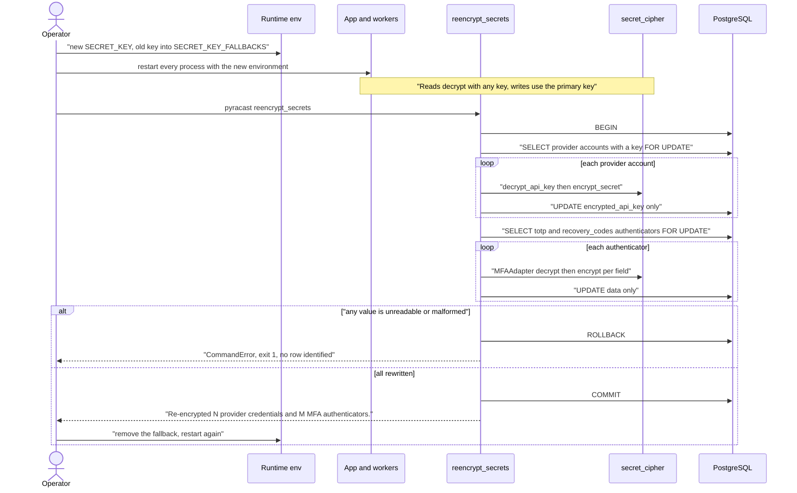

# Rotate the application key and re-encrypt stored secrets

An operator promotes a new `PYRACAST_SECRET_KEY`, keeps the previous one in `PYRACAST_SECRET_KEY_FALLBACKS`, restarts every process, and runs `pyracast reencrypt_secrets`. In one transaction the command rewrites every provider API key and every TOTP and recovery-code payload under the new primary key, so the old key can then be removed. There is no screen, endpoint or scheduled job; broker and database password rotation are separate manual procedures.

## Entry points

- Command `pyracast reencrypt_secrets`: `pyracast.accounts.management.commands.reencrypt_secrets` `Command.handle`, which calls the module function `reencrypt_secrets`. Reached through the `pyracast` console script (`pyracast.cli` `main`, `execute_from_command_line`). Actor: operator, locally with `uv run --locked pyracast reencrypt_secrets` (README) or, by analogy with the other documented operator commands, `docker compose ... exec api pyracast reencrypt_secrets` on the VM; the production form is not documented.
- Passive decrypt paths that make the fallback window work: `pyracast.connections.secrets` `decrypt_api_key` (used by `pyracast.providers` `_request` on every Solcast call) and `pyracast.accounts.mfa` `MFAAdapter.decrypt` (wired by `MFA_ADAPTER` in `pyracast.settings`, called through `allauth.mfa.utils.decrypt` on every TOTP or recovery-code check and recovery-code display).
- Writers that always use the running process's primary key: `encrypt_secret` from `pyracast.connections.operations` `create_account` and `rotate_secret`, and `MFAAdapter.encrypt` from allauth TOTP activation and recovery-code generation.
- Shared cipher: `pyracast.encryption` `secret_cipher`. Settings source: `PYRACAST_SECRET_KEY` and `PYRACAST_SECRET_KEY_FALLBACKS` in `pyracast.settings`, delivered to containers through `deploy/runtime_secrets.py` `prepare_runtime` into `runtime.env` (`env_file`, `format: raw`).
- Documented in the `docs/DEPLOYMENT.md` "Key rotation" bullet and `README.md` (application-secret rotation paragraph).

## Sequence

## Data

| Table | R/W | What |
|---|---|---|
| `connections_provideraccount` | R/W | Every row with a non-empty `encrypted_api_key`, enabled or not, is locked and rewritten (`encrypted:v1:` plus Fernet token). `credential_revision`, cooldown and quota columns are untouched. Fixture accounts with an empty key are skipped. |
| `mfa_authenticator` | R/W | `type` totp: `data.secret`. `type` recovery_codes: `data.migrated_codes` items when present, otherwise `data.seed` (`mfa:v1:` plus token). `used_mask`, `viewed_at` and other keys are copied unchanged. WebAuthn rows are not selected (WebAuthn is not in `MFA_SUPPORTED_TYPES`). |

## Authorization

- None in the application: the trust boundary is shell access to the host or container. There is no operator identity, confirmation, audit event or security-log entry.
- Database: `deploy/bootstrap.sql` grants the runtime role `pyracast_app` `SELECT, INSERT, UPDATE, DELETE` through default privileges on tables created by `pyracast_owner`, which `FOR UPDATE` and `UPDATE` need. No owner role is required.
- Tenancy is not involved: both tables are global, not per workspace.

## Failure paths

| Condition | Result |
|---|---|
| Old key missing from fallbacks, wrong key, corrupted token, MFA value without `mfa:v1:`, plaintext that is not UTF-8 | `ProviderError` or `PermissionDenied` becomes `CommandError` "Secret re-encryption failed. No changes were committed; retain the fallback keys.", exit 1, full rollback, no row id and no value echoed. Provider rows cannot lack the prefix or exceed 2048 characters: the check constraint and `varchar(2048)` forbid it |
| TOTP row without `secret`, recovery row without `seed` or `migrated_codes`, `data` stored as a JSON list, `migrated_codes` not iterable | `KeyError` or `TypeError` mapped to the same `CommandError` |
| Decrypted provider key no longer matches the 1 to 1024 printable ASCII rule | `ValidationError` mapped to the same `CommandError` |
| Database error; a row lock held elsewhere longer than `lock_timeout=5s`; a statement over `statement_timeout=60s`; a non-string `secret`, `seed` or code, or `data` that is a JSON string or null (`AttributeError`) | Not mapped: raw traceback, transaction rolled back |
| Empty `PYRACAST_SECRET_KEY` | Django `ImproperlyConfigured` on the first `settings.SECRET_KEY` access, which is `secret_cipher` for the first row inside the transaction: raw traceback and rollback. With no rows the command exits 0 |
| No rows to rewrite | Exit 0 with "Re-encrypted 0 provider credentials and 0 MFA authenticators." |
| Fallback removed before a successful run | Provider calls raise `ProviderError("invalid_provider_secret")`; TOTP and recovery verification raises `PermissionDenied` "Authenticator could not be verified.", so staff and superusers, who must have TOTP, cannot sign in |

## Rules and invariants

- All-or-nothing: one `transaction.atomic` over both tables; the exception handler deliberately maps errors to a fixed message so no secret text leaks. Provider rows are locked before authenticator rows.
- The command rewrites every row, including rows already under the primary key, so a rerun is safe and idempotent in meaning but always updates all rows.
- Row locks block `rotate_secret`, `reserve_account_request` (quota reservation before each provider request), the admin binding form and allauth recovery-code validation until commit; a blocked writer fails after `lock_timeout=5s`. Rows inserted after the selects are not seen: a process still running the old primary key can write old-key ciphertext after the run, which breaks once the fallback is removed. Restart every container (`api`, `worker`, `notifications`, `dispatcher`) with the new key before running.
- Domain separation: provider and MFA keys use different HKDF `info` contexts (`pyracast-provider-credentials-v1`, `pyracast-mfa-credentials-v1`), so ciphertexts are not interchangeable. The first key in `secret_cipher` encrypts, every key may decrypt.
- Unlike `rotate_secret`, no `credential_revision` increment and no `AuditEvent`, so bindings validated against the revision stay valid and a 401 block tied to `authentication_failed_revision` stays in place.
- `PYRACAST_SECRET_KEY_FALLBACKS` is split on whitespace; keys containing spaces are not supported. `SECRET_KEY` also feeds Django's session auth hash and the historical-upload preview signature (`django.core.signing`); both accept fallbacks, and the command does not touch them.

## Tests

- `tests/test_secret_reencryption.py`: end-to-end rotation of provider key, TOTP and both recovery-code layouts including `used_mask` and unchanged `credential_revision`; rollback with a corrupted TOTP and no echo of the value; empty fixture credentials.
- `tests/test_provider_secrets.py` `test_rotation_retains_old_keys_only_while_fallback_is_configured` and `tests/test_mfa_secrets.py` (fallback decrypt, domain separation, corrupted payloads) pin the cipher layer.
- Gaps: no test through the `pyracast` console script or real `docker compose exec`; no WebAuthn-untouched case; no lock or concurrent-writer case; no `KeyError`, `TypeError` or `ValidationError` mapping case; the rollback test checks only the provider row, not MFA rows; no empty-`SECRET_KEY` case; no deployment-level test that `PYRACAST_SECRET_KEY_FALLBACKS` survives `prepare_runtime`; no Playwright coverage (none expected).
