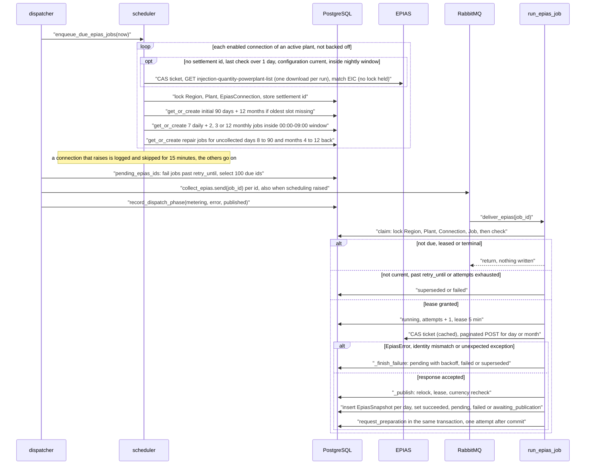

# Collect EPIAS reported production and settlement injection

The dispatcher's `metering` phase (every poll, default 30 s) turns each enabled EPIAS connection into daily `realtime_generation` jobs and monthly `settlement_injection` jobs, then sends up to 100 due job ids to the `collect_epias` actor. The worker leases one job, fetches EPIAS with the platform-wide credentials, stores one hashed `EpiasSnapshot` per target day and attempt, sets the job outcome and, in the same transaction, records a calibration preparation request. There is no screen or endpoint: results surface in the production-history read, the EPIAS status read and the admin operations page.

## Entry points

- Dispatcher phase `metering` (last of five): `src/pyracast/orchestration/dispatcher.py` `phases` calls `src/pyracast/metering/runtime.py` `dispatch_epias`, which runs `pyracast.background.failures.publish_after`: `src/pyracast/metering/scheduler.py` `enqueue_due_epias_jobs`, then `src/pyracast/metering/jobs.py` `pending_epias_ids` (at most 100, oldest `available_at` first) and `actor.send` for each id. Command: `src/pyracast/orchestration/management/commands/dispatch.py`.
- Actor `collect_epias` (queue `epias`, `max_retries=0`, time limit 210 s) is the `METERING` kind of `src/pyracast/orchestration/kinds.py`, consumed by the `worker` command (`src/pyracast/orchestration/management/commands/worker.py`; `epias` is in the default queues); `runtime.deliver_epias` calls `jobs.run_epias_job`.
- Initial backfill jobs are also created outside the dispatcher by `scheduler.enqueue_connection(..., initial=True)`: from `src/pyracast/metering/operations.py` `connect_epias` (owned by `epias-connection`) and from `src/pyracast/plants/operations.py` `_save_configuration` whenever a plant with an enabled connection gets a new configuration (`revise_plant`, `activate_submitted_plants`; owned by `plant-configuration-revision`). The next dispatcher cycle sends them.
- External: EPIAS CAS `giris.epias.com.tr/cas/v1/tickets` and transparency `seffaflik.epias.com.tr/electricity-service/v1/generation/data/{realtime-generation, injection-quantity, injection-quantity-powerplant-list}` via `src/pyracast/epias.py` `EpiasClient`, built once per process by `src/pyracast/metering/client.py` `get_epias_client` from `PYRACAST_EPIAS_USERNAME` and `PYRACAST_EPIAS_PASSWORD` (read from the environment in `settings.py`). The plant-list lookup runs in the dispatcher process, the data fetches in the worker.

## Sequence

## Data

| Table | R/W | What |
|---|---|---|
| `metering_epiasconnection` | R/W | Enabled, revision, `provider_plant_id`, EIC; scheduler writes `settlement_plant_id` and `settlement_checked_at`; row lock |
| `metering_epiascollectionjob` | R/W | Created by `get_or_create` on the slot key; lease, `attempts`, `available_at`, `retry_until`, `status`, `last_error`; bulk expiry in `pending_epias_ids` |
| `metering_epiassnapshot` | R/W | One per job, attempt and target day: filtered raw rows, normalized readings, `content_sha256`, `complete`, `available_at` |
| `regions_region` | R | Row lock (first in order), `timezone`, `deleted_at`, approval state through `binding_is_current` |
| `plants_plant`, `plants_plantconfiguration` | R, W | Row lock, `current_configuration`, `configuration_is_current`; `calibration_preparation_due_at` is set by `request_preparation` |
| `connections_sitebinding`, `connections_provideraccount` | R | `binding_is_current` inside `configuration_is_current` |
| `forecasts_collectionschedule` | R | `enabled` and `effective_from` gate the nightly window; a disabled schedule supersedes windowed jobs |
| `plants_calibrationrun`, `plants_calibrationactivation`, `plants_plantevent` | R/W, R, W | Written by the preparation that follows the commit (or the dispatcher's calibration phase), outside the job transaction: it skips while a run is `pending` or `running`, compares earlier runs of the latest activation, then may insert a pending run and a `calibration_scheduled` event |
| `forecasts_dispatcherstatus` | W | `record_dispatch_phase("metering", ...)` after every cycle |

## Authorization

- No user principal. Tenant scope follows job -> connection -> plant -> region; every write is keyed by that job or connection. Which EPIAS plant feeds a plant was fixed by the platform administrator in `connect_epias`; each job pins that identity in `provider_plant`.
- The scheduler only takes connections with `enabled=True` on plants whose region is not trashed, and `enqueue_connection` requires a current configuration (`plants/operations.py` `configuration_is_current`).
- `jobs._current` runs at claim, after failure and at publication under the row locks: connection enabled, revision equal, `provider_plant` id and EIC equal to the connection (settlement id for settlement jobs), configuration still current, and for windowed jobs no disabled schedule.
- Lease ownership (`_owns`: running, same token, unexpired) is rechecked under lock before any failure or publication write.
- One platform credential pair is shared by all tenants. It is sent only in the login form to the fixed CAS host; the ticket goes only in the `TGT` header to the fixed data host. `EpiasClient` follows no redirects and rejects responses echoing the username, password or ticket (`unsafe_epias_response`).
- Database: `epiascollectionjob_slot_uniq`, `epiassnapshot_job_attempt_target_date_uniq`, status, source and `epiascollectionjob_lease_chk` constraints, deferred composite FKs pinning snapshot -> job -> connection, configuration and plant (declared in `src/pyracast/schema_objects.py`), and the `epiassnapshot_immutable` trigger that refuses every update of a stored snapshot.

## Failure paths

| Condition | Result |
|---|---|
| One connection raises while scheduling | Logged as `metering_connection_failed item=connection:<id>`, the connection is skipped for 15 minutes in that process, the others are scheduled and due ids are still sent; `DispatcherStatus.last_error` = `items_failed:<n>`, admin "dispatcher phases" check; a one-shot `dispatch` exits with `CommandError` |
| Scheduling fails outside a single connection | Due ids are still sent; the phase records the exception class |
| `actor.send` raises (RabbitMQ unavailable) | Remaining ids are not sent and the phase fails with the exception class; jobs stay `pending` and are resent next cycle |
| Queue holds 1,000 or more messages | Publication is skipped with a `publication_skipped` warning; ids stay in the database |
| Settlement lookup fails with `EpiasError` | `settlement_plant_id` stays null, the failure is logged (`epias_settlement_lookup_failed`) and the check is retried after 1 hour; finding nothing or an ambiguous EIC stamps `settlement_checked_at` = now and retries after 1 day, inside the window |
| Job or a parent row missing, job not due, leased or terminal | `claim_epias_job` returns None, nothing written |
| Lock timeout or deadlock in `claim_epias_job` | The delivery ends normally with `job_claim_contended` (`worker-runtime`); the job is left as it was for a later metering phase |
| Connection disabled or changed, configuration replaced, location trashed, region binding not current, schedule disabled (windowed jobs) | `superseded`, terminal |
| Past `retry_until` at claim, before the request or in `pending_epias_ids` | `failed`, `retry_window_expired` (a credential error stays the job's error) |
| Job claimed again after three attempts, for example after its third lease expired (yesterday's nightly job is exempt) | `failed`, `attempts_exhausted` |
| Credentials missing or rejected (`epias_credentials_missing`, `epias_credentials_rejected`) | The attempt is returned and the job waits 15 minutes; the error stays the job's `last_error` and its outcome when the window ends; a rejected sign-in stops further sign-ins of the process until it restarts |
| HTTP 408, 425, 429, 5xx except 501/505, 401 from a data endpoint, transport error, schema, interval, unsafe-response or `epias_deadline_exceeded` errors | `pending` with backoff (`Retry-After` honored on 429/503; windowed jobs wait at least 30 minutes), `epias_provider_failure`; `failed` when the budget or window ends |
| Any other unexpected HTTP status (for example 400, 403, 404, a redirect) or an answer above 32 MiB | `failed`, `epias_provider_failure` |
| Response plant, day, source kind or period differs from the job | `epias_response_identity_mismatch` raised, recorded as `epias_provider_failure`, retried like a provider failure |
| Lease lost before a failure or publication write | Response discarded, nothing written; the job stays `running` until it is due again and `pending_epias_ids` resends it (`interrupted_metering` in admin health) |
| Realtime day incomplete (not 24 hourly labels with totals) | Snapshot kept, `partial_data`; yesterday's nightly job retries every 30 min to 09:00, older windowed days every 30 min, backfill days after 30 then 60 min; `failed` after three attempts |
| Settlement period empty or incomplete | Snapshots kept, job ends `awaiting_publication` with `unpublished_data` or `partial_data`; only a later nightly job refetches, and only for the last 2 (Monday 3) months |
| The preparation after the commit raises | Snapshots and the job outcome stand; the failure is logged and the plant is prepared again an hour later |
| An exception while fetching, validating or publishing a claimed attempt | `metering_job_failed job=<id> attempt=<n> error_type=<class> origin=<module>:<line>:<function>` is logged at ERROR, never the exception message |

## Rules and invariants

- Row-lock order: Region, Plant, EpiasConnection, EpiasCollectionJob. No lock is held during EPIAS calls (the settlement lookup runs before the scheduler transaction). `request_preparation` only updates the already locked plant row; the preparation after commit takes Tenant, Region and Plant in its own transaction. The bulk expiry in `pending_epias_ids` is a plain `UPDATE` without parent locks or a currency check.
- Nightly window: region-local 00:00 (first existing half hour) to 09:00 (`collection_window.nightly_window`); no daily jobs if the connection changed inside tonight's window or the schedule is disabled or not yet effective. Target days are counted in Europe/Istanbul.
- Daily run: yesterday plus six older days and, once a settlement id is known, 2 settlement months (3 on Monday, 12 if the revision has no other settlement jobs); every job gets `retry_until` = 09:00. Only yesterday's realtime job retries without an attempt cap; claiming a windowed job pushes `available_at` 30 min forward.
- Repair: inside the window, a realtime day 8 to 90 days back or a settlement month 4 to 12 months back that has no snapshot for the current revision and configuration and no open job gets a job, newest first, at most 31 jobs per connection and night in that range, and at most 3 nights per slot whose repair failed after a request; it has the window's `retry_until` and three attempts.
- Initial backfill: 90 realtime days and 12 completed months keyed on `scheduled_for = max(connection.updated_at, configuration.created_at)`, so repeated scheduling is idempotent; it is re-run whenever the oldest day or month slot is missing for the current revision and configuration. Only the previous-day job inherits a deadline when backfill starts inside the window.
- `succeeded`, `failed`, `superseded` and `awaiting_publication` are terminal. Slots are looked up by key whatever their status, so a terminal slot is never retried; new work needs a new `scheduled_for`, connection revision or configuration.
- `retry_until` is checked at claim, before the request and when a retry is scheduled, not at publication: a response requested before 09:00 is still stored after it.
- Settlement requests cover one calendar month (at most 31 days) with page size 100; realtime requests cover one day. A sign-in or page request starts only within 100 s of the job's start, and each answer is read within 30 s. The CAS ticket is reused for 7,140 s per process and dropped on any 401 or 403.
- Snapshots are never updated; a retry writes a new row per attempt. Missing hours stay missing, not zero; readings use `hour-start-istanbul-v1`.
- Leases last 5 minutes; every step adds monotonic elapsed time to `now`. Dramatiq never retries; the dispatcher resends due ids every cycle and the claim discards duplicates.
- EPIAS jobs use no Solcast quota and have no request budget of their own, but scheduling and `_current` need the region's provider binding to be current (`pyracast.connections.currency.binding_is_current`).
- `delivery_health` counts `overdue_metering`, `interrupted_metering` and `failed_metering` (failed jobs scheduled in the last day); `awaiting_publication` is not counted.

## Tests

- `tests/test_claim_contention.py`: a delivery behind a held region lock ends without claiming.
- `tests/test_metering.py`: scope, duplicate workers, lease expiry, failure redaction, identity mismatch, supersession, partial data, purge during claim or scheduling. `tests/test_metering_nightly.py`: window, deadlines, 30-minute retries, schedule disable. `tests/test_metering_repair.py`: repair horizon, nightly cap, three repair nights.
- `tests/test_metering_settlement.py`, `tests/test_metering_history_backfill.py`: monthly split, unpublished settlement, EIC lookup outside locks, 90-day and 12-month backfill idempotency, backfill after a configuration revision, publication standing while preparation raises.
- `tests/test_epias.py`, `tests/test_epias_settlement.py`, `tests/test_epias_credentials.py`, `tests/test_epias_deadline.py`, `tests/test_collection_window.py`: client parsing, pagination, TGT reuse, redaction, credential outcomes, request and body deadlines, window edges. `tests/test_metering_runtime.py`: credentials cache, duplicate dispatch through the stub broker, opt-in RabbitMQ delivery (`PYRACAST_LIVE_QUEUE=1`). `tests/test_epias_live.py`: captured-fixture replay and opt-in live check (`PYRACAST_EPIAS_LIVE=1`).
- Phase level: `tests/test_dispatch_isolation.py` (a failing connection does not stop the others or publication, one settlement list per run, short retry after a failed lookup), `tests/test_dispatch_resilience.py` (with `dispatch_epias` mocked). Health counters: `tests/test_delivery_health.py`, `tests/test_admin_health_queries.py`, `tests/test_admin_health_views.py`.
- Gaps: no test pins what `dispatch_epias` does when `actor.send` raises; the America/New_York test (`test_metering.py` `test_daily_slot_uses_region_night_independently_of_forecast_times`) pins window, `scheduled_for` and target days only at a moment where region and Istanbul dates agree, so none separates Istanbul from region-local target days; none for a lease expiring during a multi-page fetch, or recovery after a binding was briefly not current. No Playwright coverage (no UI); `web/tests/epias-production.spec.ts` covers the production screen with mocked APIs.
