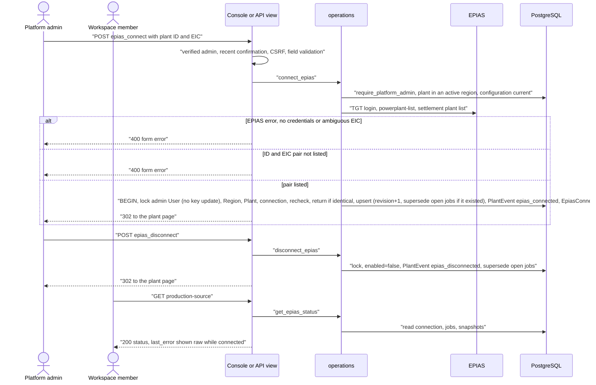

# Connect or disconnect a plant's EPIAS reported-production feed

A platform administrator with verified MFA and a recent authenticator confirmation links a plant to its EPIAS (transparency platform) generation feed by typing the EPIAS plant ID and the plant's 16-character EIC on the plant review page of the `/admin/` console. The identifiers are checked against the shared server-side EPIAS account, the settlement plant is resolved by EIC and a 90-day plus 12-month backfill is queued as database rows that the dispatcher sends later. Disconnect disables the connection and supersedes open jobs but keeps saved data. Members only read the status, through a REST endpoint with no mutating method.

## Entry points

- Console: `GET|POST /admin/plants/{region_id}/` (URL name `admin:workspace_plant`; the ID is the Region's, not the Plant's) -> `pyracast.platform_admin.site.PlatformAdminSite` -> `pyracast.platform_admin.plant_review.plant`; the panel uses the region's first plant. Panel "EPİAŞ production connection" in `src/pyracast/regions/templates/admin/regions/region/setup.html`. POST actions `epias_connect` (form `pyracast.platform_admin.forms.EpiasConnectionForm`, prefix `epias`) and `epias_disconnect`.
- REST: `GET /api/tenants/{t}/regions/{r}/plants/{p}/production-source/` -> `pyracast.plants.epias_api.EpiasConnectionView`. The web caller is `web/src/features/production/history/source-details.tsx` `ProductionSourceDetails`, which keeps the cached source with a retry when a refresh fails. Other methods answer 405.
- Operations: `pyracast.metering.operations.connect_epias`, `disconnect_epias`, `get_epias_status`; backfill rows by `pyracast.metering.scheduler.enqueue_connection` with `initial=True`, also called by `pyracast.plants.operations` when a new configuration is created for an enabled connection. Follow-up: the `metering` dispatcher phase (`pyracast.metering.runtime.dispatch_epias`) sends the rows to the `collect_epias` actor on queue `epias` (flow `epias-collection`).

## Sequence

## Data

| Table | R/W | What |
| --- | --- | --- |
| `metering_epiasconnection` | R/W, `FOR UPDATE` | One row per plant (`OneToOne`): provider and settlement IDs, EIC, name, `enabled`, `revision`, `connected_by` |
| `metering_epiasconnectionrevision` | W | One row per connect: revision, provider plant ID, EIC and `connected_at`; written with the event in one transaction |
| `metering_epiascollectionjob` | R/W | Backfill rows created `pending` by `get_or_create`; open rows set `superseded` on a changed connect and on disconnect |
| `metering_epiassnapshot` | R | Counted for `archived_days`, `complete_through` and settlement dates in the status |
| `plants_plantevent` | W | `epias_connected` and `epias_disconnected` audit rows with provider ID, EIC, revision |
| `auth_user`, `regions_region`, `plants_plant` | R, `FOR NO KEY UPDATE` (user), `FOR UPDATE` | Actor still an active staff superuser, existence, trash state (connect) |
| `plants_plantconfiguration`, `connections_sitebinding`, `connections_provideraccount` | R | Configuration still current (`configuration_is_current`), not locked |
| `accounts_membership` | R | Member check for GET |
| `forecasts_collectionschedule` | R | Decides whether the first previous-day job gets a nightly retry deadline |

## Authorization

- Console: the console gate (`admin-console-access`): an active staff superuser with MFA evidence for a live authenticator, a proof by the authenticator within the last hour for every request and a recent confirmation for every unsafe one; others are redirected (302). CSRF is enforced (403). A stale POST answers 403 with the confirmation form and stores nothing.
- REST GET: the route policy requires an active membership, so every role, viewers included, may read; a platform admin without membership gets 403 `membership_required`. `get_epias_status` checks membership again through `member_plant`.
- Operations: `connect_epias` and `disconnect_epias` call `require_platform_admin` (active staff superuser, no MFA check) before any lookup or provider call and again on the locked user row. No tenant membership is needed: the plant is resolved by ID. Database: only the `OneToOne` plant key and check constraints; no unique constraint on provider plant ID or EIC.

## Failure paths

| Condition | Result |
| --- | --- |
| Unauthenticated, not a verified platform admin | Console redirects to login (302); the status read answers 401 `not_authenticated` or 403 `membership_required` |
| Bad CSRF; stale authenticator confirmation | 403, nothing stored |
| Status read: location trashed or outside the URL scope | 404 `not_found` |
| ID below 1 or EIC not 16 letters, digits or hyphens | Console 400 with field errors, no provider call |
| Region without a plant, configuration missing or not current | Console 400 "unavailable or changed"; the submit button is disabled while the configuration is not current |
| ID and EIC not in the EPIAS list (case-sensitive) | Console 400 "did not match" |
| Credentials unset or rejected, EPIAS failure or ambiguous settlement EIC | Console 400 with a credentials or try-later message |
| Admin loses superuser or plant changes after provider calls | 403 or the "unavailable or changed" message from the recheck under lock; nothing written |
| Identical connect to an enabled connection | Console 302 with "already connected, nothing changed"; no event, revision or job |
| Disconnect with no connection or an already disabled one | Console 302 with "not connected"; nothing written |
| Lock wait over 5 s | Console redirect with a retry message, nothing saved |

## Rules and invariants

- Provider calls run before the transaction. Under the lock both actions recheck the active staff superuser; connect also rechecks trash state and configuration, disconnect whether the connection is enabled. Lock order is the acting administrator's User row (`FOR NO KEY UPDATE`), Region, Plant, connection, jobs ([decision record](../ARCHITECTURE.md#tenancy-and-authorization)); workers take Region, Plant, connection, job.
- A connect that changes the enabled state, provider ID, EIC or settlement ID raises `revision` (a first connect starts at 1), supersedes open jobs and queues the whole backfill again; a disabled connection is reused. An identical connect returns before any write.
- Initial jobs are unique per slot with `scheduled_for = max(connection.updated_at, configuration.created_at)`. Only the previous-day job gets a retry deadline, and only when that slot lies inside the nightly window and no disabled schedule exists.
- With no settlement match the connection is saved with `settlement_plant_id` null; the scheduler looks again once a day inside the nightly window and then queues the 12 months, without an audit event (`epias-collection`).
- Status and history count only snapshots whose pinned provider ID and EIC equal the current connection: after a change of identity old snapshots stay stored but hidden, a reconnect to the same identity keeps them visible. The status carries `state` (`never_connected`, `connected`, `disconnected`), `disconnected_at`, `health` (null when disconnected; otherwise the newest batch of jobs decides between `collecting`, `waiting_for_publication`, `needs_attention` and `up_to_date`), `complete_through` and `failed_days`; the production tab shows the name, connection state, archived days and last error.
- Calibration reads the `metering_epiasconnectionrevision` rows (`production_identity_at`) to decide which provider identity was valid when its inputs were collected, so a connect must keep provider ID, EIC and revision there.

## Tests

- `tests/test_admin_epias.py` (console connect, disconnect, validation, safe errors, live MFA, CSRF, identical save); `tests/test_console_step_up.py` (stale confirmation); `tests/test_epias_api.py`, `tests/test_epias_status.py` and `tests/test_epias_authorization.py` (status contract, scope, operation guards); `tests/test_epias_identity_revisions.py` (revision rows, identical reconnect); `tests/test_metering.py` (identity mismatch, recheck under lock, reconnect revision); `tests/test_metering_history_backfill.py`, `tests/test_metering_settlement.py`, `tests/test_metering_nightly.py` (initial windows, retry deadline, later settlement resolution); `tests/test_routed_surface.py` (PUT and DELETE answer 405).
- Playwright: `web/tests/epias-production.spec.ts` (mocked status in source details, cached source on a failed refresh); `web/integration/admin-csp.spec.ts` (console panel render only).
- Gaps: no concurrent connect or lock-order test; no web test for non-empty `last_error` or the status loading state; no test that two plants or tenants cannot share one EIC.
