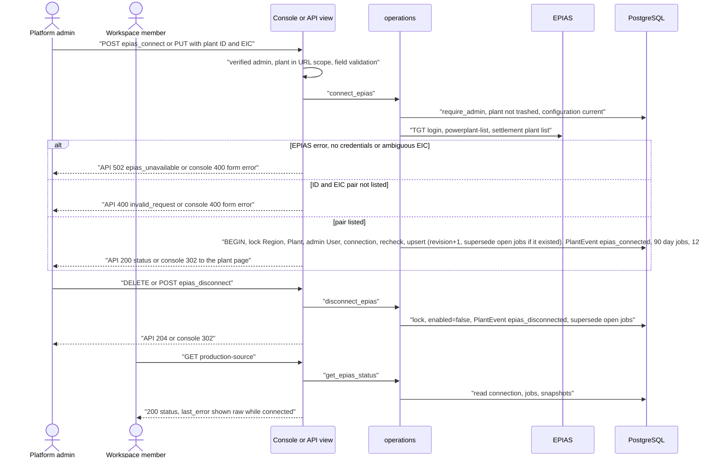

# Connect or disconnect a plant's EPIAS reported-production feed

A platform administrator with verified MFA links a plant to its EPIAS (transparency platform) generation feed by typing the EPIAS plant ID and the plant's 16-character EIC on the plant review page of the `/admin/` console, or through a REST endpoint that no screen calls. The identifiers are checked against the shared server-side EPIAS account, the settlement plant is resolved by EIC and a 90-day plus 12-month backfill is queued as database rows that the dispatcher sends later. Disconnect disables the connection and supersedes open jobs but keeps saved data; members only read the status in the production tab.

## Entry points

- Console: `GET|POST /admin/plants/{region_id}/` (the ID is the Region's, not the Plant's) -> `pyracast.admin.PlatformAdminSite.plant` -> `RegionAdmin.setup` (also routed at `/admin/regions/region/{region_id}/setup/`); the panel uses the region's first non-trashed plant. Panel "EPİAŞ production connection" in `src/pyracast/regions/templates/admin/regions/region/setup.html`. POST actions `epias_connect` (form `pyracast.admin_forms.EpiasConnectionForm`, prefix `epias`) and `epias_disconnect`.
- REST: `GET|PUT|DELETE /api/tenants/{t}/regions/{r}/plants/{p}/production-source/` -> `pyracast.plants.epias_api.EpiasConnectionView`. Only GET has a web caller (`useResource` in `web/src/components/production-history.tsx`).
- Operations: `pyracast.metering.operations.connect_epias`, `disconnect_epias`, `get_epias_status`; backfill rows by `pyracast.metering.scheduler.enqueue_connection` with `initial=True`, also called by `pyracast.plants.operations` when a new configuration is created for an enabled connection. Follow-up: the `metering` dispatcher phase (`pyracast.metering.runtime.dispatch_epias`) sends the rows to the `collect_epias` actor on queue `epias` (flow `epias-collection`).

## Sequence

## Data

| Table | R/W | What |
| --- | --- | --- |
| `metering_epiasconnection` | R/W, `FOR UPDATE` | One row per plant (`OneToOne`): provider and settlement IDs, EIC, name, `enabled`, `revision`, `connected_by` |
| `metering_epiascollectionjob` | R/W | Backfill rows created `pending` by `get_or_create`; open rows set `superseded` on reconnect and disconnect |
| `metering_epiassnapshot` | R | Counted for `archived_days` and settlement dates in the status |
| `plants_plantevent` | W | `epias_connected` and `epias_disconnected` audit rows with provider ID, EIC, revision |
| `regions_region`, `plants_plant`, `auth_user` | R, `FOR UPDATE` | Existence, trash state, actor still an active superuser |
| `plants_plantconfiguration`, `connections_sitebinding`, `connections_provideraccount` | R | Configuration still current (`configuration_is_current`), not locked |
| `accounts_membership` | R | Member check for GET |
| `forecasts_collectionschedule` | R | Decides whether the first previous-day job gets a nightly retry deadline |

## Authorization

- Console: `PlatformAdminSite.has_permission` needs an active staff superuser with verified MFA (`has_verified_mfa`); `admin_view` redirects others (302). CSRF is enforced (403).
- API PUT and DELETE: `EpiasConnectionView.check_permissions` applies `pyracast.api.views.PlatformAdmin` (active superuser plus verified MFA) before any body parsing. The view overrides `permission_classes`, so the default `WorkspaceWritePermission` does not apply, and no tenant membership is needed: `admin_plant` resolves the plant from the URL IDs.
- API GET: `ScopedView.plant` calls `require_member`; every role, viewers included, may read; a platform admin without membership gets 403.
- Operations: `connect_epias` and `disconnect_epias` call `require_admin` (active superuser, no MFA check) before any lookup or provider call and again on the locked user row; `get_epias_status` calls `require_member`. Database: only the `OneToOne` plant key and check constraints; no unique constraint on provider plant ID or EIC.

## Failure paths

| Condition | Result |
| --- | --- |
| Unauthenticated, not a verified platform admin (PUT, DELETE) or non-member GET | 403 `http_403`; console redirects to login (302) |
| Plant or region trashed, or outside the URL scope | API 404 `http_404` from `get_object_or_404`, before body validation |
| ID below 1 or EIC not 16 letters, digits or hyphens | API 400 `http_400` with field errors (DRF serializer); console 400 with field errors |
| Configuration missing or not current | API 400 `invalid_request`, localized `configuration_unavailable`; console 400 "unavailable or changed" |
| ID and EIC not in the EPIAS list (case-sensitive) | API 400 `invalid_request` with the raw key `epias_plant_identity_mismatch`; console 400 "did not match" |
| Credentials unset, EPIAS failure or ambiguous settlement EIC | API 502 `epias_unavailable`; console 400 with a credentials or try-later message |
| Admin loses superuser or plant changes after provider calls | 403 or `configuration_unavailable` from the recheck under lock; nothing written |
| Disconnect with no connection | API 204, console 302 with the success message; nothing written |
| Lock wait over 5 s | API 503 `workspace_busy` with `Retry-After: 1` |

## Rules and invariants

- Provider calls run before the transaction; admin, trash state and configuration are rechecked under the lock. Lock order is Region, Plant, User, connection, jobs; workers take Region, Plant, connection, job.
- Every connect for an existing plant raises `revision` and supersedes open jobs, even for identical identifiers, so the whole backfill is queued again; a disabled connection is reused.
- Initial jobs are unique per slot with `scheduled_for = max(connection.updated_at, configuration.created_at)`. Only the previous-day job gets a retry deadline, and only when that slot lies inside the nightly window and no disabled schedule exists.
- With no settlement match the connection is saved with `settlement_plant_id` null; `enqueue_due_epias_jobs` retries daily inside the nightly window and then queues the 12 months, without an audit event.
- Status and history count only snapshots whose pinned provider ID and EIC equal the current connection: after a change of identity old snapshots stay stored but hidden, a reconnect to the same identity keeps them visible. Calibration reads the `epias_connected` event (`production_identity_at`), so its details must keep provider ID, EIC and revision.

## Tests

- `tests/test_admin_epias.py` (console connect, disconnect, validation, safe errors, live MFA, CSRF); `tests/test_epias_api.py` and `tests/test_epias_authorization.py` (REST contract, 502, scope, permission order); `tests/test_metering.py` (identity mismatch, recheck under lock, reconnect revision, status counts); `tests/test_metering_history_backfill.py`, `tests/test_metering_settlement.py`, `tests/test_metering_nightly.py` (initial windows, retry deadline, later settlement resolution).
- Playwright: `web/tests/epias-production.spec.ts` (mocked status in source details); `web/integration/admin-csp.spec.ts` (console panel render only).
- Gaps: no concurrent connect or lock-order test; no API test of the 400 bodies; no web test for non-empty `last_error`, status error or loading; no test that two plants or tenants cannot share one EIC.
