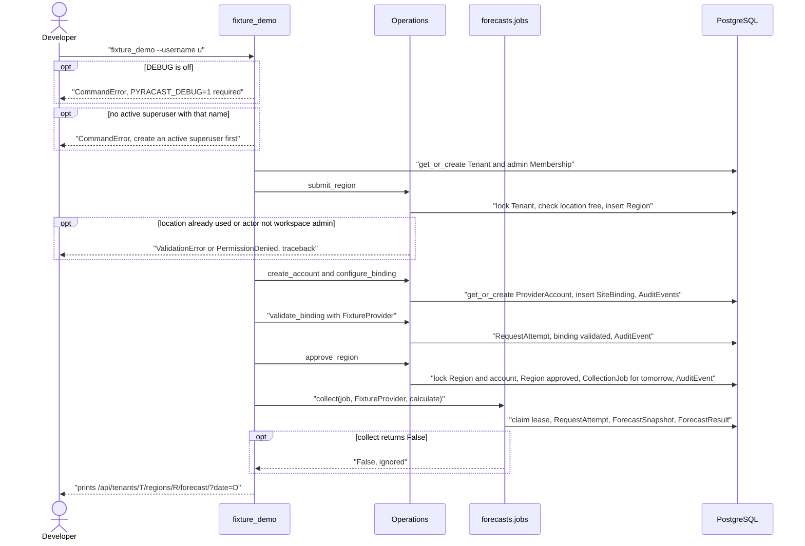

# Create a synthetic demo plant locally

A developer runs `pyracast fixture_demo --username <superuser>` against a local debug database. The command creates a demo workspace, a location, a fixture provider account and binding, validates and approves them and runs the first forecast collection in the same process, with no RabbitMQ, no provider request and no weather request. The outcome is an approved location with one published forecast for tomorrow and a printed API path to read it. No plant is created.

## Entry points

- Command `fixture_demo` (`src/pyracast/forecasts/management/commands/fixture_demo.py` `Command.handle`, started through `pyracast.cli.main`). Option `--username` (required). Actor: a developer with an active superuser account. No screen and no endpoint.
- Documented only in `README.md` section "First administrator and demo", after `provision_admin_mfa`; the command itself never checks MFA. Operations called in order: `submit_region`, `create_account`, `configure_binding`, `validate_binding`, `approve_region`, `collect` (`submit_region`, `configure_binding` and `approve_region` in `pyracast/regions/operations.py`; `create_account` and `validate_binding` in `pyracast/connections/operations.py`; `collect` in `pyracast/forecasts/jobs.py`), with `FixtureProvider` (`pyracast/providers.py`) and `calculate` (`pyracast/calculation.py`).

## Sequence

## Data

| Table | R/W | What |
| --- | --- | --- |
| `auth_user` | R | The named active superuser |
| `accounts_tenant`, `accounts_membership` | R/W | Tenant "Fixture demonstration" and the actor as its admin, both get-or-create |
| `regions_region` | R/W | Location "Synthetic Ankara" (39.9, 32.8, Europe/Istanbul), then status approved with the approved binding |
| `connections_provideraccount` | R/W | Global account `fixture` / `fixture-demo` (get-or-create, quota 10, no key) |
| `connections_sitebinding` | R/W | Binding `synthetic`, 1000 kW AC and DC, flat, marked validated |
| `forecasts_collectionjob` | R/W | One `forecasts` job, `scheduled_slot` now, `target_date` tomorrow local, ends `succeeded` |
| `forecasts_requestattempt` | W | Two attempts, validation and forecast, both counted against the account's daily quota |
| `forecasts_forecastsnapshot`, `forecasts_forecastresult` | W | 30-minute fixture intervals (600 kW from 06:00 to 18:00 local) and the calculated payload flagged `synthetic_fixture` |
| `regions_auditevent` | W | `provider_account_created` (only when the global account is new), `binding_configured`, `connection_validated`, `approved` |
| `plants_plant`, `plants_plantconfiguration`, `forecasts_collectionschedule` | R | Queried (plants locked) by `approve_region`, `claim` and `publish`; empty for the demo region, so no plant activation and no `ForecastIssuance` |

## Authorization

- Command: `settings.DEBUG` gate and an active superuser lookup, both in `Command.handle`; `is_staff` is not required and there is no MFA check, the shared CLI posture. Operations: `require_admin` (active superuser) in `create_account`, `configure_binding`, `validate_binding` and `approve_region`; `require_workspace_admin` in `submit_region`, which locks the tenant row and needs an admin membership.
- Database: `one_workspace_admin` and `unique_workspace_name` on tenant and membership; `provider_account_encrypted_api_key` lets only a `fixture` account have an empty key. The platform API accepts provider `fixture` in any environment, so only the command is debug-gated.

## Failure paths

| Condition | Result |
| --- | --- |
| `PYRACAST_DEBUG` is not `1` | `CommandError` "Fixture demonstration requires PYRACAST_DEBUG=1." |
| User unknown, inactive or not superuser | `CommandError` "Create an active superuser first." |
| Second run (location already exists in the tenant) | `ValidationError("location_already_exists")` traceback |
| Another superuser runs it after the first | `IntegrityError` on `one_workspace_admin`, traceback |
| Actor is already a viewer of the tenant | `PermissionDenied` from `require_workspace_admin`, traceback |
| Rerun after the region was deleted, existing `fixture-demo` account disabled or out of today's quota | `DoesNotExist` from `configure_binding` or `QuotaExceededError` from `validate_binding`, traceback |
| `collect` returns `False` (retry, stale, lease lost) | Ignored: exit 0 and the path is printed, the forecast may be missing |

## Rules and invariants

- Every operation commits on its own: no command transaction and no cleanup, so rows written before a failure stay and every rerun then fails on the location. `approve_region` sets `target_date` to tomorrow in the region zone, so the printed path reads tomorrow.
- The job's `scheduled_slot` is the approval time. `claim` accepts it because `available_at` is not in the future, no schedule row exists (so the slot-mismatch check is skipped) and the default cutoff timing starts at this job's own slot, so no later slot supersedes it unless the local cutoff passes between approval and collection.
- `collect` gets no weather provider, so no Open-Meteo call happens. The worker (`pyracast/runtime.py` `deliver`) also skips weather for non-Solcast accounts.
- The result is an ordinary approved region. `enqueue_due` (flow `forecast-collection-scheduling`) schedules it like any other and `adapter_for` returns `FixtureProvider`, so a running dispatcher keeps producing fixture forecast and nightly `estimated_actuals` jobs and spending the account's quota of 10 per UTC day.
- When the actor is also staff and the browser session has verified MFA (`can_admin`), `/app/` hands them to `/admin/`. The customer view of the demo workspace needs `/app/?workspace=customer` (`Dashboard` `enterAdministration`).

## Tests

- `tests/test_api.py` `test_fixture_demo` pins the debug gate, the superuser requirement, the printed path, one complete `ForecastResult` and the binding reference metadata.
- `test_fixture_workflow_and_freshness` (same file) pins the equivalent API route with `FixtureProvider` and the 7.2 kWh/m2 result.
- Gaps: no rerun, viewer-membership, second-superuser or inactive-user case; nothing asserts that `collect` succeeded, the audit events, or that the path returns 200. No Playwright test.
