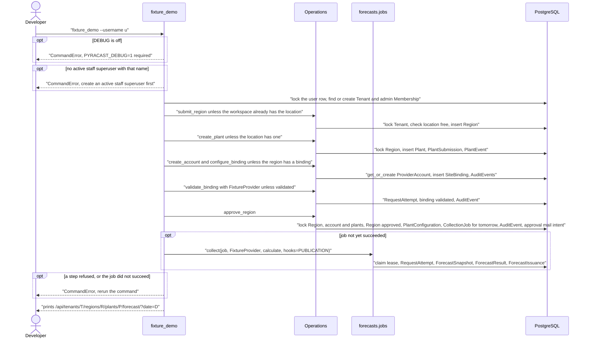

# Create a synthetic demo plant locally

A developer runs `pyracast fixture_demo --username <administrator>` against a local debug database. The command creates, or resumes, the operator's demo workspace with a location, a plant, a fixture provider account and binding, validates and approves them and runs the first forecast collection in the same process, with no RabbitMQ, no provider request and no weather request. The outcome is an approved location with one published forecast for tomorrow, the plant's archived forecast and a printed API path to read it.

## Entry points

- Command `fixture_demo` (`src/pyracast/forecasts/management/commands/fixture_demo.py` `Command.handle` and `run_demo`, started through `pyracast.cli.main`). Option `--username` (required). Actor: a developer with an active staff superuser account, as `bootstrap_admin` creates it. No screen and no endpoint.
- Documented only in `README.md` section "First administrator and demo", after `bootstrap_admin`, which prints the username; the command itself never checks MFA. Steps in order: `submit_region`, `create_plant`, `create_account`, `configure_binding`, `validate_binding`, `approve_region`, `collect` (`submit_region` and `configure_binding` in `pyracast/regions/operations.py`; `create_plant` in `pyracast/plants/operations.py`; `create_account` in `pyracast/connections/operations.py`; `validate_binding` in `pyracast/forecasts/validation.py`; `approve_region` in `pyracast/plants/approval.py`; `collect` in `pyracast/forecasts/jobs/collect.py` with the plant publication hooks `PUBLICATION` of `pyracast/plants/publication.py`), with `FixtureProvider` (`pyracast/providers.py`) and `calculate` (`pyracast/calculation.py`). Each step reuses what an earlier run left.

## Sequence

## Data

| Table | R/W | What |
| --- | --- | --- |
| `auth_user` | R | The named active staff superuser; its row is locked while the workspace is found or created |
| `accounts_tenant`, `accounts_membership` | R/W | Tenant "Fixture demonstration (user `<id>`)" with the actor as its admin, found by that name and membership or created together |
| `regions_region` | R/W | Location "Synthetic Ankara" (39.9, 32.8, Europe/Istanbul), then status approved with the approved binding |
| `plants_plant`, `plants_plantsubmission`, `plants_plantconfiguration`, `plants_plantevent` | R/W | Plant "Synthetic plant" (1 MW DC) with its declaration; approval activates it as configuration revision 1 on the binding |
| `connections_provideraccount` | R/W | Global account `fixture` / `fixture-demo` (get-or-create, quota 10, no key) |
| `connections_sitebinding` | R/W | Binding `synthetic`, 1000 kW AC and DC, flat, marked validated |
| `forecasts_collectionjob` | R/W | One `forecasts` job, `scheduled_for` the approval time, `target_date` tomorrow local, ends `succeeded` |
| `forecasts_requestattempt` | W | Two attempts, validation and forecast, both counted against the account's daily quota |
| `forecasts_forecastsnapshot`, `forecasts_forecastresult` | W | 30-minute fixture intervals (600 kW from 06:00 to 18:00 local) and the calculated payload flagged `synthetic_fixture` |
| `plants_forecastissuance` | W | The plant's archived forecast, when its configuration is older than the snapshot |
| `regions_auditevent` | W | `provider_account_created` (only when the global account is new), `binding_configured`, `connection_validated`, `approved` |
| `notifications_outboundmail` | W | One approval-mail intent per administrator whose address is verified (the actor, once its address is verified); sent only if a mailer runs |
| `forecasts_collectionschedule`, `metering_epiasconnection` | R | Read by `claim`, `publish` and the plant configuration; empty for the demo region |

## Authorization

- Command: the `settings.DEBUG` gate and `is_platform_admin` (active, staff and superuser), both in `Command.handle`; there is no MFA check, the shared CLI posture. Operations: `require_platform_admin` in `create_account`, `configure_binding`, `validate_binding` and `approve_region`; `authorize_workspace_admin` in `submit_region` and `create_plant`, which lock their rows and need the actor's admin membership of the demo workspace.
- Database: `membership_tenant_administrator_uniq` allows one administrator per workspace, which is why each operator gets an own demo workspace; `provideraccount_encrypted_api_key_chk` lets only a `fixture` account have an empty key. Only this command creates a fixture account: the console and the API create Solcast accounts and select only Solcast ones, so no HTTP route accepts the fixture provider.

## Failure paths

| Condition | Result |
| --- | --- |
| `PYRACAST_DEBUG` is not `1` | `CommandError` "Fixture demonstration requires PYRACAST_DEBUG=1." |
| User unknown, inactive, not staff or not superuser | `CommandError` "Create an active staff superuser first." |
| A step refuses (`ValidationError`, `PermissionDenied`, `QuotaExceededError`): the location used by a region of another name, the existing `fixture-demo` account disabled or out of today's quota | `CommandError` "Fixture demonstration stopped: ..." |
| `collect` returns `False` and the job is not `succeeded` (retry, stale, running elsewhere) | `CommandError` "The demo collection ended as `<status>`; run the command again." |
| `collect` returns `False` but the job succeeded meanwhile | The path is printed |
| Interrupted run | Rows written so far stay; a rerun resumes from them |

## Rules and invariants

- Every operation commits on its own: no command transaction and no cleanup. A rerun finds the workspace by the user's identity (the name carries the user id, so a changed username resumes it) and its admin membership, then the region by name, the plant, the binding of the current region revision and the job of an earlier approval, so it completes what is missing and prints the same path. Another workspace with the same name is never joined, because the lookup requires the actor's admin membership; concurrent runs for one operator serialize on the user row and reuse one workspace.
- `approve_region` sets `target_date` to tomorrow in the region zone, so the printed path reads tomorrow. A plant issuance needs a configuration older than the snapshot, so each step reads the clock again.
- The job's `scheduled_for` is the approval time. `claim` accepts it because `available_at` is not in the future, no schedule row exists (so the slot-mismatch check is skipped) and the default timing starts at this job's own slot, so no later slot supersedes it unless a default collection time passes between approval and collection.
- `collect` gets no weather provider, so no Open-Meteo call happens. The worker (`pyracast/forecasts/runtime.py` `deliver`) also skips weather for non-Solcast accounts.
- The result is an ordinary approved region. `enqueue_due` (flow `forecast-collection-scheduling`) schedules it like any other and `adapter_for` returns `FixtureProvider`, so a running dispatcher keeps producing fixture forecast and nightly `estimated_actuals` jobs and spending the account's quota of 10 per UTC day.
- When the actor's browser session has verified MFA (`can_admin`), `/app/` hands them to `/admin/`; the demo workspace as a customer sees it is under `/app/w/`.

## Tests

- `tests/test_fixture_demo.py`: the debug gate and staff superuser requirement, the printed plant forecast path, one complete `ForecastResult`, the plant's `ForecastIssuance`, reruns, username changes and interrupted runs resuming one workspace, a namesake workspace never joined, one workspace per operator, refused steps and an unpublished collection reported as `CommandError`.
- `tests/test_fixture_demo_concurrency.py`: concurrent workspace creation reuses one workspace.
- `test_fixture_workflow_and_freshness` in `tests/test_api.py` pins the equivalent API route with `FixtureProvider` and the 7.2 kWh/m2 result.
- Gaps: no viewer-membership or disabled-account case; nothing asserts the audit events, the approval mail intent or that the path returns 200. No Playwright test.
