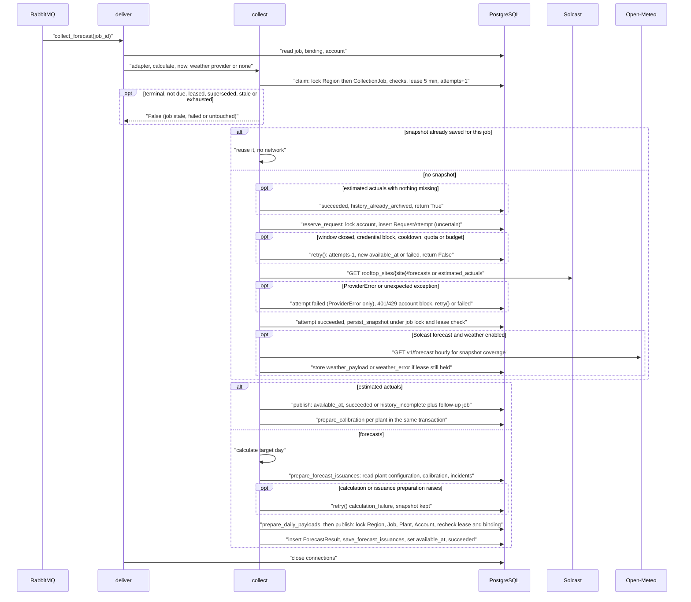

# Run a collection job: fetch the provider, store the snapshot and publish the result

A Dramatiq delivery of `collect_forecast` executes one `CollectionJob`; the dispatcher's collection phase and the container smoke script send it, and the fixture demo command calls the same `collect` function without a queue. The worker claims a five-minute lease, reserves account quota, calls Solcast (or the fixture provider) and, for Solcast forecasts, Open-Meteo, stores one `ForecastSnapshot` per job (immutable once published), then publishes a `ForecastResult` and plant `ForecastIssuance` rows (forecasts) or marks the estimated-actuals acquisition available and prepares calibration (history). Handled failures are recorded on the job row, which the dispatcher sends again when it is due; an exception that escapes leaves the row as it was (`running` until the lease expires once claimed). Dramatiq itself never retries.

## Entry points

- Actor `collect_forecast` (queue `default`, `max_retries=0`, no `time_limit`, so Dramatiq's default of 10 minutes applies) built by `src/pyracast/runtime.py` `make_actor` and consumed by `pyracast worker` (`src/pyracast/forecasts/management/commands/worker.py`, default queues `default`, `calibration`, `epias`); its function `runtime.deliver` loads the job, picks the adapter (`src/pyracast/providers.py` `adapter_for`) and the optional `OpenMeteoProvider`, then calls `src/pyracast/forecasts/jobs.py` `collect` with `calculation.calculate`.
- Senders: `runtime.dispatch` (job ids from `jobs.pending_job_ids`, see `forecast-collection-scheduling`) and `deploy/smoke.sh` (one fixture job through real RabbitMQ). `src/pyracast/forecasts/management/commands/fixture_demo.py` calls `collect` directly with `FixtureProvider` and no weather (DEBUG only).
- No HTTP endpoint, screen or admin action calls `collect` or sends the message. Approval (first job), re-validation after a 401 (`validate_binding` re-arms the latest failed forecast job) and the admin cooldown reset (`clear_provider_cooldown`) only change rows that the dispatcher then picks up; results surface through the forecast read flows.

## Sequence

## Data

| Table | R/W | What |
|---|---|---|
| `forecasts_collectionjob` | R/W | Lease token and expiry, `status`, `attempts`, `available_at`, `last_error`; follow-up history job insert on `history_incomplete`; sibling jobs read for the first slot and the concurrent-history check |
| `regions_region` | R | Row lock in `claim` and `publish` (again in `prepare_calibration`); approval, revision and approved binding in `binding_is_current` |
| `connections_sitebinding` | R | Site id, coordinates, timezone, capacities, validated credential revision |
| `connections_provideraccount` | R/W | Lock in `reserve_account_request`, `record_provider_failure` and `publish`; `authentication_failed_revision` (401) and `request_blocked_until` (429) |
| `forecasts_collectionschedule` | R | `enabled`, `times`, `effective_from` for supersession, stale checks, the forecast budget and the follow-up job status |
| `forecasts_requestattempt` | R/W | Count per account and UTC day; insert reservation (`uncertain`), then `succeeded` or `failed`; stays `uncertain` after an unexpected adapter exception |
| `forecasts_forecastsnapshot` | R/W | One per job: raw and normalized payload, coverage, weather payload or error, `available_at` at publication; archived estimated-actuals snapshots read by `missing_actuals_window` |
| `forecasts_forecastresult` | R/W | Forecast jobs only, `get_or_create` per snapshot: target-day payload plus `daily_payloads` for up to three local days |
| `plants_plant`, `plants_plantconfiguration` | R | Locked active plant of the region; current configuration for issuances |
| `plants_forecastissuance` | R/W | Frozen pre-daylight electrical outputs per plant, snapshot and target day, `get_or_create` by `src/pyracast/plants/forecast_archive.py` `save_forecast_issuances` inside `publish` |
| `plants_calibrationrun`, `plants_plantevent` | R/W | `prepare_calibration` inserts a pending run and a `calibration_scheduled` event after a succeeded estimated-actuals job (sent later by the dispatcher's calibration phase) |
| `plants_calibrationactivation`, `plants_productionobservation`, `incidents_incidentrevision`, `metering_epias*` | R | Inputs of `prepare_forecast_issuances` (active calibration, incident scenarios) and `prepare_calibration` (measurements) |

## Authorization

- No user principal: the worker trusts the job id and derives scope from job -> binding -> region; snapshot, result and issuance writes are keyed by that job, binding or region. `ProviderAccount` has no tenant, so its quota count, 401 credential block and 429 cooldown are shared by every tenant bound to the account (see `provider-quota-and-backoff`).
- `jobs.binding_is_current` (region approved, not deleted, revision equal, binding is the approved one, account enabled and authorized, validated credential revision current) runs in `claim` and again in `publish`, both under the Region lock. When a `CollectionSchedule` row exists, `claim` also requires it to be enabled and, for forecast and same-day (intraday) estimated-actuals jobs, the slot clock to be configured.
- Lease ownership (`lease_token` plus unexpired `lease_expires_at`) is rechecked under the job row lock by `persist_snapshot`, `_persist_weather` and `publish`; `retry` and the `history_already_archived` update check only the token and `status="running"`.
- `reserve_account_request` refuses a purpose outside `RequestPurpose` with a `ValidationError`, then enforces under the account lock, before any network call and in this order: history deadline, credential block, cooldown, then enabled, authorized and daily quota (all three reported as `quota_exhausted`), then the forecast budget.
- Solcast credentials are decrypted only in `SolcastProvider._request`; `site_id` must match `[A-Za-z0-9_-]{1,200}`, redirects are off and a response echoing the key is rejected (`unsafe_provider_response`). The Open-Meteo key, when configured, is attached by `_WeatherKeyTransport` and checked against the payload.
- Database: one snapshot per job, one result per snapshot, unique issuance per plant, snapshot and day, unique job per binding, endpoint and slot, and status and source-kind check constraints.

## Failure paths

| Condition | Result |
|---|---|
| Job row missing or provider not fixture/solcast | Exception escapes `deliver`; Dramatiq logs and dead-letters the message, job row untouched (a pending row is sent again every dispatcher cycle) |
| Job terminal, not yet due, actively leased, or another estimated-actuals job of the binding running | `claim` returns None, nothing written |
| `retry_until` passed at claim, at reservation or just before the request | `failed`, `history_window_closed`; after claim the attempt is refunded, and a reservation already inserted is marked `failed` but still counted |
| Three attempts used on a job without `retry_until` | `failed`, `attempts_exhausted` |
| A later configured forecast slot is due | `stale`, `forecast_superseded` |
| Binding no longer current, schedule disabled or slot no longer configured | `stale`, `last_error` unchanged |
| Estimated actuals already archived | `succeeded`, `history_already_archived`, no request |
| Credential revision blocked by an earlier 401, or account cooldown active | `failed`, `provider_authentication_failed`, or `retry`, `provider_throttled` until the block ends; attempt refunded in both |
| Daily quota exhausted (or account disabled or unauthorized after claim), or a history request would eat the reserved forecast budget | `retry`, `quota_exhausted` (next UTC midnight) or `history_budget_reserved`, attempt refunded; windowed job `failed` once the retry time reaches `retry_until` |
| Provider HTTP 401 | `failed`, `provider_authentication_failed`; account blocked for that credential revision |
| Provider HTTP 429 | `retry`, `provider_throttled` (attempt not refunded; `failed` on the third without `retry_until`, a windowed job once the next retry reaches `retry_until`); account cooldown from `Retry-After`, default 900 s |
| Transport error, non-JSON body, 408, 425, 5xx except 501/505, undecryptable key, invalid site id, unsafe response | `retry`, `provider_failure`; `failed` after the third attempt without `retry_until`, a windowed job once the next retry reaches `retry_until` |
| Other HTTP status (3xx, 403, 404, 501, 505) or invalid payload schema or interval | `failed`, `provider_failure` |
| Unexpected adapter exception | `retry`, `provider_unexpected_failure` (same attempt and window limits); the attempt stays `uncertain` |
| Open-Meteo failure | Snapshot `weather_error` code; publication continues with an unavailable weather reference |
| Lease lost before the snapshot write | Returns False; job stays `running` until lease expiry, response discarded, request still counted |
| Lease lost before the weather write | Returns False; the snapshot keeps `weather_acquisition_interrupted` and the next claim reuses it without asking Open-Meteo again |
| Snapshot source kind differs from the endpoint, or the target-day calculation or issuance preparation raises | `retry`, `invalid_source_kind` or `calculation_failure`; snapshot reused without a new request. A failing supplemental day in `prepare_daily_payloads` is only logged and left out of `daily_payloads`; publication continues |
| Lease lost at publication, or binding no longer current there | False and reclaimed after expiry with the snapshot reused, or `stale` with the snapshot kept unpublished |
| Estimated actuals still incomplete after publication | `succeeded`, `history_incomplete`; new job 30 minutes later if before `retry_until` |
| Uncaught exception after claim (5 s lock timeout in any step, or issuance save or calibration preparation inside the publish transaction) | Open transaction rolls back; exception reaches Dramatiq; job stays `running` until lease expiry |

## Rules and invariants

- Lock order: `claim` takes Region then CollectionJob; `publish` takes Region, CollectionJob, Plant, ProviderAccount (`prepare_calibration` re-locks Region and Plant inside it); `retry`, `persist_snapshot` and `_persist_weather` lock only the job; quota reservation locks only the account. No transaction is open during Solcast or Open-Meteo calls.
- Lease is `LEASE_DURATION` (5 minutes), shorter than Dramatiq's 10-minute time limit, so a worker may still run after its lease expired; the lease rechecks stop it from writing. Every step adds monotonic elapsed time to `now`. Claiming a windowed job moves `available_at` forward by 5 minutes (intraday) or 30 minutes (nightly), so a crashed worker cannot trigger another request sooner.
- `claim` increments `attempts`; quota and admission waits (`quota=True`, `waiting=True`) give it back. Jobs without `retry_until` stop after three attempts; windowed estimated-actuals jobs stop when the next `available_at` would reach `retry_until`. Non-retryable errors fail at once.
- Backoff (`provider_retry.next_retry_at`): max of `30*2^min(attempts,6)` s, the minimum and `Retry-After`, plus 0-30 s jitter, capped at `MAX_RETRY_AT`. Retryable provider errors other than 429 on forecast jobs use at least `120*2^attempts` s (4 then 8 minutes); intraday windows the same; nightly windows 30 minutes. A `provider_throttled` retry is claimable early once the account cooldown has been cleared.
- The `RequestAttempt` reservation commits before the request and always counts toward the UTC-day quota, whatever its outcome. Idempotency: the snapshot is reused on every later attempt with no network call; result, issuances, follow-up job and `available_at` are written with get-or-create or null-guarded updates.
- Weather only for Solcast forecast jobs with `PYRACAST_WEATHER_ENABLED`; the snapshot is saved first with `weather_acquisition_interrupted` and weather is attached only while it is unpublished and leased. Weather never reserves Solcast quota.
- Issuances are prepared outside locks (`prepare_forecast_issuances`) and saved by `save_forecast_issuances` only when the locked plant's current configuration still matches and publication precedes the day's first daylight (`forecast_cutoff`). An approval-created first forecast job may run outside configured clocks (see `claim`).

## Tests

- `tests/test_jobs.py`: duplicate delivery, lease takeover, expired lease, snapshot reuse, quota and backoff, stale binding, publication locks. `tests/test_collection_resilience.py`, `tests/test_collection_review_regressions.py`, `tests/test_collection_dispatch_isolation.py`, `tests/test_provider_retry.py`: attempt budget, 401/429 blocks, permanent failures, supersession, outage recovery.
- `tests/test_nightly_solcast.py`, `tests/test_collection_calendar_windows.py`: windowed history, `history_incomplete`, deadlines. `tests/test_weather_collection.py`, `tests/test_weather_provider.py`, `tests/test_providers.py`: weather archive, gating in `deliver`, adapters.
- `tests/test_forecast_archive_publication.py`, `tests/test_provisional_calibration.py`: issuances and calibration preparation after history. Delivery: `tests/test_runtime.py` (stub broker), `tests/test_live_queue.py` (real RabbitMQ on a test queue, skipped unless `PYRACAST_LIVE_QUEUE=1`), `deploy/smoke.sh`.
- Gaps: no test for `deliver` with a missing job (only `claim`) or an unsupported provider (only `adapter_for`), nor for an exception raised inside `publish` by `prepare_calibration`. No Playwright coverage (no UI).
