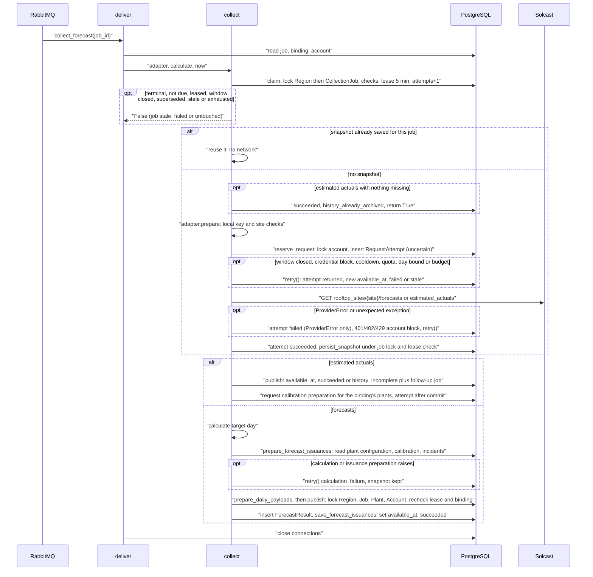

# Run a collection job: fetch the provider, store the snapshot and publish the result

A Dramatiq delivery of `collect_forecast` executes one `CollectionJob`; the dispatcher's collection phase and the container smoke script send it, and the fixture demo command calls the same `collect` function without a queue. The worker claims a five-minute lease, reserves account quota, calls Solcast (or the fixture provider), stores one `ForecastSnapshot` per job (acquisition immutable once stored), then publishes a `ForecastResult` and plant `ForecastIssuance` rows (forecasts) or marks the estimated-actuals acquisition available and asks for calibration preparation (history). Every handled failure after the claim is recorded on the job row through `retry`, which the dispatcher sends again when it is due; an exception outside `collect` leaves the row as it was (`running` until the lease expires once claimed). Dramatiq itself never retries.

## Entry points

- Actor `collect_forecast` (queue `default`, `max_retries=0`, time limit `deadlines.TIME_LIMIT` = lease minus a 90 s margin) is `orchestration.kinds.COLLECTION`, consumed by `pyracast worker` (`src/pyracast/orchestration/management/commands/worker.py`, default queues `default`, `calibration`, `epias`). Its function `forecasts/runtime.py` `deliver` loads the job (a missing job returns quietly), picks the adapter (`src/pyracast/providers.py` `adapter_for`), then calls `forecasts/jobs/collect.py` `collect` with `calculation.calculate` and `plants.publication.PUBLICATION`.
- Senders: `dispatch_collections` (job ids from `jobs.ready.pending_job_ids`, see `forecast-collection-scheduling`) and `deploy/smoke.sh` (one fixture job through real RabbitMQ). `forecasts/management/commands/fixture_demo.py` calls `collect` directly with `FixtureProvider` (DEBUG only).
- No HTTP endpoint, screen or admin action calls `collect` or sends the message. Approval (first job), validation after a 401 or a key replacement (`validate_binding`, also run by the automatic revalidation, re-arms the latest forecast job refused for the key unless it is older than the due slot) and the console delay reset (`clear_provider_cooldown`) only change rows that the dispatcher then picks up; results surface through the forecast read flows.
- Modules: `src/pyracast/forecasts/jobs/claim.py` (`claim`, `retry`), `src/pyracast/forecasts/jobs/collect.py`, `src/pyracast/forecasts/jobs/publish.py` (`publish`, the `PublicationHooks` protocol), `src/pyracast/forecasts/jobs/ready.py`.

## Sequence

## Data

| Table | R/W | What |
|---|---|---|
| `forecasts_collectionjob` | R/W | Lease token and expiry (kept only with `running`, `collectionjob_lease_chk`), `status`, `attempts`, `available_at`, `last_error`; follow-up history job insert on `history_incomplete`; sibling jobs read for the first slot and the concurrent-history check |
| `regions_region` | R | Row lock in `claim` and `publish`; approval, revision and approved binding in `binding_is_current` |
| `connections_sitebinding` | R | Site id, coordinates, timezone, capacities, validated credential revision |
| `connections_provideraccount` | R/W | Lock in `reserve_account_request`, `record_provider_failure` and `publish`; `authentication_failed_revision` (401) and `request_blocked_until` (402, 429) |
| `forecasts_collectionschedule` | R | `enabled`, `times`, `effective_from` through `forecast_timing`: supersession, stale checks, the day bound, the forecast budget and the follow-up job status |
| `forecasts_requestattempt` | R/W | Count per account and UTC day; insert reservation (`uncertain`), then `succeeded` or `failed` with the provider's `http_status`; stays `uncertain` after an unexpected adapter exception |
| `forecasts_forecastsnapshot` | R/W | One per job: raw and normalized payload, coverage, `available_at` at publication. Trigger `forecastsnapshot_publication_guard`: before publication only `available_at` changes, after it nothing. Archived estimated-actuals snapshots read by `missing_actuals_window` |
| `forecasts_forecastresult` | R/W | Forecast jobs only, `get_or_create` per snapshot: target-day payload plus `daily_payloads` for up to three local days |
| `plants_plant`, `plants_plantconfiguration` | R/W | Locked active plant of the region; current configuration for issuances; `calibration_preparation_due_at` set after published actuals |
| `plants_forecastissuance` | R/W | Frozen pre-daylight electrical outputs per plant, snapshot and target day, `get_or_create` by `src/pyracast/plants/forecast_archive.py` `save_forecast_issuances` inside `publish` |
| `plants_calibrationrun`, `plants_plantevent` | R/W | The after-commit preparation (`plants/preparation.py`) inserts a pending run and a `calibration_scheduled` event; what it leaves is prepared by the dispatcher's calibration phase |
| `plants_calibrationactivation`, `plants_productionobservation`, `incidents_incidentrevision`, `metering_epias*` | R | Inputs of `prepare_forecast_issuances` (active calibration, incident scenarios) and calibration preparation (measurements) |

## Authorization

- No user principal: the worker trusts the job id and derives scope from job -> binding -> region; snapshot, result and issuance writes are keyed by that job, binding or region. `ProviderAccount` has no tenant, so its quota count, 401 credential block and 402/429 cooldown are shared by every tenant bound to the account (see `provider-quota-and-backoff`).
- `connections.currency.binding_is_current` (region approved, not deleted, revision equal, binding is the approved one, account enabled and authorized, validated credential revision current) runs in `claim` and again in `publish`, both under the Region lock. When a `CollectionSchedule` row exists, `claim` also requires it to be enabled and, for forecast and same-day (intraday) estimated-actuals jobs, the slot clock to be configured.
- Lease ownership (`lease_token` plus unexpired `lease_expires_at`) is rechecked under the job row lock by `persist_snapshot` and `publish`; `retry` and the `history_already_archived` update check only the token and `status="running"`.
- `reserve_account_request` enforces under the account lock, before any network call and in this order: history deadline, credential block, cooldown (`quota.deferral`), account enabled and authorized, daily quota, then for forecasts the binding's day bound and for estimated actuals the forecast budget.
- Solcast credentials are decrypted only in `SolcastProvider.prepare` and `_request`; `site_id` must match `SITE_ID_PATTERN`, redirects are off, the answer is size- and time-bounded and a response echoing the key is rejected (`unsafe_provider_response`).
- Database: one snapshot per job, one result per snapshot, unique issuance per plant, snapshot and day, unique forecasts or estimated-actuals job per binding, endpoint and slot, and status, lease and source-kind check constraints.

## Failure paths

| Condition | Result |
|---|---|
| Job row missing | `deliver` returns quietly |
| Provider not fixture or solcast, or a fixture account while `PYRACAST_FIXTURE_PROVIDER` is off | `adapter_for` raises in `deliver` (`fixture_provider_disabled` for the latter); Dramatiq logs it, job row untouched (a pending row is sent again every dispatcher cycle) |
| Job terminal, not yet due, actively leased, or another estimated-actuals job of the binding running | `claim` returns None, nothing written |
| `retry_until` passed at claim | `failed`, `history_window_closed`; no attempt taken |
| `retry_until` passed at reservation or just before the request | `failed`, `history_window_closed`; the attempt is returned, and a reservation already inserted is marked `failed` but still counted |
| Three attempts used on a job without `retry_until` | `failed`, `attempts_exhausted` (checked after supersession) |
| A later configured forecast slot is due | `stale`, `forecast_superseded` |
| Binding no longer current, schedule disabled or slot no longer configured | `stale`, `binding_not_current`, `schedule_disabled` or `slot_not_configured` |
| Estimated actuals already archived | `succeeded`, `history_already_archived`, no request |
| Key or site check of `adapter.prepare` fails | `failed`, `provider_configuration_invalid`; no ledger request |
| Credential revision blocked by an earlier 401 | `failed`, `provider_authentication_failed`; attempt returned |
| Account wait active (429 or 402) | `retry`, `provider_throttled`, until the wait ends; attempt returned; a windowed job is `failed` once that reaches `retry_until` |
| Account disabled or unauthorized after claim | `retry`, `account_unavailable`, at the next provider day; windowed job `stale` once that passes `retry_until` |
| Daily quota used | `retry`, `quota_exhausted` at the next provider day; attempt returned; windowed job `stale` once that passes `retry_until` |
| Forecast job beyond the binding's day bound, or collection disabled after the claim | `stale`, `quota_exhausted` or `schedule_disabled`; attempt returned |
| Estimated-actuals request would eat the reserved forecast budget | `retry`, `history_budget_reserved`, no sooner than 30 min; attempt returned; `stale` once that reaches `retry_until` |
| Provider 401 | `failed`, `provider_authentication_failed`; account blocked for that credential revision |
| Provider 402 | `retry`, `provider_allowance_exhausted`, at the next provider day; the account is blocked until then |
| Provider 429 | `retry`, `provider_throttled` (attempt kept; `failed` on the third without `retry_until`, a windowed job once the next retry reaches `retry_until`); account cooldown from `Retry-After`, default 900 s |
| Provider 403 or 404 | `failed`, `provider_access_denied` or `provider_site_not_found` |
| Other 3xx/4xx status, 501, 505 | `failed`, `provider_failure` (`provider_server_error` for 501 and 505) |
| Answer with an invalid schema or interval, oversized, or echoing the key | `failed`, `provider_invalid_response`; no second request |
| Transport error, non-JSON or undecodable body, 5xx except 501/505, 408, 425 | `retry`, `provider_unreachable`, `provider_invalid_response`, `provider_server_error` or `provider_failure`; `failed` after the third attempt without `retry_until`, a windowed job once the next retry reaches `retry_until` |
| Unexpected adapter exception | `retry`, `provider_unexpected_failure` (same attempt and window limits); the attempt stays `uncertain` |
| Lease lost before the snapshot write | Returns False; job stays `running` until lease expiry, response discarded, request still counted |
| Snapshot source kind differs from the endpoint, or the target-day calculation or issuance preparation raises | `retry`, `invalid_source_kind` or `calculation_failure`; snapshot reused without a new request. A failing supplemental day in `prepare_daily_payloads` is only logged and left out of `daily_payloads`; publication continues |
| Lease lost at publication, or binding no longer current there | False and reclaimed after expiry with the snapshot reused, or `stale` with the snapshot kept unpublished |
| Estimated actuals still incomplete after publication | `succeeded`, `history_incomplete`; new job 30 minutes later if before `retry_until` |
| Lock timeout or deadlock inside `claim` | The delivery ends normally with `job_claim_contended` (`worker-runtime`); the job row is untouched and published again while it stays eligible |
| Other database error inside `claim` | The exception escapes `deliver`; the job row is untouched |
| Database error after the claim | `retry`, `lock_contention` (lock timeout or deadlock: attempt returned when nothing was reserved, otherwise counted) or `publication_failure`; the open transaction rolls back |
| Any other exception after the claim | `retry`, `publication_failure`, logged without its message |

## Rules and invariants

- Lock order: `claim` takes Region then CollectionJob; `publish` takes Region, CollectionJob, Plant (`PublicationHooks.lock`), ProviderAccount; `retry` and `persist_snapshot` lock only the job; quota reservation locks only the account. Preparation after commit takes Tenant, Region and Plant in its own transaction. No transaction is open during a provider call.
- Lease is `LEASE_DURATION` (5 minutes); the actor's time limit (`TIME_LIMIT`, 3.5 minutes) leaves a margin for the last statement, so an interrupted worker is gone before its lease ends, and the lease rechecks stop a late one from writing. Every step adds monotonic elapsed time to `now` (`background.clock.Clock`). Claiming a windowed job moves `available_at` forward by 5 minutes (intraday) or 30 minutes (nightly), so a crashed worker cannot trigger another request sooner.
- `claim` increments `attempts` (`background.lease.take`); waits for the provider, a closed window and skips give it back. Jobs without `retry_until` stop after `PROVIDER_JOB.max_attempts` (three); windowed estimated-actuals jobs stop when the next `available_at` would reach `retry_until`. Non-retryable errors fail at once.
- Backoff (`provider_retry.next_retry_at`): max of `30*2^min(attempts,6)` s, the minimum and `Retry-After`, plus 0-30 s jitter, capped at `MAX_RETRY_AT`. Retryable provider errors on forecast jobs use at least `120*2^min(attempts,6)` s; intraday windows the same; nightly windows 30 minutes. A `provider_throttled` retry is claimable early once the account cooldown has been cleared.
- The `RequestAttempt` reservation commits before the request and always counts toward the UTC-day quota, whatever its outcome. Idempotency: the snapshot is reused on every later attempt with no network call; result, issuances, follow-up job and `available_at` are written with get-or-create or null-guarded updates.
- Publication reaches plants only through `PublicationHooks` (`plants.publication.PUBLICATION`): `prepare` issuances outside locks, `lock` the plant, `save` the archive, and `actuals_published` records calibration preparation requests for the binding's plants in the publish transaction. Issuances are saved only when the locked plant's current configuration still matches and publication precedes the day's first daylight. An approval-created first forecast job may run outside configured clocks (see `claim`).

## Tests

- `tests/test_jobs.py`: duplicate delivery, lease takeover, expired lease, snapshot reuse, quota and backoff, stale binding, publication locks. `tests/test_collection_failures.py` (one outcome per provider answer, 402, unreachable and invalid answers, lock timeouts, missing job, account disabled, supersession before the attempt limit), `tests/test_collection_resilience.py`, `tests/test_collection_review_regressions.py`, `tests/test_collection_dispatch_isolation.py`, `tests/test_provider_retry.py`: attempt budget, 401/429 blocks, permanent failures, supersession, outage recovery. `tests/test_job_leases.py`, `tests/test_job_lease_invariants.py`, `tests/test_archive_invariants.py` (snapshot publication guard).
- `tests/test_claim_contention.py`: a delivery behind a held region lock ends and collects once released.
- `tests/test_nightly_solcast.py`, `tests/test_collection_calendar_windows.py`: windowed history, `history_incomplete`, deadlines. `tests/test_providers.py`: adapters.
- `tests/test_forecast_archive_publication.py`, `tests/test_provisional_calibration.py`: issuances and calibration preparation after history. Delivery: `tests/test_runtime.py` (stub broker), `tests/test_job_kinds.py`, `tests/test_live_queue.py` (real RabbitMQ on a test queue, skipped unless `PYRACAST_LIVE_QUEUE=1`), `deploy/smoke.sh`.
- Gaps: no test for an unsupported provider in `deliver` (only `adapter_for`). No Playwright coverage (no UI).
