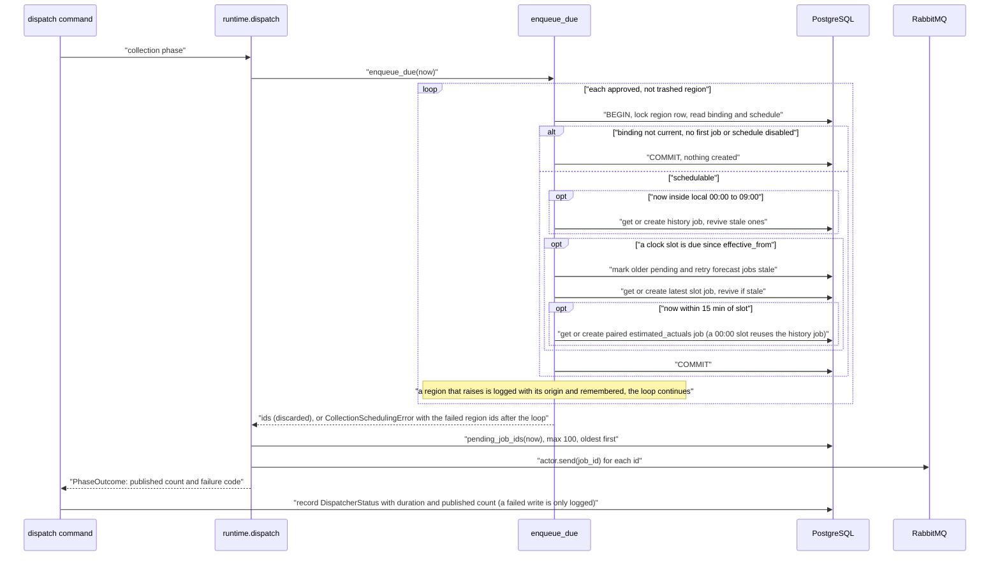

# Forecast collection scheduling and publishing of due jobs

The `pyracast dispatch` loop (every 30 s in production) runs the `collection` phase. It creates slot-unique `CollectionJob` rows per approved region: inside the local night window the daily history job, then, when a forecast clock is due, the job for the latest due clock and its intraday estimated-actuals pair. It then sends up to 100 due job ids, oldest `available_at` first, to the `collect_forecast` Dramatiq actor. Execution (claim, fetch, publish) is the `forecast-collection-execution` flow.

## Entry points

- Command: `src/pyracast/forecasts/management/commands/dispatch.py` `Command.handle` runs `notifications`, `collection`, `calibration`, `retention`, `metering` in this order, once or with `--loop --poll-seconds` (default 60). Production: `deploy/compose.yaml` (`--poll-seconds 30`).
- Phase: `src/pyracast/runtime.py` `dispatch(actor)` (`now` is taken once, so jobs created this cycle are due in the same cycle, but are sent only if they fit the 100-id cap). Scheduling: `src/pyracast/forecasts/scheduler.py` `enqueue_due(now)` -> `_enqueue_region`, using `forecasts/timing.py` (`effective_forecast_schedule`, `latest_forecast_slot`) and `collection_window.py` `nightly_window`. Publishing: `src/pyracast/forecasts/jobs.py` `pending_job_ids(now, limit=100)`.
- Inputs created elsewhere: `regions/operations.py` `approve_region` (the first job), `forecasts/schedule.py` `configure_schedule` (flow `collection-schedule`), and follow-up history jobs from `jobs.py` `publish` (execution flow). No screen, endpoint or user actor.

## Sequence

## Data

| Table | R/W | What |
| --- | --- | --- |
| `regions_region` | R | Approved, not trashed regions; `FOR UPDATE` row lock per region; `approved_binding`, `revision`, `timezone` |
| `connections_sitebinding` | R | `validated_at`, `region_revision`, `validated_credential_revision` |
| `connections_provideraccount` | R | `enabled`, `authorized_at`, `credential_revision`, `daily_quota` (trims clocks), `request_blocked_until` (publishing) |
| `forecasts_collectionschedule` | R | `enabled`, `times`, `effective_from`; no row means one clock at `PYRACAST_CUTOFF_LOCAL` |
| `forecasts_collectionjob` | R/W | Slot jobs via `get_or_create`; `status` moves to `stale` or back to `pending` |
| `forecasts_forecastsnapshot` | R | Only to skip reviving history jobs that already have a snapshot |
| `forecasts_dispatcherstatus` | R/W | Per-phase attempt, success and error class, upserted by the command (`update_or_create`); no `RequestAttempt` here, quota is reserved at execution |

## Authorization

None. A system process with direct database access and no tenant context. Scope is "approved and not trashed" plus `validated_at` set and `binding_is_current` in `forecasts/jobs.py` (region approved, not trashed, same revision and binding; account enabled and authorized; credential revision validated). `claim` rechecks `binding_is_current` and the schedule at execution.

## Failure paths

| Condition | Result |
| --- | --- |
| Naive `now` or `cutoff_hour` outside 0-23 | `ValidationError` for direct callers; `dispatch` always passes an aware `now` and no `cutoff_hour` |
| One region raises (lock wait over 5 s, DB error) | That region rolls back and `collection_region_scheduling_failed region_id=<id> error_type=<class> origin=<location>` is logged; others continue; after the loop `CollectionSchedulingError` carries the failed region ids |
| `enqueue_due` raised | `dispatch` closes unusable connections, still sends pending ids and returns the published count with `collection_regions_failed:<count>` (or the class name of any other error, logged as `collection_scheduling_failed`) |
| Broker or `pending_job_ids` fails | `collection_publish_failed` is logged with the ids sent so far; the outcome keeps an earlier scheduling code, otherwise records the class name; ids already sent stay sent, the rest stay due |
| Phase failed | Command logs `dispatch_phase_failed` for a raising phase, stores the failure code in `DispatcherStatus.last_error` (unhealthy in `delivery_health`), runs the remaining phases; one-shot mode ends with `CommandError`. If recording the status itself fails, the row stays unchanged, `dispatch_monitoring_failed` is logged, later phases still run and one-shot mode also ends with `CommandError` |
| No approval job, stale binding, disabled schedule | Region skipped silently; leftover jobs are still published and closed by `claim` |

## Rules and invariants

- Idempotency: `unique_collection_slot` (binding, endpoint, scheduled_slot; non-import jobs) plus the region row lock. Repeated or concurrent dispatchers create no duplicates.
- Only the latest slot of yesterday and today is scheduled, so a long outage collapses to one job. A newer slot marks older `pending` and `retry` forecast jobs `stale` (`forecast_superseded`); `running` jobs are untouched.
- `first_slot` is the earliest forecast job, normally the off-clock approval job. `effective_from` is the later of it and `schedule.effective_from`, so neither approval nor edits backfill earlier slots.
- Forecast clocks are trimmed to `daily_quota - 1`; one request per day is reserved for history. With `daily_quota` 1 only history is scheduled.
- Night window: local 00:00 (first valid half-hour if DST skips it) to 09:00. One history job per local night for yesterday with `retry_until` at the window end; an existing job with that deadline is reused. A disabled schedule stops new night work.
- The paired actuals job exists only if scheduling runs within 15 minutes of the slot. A 00:00 clock slot equals the night window start, so the pair's `get_or_create` (same binding, endpoint and slot) returns the history job created just before: no separate intraday job, target date stays yesterday and the deadline stays 09:00. Revival resets `status`, lease and `available_at` but keeps `attempts` and `last_error`.
- Publishing is at-least-once and capped: each cycle resends the first 100 due ids ordered by (`available_at`, pk) without dedup, so a backlog drains over later cycles; `claim` (lease plus region lock) makes duplicates harmless. The actor has `max_retries=0`; retry policy lives in the database. `pending_job_ids` skips trashed regions, wakes throttled `retry` jobs once the account cooldown is cleared and republishes `running` jobs whose lease expired and whose `available_at` has passed.

## Tests

- `tests/test_jobs.py`: dedup and missed-slot recovery, unapproved or unvalidated binding, naive `now` and invalid `cutoff_hour`, concurrent approvals.
- `tests/test_collection_dispatch_isolation.py`: pending ids sent after scheduler failure, contended region isolated. `tests/test_runtime.py`: schedule before send, repeated sends. `tests/test_dispatch_resilience.py`, `tests/test_dispatch_recovery.py`: command phases and reconnect (collection phase mocked).
- `tests/test_collection_resilience.py` (slot collapse, supersession), `tests/test_cutoff.py` (DST), `tests/test_collection_window.py`, `tests/test_nightly_solcast.py` (night window, revival), `tests/test_collection_schedule.py` (paired jobs, concurrent daytime schedulers, history revival keeps attempts), `tests/test_collection_calendar_windows.py` (durable same-slot pair).
- Gaps: no test of the 100-id limit or ordering of `pending_job_ids`, nor of a forecast clock of 00:00 sharing the history slot. No Playwright test; the flow has no UI.
