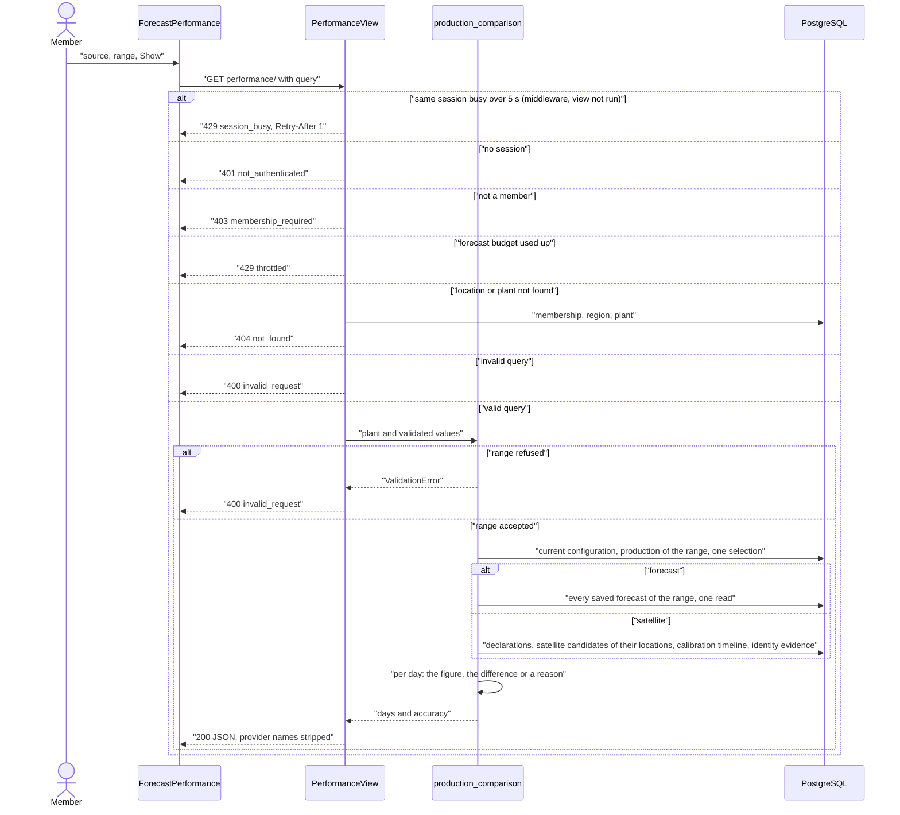

# Compare measured production with forecasts

A workspace member opens Production > Comparison on a plant, picks "Forecast" or "Satellite data" and a date range of past days. The API puts each day's actual production beside the figure the forecast screen shows for that day and source and returns per-day results, accuracy figures and a reason for every day not compared. No domain row is written and no provider is contacted; only session bookkeeping is written.

## Entry points

- Screen: `web/src/features/forecast/forecast-performance.tsx` `ForecastPerformance` (form) and `PerformanceResults` (`useApiQuery`, no poll), loaded on demand and mounted by `features/plant/workspace/production-section.tsx` `ProductionSection` on tab `production`, view `comparison`, keyed by configuration id.
- Form: two tabs named as the forecast screen's sources, "Forecast" (default) and "Satellite data" (Turkish "Tahmin", "Uydu verisi"), sent as `data_source`; a start and an end date (the end date ends yesterday in the plant time zone) and the button "Show", with "Up to 90 days." (`range_limit`) on its own line under them, describing both date inputs. A tab change loads at once with the form's dates.
- Results: "Absolute error as % of production", "Days compared", "Mean absolute daily error" and "Average daily difference" with its sign in the value ("+0.42 MWh", "−0.42 MWh") and its meaning under it ("Forecast too high" or "Forecast too low"; "Satellite data too high" or "Satellite data too low"). "Includes EPİAŞ real-time production." stands above the results, and a compared day's status reads "Real-time (EPİAŞ)", when a compared day has `provisional_production`. The table of compared days has Date, Status, "Actual (MWh)", "Forecast (MWh)" or "Satellite data (MWh)" and "Forecast − actual (MWh)" or "Satellite data − actual (MWh)". "Days not compared ({count})" counts `requested_days - matched_days` and shows whenever the answer has requested days: as the summary of the reasons with their dates when there are reasons, as plain text otherwise (also with 0).
- CSV: `ui/csv-download.tsx` `CsvDownload` (file names and columns in `csv-export`); the chart of absolute daily error is `features/forecast/daily-accuracy-chart.tsx`.
- `GET /api/tenants/{t}/regions/{r}/plants/{p}/performance/` -> `pyracast.plants.api.PerformanceView.get` -> `pyracast.plants.performance.production_comparison`. Query (`PerformanceQuery`): `start_date`, `end_date`, `data_source` (`forecast` default, `satellite`). Actors: administrator and viewer; no command, script or job.

## Sequence

## Data

| Table | R/W | What |
| --- | --- | --- |
| `django_session`, `usersessions_usersession` | R/W | `SessionLifetime` records activity at most once per 60 s; other requests only read the session |
| `accounts_membership`, `regions_region`, `plants_plant`, `plants_plantsubmission` | R | Membership, active region of the tenant (its zone counts the plant's days), plant of that region (joined with its submission) |
| `plants_plantconfiguration`, `connections_sitebinding`, `connections_provideraccount` | R | Current configuration and binding (zone and location of the production days); for satellite data every declaration of the plant |
| `plants_productionobservation`, `metering_epiasconnection`, `metering_epiassnapshot`, `metering_epiascollectionjob`, `incidents_plantincident`, `incidents_incidentrevision` | R | Production of the range under `MEASUREMENT_POLICY`; outage overlay; for satellite data the production identity of the calibrations |
| `plants_forecastissuance`, `forecasts_forecastsnapshot`, `forecasts_collectionjob` | R | Forecast: every forecast saved for the range's days (snapshot payload columns not loaded) and the approval job of each binding |
| `forecasts_forecastsnapshot`, `forecasts_collectionjob`, `forecasts_referencecapacitynormalization`, `plants_calibrationactivation`, `plants_calibrationrun` | R | Satellite: archived actual candidates of every location the declarations use, with their normalization lineage; the calibration timeline |

## Authorization

- Route policy: `ROUTE_POLICIES` in `pyracast.api.permissions` marks the route member access with the `forecast` throttle; `RoutePolicy` runs before the view. Any role reads. `ScopedView.plant_queryset` then requires the region in the URL tenant, not trashed, and the plant in the region; the query is validated only after that, so an outsider gets 403 before any 400.
- The response passes `CustomerJSONRenderer` (`public_source_data`), which drops provider-named keys and rewrites technical strings; `PerformanceOutput` serializes the answer and documents the schema.

## Failure paths

| Condition | Result |
| --- | --- |
| Same session has another request running for over 5 s (middleware, before the view) | 429 `session_busy`, `Retry-After: 1`; the client waits at most 2 s and repeats once |
| No session | 401 `not_authenticated` with `WWW-Authenticate: Session` |
| Not a member | 403 `membership_required` |
| More than 60 reads a minute in the `forecast` scope (shared with both forecast reads) | 429 `throttled` with `retry_after` |
| Location unknown, of another tenant or trashed; plant not in it | 404 `not_found` |
| Unknown query key, bad date, a source other than `forecast` or `satellite`, a blank or repeated `data_source` | 400 `invalid_request` with `fields`, or a message for an unknown key |
| One date only; not 1 to 90 days; start before today - 366; end today or later | 400 `invalid_request` ("Enter both the start and the end date.", "Choose a date range of 1 to 90 days, before today and within the past year.") |
| A stored outage revision of the range cannot be decoded | 400 `calculation_out_of_range`; one `forecast_read_fault` warning (step `production`) naming the record |
| No current configuration | 200, `configuration_id` null, every day `incomplete_or_invalid_day` |
| Day without a production total (daylight not covered) | Not compared: `incomplete_or_invalid_day`, whatever the figure |
| Day without a saved forecast; without satellite data | Not compared: `forecast_not_available`; `estimated_actuals_not_available` |
| Day whose saved forecasts all cannot be decoded (one `forecast_read_fault` warning each, step `candidates`), whose satellite data cannot be decoded or calculated (one warning, step `performance`), or whose figure has no complete daylight total | Not compared: `invalid_forecast_data`; the other days are still compared |
| `local_day_bounds` or `daylight_window` raises for a local date the timezone skips | 500 `server_error` with `request_id`: outside the per-day guard. Read from code, not reproduced |
| Statement over 60 s | 503 `request_timeout` with `request_id` |
| First request fails in the browser | Error `Notice` with the API message |
| Later request for the same query fails | Previous result kept with a "Could not refresh" alert and a retry |

## Rules and invariants

- Domain data is read-only: no transaction, no row lock (`ATOMIC_REQUESTS` off); the request holds only the per-session advisory lock of `SessionRequestSerialization`. One `now` pins every "known by" filter. Past days are counted from the plant's day in its region's zone (`plants.production.plant_today`), as in the forecast read; each day's bounds and daylight use the current binding's zone (the region's without a configuration), which the answer names as `timezone`. Without dates the range is the 30 days ending yesterday.
- Actual production is the day total of `plants.production.native_production_days` (`MEASUREMENT_POLICY`), read once for the range: null unless every daylight window is covered (the whole day on a polar night), so a missing day never becomes a zero error while a day of zero production is compared. `provisional_production` marks a day that rests on an EPİAŞ real-time hour.
- The figure is the one the forecast screen shows for the day at 60 minutes (`forecast-view`): for `forecast` its "Best forecast" (`plants.forecast_choice.best_forecast`), for `satellite` its satellite data (`plants.satellite_data`); the daylight total of a complete day (`forecast_choice.day_total`). The comparison holds no selection rule of its own.
- A day is `matched` when both totals exist; `error_mwh` is figure minus actual. `relative_error` is the sum of absolute daily errors over the actual production of the matched days (null when that is zero); `daily_mae_mwh` and `daily_bias_mwh` are the mean absolute and mean signed daily error. `forecast_id` and `calibration_id` name what the figure came from.
- `production_comparison` reads at most a fixed number of queries for any range (5 for `forecast`, 11 for `satellite`): the saved forecasts in one query; the satellite candidates of every location in two (single-snapshot and native) with their normalization lineage (`forecasts.sources.with_normalization`); the calibration timeline once and the identity evidence of all its runs in one query, each run's part scoped to its evidence ids, configuration, source kinds and the plant's EPİAŞ connection (`plants.measurements.current_production_identities`).
- The frontend sends no dates on the first load and the form's dates afterwards. Results are cached per request, so resubmitting an unchanged form does not refetch. Loading shows a status line.

## Tests

- `tests/test_production_comparison.py`: each compared day equals the forecast read of that day and source (`selection_mode=best` for Forecast), reasons, accuracy, a calibrated satellite day, a day of zero production, a saved forecast or satellite day without a complete daylight total, a fixed query ceiling for 10 and 90 days, access (401, 403, 404), the range and refused keys and values. `tests/test_forecast_choice.py`: real-time production compared with the saved forecast nearest to it; Best against Automatic. `tests/test_forecast_read_faults.py`: one damaged day leaves the others compared. `tests/test_forecast_contract.py` and `tests/test_forecast_read_contract.py`: the schema and the documented envelope. `tests/test_route_policy.py`, `tests/test_api_throttling.py`: access and budget.
- `web/tests/production-comparison.spec.ts` (both names in Turkish, the range's limit describing both dates, the signed difference and the real-time mark, days not compared, a failed refresh kept until a retry), `web/tests/workspace.spec.ts` (loading, CSV hidden while loading, metrics, days not compared and the selected range), `web/tests/exports.spec.ts` (the comparison file in both sources): mocked routes. `web/tests/outages.spec.ts` stubs the endpoint.
- `tests/test_solar.py` pins the daylight windows behind every day: Turkish locations bit-identical over a year, every horizon crossing at New York, Kolkata, Tromsø, the North Pole and near both poles, daylight and nights shorter than the scan step down to a few seconds, a sunset at the start of the day, Astral events within a second of midnight kept by exactly one day, a late Astral event replaced by the crossing, Astral events the scan contradicts at high latitudes, and a property over every latitude against a sampled zenith.
- Gaps: no polar location through this route, no test of the 500 paths, no test against the real API.
