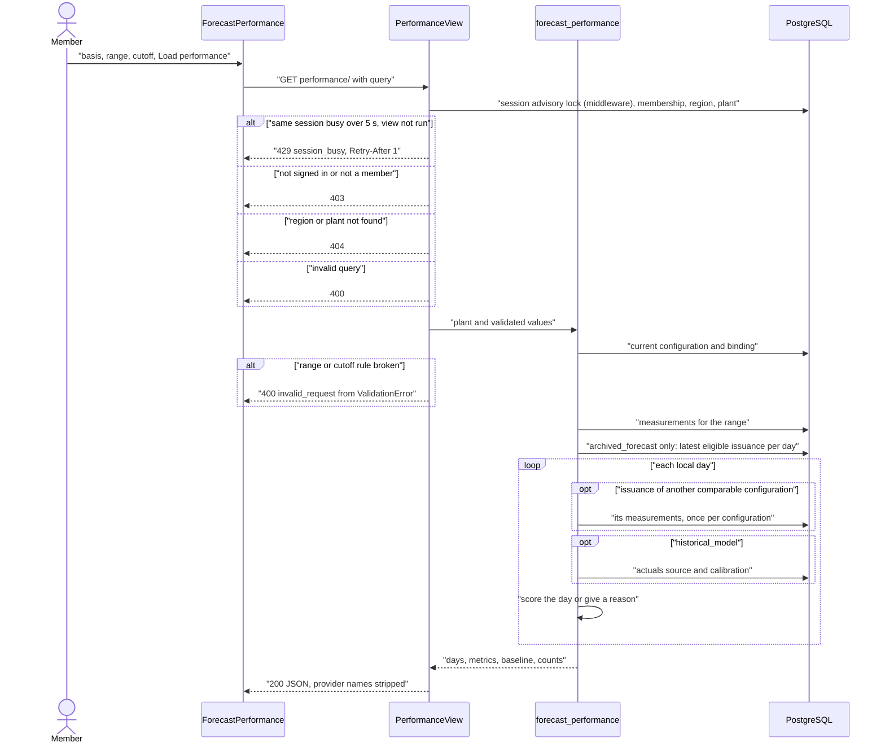

# Compare measured production with forecasts

A workspace member opens Production > Comparison on a plant, picks a basis (historical model or archived forecast), a date range and optionally a previous-day cutoff. The API pairs each completed local day's measured production with a frozen forecast issuance or a retrospective model run and returns per-day results, accuracy statistics and a reason for every unmatched day. No domain row is written and no provider is contacted; only session bookkeeping is written.

## Entry points

- Screen: `web/src/components/forecast-performance.tsx` `ForecastPerformance` (form) and `PerformanceResults` (`useResource`), mounted by `web/src/components/plant-workspace.tsx` `PlantWorkspace` on tab `production`, sub-view `comparison`, keyed by configuration id. CSV: `web/src/components/csv-download.tsx` `CsvDownload`.
- `GET /api/tenants/{t}/regions/{r}/plants/{p}/performance/` -> `pyracast.plants.api.PerformanceView.get` -> `pyracast.plants.performance.forecast_performance`. Query (`PerformanceQuery`): `start_date`, `end_date`, `daylight_only`, `comparison`, `issuance_cutoff`. Actors: administrator and viewer; no command, script or job.

## Sequence

## Data

| Table | R/W | What |
| --- | --- | --- |
| `django_session`, `usersessions_usersession` | R/W | `SessionLifetime` saves `last_activity_at` at most once per 60 s; allauth activity tracking saves `last_seen_at`, IP and user agent on every authenticated request |
| `accounts_membership`, `regions_region`, `plants_plant`, `plants_plantsubmission` | R | Membership, active region of the tenant, active plant (joined with its submission); region timezone and location when there is no configuration |
| `plants_plantconfiguration`, `connections_sitebinding` | R | Current and per-issuance configuration (basis, limits), binding (timezone, coordinates) |
| `plants_forecastissuance` | R | Archived mode: frozen `native_intervals`, factor, calibration per target day (joined with snapshot, job, calibration run) |
| `forecasts_forecastsnapshot`, `forecasts_collectionjob`, `forecasts_referencecapacitynormalization`, `connections_provideraccount` | R | Estimated-actuals sources per day (historical mode), issuance snapshot metadata |
| `plants_calibrationactivation`, `plants_calibrationrun`, `incidents_plantincident`, `incidents_incidentrevision` | R | Historical mode: calibration whose training had begun by the day and its validity; outage overlay on measurements |
| `plants_productionobservation`, `metering_epiasconnection`, `metering_epiassnapshot`, `metering_epiascollectionjob` | R | Manual heads recorded by `now`; settlement and (historical mode) provisional hours, only for a `net_export` basis with an enabled connection |

## Authorization

- `SessionAuthentication`, `IsAuthenticated`; `WorkspaceWritePermission` passes every safe method, so there is no role gate. `ScopedView.plant_queryset` calls `require_member` (active user with a membership), then requires the region in the URL tenant and the plant in the region, both not trashed; the query is validated only after that, so an outsider gets 403 before any 400. The response passes `CustomerJSONRenderer` (`public_source_data`), which drops provider-named keys and rewrites technical strings; `PerformanceOutput` only documents the schema.

## Failure paths

| Condition | Result |
| --- | --- |
| Same session has another request running for over 5 s (middleware, before the view) | 429 `session_busy`, `Retry-After: 1` |
| Anonymous, inactive user, not a member; region of another tenant or trashed, plant unknown or trashed | 403 `http_403`; 404 `http_404` |
| Unknown query field (any non-field error), bad date, bad choice, cutoff not `HH:MM[:SS[.ffffff]]` (an offset is rejected here) | 400 `http_400` with field or `non_field_errors` |
| One date only; not 1 to 90 days; start older than 366 days; end today or later; cutoff with `historical_model`; cutoff time ambiguous or missing (DST) | 400 `invalid_request` |
| No current configuration | 200, `configuration_id` null, `days` empty, `missing_days` = requested, `metrics` null |
| Day: issuance basis or timezone differs; no issuance; no estimated actuals | Missing: `configuration_not_comparable`, `forecast_not_available`, `estimated_actuals_not_available` |
| Day: saved issuance, source or meter rows invalid (`ValueError`, `ArithmeticError` in transfer or scoring); a required window not fully covered | Excluded: `invalid_forecast_data`, `incomplete_or_invalid_day` |
| `daylight_window` raises for a location (window set-up), or historical actual-source selection raises (bad saved bounds, `daylight_window`) | Uncaught 500: both run outside the per-day guard; the UI shows the error `Notice` |

## Rules and invariants

- Domain data is read-only: no transaction, no row lock (`ATOMIC_REQUESTS` off); the request holds only the per-session advisory lock of `SessionRequestSerialization`. One `now` pins the "known by" filters of measurements, estimated actuals and calibration (`recorded_at`, `collected_at`, `available_at`, `issued_at`, activation and run times); archived issuances are filtered only by an explicit cutoff. Only completed local days of the current binding's timezone (region timezone without a configuration) count; the frontend `max` uses the region timezone.
- Archived mode scores the issuance's frozen `native_intervals` (`power_mw`, and `baseline_power_mw` for the baseline) with no recalculation. `select_forecast_issuances` keeps one row per target day for the plant, latest `-snapshot__collected_at` then `-pk`; constraint `forecast_issuance_before_daylight` enforces `published_at < cutoff_at`. With a cutoff, publication, acquisition and provider issue time must be at or before the previous day's local time. The issuance's configuration selects the measurements and daylight windows; basis and timezone must equal the current ones. Archived mode uses `LEGACY_MEASUREMENT_POLICY` (manual over settlement) and no incident overlay (`incident_revision_ids=[]`). Historical mode uses `MEASUREMENT_POLICY` (adds provisional realtime hours, flagged `provisional_production`) and marks hours inside incidents known by `now` as outage, which excludes them.
- Historical mode applies the current configuration to every day and sets `historical_configuration_assumed` on days that began before the configuration was created. It takes `calibration_for_day` (newest of the 60 latest activations whose first training day is on or before the day and that is usable now; an activation without a run, a baseline reset, ends the search; else factor 1) and reports factor 1 as `baseline_metrics`. It is not forecast accuracy. A day matches only when every required window (daylight windows, or the whole day when `daylight_only` is false) is fully covered by `valid` meter intervals that the forecast fully covers. Whole intervals overlapping a window are kept. With `daylight_only`, a polar-night day has no window and never matches; without it (API default) the whole local day is the window. Missing days never become zero errors. Aggregate metrics rerun `evaluate_samples` over the matched samples; four reasons count as `missing_days`, two as `excluded_days`.
- The frontend always sends `daylight_only=true`, defaults to `historical_model` (API default: `archived_forecast`), sends `issuance_cutoff` only for archived mode and omits dates on first load (server picks the last 30 completed days). Results are keyed by URL (and refetched on locale change), so resubmitting an unchanged form does not refetch. Loading shows a status line; a failed request shows an error `Notice` with the API message.

## Tests

- `tests/test_forecast_performance.py`: frozen clipping, read-only, daylight boundaries, no configuration, date validation, 403 and 404, basis mixing, archived configuration and location. `tests/test_performance_cutoff.py`: cutoff parsing and selection, ambiguous time, incidents. `tests/test_historical_model_comparison.py`: period calibration, tenant access. `tests/test_settlement_performance.py`: settlement provenance. `web/tests/production-comparison.spec.ts`, `web/tests/workspace.spec.ts` (loading, CSV, archived metrics): mocked routes. `web/integration/workspace.spec.ts` only opens the screen on the real API; `web/tests/outages.spec.ts` stubs the endpoint.
- Gaps: no viewer request, no unknown-field 400, no polar location, no day scored at a non-Turkish location or timezone (New York coordinates appear only on a relocated current binding while archived scoring uses the original location; Berlin only for cutoff rejection), no test of the uncaught 500 paths, no query-count bound for 90 days, no real-data assertion, no error-alert test.
