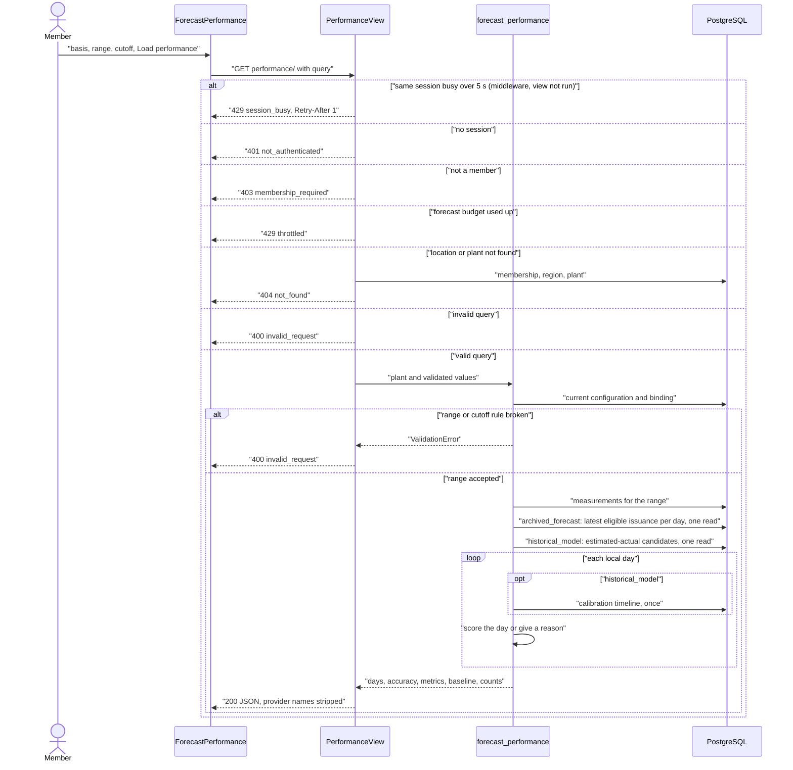

# Compare measured production with forecasts

A workspace member opens Production > Comparison on a plant, picks a basis (archived forecast or historical model), a date range and optionally a previous-day cutoff. The API pairs each completed local day's measured production with a frozen forecast issuance or a retrospective model run and returns per-day results, accuracy statistics and a reason for every unmatched day. No domain row is written and no provider is contacted; only session bookkeeping is written.

## Entry points

- Screen: `web/src/features/forecast/forecast-performance.tsx` `ForecastPerformance` (form) and `PerformanceResults` (`useApiQuery`, no poll), loaded on demand and mounted by `features/plant/workspace/production-section.tsx` `ProductionSection` on tab `production`, view `comparison`, keyed by configuration id. The screen opens on "Forecast accuracy" (archived issuances); "Model check" is the historical model; the cutoff sits under "Advanced". CSV: `ui/csv-download.tsx` `CsvDownload`; the chart of absolute daily error is `features/forecast/daily-accuracy-chart.tsx`.
- `GET /api/tenants/{t}/regions/{r}/plants/{p}/performance/` -> `pyracast.plants.api.PerformanceView.get` -> `pyracast.plants.performance.production_comparison`. Query (`PerformanceQuery`): `start_date`, `end_date`, `data_source`. Actors: administrator and viewer; no command, script or job.

## Sequence

## Data

| Table | R/W | What |
| --- | --- | --- |
| `django_session`, `usersessions_usersession` | R/W | `SessionLifetime` records activity at most once per 60 s; other requests only read the session |
| `accounts_membership`, `regions_region`, `plants_plant`, `plants_plantsubmission` | R | Membership, active region of the tenant, plant of that region (joined with its submission); region timezone and location when there is no configuration |
| `plants_plantconfiguration`, `connections_sitebinding` | R | Current and per-issuance configuration (basis, limits), binding (timezone, coordinates) |
| `plants_forecastissuance` | R | Archived mode: frozen `native_intervals`, factor, calibration per target day (joined with snapshot, job, calibration run; payload columns not loaded) |
| `forecasts_forecastsnapshot`, `forecasts_collectionjob`, `forecasts_referencecapacitynormalization`, `connections_provideraccount` | R | Historical mode: estimated-actual sources for the whole range |
| `plants_calibrationactivation`, `plants_calibrationrun`, `incidents_plantincident`, `incidents_incidentrevision` | R | Historical mode: calibration whose training had begun by the day and its validity; outage overlay on measurements |
| `plants_productionobservation`, `metering_epiasconnection`, `metering_epiassnapshot`, `metering_epiascollectionjob` | R | Manual heads created by `now`; settlement and (historical mode) provisional hours, only for a `net_export` basis with an enabled connection |

## Authorization

- Route policy: `ROUTE_POLICIES` in `pyracast.api.permissions` marks the route member access with the `forecast` throttle; `RoutePolicy` runs before the view. Any role reads. `ScopedView.plant_queryset` then requires the region in the URL tenant, not trashed, and the plant in the region; the query is validated only after that, so an outsider gets 403 before any 400.
- The response passes `CustomerJSONRenderer` (`public_source_data`), which drops provider-named keys, rewrites technical strings and passes operator provenance only through its allowlists; `PerformanceOutput` serializes the answer and documents the schema.

## Failure paths

| Condition | Result |
| --- | --- |
| Same session has another request running for over 5 s (middleware, before the view) | 429 `session_busy`, `Retry-After: 1`; the client waits at most 2 s and repeats once |
| No session | 401 `not_authenticated` with `WWW-Authenticate: Session` |
| Not a member | 403 `membership_required` |
| More than 60 reads a minute in the `forecast` scope (shared with both forecast reads) | 429 `throttled` with `retry_after` |
| Location unknown, of another tenant or trashed; plant not in it | 404 `not_found` |
| Unknown query field, bad date, bad choice, cutoff not `HH:MM[:SS[.ffffff]]` (an offset is rejected here) | 400 `invalid_request` with `fields`, or a message for an unknown key |
| One date only; not 1 to 90 days; start older than 366 days; end today or later; cutoff with `historical_model`; cutoff time ambiguous or missing (DST) | 400 `invalid_request` |
| No current configuration | 200, `configuration_id` null, `days` empty, `missing_days` = requested, `metrics` null |
| Day: issuance basis or timezone differs; no issuance; no estimated actuals | Missing: `configuration_not_comparable`, `forecast_not_available`, `estimated_actuals_not_available` |
| Day: saved issuance, source or meter rows invalid (`ValueError`, `ArithmeticError` in transfer or scoring; one `forecast_read_fault` warning); a required window not fully covered | Excluded: `invalid_forecast_data`, `incomplete_or_invalid_day`; the other days are still scored |
| `daylight_window` or `local_day_bounds` raises for a local date the timezone skips (window set-up), or the historical candidate read raises for it | 500 `server_error` with `request_id`: both run outside the per-day guard. Read from code, not reproduced |
| Statement over 60 s | 503 `request_timeout` with `request_id` |
| First request fails in the browser | Error `Notice` with the API message |
| Later request for the same query fails | Previous result kept with a "Could not refresh" alert and a retry |

## Rules and invariants

- Domain data is read-only: no transaction, no row lock (`ATOMIC_REQUESTS` off); the request holds only the per-session advisory lock of `SessionRequestSerialization`. One `now` pins the "known by" filters of measurements (`created_at`), estimated actuals (`collected_at`, `available_at`, `issued_at`) and calibration (activation and run times); archived issuances are filtered only by an explicit cutoff. Only completed local days of the current binding's timezone (region timezone without a configuration) count; the frontend `max` uses the region timezone.
- The read costs at most eight queries for 90 days: issuances, estimated-actual candidates, measurements and the calibration timeline are each read once for the range.
- Archived mode scores the issuance's frozen `native_intervals` (`power_mw`, and `baseline_power_mw` for the baseline) with no recalculation. `select_forecast_issuances` keeps one row per target day for the plant, latest `-snapshot__collected_at` then `-pk`; constraint `forecastissuance_published_at_chk` enforces `published_at < cutoff_at`. With a cutoff, publication, acquisition and provider issue time must be at or before the previous day's local time. The issuance's configuration selects the measurements and daylight windows; basis and timezone must equal the current ones. Archived mode uses `SETTLEMENT_ONLY_MEASUREMENT_POLICY` (manual over settlement) and no incident overlay (`incident_revision_ids=[]`). Historical mode uses `MEASUREMENT_POLICY` (adds provisional realtime hours, flagged `provisional_production`) and marks hours inside incidents known by `now` as outage, which excludes them.
- Historical mode applies the current configuration to every day and sets `historical_configuration_assumed` on days that began before the configuration was created. It takes `calibration_for_day` (newest of the 60 latest activations whose first training day is on or before the day and that is usable now; an activation without a run, a baseline reset, ends the search; else factor 1), recomputes the reference under the geometry version of that calibration (returned as `model_version`) and reports factor 1 as `baseline_metrics`. It is not forecast accuracy. A day matches only when every required window (daylight windows, or the whole day when `daylight_only` is false) is fully covered by `valid` meter intervals that the forecast fully covers. Whole intervals overlapping a window are kept. With `daylight_only`, a polar-night day has no window and never matches; without it (API default) the whole local day is the window. Missing days never become zero errors. Aggregate metrics rerun `evaluate_samples` over the matched samples; three reasons count as `missing_days`, two as `excluded_days`.
- Every day states its `selection_policy` and `calibration_in_sample` (null without a calibration; false for archived issuances; true when the day is in the run's training days). `relative_error` is the sum of absolute daily errors over measured energy for all matched days. `skill_score` is one minus the absolute daily error over that of the uncalibrated reference, on archived days and on historical days the calibration did not train on (`skill_days`).
- The frontend always sends `daylight_only=true`, defaults to `archived_forecast` (API default: `archived_forecast`), sends `issuance_cutoff` only for archived mode and omits dates on first load (server picks the last 30 completed days). Results are cached per request and language, so resubmitting an unchanged form does not refetch. Loading shows a status line. Unmatched days are grouped by reason with their dates.

## Tests

- `tests/test_production_comparison.py`: each compared day equals the forecast read for that day and source, reasons, accuracy, query count independent of the range, date validation, 401, 403, 404 and 400. `tests/test_forecast_choice.py`: the saved forecast nearest to real-time production, a day without a day-ahead saved forecast. `tests/test_forecast_contract.py` and `tests/test_forecast_read_contract.py`: per-day selection policy and the documented envelope. `tests/test_forecast_read_faults.py`: one damaged day leaves the others scored. `tests/test_route_policy.py`, `tests/test_api_throttling.py`: access and budget.
- `web/tests/production-comparison.spec.ts` (a failed refresh keeps the comparison until a retry), `web/tests/workspace.spec.ts` (loading, CSV hidden while loading, archived metrics): mocked routes. `web/tests/outages.spec.ts` stubs the endpoint.
- `tests/test_solar.py` pins the daylight windows behind every day: Turkish locations bit-identical over a year, every horizon crossing at New York, Kolkata, Tromsø, the North Pole and near both poles, daylight and nights shorter than the scan step down to a few seconds, a sunset at the start of the day, Astral events within a second of midnight kept by exactly one day, a late Astral event replaced by the crossing, Astral events the scan contradicts at high latitudes, and a property over every latitude against a sampled zenith.
- Gaps: no unknown-field 400, no polar location through this route, no test of the 500 paths, no real-data assertion, no test against the real API.
