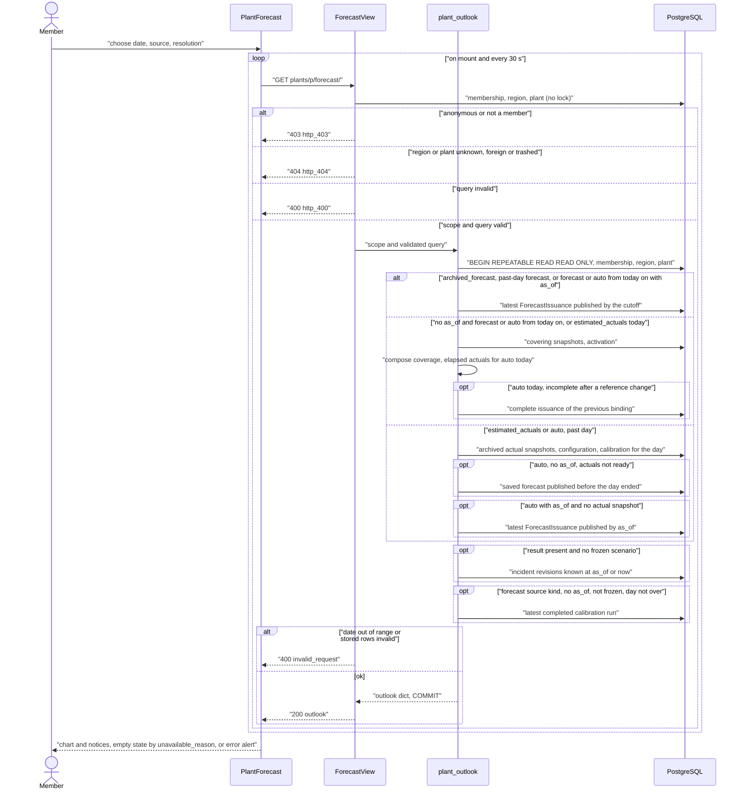

# View a plant's generation forecast

A workspace member (administrator or viewer) opens the plant's Forecast tab in the Generation view, picks a local date, a data source (automatic, forecast outlook, archived forecast, estimated actuals) and a 30 or 60 minute resolution, and the screen polls the plant forecast every 30 seconds. The backend composes the electrical outlook from already saved provider acquisitions, frozen forecast issuances, the active calibration and reported outages, and adds an outage scenario and a production diagnostic where they apply. No domain row is written, no job is enqueued and no provider is called; the read takes no row lock, runs on one read-only snapshot and its only writes are session bookkeeping (Django session activity and allauth user-session tracking). The irradiance view of the same tab is `irradiance-forecast-view`.

## Entry points

- Screen: `web/src/components/plant-workspace.tsx` `PlantWorkspace` (forecast tab: date, `DataSourceControl` from `web/src/components/data-source.tsx`, resolution; a notice instead of a request for a future day with estimated actuals or archive) and its inner `PlantForecast` (`useResource` with a 30 s poll, remounted by a key of view, date, resolution, source, configuration id and outage revision).
- Rendering: `web/src/components/forecast-panel.tsx` `ForecastPanel` with `electrical`, `web/src/components/forecast-intervals.tsx` `ForecastIntervals`, `web/src/lib/intervals.ts` `dataIntervalRange`; CSV download belongs to `csv-export`.
- `GET /api/tenants/{t}/regions/{r}/plants/{p}/forecast/?date=&data_source=&resolution_minutes=&as_of=` -> `pyracast.plants.api.ForecastView.get` -> `pyracast.plants.history.plant_outlook` (its only caller). `as_of` has no UI; it is API only. Actors: workspace administrator and viewer, with identical results.

## Sequence

## Data

| Table | R/W | What |
| --- | --- | --- |
| `django_session`, `usersessions_usersession` | R/W | Session load; `SessionLifetime` saves `last_activity_at` at most once per 60 s, so every poll counts as activity; allauth `UserSessionsMiddleware` (`USERSESSIONS_TRACK_ACTIVITY`) saves `last_seen_at`, IP and user agent on every authenticated request |
| `accounts_membership` | R | `require_member` in `ScopedView.plant_queryset`, again inside the snapshot, and in `plant_forecast` |
| `regions_region` | R | Active region of the tenant; status, revision and approved binding for `binding_is_current` |
| `plants_plant` | R | Active plant of that region; `current_configuration_id` drives freshness and `previous_configuration`; the view lookup also joins `plants_plantsubmission` |
| `plants_plantconfiguration` | R | Current declaration, the one valid at the day's start, during it, or the first known; with `as_of` the latest created by then; the issuance's own |
| `connections_sitebinding` | R | Timezone, coordinates, capacity and whether the reference binding is still current |
| `connections_provideraccount` | R | Enabled, authorized and credential revision of the binding's account on the current path (`current_forecast`) |
| `forecasts_forecastsnapshot`, `forecasts_collectionjob`, `forecasts_forecastresult`, `forecasts_referencecapacitynormalization` | R | Saved acquisitions of succeeded jobs, collected, available and published by the cutoff; normalization provenance of scaled reference data |
| `plants_forecastissuance` | R | Frozen 30/60 minute payloads and outage scenarios for archive, past-day forecast, `as_of` and reference transition |
| `plants_calibrationactivation`, `plants_calibrationrun` | R | Active or retrospective calibration factor; diagnostic from the latest completed run |
| `incidents_plantincident`, `incidents_incidentrevision` | R | Latest revision per incident known at the evaluation time, for the scenario and for calibration validity |
| `metering_epiasconnection`, `metering_epiassnapshot`, `metering_epiascollectionjob`, `plants_plantevent` | R | Production identity of a calibration fitted on EPİAŞ data: current identity on live reads, the `epias_connected` event at day end on the saved fallback |

## Authorization

- Authentication: `SessionAuthentication` and `IsAuthenticated` (`REST_FRAMEWORK` in `pyracast.settings`); `WorkspaceWritePermission` passes every safe method, so viewer and administrator read alike. There is no role check on this path.
- View: `ScopedView.plant_queryset` calls `require_member` (active user with a membership of the tenant), then loads the region by `tenant_id` and the plant through that region (`get_object_or_404`), before the query is validated.
- Operation: `plant_outlook` calls `require_member` inside its snapshot, so membership, region, plant and forecast data come from one committed state; a membership removed after the snapshot began is refused from the next poll on. `plant_forecast` checks once more on the issuance path.
- Data boundary: no row-level security; tenant isolation is the region filter on `tenant_id` and the plant-to-region join, repeated inside the snapshot. At delivery `CustomerJSONRenderer` (`pyracast.api.public.public_source_data`) drops provider account, site and credential fields and rewrites provider names (`provider-detail-redaction`).

## Failure paths

| Condition | Result |
| --- | --- |
| Anonymous, expired session, inactive user or not a member | 403 `http_403`; error alert in the panel |
| Region or plant unknown, of another tenant or trashed | 404 `http_404`; trashed between the view lookup and the snapshot gives 404 `not_found` |
| Unknown query field, missing or bad date, resolution not 30/60, unknown source, naive `as_of` | 400 `http_400` with field detail (DRF serializer error) |
| `forecast` or `auto` after today + 14, `forecast` before today - 366, `archived_forecast` outside today - 366 .. today | 400 `invalid_request`; detail is the localized `date_out_of_range` sentence |
| `estimated_actuals` or `auto` for a past day older than 366 days, `estimated_actuals` for a future day or for today with `as_of`; `as_of` later than now | 400 `invalid_request` with "Estimated actuals require a completed local day within the past year." or "as_of must be aware and no later than now." (localized) |
| Saved source rows non-finite, negative or malformed | 400 `invalid_request` with the localized `calculation_out_of_range` sentence |
| Another request of the same session running for over 5 s | 429 `session_busy`, `Retry-After: 1`; shown as an alert, retried only by the next poll |
| `ValueError` or `KeyError` outside the try blocks (`local_day_bounds` for a local date the timezone skips, wherever the read computes the local day: directly, as in the archived-actual selection and the current path, or through `daylight_window`, as in the issuance cutoff of the no-issuance path; `incident_scenario`), statement over 60 s | 500 without a JSON body; alert "Request failed (500)". Read from code, not reproduced |
| No configuration for the day, or the current one no longer current | 200, `result: null`, `freshness: missing`, `configuration_unavailable`; empty state "no configuration" |
| No snapshot or issuance | 200, `result: null`, `forecast_unavailable` (empty state "missing is not zero") or `estimated_actuals_unavailable` (its own empty state) |
| Future day selected with `estimated_actuals` or `archived_forecast` | No request; notice `selectTodayOrPastDay` or `selectArchivedDay` |
| Any request or poll fails | Error alert replaces the panel, including one already rendered; polling continues every 30 s |

## Rules and invariants

- Source dispatch in `_plant_outlook` (local "today" in the region timezone):
  - `archived_forecast`: frozen `ForecastIssuance` (`latest-published-pre-daylight-issuance-v1`: the latest collected issuance published by `as_of` or now), never recalculated, days today - 366 .. today.
  - `forecast`: today .. +14 without `as_of` uses `current_forecast` (`latest-forecast-coverage-v2`); a past day or any `as_of` goes through `plant_forecast` (today - 366 .. today + 14) to the same issuance selection as the archive, flagged `archived_forecast`.
  - `auto`: today or later uses `automatic_forecast` (today adds elapsed estimated actuals, source kind `mixed`, and the reference-transition fallback to the previous binding's complete issuance), or the issuance like `forecast` when `as_of` is given; a past day uses archived estimated actuals and, without `as_of`, returns `saved_forecast` (`forecast_fallback`) while actuals do not cover daylight and a saved forecast exists; with `as_of` and no actual snapshot it uses the issuance.
  - `estimated_actuals`: today without `as_of` uses `current_forecast(actuals_only=True)`; a past day prefers the current configuration when its binding archived the day, with the activated calibration whose training period had begun (`retrospective_calibration`), otherwise the configuration of that day at factor 1; with `as_of` it is uncalibrated.
- The read runs in one `REPEATABLE READ, READ ONLY` transaction (`pyracast.db.read_snapshot`) and takes no row lock: it never waits for a writer and never delays one. Membership, configuration, snapshots, calibration and incidents come from one committed state, so the normal result and the outage scenario see the same incidents, and the two covering-snapshot selection reads cannot disagree. A write committed during the read appears from the next poll on.
- Outage scenario: every issuance result carries the `outage_scenario` frozen at collection (possibly null), is never re-evaluated and gets no diagnostic; only the reference-transition fallback drops it. Otherwise `incident_scenario` evaluates incidents known at `as_of` or now. A calibration whose training-window incident history changed is dropped at selection (`uncalibrated`); when the change is only visible at evaluation time (saved fallback, reference transition) the result is recalculated at factor 1 with `calibration_invalidated_by_outage_history`.
- `production_diagnostic` only for `source_kind: forecast`, no `as_of`, no frozen scenario, a day not yet ended and a latest completed run whose derating baseline equals the outlook factor; evidence whose latest matched day is more than two days before today is `stale`.
- Freshness: the current composition is `fresh` when every contributing snapshot was collected within 24 h; archive and historical actuals are `fresh` only when their configuration is still the plant's current one.
- Defaults differ: API `data_source=forecast`, `resolution_minutes=30`; screen `auto`, 60, tomorrow in the region timezone.

## Tests

- API and operation: `tests/test_plant_api.py` (unavailable shape, status 400 for resolution 15 and naive `as_of`, resolution capping), `tests/test_archived_forecast_api.py` (archive replay, future-day 400, foreign tenant 403, `as_of` replay), `tests/test_api_localization.py` (Turkish completed-day message), `tests/test_archived_actual_composition_api.py`, `tests/test_plant_forecasting.py` (uncalculable input gives 400, `as_of` keeps the frozen issuance).
- Selection policy: `tests/test_current_forecast.py`, `tests/test_current_forecast_coverage.py`, `tests/test_automatic_forecast_selection.py`, `tests/test_intraday_outlook.py`, `tests/test_midnight_forecast_fallback.py`, `tests/test_historical_outlook.py`, `tests/test_past_day_outlook.py`, `tests/test_archived_forecast.py`, `tests/test_outlook_preparation.py`, `tests/test_provisional_calibration.py`, `tests/test_production_diagnostics.py`, `tests/test_incident_calibration.py`, `tests/test_historical_production_identity.py`, `tests/test_transfer_replay.py`.
- Snapshot: `tests/test_forecast_read_locks.py` (a row lock held elsewhere does not delay the read; one read-only snapshot without `FOR UPDATE`; incident, collection publication, revision, suspension, account and membership writes commit while a calibrated read is open; the open read keeps its source, calibration factor and scenario, and the next read shows the change), `tests/test_db.py` (`read_snapshot`).
- Contract: `tests/test_forecast_read_contract.py` (viewer and administrator bodies equal, foreign plant and region 404, `http_400` field on unknown key and empty date, past-day `forecast` equals `archived_forecast`).
- Playwright (mock API): `web/tests/workspace.spec.ts` (30 s refresh, data sources and archive, missing configuration, edge-zero cropping, CSV), `web/tests/archived-forecast.spec.ts`, `web/tests/daylight-forecast.spec.ts`, `web/tests/forecast-intervals.spec.ts`, `web/tests/forecast-coverage.spec.ts`, `web/tests/midnight-forecast.spec.ts`, `web/tests/outages.spec.ts`, `web/tests/localization.spec.ts` (a failed first request shows a localized alert, mocked with a body this endpoint never sends); real API: `web/integration/workspace.spec.ts`.
- Gaps: no 429 `session_busy` test for a read; no test for the uncaught `ValueError` and `KeyError` paths that escape as 500; no Playwright test that a failed poll replaces a rendered panel.
