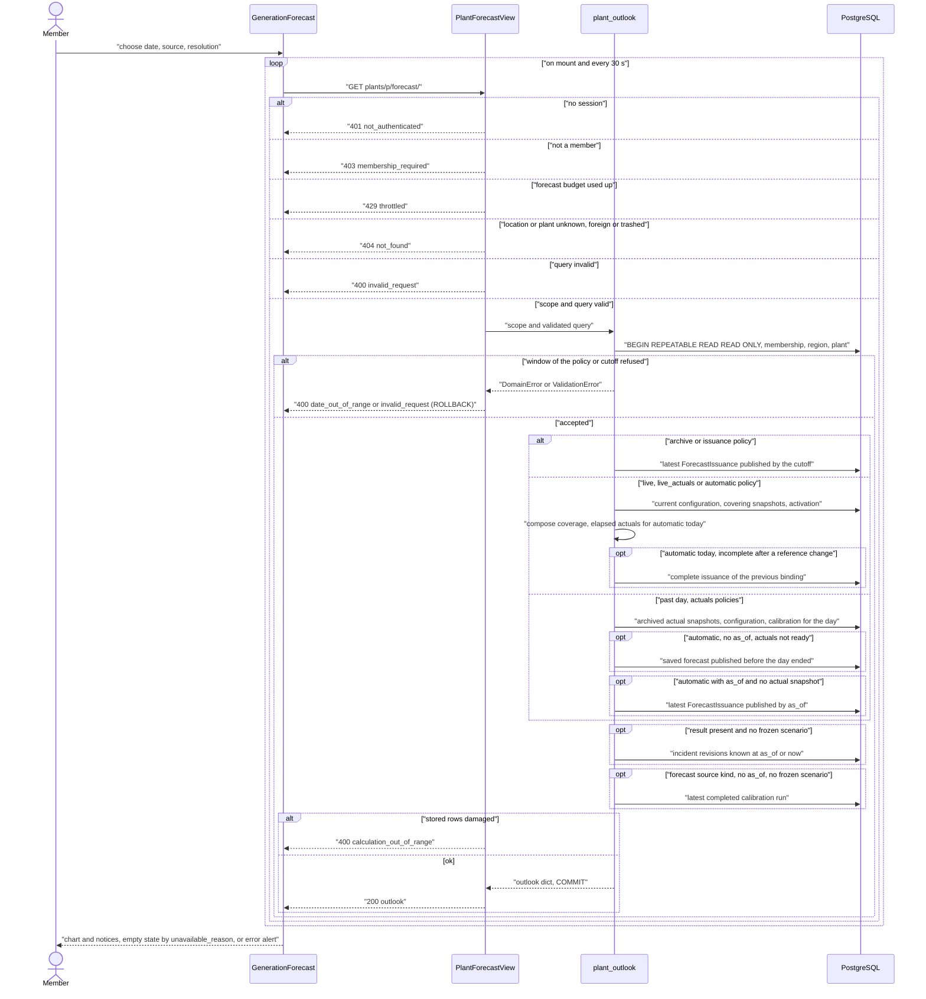

# View a plant's generation forecast

A workspace member (administrator or viewer) opens the plant's Forecast tab in the Generation view, picks a plant-local date, a data source (automatic, forecast outlook, archived forecast, estimated actuals) and a 30 or 60 minute resolution, and the screen polls the plant forecast every 30 seconds. The backend composes the electrical outlook from already saved provider acquisitions, frozen forecast issuances, the active calibration and reported outages, and adds an outage scenario and a production diagnostic where they apply. No domain row is written, no job is enqueued and no provider is called; the read takes no row lock, runs on one read-only snapshot and its only writes are session bookkeeping. The irradiance view of the same tab is `irradiance-forecast-view`.

## Entry points

- Screen: `web/src/features/plant/plant-workspace.tsx` `PlantWorkspace` and `workspace/forecast-section.tsx` `ForecastSection` (date, `DataSourceControl` from `features/forecast/data-source.tsx`, resolution). Date and view are the `date` and `view` URL parameters; choosing a source moves the date into the bounds of that source (`features/forecast/date-bounds.ts`), and a date outside them shows a notice instead of a request. `workspace/forecast-reading.tsx` `GenerationForecast` reads through `useApiQuery`, remounted by a key of view, date, resolution, source and configuration id. It polls every 30 s (`cadence.live`) unless the source is `archived_forecast` or the day is before yesterday; a hidden tab never polls.
- Rendering: `features/forecast/forecast-panel.tsx` `ForecastPanel` over `panel/forecast-summary.tsx`, `forecast-chart.tsx`, `forecast-provenance.tsx`, `forecast-unavailable.tsx` and `panel/model.ts`, plus `forecast-intervals.tsx`. CSV download belongs to `csv-export`.
- `GET /api/tenants/{t}/regions/{r}/plants/{p}/forecast/?date=&data_source=&resolution_minutes=&as_of=` -> `pyracast.plants.api.PlantForecastView.get` -> `pyracast.plants.history.plant_outlook` (its only caller), which takes the policy and day window from `pyracast.forecasts.outlook` (`PLANT_POLICIES`, `PLANT_DAYS`). `as_of` has no UI; it is API only. Actors: workspace administrator and viewer, with identical results.

## Sequence

## Data

| Table | R/W | What |
| --- | --- | --- |
| `django_session`, `usersessions_usersession` | R/W | Session load; `SessionLifetime` records activity at most once per 60 s (`last_activity_at`, device record), so most polls only read |
| `accounts_membership` | R | `RoutePolicy`, then `tenant_membership` again inside the snapshot |
| `regions_region` | R | Active region of the tenant; status, revision and approved binding for `binding_is_current` |
| `plants_plant` | R | Plant of that region; `current_configuration_id` drives availability and `previous_configuration`; the view lookup also joins `plants_plantsubmission` |
| `plants_plantconfiguration` | R | Current declaration, the one valid at the day's start, during it, or the first known; with `as_of` the latest created by then; the issuance's own |
| `connections_sitebinding`, `connections_provideraccount` | R | Timezone, coordinates, capacity; enabled, authorized and credential revision for `binding_is_current` |
| `forecasts_forecastsnapshot`, `forecasts_collectionjob`, `forecasts_forecastresult`, `forecasts_referencecapacitynormalization` | R | Saved acquisitions of succeeded jobs, collected, available and published by the cutoff; normalization provenance of scaled reference data |
| `plants_forecastissuance` | R | Frozen 30/60 minute payloads and outage scenarios for archive, issuance policy and reference transition |
| `plants_calibrationactivation`, `plants_calibrationrun` | R | Active or retrospective calibration; diagnostic from the latest completed run |
| `incidents_plantincident`, `incidents_incidentrevision` | R | Latest revision per incident known at the evaluation time, for the scenario and for calibration validity |
| `metering_epiasconnection`, `metering_epiasconnectionrevision`, `metering_epiassnapshot`, `metering_epiascollectionjob` | R | Production identity of a calibration fitted on EPİAŞ data: the current connection on live reads, the revision valid at the cutoff on saved reads |

## Authorization

- Route policy: `ROUTE_POLICIES` in `pyracast.api.permissions` marks this route member access with the `forecast` throttle. `RoutePolicy` runs before the view: no session answers 401, a missing membership 403. Viewer and administrator read alike; there is no role check on this path.
- View: `ScopedView.plant_queryset` loads the region by `tenant_id` and not trashed, then the plant through that region (`get_object_or_404`), before the query is validated. A plant has no trash of its own; it disappears with its location.
- Operation: `plant_outlook` calls `tenant_membership` inside its snapshot, so membership, region, plant and forecast data come from one committed state; a membership removed after the snapshot began is refused from the next poll on.
- Data boundary: no row-level security; tenant isolation is the region filter on `tenant_id` and the plant-to-region join, repeated inside the snapshot. At delivery `CustomerJSONRenderer` (`pyracast.api.public.public_source_data`) drops provider account, site and credential fields, rewrites provider names and passes stored provenance such as `reference_capacity_normalization` only as an allowlist (policy, capacities, factor, time).

## Failure paths

| Condition | Result |
| --- | --- |
| No session, expired session | 401 `not_authenticated` with `WWW-Authenticate: Session` |
| Not a member of the workspace (also one removed before the snapshot) | 403 `membership_required` |
| More than 60 reads a minute in the `forecast` scope (plant, region and performance reads share one budget per user) | 429 `throttled` with `retry_after` |
| Location unknown, of another workspace or trashed; plant not in it | 404 `not_found` |
| Unknown query key, missing or bad date, resolution not 30/60, unknown source, naive `as_of` | 400 `invalid_request`; `fields` names the input (an unknown key has a message only) |
| `forecast` or `auto` after today + 14, `forecast` before today - 366, `archived_forecast` outside today - 366 .. today | 400 `date_out_of_range` |
| `estimated_actuals` or `auto` for a past day older than 366 days, `estimated_actuals` for a future day or for today with `as_of`; `as_of` later than now | 400 `invalid_request` with "Estimated actuals require a completed local day within the past year." or "as_of must be aware and no later than now." (localized) |
| Saved source rows or frozen payloads non-finite, malformed or missing keys | 400 `calculation_out_of_range`; one `forecast_read_fault` warning with the error class only |
| Another request of the same session running for over 5 s | 429 `session_busy`, `Retry-After: 1`; the client waits at most 2 s and repeats once |
| Statement over 60 s | 503 `request_timeout` with `request_id` |
| `ValueError` or `KeyError` outside the guarded steps (`local_day_bounds` for a local date the timezone skips, `incident_scenario`) | 500 `server_error` with `request_id`. Read from code, not reproduced |
| No configuration for the day, or the current one not current (account disabled, credentials changed, location revised) | 200, `result: null`, `freshness: missing`, `configuration_unavailable`; empty state "no configuration" |
| No snapshot or issuance | 200, `result: null`, `forecast_unavailable` (empty state "missing is not zero") or `estimated_actuals_unavailable` (its own empty state) |
| Date outside the bounds of the selected source | No request; notice `selectDateInRange` |
| First request fails | Error notice in place of the panel |
| Later poll fails | The panel stays, with a "Could not refresh" alert and a retry; polling continues. A 403 or 404 drops the data |

## Rules and invariants

- `plant_policy` picks one policy from source, day (past, today, future) and whether `as_of` is given; `PLANT_DAYS` bounds the days each policy answers:
  - `archive` (`archived_forecast`, today - 366 .. today) and `issuance` (`forecast` for a past day, and every `forecast` or `auto` read of today or later with `as_of`; today - 366 .. today + 14): `issued_forecast` returns the frozen `ForecastIssuance` payload of the resolution, selected by `latest-published-pre-daylight-issuance-v1` (the latest collected issuance published by `as_of` or now), never recalculated, flagged `archived_forecast` and `previous_configuration` when its configuration is not current.
  - `live` (`forecast`, today .. +14, no `as_of`): `current_forecast` composes the newest covering snapshots for the current configuration (`latest-forecast-coverage-v2`).
  - `automatic` (`auto`, today .. +14, no `as_of`): `automatic_forecast`; today adds elapsed estimated actuals (source kind `mixed`), and an incomplete day after a reference change falls back to the previous binding's complete issuance.
  - `live_actuals` (`estimated_actuals`, today, no `as_of`): `current_forecast` with completed actuals only.
  - `archived_actuals` (`estimated_actuals`, past days) and `actuals_then_saved_forecast` (`auto`, past days): `_past_actuals` reads the archived actual snapshots. It prefers the current configuration when its binding archived the day, with the calibration whose training period had begun (`retrospective_calibration`); otherwise the configuration of that day (valid at the day's start, during it, or the first known) at factor 1; with `as_of` it is uncalibrated. `auto` without `as_of` returns `saved_forecast` (`forecast_fallback`) while actuals do not cover daylight and a saved forecast exists; with `as_of` and no actual snapshot it uses the issuance.
- The read runs in one `REPEATABLE READ, READ ONLY` transaction (`pyracast.db.read_snapshot`) and takes no row lock: it never waits for a writer and never delays one. Membership, configuration, snapshots, calibration and incidents come from one committed state, so the normal result and the outage scenario see the same incidents. A write committed during the read appears from the next poll on.
- The envelope (`PlantForecastOutput`, shared `ForecastEnvelope`) carries `freshness`: `fresh` for a live result, `stale` with `stale_reason` `collection_overdue` when a contributing snapshot was collected over 24 h ago, `archived` for a completed day and for frozen issuances and saved fallbacks, `missing` without a result. `source_kind` is `forecast`, `estimated_actuals` or `mixed`.
- Outage scenario: every issuance result carries the `outage_scenario` frozen at collection (possibly null), is never re-evaluated and gets no diagnostic; only the reference-transition fallback drops it. Otherwise `incident_scenario` evaluates incidents known at `as_of` or now and returns the scenario with an optional replacement result; the outlook is not mutated. A calibration whose training-window incident history changed is dropped at selection (`uncalibrated`); when the change is only visible at evaluation time (saved fallback, reference transition) the result is recalculated at factor 1 with `calibration_invalidated_by_outage_history`, retaining the forecast-fallback flag, reason and cutoff where present.
- A tracker plant computes under the geometry version of its active calibration (the default when uncalibrated) and records it in `result.model_version`; the scenario and any recomputation keep that version, and a calibration fitted under another transfer model is not applied.
- `production_diagnostic` only for `source_kind: forecast`, no `as_of`, no frozen scenario, a day not yet ended and a latest completed run whose derating baseline equals the outlook factor and whose transfer model equals the outlook `model_version`; evidence whose latest matched day is more than two days before today is `stale`.
- Defaults differ: API `data_source=auto`, `resolution_minutes=30`; screen `auto`, 60, tomorrow in the plant time zone, which the plant header states once.

## Tests

- API and operation: `tests/test_plant_api.py` (unavailable shape, 400 for resolution 15 and naive `as_of`, resolution capping), `tests/test_archived_forecast_api.py` (archive replay, future-day 400, foreign tenant 403, `as_of` replay), `tests/test_api_localization.py` (Turkish completed-day message), `tests/test_archived_actual_composition_api.py`, `tests/test_plant_forecasting.py`.
- Dispatch and freshness: `tests/test_outlook_dispatch.py` (every source, day and cutoff answers as pinned, plant and region), `tests/test_forecast_freshness.py`, `tests/test_forecast_read_faults.py` (damaged actuals or issuance answer 400 with one warning), `tests/test_forecast_read_cost.py` (cost does not grow with history), `tests/test_forecast_contract.py`.
- Selection policy: `tests/test_current_forecast.py`, `tests/test_current_forecast_coverage.py`, `tests/test_automatic_forecast_selection.py`, `tests/test_intraday_outlook.py`, `tests/test_midnight_forecast_fallback.py`, `tests/test_historical_outlook.py`, `tests/test_past_day_outlook.py`, `tests/test_archived_forecast.py`, `tests/test_outlook_preparation.py`, `tests/test_provisional_calibration.py`, `tests/test_production_diagnostics.py`, `tests/test_incident_calibration.py`, `tests/test_historical_production_identity.py`, `tests/test_transfer_replay.py`.
- Access: `tests/test_route_policy.py` (policy table, each role), `tests/test_api_throttling.py` (429 `throttled`, one budget per user), `tests/test_session_serialization.py` (busy session), `tests/test_public_data.py` (provenance reaches customers as an allowlist).
- Snapshot: `tests/test_forecast_read_locks.py` (a row lock held elsewhere does not delay the read; one read-only snapshot without `FOR UPDATE`; incident, publication, revision, suspension, account and membership writes commit while a calibrated read is open; the open read keeps its source, factor and scenario, and the next read shows the change), `tests/test_db.py` (`read_snapshot`).
- Contract: `tests/test_forecast_read_contract.py` (viewer and administrator bodies equal, foreign plant and region 404, `invalid_request` field on unknown key and empty date, past-day `forecast` equals `archived_forecast`).
- Playwright (mock API): `web/tests/workspace.spec.ts` (30 s refresh, data sources and archive, missing configuration, edge-zero cropping), `web/tests/query-layer.spec.ts` (a failed poll keeps the chart, a hidden tab makes no request), `web/tests/forecast-date-bounds.spec.ts`, `web/tests/forecast-panel-model.spec.ts`, `web/tests/archived-forecast.spec.ts`, `web/tests/daylight-forecast.spec.ts`, `web/tests/forecast-intervals.spec.ts`, `web/tests/forecast-coverage.spec.ts`, `web/tests/midnight-forecast.spec.ts`, `web/tests/outages.spec.ts`; real API: `web/integration/workspace.spec.ts`.
- Gaps: no test for the uncaught `ValueError` and `KeyError` paths that answer 500.
