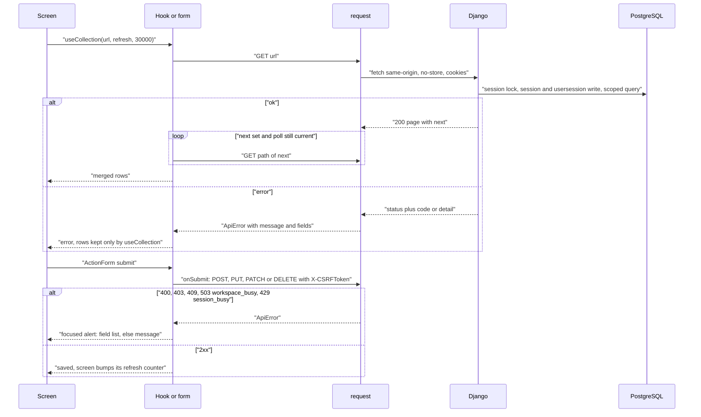

# Frontend shared layer: HTTP clients, hooks, polling, forms and UI primitives

Every customer screen reads and writes through two same-origin fetch wrappers and a few shared hooks. `request` carries `/api/` JSON, `authRequest` the allauth envelopes. `useCollection` and `useResource` load saved data and, when the screen passes `pollMs`, re-read it every 30 s without calling providers; `ActionForm` turns a rejected submit into field-level messages. The outcome is a screen showing saved data, a localized or server-provided message, or a per-field error.

## Entry points

- `web/src/lib/api.ts` `request`, `send`, `errorMessage`, `validationFields`, `ApiError`. Callers pass the CSRF token explicitly. `/api/session/*` calls go through a module-level promise queue and a concurrent `GET /api/session/` shares one in-flight request (`sessionFlight`).
- `web/src/lib/auth-api.ts` `authRequest`, `AuthResponseError` for `/api/auth/browser/v1/*` (allauth headless).
- `web/src/components/ui.tsx` `useCollection` (follows `next`), `useResource`, `ActionForm`, `Notice`, `Field`, `Select`, `Stat`, `Tag`, `JsonDetails`, `Empty`.
- `web/src/components/change-request-updates.tsx` `useProposalKey`, `ChangeRequestUpdates` (provided by `Workspace` in `web/src/components/dashboard.tsx`).
- `web/src/components/scroll-region.tsx` `ScrollRegion`; `web/src/app/globals.css`, the only global stylesheet (the public site adds `public-site.module.css`). Hand-written 30 s pollers: `web/src/components/collection-schedule.tsx` (always) and `web/src/components/production-history.tsx` (visible tab, editor closed).
- Server side: `pyracast.api.errors.exception_handler`, `pyracast.api.session.SessionView`, `pyracast.accounts.session_lock.SessionRequestSerialization`, `pyracast.accounts.middleware.SessionLifetime`, allauth `UserSessionsMiddleware`.

## Sequence

## Data

| Table | R/W | What |
| --- | --- | --- |
| `django_session` | R/W | `SessionLifetime` refreshes `last_activity_at` at most once a minute on any authenticated request, polls included |
| `usersessions_usersession` | W | `USERSESSIONS_TRACK_ACTIVITY` updates `last_seen_at`, IP and user agent on every authenticated request, polls included |
| Advisory lock | W | One per well-formed session cookie serializes that session's requests (5 s wait) |
| Tenant, region and plant tables | R | Whatever the polled URL selects, saved rows only; the forecast polls read one read-only snapshot and take no row lock |

## Authorization

- Browser: `ActionForm` hides submit and disables the fieldset unless `permitted ?? useCanManageWorkspace()`. Presentation only.
- Transport and view: `SessionAuthentication` (CSRF on unsafe methods of authenticated requests; `SessionLanguageView` adds `csrf_protect`; token from `GET /api/session/`, the cookie is HttpOnly), `IsAuthenticated` and `WorkspaceWritePermission` (unsafe `tenant_id` URLs need an active admin membership by default). Exceptions: production and outage proposals, withdraw and seen in `src/pyracast/change_requests/api.py` use `WorkspaceMemberWritePermission` (any active membership), and withdraw and seen then answer 404 unless the caller proposed the request under the same membership; EPIAS connect and disconnect need `PlatformAdmin`. Reads are scoped by view querysets, see `docs/flows/tenant-authorization.md`. `CustomerJSONRenderer` redacts provider detail outside `/api/platform/`; `PrivateAPIResponses` sets `private, no-store` on `/api/`.

## Failure paths

| Condition | Result |
| --- | --- |
| Non-2xx with non-JSON body | `Errors.request` with the status. A 2xx non-JSON body returns `null` to the caller (`authRequest` throws `Errors.invalidResponse`) |
| Bare code string, or a body whose only key is `code` (503 `workspace_busy`, provider codes) | `Errors.codes.<code>` (`location_already_exists` and `location_already_has_plant` as bare strings use `Errors.duplicateLocation`/`activePlant`); an unknown lowercase code gives an empty message and falls back to `Errors.request` |
| Body with `code` and `detail` (DRF `http_N`, 400 `invalid_request`, 409 change-request conflicts, 429 `session_busy`) | `detail` wins over `code`; the server text is shown as sent, so `session_busy` stays English |
| Validation 400 with object `detail` | `detail` keys become `ApiError.fields`; `detail` and `non_field_errors` stay in the message. A list `detail` (non-field `ValidationError`) gives a message only |
| 429 `provider_throttled`, `quota_exhausted`, 502 `provider_unavailable`, 503 `provider_authentication_failed` | Localized `Errors.codes.*`, saved data stays |
| Expired session during a poll | 403 with DRF `detail` as an error notice; the session is re-read only on focus or visibility change |
| `next` repeats or leaves `/api/` | `Common.invalidPage`; same-URL rows are kept |
| Poll fails | `useResource` drops `data`; `useCollection` keeps last rows beside the error |
| `authRequest` non-2xx | 401 and 404 on `GET account/authenticators/totp` are returned (allauth flow state); others throw `AuthResponseError` with joined `errors[].message`, `errors[].param` as fields. A non-object body throws at any status |

## Rules and invariants

- `fetch` appears only in `send` and `authRequest`, always `same-origin` and `no-store`. A `next` link is reduced to path plus query, so the host of a DRF absolute link is never followed.
- Session calls are serialized and a concurrent `GET /api/session/` is coalesced, so Strict Mode, focus and visibility events make one request.
- Hooks drop stale responses with a per-effect `sequence` and `current` flag. `useCollection` keys state by URL, `useResource` does not, so callers remount it with a `key` when the URL changes.
- Hook polling has no visibility check, backoff or pause on error; `Retry-After` (sent with `workspace_busy` and `session_busy`) is ignored and nothing retries. Polls count as activity (`docs/ARCHITECTURE.md`), so an open tab never hits the 30 minute idle limit, only the 12 hour one.
- `useProposalKey` holds one UUID per exact JSON payload. The server replays equal `(proposer_membership, key)` with equal payload hash and rejects a changed payload (409 `idempotency_key_reused`).
- After login, logout or password change the caller must re-read `/api/session/` for the rotated CSRF token; `request` does not refresh it.

## Tests

- `web/tests/workspace.spec.ts`: one CSRF handshake across Strict Mode and focus, tenant pagination with an absolute `next`, 30 s refresh of open forecasts, stale performance CSV, prior workspace response ignored.
- `web/tests/change-requests.spec.ts`: 503 `workspace_busy` then retry with the same idempotency key, role change during polling, server `Invalid page.` after last-page removal. `web/tests/epias-production.spec.ts`: polling pauses while editing or hidden and survives a failed refresh.
- `web/tests/workspace-roles.spec.ts` (`readonly-form`, `form-errors`), `web/tests/scroll-region.spec.ts`. pytest: `tests/test_api.py`, `tests/test_api_localization.py`, `tests/test_api_cache.py`, `tests/test_api_contention.py`, `tests/test_session_serialization.py`, `tests/test_account_security.py` (activity refresh).
- Gaps: no test for a cyclic `next`, a 2xx non-JSON body, `Retry-After`, `session_busy` text, `useResource` data loss on a failed poll, or hidden-tab polling outside production history.
