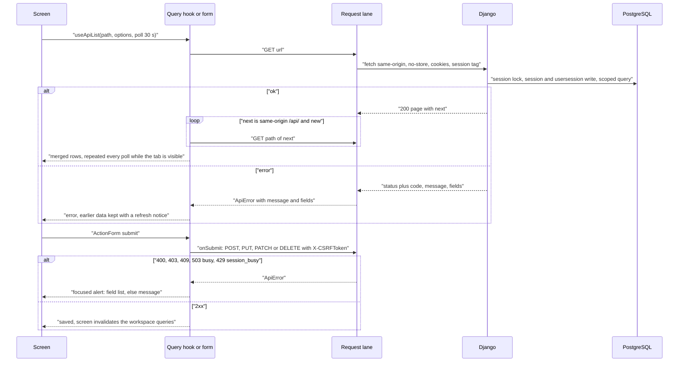

# Frontend shared layer: HTTP client, queries, polling, forms and UI primitives

Every customer screen reads and writes through one typed client over one request lane. TanStack Query owns server state: `useApiQuery` and `useApiList` load saved data and, when the screen passes `poll`, re-read it without calling providers while the tab is visible. `ActionForm` and `AsyncButton` turn a rejected action into field-level or general messages. The outcome is a screen showing saved data, a message the server wrote in the user's language, or a per-field error.

## Entry points

- `web/src/lib/api/client.ts` `api` (`get`, `post`, `put`, `patch`, `delete`): paths, path parameters, query and body typed from the generated `web/src/lib/schema.d.ts`; `buildUrl`.
- `web/src/lib/api/lane.ts` `send`, `prepared`, `exchange`: the only `fetch`. CSRF token from the session store, `X-Session-Tag`, `/api/session/` and `/api/auth/` calls serialized one after another, one retry for `session_busy`, 95 s timeout, localized network and non-JSON failures.
- `web/src/lib/api/errors.ts` `errorFromResponse`, `ApiError`, `DisplayError`, `displayMessage`, `ERROR_CODES`: one error value for every failure.
- `web/src/lib/auth-api.ts` `authRequest` for `/api/auth/browser/v1/*` (allauth headless), through the same lane.
- `web/src/lib/api/query.ts` `useApiQuery`, `useApiList`, `useRefresh`, `invalidate`, `cadence`, `createQueryClient`, `QueryOwner`; keys in `web/src/lib/api/keys.ts`; `web/src/lib/session-client.ts` (session state, tag, `sessionOwner`, `loadSession`).
- `web/src/ui/`: `form.tsx` (`ActionForm`, `AsyncButton` and the field components), `resource.tsx` `Resource`, `ui.tsx` (`Notice`, `RefreshFailed`, `Empty`), `action.tsx` (`ConfirmAction`), `live-region.tsx`, `route-error.tsx`, `vocabulary.tsx`; `web/src/lib/idempotency.ts` `useProposalKey`.
- Styling: `web/src/styles/tokens.css` and `tokens.ts`, `web/src/app/globals.css` (the public site adds `public-site.module.css`), enforced by `web/eslint/design-tokens.mjs`.
- Server side: `pyracast.api.errors.exception_handler`, `pyracast.api.session.SessionView`, `pyracast.accounts.session_lock.SessionRequestSerialization`, `pyracast.accounts.session_tag.SessionTagCheck`, `pyracast.accounts.middleware.SessionLifetime`, allauth `UserSessionsMiddleware`.

## Sequence

## Data

| Table | R/W | What |
| --- | --- | --- |
| `django_session` | R/W | `SessionLifetime` refreshes `last_activity_at` at most once a minute on any authenticated request, polls included |
| `usersessions_usersession` | W | The same refresh updates `last_seen_at`, IP and user agent of the device record |
| Advisory lock | W | One per well-formed session cookie serializes that session's requests (5 s wait) |
| Tenant, region and plant tables | R | Whatever the polled URL selects, saved rows only; forecast composition reads one read-only snapshot and takes no row lock; the plant poll's initial scope checks precede that snapshot |

## Authorization

- Browser: `ActionForm` hides submit and disables the fieldset unless `permitted ?? useCanManageWorkspace()`; `AsyncButton` renders nothing under the same rule. Presentation only.
- Transport and view: `SessionAuthentication` (CSRF on unsafe methods of authenticated requests, refused as 403 `csrf_failed`; `SessionLanguageView` adds `csrf_protect`; token from `GET /api/session/`, the cookie is HttpOnly), `RoutePolicy` (the route-and-method table in `pyracast.api.permissions`: public, account, member or admin access; a route or method missing from it is refused) and `SessionTagCheck` (409 `session_changed` for a request prepared for another session). Reads are scoped by view querysets, see `docs/flows/tenant-authorization.md`. `CustomerJSONRenderer` redacts provider detail; `PrivateAPIResponses` sets `private, no-store` on `/api/`.

## Failure paths

| Condition | Result |
| --- | --- |
| Non-2xx with a body that lacks `code` and `message` | `Errors.request` with the status. A 2xx non-JSON body throws `Errors.invalidResponse`; a 204 gives `null` |
| Contract body `{code, message, fields?, retry_after?, request_id?}` | One `ApiError` (status, code, fields, `retryAfter`, `requestId`, body); the server's localized message is shown as sent, followed by `Errors.reference` when it carries a `request_id`. A code outside `ERROR_CODES` keeps its message and has no typed code |
| 400 `invalid_request` with `fields` | `fields` become per-control errors in `ActionForm`; the general message stays beside them |
| 429 `session_busy` | The lane repeats the request once after `Retry-After` (at most 2 s), for every method; a second refusal is reported. `busy` (503) is never repeated |
| 409 `session_changed` | Repeated once only when a session read shows the same session under a renewed key; otherwise the caller gets a `session_changed` error, and an answer arriving after the tab adopted another session is dropped |
| 401 `not_authenticated` or 410 `session_ended` on a non-session call | The lane reads the session once, then throws the error; the screen shows the sign-in |
| Connection failure or the 95 s timeout | `Errors.network` for a read, `Errors.unconfirmed` for a change (the change may have been saved) |
| Any failure that is not a `DisplayError` | `Common.unexpected` |
| `next` repeats or leaves `/api/` or the origin | `Errors.invalidPage`; the rows already read are not used |
| Read answers 403 or 404 | The hook drops its data, so rows of a workspace the user lost never stay on screen |
| Poll or refresh fails otherwise | Earlier data stays beside a `RefreshFailed` notice with its time and a retry |
| `authRequest` non-2xx | 401 and 404 on `GET account/authenticators/totp` are returned (allauth flow state); others throw through `errorFromResponse`, which reads allauth's `errors[].message` and `param` as the contract's message and fields. A non-object body throws at any status |

## Rules and invariants

- `fetch` appears only in `lane.ts`, always `same-origin` and `no-store`. A `next` link is reduced to path plus query, so the host of a DRF absolute link is never followed. A list read over several pages shows a row repeated on the next page once.
- Session calls are serialized and a `GET /api/session/` is shared while neither this tab sent a session change nor another tab observed a tag, so Strict Mode, focus and visibility events make one request.
- Query keys are `["session", "<user id>:<session tag>", workspace or account, path, parameters, query, language]`. Two accounts, two sessions, two workspaces or two languages never share an entry; entries of another owner are removed when the session changes.
- Polls run only in a visible tab and refetch when it becomes visible; a read never overlaps itself. Periods: `cadence.live` 30 s (portfolio, change-request inbox, collection schedule, open current-day forecast, production history while its editor is closed), `steady` 60 s (calibrations), `background` 120 s (tenants, the open site, a plant's pending requests). A list read over n pages polls every n periods. Queries do not retry on their own and are fresh for 2 s.
- Polls count as activity (`docs/ARCHITECTURE.md`), so a visible tab never hits the 30 minute idle limit, only the 12 hour one; a hidden tab sends nothing.
- A change refreshes through `useRefresh().workspace(tenantId)`, which invalidates that workspace's queries and the tenant list; a read that was already running when the change was answered stands instead of being cancelled and repeated.
- `Resource` shows a loaded query as data with the refresh notice, else the error, else the loading status (`resourceState`); data kept from an earlier read stays on screen when a refresh fails.
- `useProposalKey` holds one UUID per exact JSON payload. The server replays equal `(proposer_membership, key)` with equal payload hash and rejects a changed payload (409 `idempotency_key_reused`).
- After login, logout or password change the caller re-reads `/api/session/` (`loadSession`) for the rotated CSRF token and session tag; the lane does not refresh them.
- Colours and spacing come only from `tokens.css` (and `tokens.ts` for SVG, QR and the social image), enforced by the `pyracast/design-tokens` ESLint rule with inline directives disabled. Numbers, units, zoned times and the plant day come from `lib/format`; status and kind labels from `lib/vocabulary` and `ui/vocabulary`. `AsyncButton` announces outcomes through the one `LiveRegion` mounted in `AppRoot`. `lib` and `i18n` import no feature, `ui` imports no feature and a feature reaches another only through its top-level modules (`import-direction.spec.ts`).

## Tests

- `web/tests/transport.spec.ts` (busy retry, no replay of a busy workspace, unconfirmed change, non-JSON answer, CSRF token, session changes and sign-out), `web/tests/session-tag.spec.ts` and `web/tests/session-tabs.spec.ts` (tag handling across tabs), `web/tests/api-errors.spec.ts` (contract body, retry hints, request references, maintenance notice, allauth failures), `web/tests/query-keys.spec.ts` (keys per account, workspace and language; pages; cyclic or foreign `next`; refresh after a change), `web/tests/query-layer.spec.ts` (hidden tab makes no request, request budget in five visible minutes, failing poll keeps the chart).
- `web/tests/workspace.spec.ts` (one CSRF handshake, tenant pagination with an absolute `next`, ignored responses of a prior workspace), `web/tests/change-requests.spec.ts` (stable retry key, polls after removal), `web/tests/epias-production.spec.ts` (polling pauses while editing or hidden), `web/tests/ui-resource.spec.ts`, `web/tests/ui-kit.spec.ts`, `web/tests/workspace-roles.spec.ts` (`readonly-form`, `form-errors`), `web/tests/design-tokens.spec.ts`, `web/tests/vocabulary.spec.ts`, `web/tests/import-direction.spec.ts`.
- pytest: `tests/test_error_contract.py`, `tests/test_api_localization.py`, `tests/test_api_cache.py`, `tests/test_api_contention.py`, `tests/test_session_serialization.py`, `tests/test_session_tag.py`, `tests/test_account_security.py` (activity refresh).
- Gaps: no test sends a request past the 95 s timeout.
