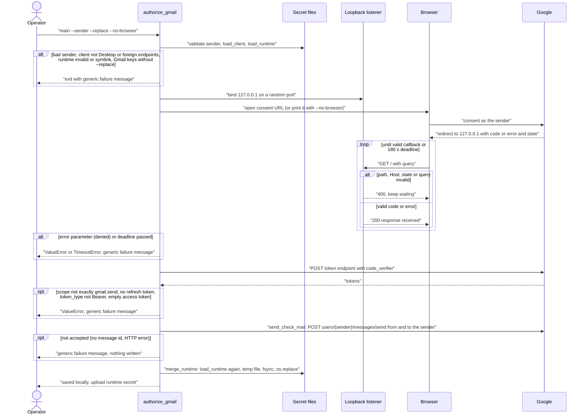

# Authorise the send-only Gmail sender

An operator runs `deploy/authorize_gmail.py` on a local workstation after saving a Google Desktop OAuth client JSON. The helper opens Google consent for the `gmail.send` scope, catches the redirect on a loopback listener, exchanges the code with PKCE, sends one self-addressed check mail as the sender and only then merges the refresh token, client credentials, backend and sender into `secrets/runtime.json`. Nothing is uploaded: the operator uploads the file to Secret Manager afterwards (`gcloud secrets versions add pyracast-runtime`, `docs/DEPLOYMENT.md`), and the application only reads the values at runtime.

## Entry points

- Script `deploy/authorize_gmail.py` `main` (calls `authorize`: listener, consent URL, code exchange): `--client` (default `secrets/gmail-client.json`), `--runtime` (default `secrets/runtime.json`), `--sender` (default `info@pyracast.app`), `--replace`, `--no-browser`. Invoked as `uv run --locked python deploy/authorize_gmail.py` (`docs/DEPLOYMENT.md`, section 2). The 180 s timeout of `authorize` has no CLI option.
- Hint from `deploy/host_secrets.py` `create`, which prints the helper name when the mail backend is `gmail`.
- Consumers of the result: `deploy/runtime_secrets.py` `runtime_files` (copies `PYRACAST_*` keys to the VM `runtime.env`), `src/pyracast/settings.py` (`MAILERS`), `src/pyracast/mail/gmail.py` `EmailBackend` (`__init__` validates `DEFAULT_FROM_EMAIL` and credentials, `open` refreshes the token), `pyracast check_mail` (run by `deploy/install-release.sh` after readiness; a failure only warns), deploy check `src/pyracast/accounts/checks.py` `check_authentication_mail_delivery`. No `web/` screen, API view or database is involved.

## Sequence

## Data

| Table or file | R/W | What |
| --- | --- | --- |
| `secrets/gmail-client.json` | R | Google Desktop client (`installed` object: ids, secret, auth and token URIs) |
| `secrets/runtime.json` | R/W | JSON object of strings, read twice (preflight and merge). Writes `PYRACAST_EMAIL_BACKEND=gmail`, `PYRACAST_FROM_EMAIL`, `PYRACAST_GMAIL_CLIENT_ID`, `_CLIENT_SECRET`, `_REFRESH_TOKEN`, keeps every other key |
| `.gmail-*` temp file next to `runtime.json` | W | Full merged content; renamed over `runtime.json` or removed in `finally` |

## Authorization

- No application authentication. Access is possession of the local secret files and a Google login for the sender mailbox, chosen in the browser (`login_hint` is only a hint). Google enforces consent and the scope; the helper rejects any token response whose scope is not exactly `gmail.send` (`exchange_code`).
- The listener accepts one callback only if path is `/`, `Host` equals `127.0.0.1:<port>`, `state` matches and exactly one of `code` or `error` is present (`Callback.do_GET`). It binds to loopback only.
- Runtime side, enforced later: `EmailBackend.open` refreshes the access token and again requires scope set `{gmail.send}` (an `invalid_grant` answer means the authorization was revoked: run the helper again with `--replace`); `check_authentication_mail_delivery` (run by `check --deploy` in `deploy/install-release.sh` and `deploy/smoke.sh`) requires, when `DEBUG` is off, a sender with `@` and a non-`localhost` domain and options the backend accepts (credentials, valid sender, positive timeout).

## Failure paths

| Condition | Result |
| --- | --- |
| Client JSON unreadable, not `installed`, foreign `auth_uri` or `token_uri`, empty or control-character credential | `SystemExit` "Gmail authorization failed. Check the Desktop client, consent, sender and local secret files." |
| Sender not one `@`, empty part, whitespace or CR/LF/NUL; runtime file missing, symlink, not a nonempty object of strings, or holding a Gmail key without `--replace` | Same message, raised before the browser opens |
| Consent denied (`error` with valid state) | Same message; browser still shows "response received" with HTTP 200 |
| Forged or malformed callback; any callback (including a replay) after the first valid one | Before a valid callback: HTTP 400 text page, wait continues until deadline. After it the loop has ended and the listener is closed: connection error, no HTTP response |
| No callback within 180 s, including when no browser launches without `--no-browser` (the `webbrowser.open` result is ignored and the URL is never shown) | `TimeoutError`, same message, no exchange attempted |
| Token endpoint HTTP or network error, invalid JSON, wrong scope, missing refresh token, bad token type, or Gmail refuses the check mail | Same message (`URLError`, `OSError`, `ValueError`), nothing written |
| Gmail key added to `runtime.json` during consent without `--replace` (with `--replace` it is overwritten), or write failure (disk, locked file on Windows) | Same message, original `runtime.json` intact, temp file removed, issued refresh token lost |
| Ctrl+C, `TypeError` (for example a non-string `auth_uri` list), `http.client.HTTPException` | Not caught, Python traceback |

## Rules and invariants

- Every handled failure collapses to one message so that tokens, codes and client secrets never reach the terminal. The cost is that the operator cannot tell causes apart.
- State and PKCE bind the redirect to this run: `state` is 32 random bytes, the verifier 64 random bytes, challenge S256, port random per run.
- `--replace` guards only the three `PYRACAST_GMAIL_*` keys; the previous refresh token is overwritten, not revoked. `merge_runtime` is atomic (same-directory temp file, `fsync`, `os.replace`) and never removes keys, so SMTP settings stay in the file but are inert once the backend is `gmail`.
- The sender is written as a bare address (display name lost). The check mail carries its own `Date` and `MIME-Version` headers and goes through the same `users/{sender}` endpoint as production, so it proves before anything is saved that the consenting account is that mailbox.
- The helper needs Python 3.14+ syntax (`except A, B`); it is not in the `py312` per-file target list in `pyproject.toml` because it only runs on the workstation.
- `docs/DEPLOYMENT.md` states that an external app in Testing gets seven-day refresh tokens (not verified here); the code cannot detect that.

## Tests

- `tests/test_gmail_authorization.py`: Desktop-client and endpoint validation, merge keeps unrelated keys and requires `--replace`, failed `os.replace` preserves the file, scope and credential rejection without disclosure, loopback rejects forged state and sends the PKCE verifier and offline parameters, a malformed callback is refused and a denial ends the run, timeout never exchanges, a symlinked or malformed runtime file is refused, `main` refuses a sender that is not one address, saves only after Gmail accepts the check mail (sent with `From`, `To`, `Date` and `MIME-Version`) and redacts failures.
- `tests/test_gmail_mail.py` and `tests/test_mail_configuration.py`: runtime backend refresh and scope recheck, settings build of Gmail `MAILERS`, the deploy check (`accounts.E001`).
- `tests/test_operations_contracts.py`: the helper's scope and token endpoint equal `pyracast.mail.gmail`, and its credential keys equal the `PYRACAST_GMAIL_*` variables `settings.py` reads.
- Gaps: untested are the printed URL of `--no-browser`, `--replace` through `main`, a callback with the wrong `Host` or path, Windows `os.replace`, and a `runtime.json` written by the helper read back by settings. No Playwright test applies.
