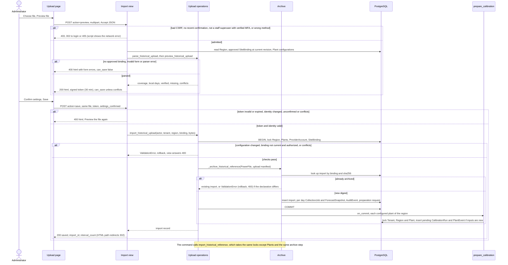

# Import a historical provider export as reference data

A platform administrator uploads a Solcast estimated-actuals export (JSON or CSV) for a plant's approved reference binding in the admin console, previews it, then saves it with a signed preview token. An operator can instead run the `import_historical_reference` command with a JSON power file and a full settings manifest. Both paths write one idempotent archive per binding and file digest: one succeeded collection job and one estimated-actuals snapshot per local day. A new archive records a calibration preparation request for the region's configured plants in the same transaction, and one preparation attempt runs after commit.

## Entry points

- Screen: the plant review page (`src/pyracast/regions/templates/admin/regions/region/setup.html`) links to `admin/workspace/historical_import.html`, which loads `admin-historical.js` and `admin-historical.css` from `src/pyracast/regions/static/pyracast/`. The script intercepts submit (and a dropped file) and posts `FormData` with `Accept: application/json`; the response fragment is `admin/workspace/historical_preview.html`. Without JavaScript the form posts normally and the administrator must select the same file again before saving.
- Endpoint: `GET|POST /admin/plants/{id}/historical-import/` (route name `admin:workspace_historical_import`; `{id}` is a Region pk) -> `pyracast.platform_admin.historical.historical_import(request, region_id, site=...)`. Operations: `pyracast.forecasts.historical_upload.parse_historical_upload`, `preview_historical_upload`, `import_historical_upload`.
- Command: `manage.py import_historical_reference --username --tenant-id --region-id --binding-id --power-file --manifest` (`pyracast/forecasts/management/commands/import_historical_reference.py`) -> `pyracast.forecasts.historical_import.import_historical_reference`.
- Follow-up: the archive calls `plants.preparation.request_region_preparation`, which stamps `calibration_preparation_due_at` on each plant of the region with a current configuration and registers `transaction.on_commit` -> `_prepare_after_commit` -> `prepare_calibration`. A failing attempt never fails the import: the `calibration` phase of `dispatch` prepares what is left (`prepare_requested_calibrations`) and later sends each pending run to the Dramatiq actor `calibrate_plant` on queue `calibration` (`plants.runtime.dispatch_calibrations`).

## Sequence

## Data

| Table | R/W | What |
| --- | --- | --- |
| `regions_region` | R (lock) | Soft-delete filter, revision, approved binding; `FOR UPDATE` during save and again in calibration preparation |
| `connections_sitebinding` | R (lock) | Approved binding at the region revision; reference settings and `timezone` drive comparison and local-day split |
| `connections_provideraccount` | R (lock) | `provider == "solcast"`, enabled, authorized, credential revision for `binding_is_current` |
| `plants_plant` | R (lock), W | `(pk, current_configuration_id)` pinned in the token and re-read `FOR UPDATE` on upload save; `calibration_preparation_due_at` stamped by the archive; locked again per plant in preparation |
| `forecasts_historicalreferenceimport` | R/W | Idempotency lookup by `(binding, sha256)`; new row with manifest, source name, actor, import time, interval count |
| `forecasts_collectionjob` | R/W | One `endpoint="historical_import"`, `status="succeeded"` job per local day, `scheduled_for` and `available_at` = import time; job status, endpoint and import are read when preparation selects reference sources |
| `forecasts_forecastsnapshot` | W, R | One `source_kind="estimated_actuals"` snapshot per day with raw rows plus import id, digest and manifest, normalized intervals, `issued_at` null, `available_at` = import time; read back as reference by preparation |
| `regions_auditevent` | W | `historical_reference_imported` with region revision (no import id) |
| `plants_calibrationrun`, `plants_plantevent` | R/W | Pending run and `calibration_scheduled` event per plant whose inputs changed, after commit |
| `plants_plantconfiguration`, `plants_productionobservation`, `metering_epiasconnection`, `metering_epiassnapshot`, `metering_epiascollectionjob`, `incidents_plantincident`, `incidents_incidentrevision`, `plants_calibrationactivation` | R | Current configuration, measurement (snapshot job checked for source and configuration), incident (plant boundary) and comparison inputs of calibration preparation |
| `django_session` | R/W | Console access; `SessionLifetime` refreshes `last_activity_at` or logs out an expired session; the session key hash is part of the preview identity |
| `auth_user`, `mfa_authenticator` | R | Console access and MFA check |

## Authorization

- Console: `PlatformAdminSite.has_permission` requires an active staff superuser whose session holds a TOTP or recovery-code MFA record matching one of the user's `Authenticator` rows. `admin_view` redirects everyone else to the admin login, which redirects to `/app/?next=/admin/`; every POST also needs a recent confirmation with the authenticator, else it answers a 403 confirmation page. `SessionLifetime` logs out sessions idle for 30 minutes or older than 12 hours. The view itself has no tenant check: platform administrators act on any region, and the view passes the region's own `tenant_id` to the operation.
- Preview token: `django.core.signing` salt `historical-upload-preview-v1`, `max_age=1800`; signed, not encrypted and not single-use. It binds actor, session key hash, file digest, file name, parser options, region pk and revision, binding ids, plant configuration ids, region timezone and binding reference settings.
- Operation: `import_historical_upload` and `import_historical_reference` both call `require_platform_admin` (active staff superuser). Under the locks, `_validate_authorized_binding` requires `binding_is_current` (region not deleted and approved at that revision with this approved binding, account enabled and authorized, credential revision validated), a Solcast account with authorization reference and authorizer, `validated_at`, `capacity_semantics_verified`, `power_basis == "ac"` and a settings verification reference.
- Command: the actor is looked up by username and must pass `require_platform_admin`; no MFA. The region is looked up with `tenant_id`, and the binding must belong to that region. Both files must be `.json` and resolve inside the current working directory (`load_json_file` trusted root).
- Database: unique `(binding, sha256)` and `(reference_import, target_date)`; the deferred composite FK `collection_import_binding_fk` keeps a job's import on the same binding; `collectionjob_reference_import_chk` ties the `historical_import` endpoint to an import and `collectionjob_import_status_chk` keeps import days `succeeded`. A trigger refuses every update of a stored import and `forecastsnapshot_publication_guard` every change of a published snapshot; deletes stay open, and `pyracast.trash._purge_region` deletes the archive with a purged region.

## Failure paths

| Condition | Result |
| --- | --- |
| Not signed in, not staff superuser, no verified MFA | 302 to admin login |
| Missing CSRF token, or POST without a recent authenticator confirmation; method other than GET or POST; region unknown or soft-deleted | 403 HTML (JS cannot parse it and shows "The request failed. Try again."); 405; 404 |
| No approved binding at the current revision | GET 200 with a notice instead of the form; POST 400 "Approve the current Solcast configuration before importing." |
| Request body over 8 MiB | Refused by the Traefik `admin-body-limit` middleware (`deploy/routes.yml`) before Django |
| No file, empty file or file over 7 MiB | 400 with the form message, parser not called |
| Over 200,000 rows, JSON nested deeper than 32, not UTF-8 JSON/CSV, forecasts instead of `estimated_actuals`, duplicate keys or columns, conflicting or non-object metadata, unknown operator timezone | 400 with the parser message, nothing written |
| Not exactly one of `pv_power_rooftop` or `pv_estimate`, negative or nonfinite power, naive timestamp without a zone, ambiguous or nonexistent local time | 400 with the parser message |
| Interval period not PT30M or PT60M, bounds disagree, unsorted or overlapping, future interval, settings change within the file, mixed products or periods | 400 with the parser message |
| File metadata conflicts with the binding | Preview 200 with conflicts and `can_save` false; save 400 "Resolve the file conflicts before importing." |
| Token missing, tampered or older than 30 minutes | 400 "The preview expired or is invalid. Preview the file again." |
| File, file name, options, session, actor, region revision or timezone, binding or plant configuration changed since preview | 400 "The file or selected configuration changed. Preview the file again." |
| Confirmation unchecked; unknown `action` (rejected only after parse and preview) | 400 "Confirm the selected reference configuration."; 400 "Choose an upload action." |
| Plant configuration changed between view and lock; binding not current, not authorized or DC power basis | 400 "The plant configuration changed. Preview the file again."; 400 "A current authorized and validated Solcast binding is required." |
| Same digest already archived with a different declaration (other path, options or source reference) | 400 "The existing import has a different source declaration." |
| Same digest and same declaration | 200 `saved` with the existing id; no new rows, audit or preparation request |
| Save meets a locked record (wait over 5 s), a deadlock or a statement over 60 s | Nothing saved; the script gets 503 JSON with a retry message and keeps the preview, a plain form gets the message after a redirect |
| Region or binding gone after the view read, worker over 90 s | Unhandled: 500 or killed worker; rolled back when it happens before commit |
| Exception in the after-commit preparation attempt | Logged per plant and left to the calibration phase; the import still succeeds |
| Another request of the same session still running after a 5 s wait | 503 HTML busy page (a GET reloads once, a POST is never replayed), which the script cannot parse and shows the network error |
| Command: unknown or non-administrator user, unknown region or binding, file outside the working directory or not `.json`, invalid manifest, settings mismatch, empty or future intervals, unauthorized binding | `CommandError` "Historical reference import failed: ..." |
| Command: lock timeout or other database error | Uncaught traceback (only `ObjectDoesNotExist`, `PermissionDenied`, `ValidationError` and `ValueError` are wrapped) |

## Rules and invariants

- Lock order is Region, Plant rows in pk order (upload path only), ProviderAccount, SiteBinding. Preparation after commit runs outside that transaction and locks Tenant, Region, then Plant. The request also holds the per-session advisory lock for its whole duration.
- Idempotency key is `(binding, sha256 of the exact bytes)`; the file name is not part of it. A repeat returns the first record only when the stored `source_settings` are equal; the CLI and upload manifests differ in shape, so the same bytes cannot be imported once through each path.
- The upload is parsed twice on save, once in the view and once in the operation, and the preview is recomputed under the locks. Interpretation options are part of the token, so a changed timezone or period forces a new preview. A naive timestamp uses the operator's timezone, otherwise a valid `source_timezone` or `timezone` declared in the file. If both are given, differ and a naive timestamp was read, the upload is rejected; offset-aware timestamps ignore both.
- Days are split in the binding's timezone; an interval crossing local midnight is stored in both day snapshots. Coverage is stored per snapshot from the first and last contained interval.
- Upload manifest: `product` is always `historical_rooftop_pv`, even for a `pv_estimate` column; `settings_matched` is true only when the binding declares DC capacity, and settings absent from the file are recorded as `operator_declared_fields`. The original file product, metadata, warnings and binding revision go to `upload_provenance`. Calibration pooling (`plants/calibration_data.py`) reads `product` and treats `settings_matched` false as `unknown`. Customers receive only an allowlisted part of the stored manifest (`api/public.py`); source name, source reference and file metadata stay with operators.
- Command restrictions: JSON only, `pv_power_rooftop` at `PT30M` with offset-aware `period_end`, a manifest with exactly the `HistoricalSourceSettings` fields, `tilt_degrees == 0`, azimuth in [-180, 180], positive DC capacity and exact float equality with the binding.
- No provider request is made. Calibration work is only requested and queued as a pending run; workers pick it up through the dispatcher. Preparation creates a run only when the binding is still current, no run is pending or running, matched measurement days exist and the input fingerprint is new.

## Tests

- `tests/test_admin_historical.py`: preview then save, repeat idempotence, changed file, token, confirmation, options, configuration or reference, session-bound token, access (anonymous, member, admin without MFA), CSRF 403, 405, missing binding, invalid file, expired token, no-JavaScript reselect path, unknown action, conflict, oversized file. `tests/test_console_failures.py` (retry message for a save that meets a locked record, busy session page), `tests/test_console_step_up.py` (recent confirmation), `tests/test_console_actions.py` (a preview stores nothing).
- `tests/test_historical_upload.py`: offsets, DST ambiguity, naive zones, CSV and Hobby columns, 30 and 60 minute periods, limits and depth, metadata verification and conflicts, unknown DC capacity, recheck under locks, hourly energy through calibration, concurrent uploads.
- `tests/test_historical_reference_import.py`: manifest schema, binding authorization and DC basis, tenant and region boundaries, future and empty input, midnight-crossing and DST days, rollback before preparation, one preparation after commit, uniqueness, concurrent imports, the command and the trusted-root guard.
- Related: `tests/test_calibration_requests.py` (the import commits while preparation raises), `tests/test_archive_invariants.py` (import trigger, import endpoint and status checks, snapshot guard), `tests/test_relational_integrity.py` (composite FK), `tests/test_trash_operations.py` (purge deletes imports), `tests/test_reference_cohorts.py` and `tests/test_calibration_source_validation.py` (pooling by `product` and `settings_matched`, on hand-built import rows). `web/tests/admin-historical-upload.spec.ts` (stub Node server, not Django): preview and save post to the page with or without a form `action`; a save that meets a busy record shows the retry message and keeps the preview.
- Gaps: no test for the 500 on a vanished region, the HTML busy page or a 403 page in the script, the product label of a `pv_estimate` upload, the same bytes through both paths, CLI rejection of azimuth above 180, or a browser test against the real backend.
