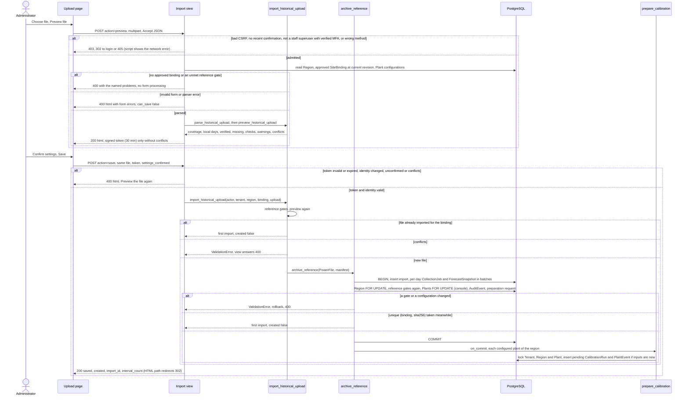

# Import a historical provider export as reference data

A platform administrator uploads a Solcast estimated-actuals export (JSON or CSV) for a plant's approved reference binding in the admin console, previews it with its plausibility checks, then saves it with a signed preview token. An operator can instead run the `import_historical_reference` command with the same kind of file. Both paths go through one importer and write one idempotent archive per binding and file digest: one succeeded collection job and one estimated-actuals snapshot per local day. A new archive records a calibration preparation request for the region's configured plants in the same transaction, and one preparation attempt runs after commit.

## Entry points

- Screen: the plant review page (`src/pyracast/regions/templates/admin/regions/region/setup.html`) links to `src/pyracast/regions/templates/admin/workspace/historical_import.html` and lists the plant's last 20 imports. The import page loads `admin-historical.js` and `admin-historical.css` from `src/pyracast/regions/static/pyracast/`. The script intercepts submit (and a dropped file) and posts `FormData` with `Accept: application/json`; the response fragment is `src/pyracast/regions/templates/admin/workspace/historical_preview.html`. Without JavaScript the form posts normally and the administrator must select the same file again before saving.
- Endpoint: `GET|POST /admin/plants/{id}/historical-import/` (route name `admin:workspace_historical_import`; `{id}` is a Region pk) -> `pyracast.platform_admin.historical.historical_import(request, region_id, site=...)`. Operations: `pyracast.forecasts.historical_upload.parse_historical_upload`, `preview_historical_upload`, `import_historical_upload` -> `pyracast.forecasts.historical_import.archive_reference`; the reference gates are `pyracast.forecasts.trust.reference_problems`.
- Command: `manage.py import_historical_reference --username --tenant-id --region-id --file --reference --confirm [--source-timezone] [--period]` (`src/pyracast/forecasts/management/commands/import_historical_reference.py`): reads the file with `irradiance.solcast_export.read_trusted_file`, then `parse_historical_upload` and `import_historical_upload` for the region's approved binding.
- Follow-up: the archive calls `plants.preparation.request_region_preparation`, which stamps `calibration_preparation_due_at` on each plant of the region with a current configuration and registers `transaction.on_commit` -> `_prepare_after_commit` -> `prepare_calibration`. A failing attempt never fails the import: the `calibration` phase of `dispatch` prepares what is left (`prepare_requested_calibrations`) and later sends each pending run to the Dramatiq actor `calibrate_plant` on queue `calibration` (`plants.runtime.dispatch_calibrations`).

## Sequence

## Data

| Table | R/W | What |
| --- | --- | --- |
| `regions_region` | R (lock) | Soft-delete filter, revision, approved binding; `FOR UPDATE` only for the archive's final check and commit, and again in calibration preparation |
| `connections_sitebinding` | R | Approved binding at the region revision, re-read for the final check; reference settings and `timezone` drive comparison, plausibility and local-day split |
| `connections_provideraccount` | R | `provider == "solcast"`, authorization reference and authorizer, enabled, authorized and credential revision for `binding_is_current`; never locked |
| `plants_plant` | R (lock), W | `(pk, current_configuration_id)` pinned in the token and re-read `FOR UPDATE` on console save; `calibration_preparation_due_at` stamped by the archive; locked again per plant in preparation |
| `forecasts_historicalreferenceimport` | R/W | Lookup by `(binding, content_sha256)` for the preview check and a repeat; new row with manifest, source name, actor, import time, interval count; the plant page lists the last 20 |
| `forecasts_collectionjob` | R/W | One `endpoint="historical_import"`, `status="succeeded"` job per local day, `scheduled_for` and `available_at` = import time; job status, endpoint and import are read when preparation selects reference sources |
| `forecasts_forecastsnapshot` | W, R | One `source_kind="estimated_actuals"` snapshot per day with the day's raw rows plus `historical_import` `{"id", "sha256"}`, normalized intervals, `issued_at` null, `available_at` = import time; read back as reference by preparation |
| `regions_auditevent` | W | `historical_reference_imported` with region revision (no import id) |
| `plants_calibrationrun`, `plants_plantevent` | R/W | Pending run and `calibration_scheduled` event per plant whose inputs changed, after commit |
| `plants_plantconfiguration`, `plants_productionobservation`, `metering_epiasconnection`, `metering_epiassnapshot`, `metering_epiascollectionjob`, `incidents_plantincident`, `incidents_incidentrevision`, `plants_calibrationactivation` | R | Current configuration, measurement (snapshot job checked for source and configuration), incident (plant boundary) and comparison inputs of calibration preparation |
| `django_session` | R/W | Console access; `SessionLifetime` refreshes `last_activity_at` or logs out an expired session; the session key hash is part of the preview identity |
| `auth_user`, `mfa_authenticator` | R | Console access and MFA check |

## Authorization

- Console: the console gate (`admin-console-access`): an active staff superuser with MFA evidence for a live authenticator, a proof by the authenticator within the last hour for every request and a recent confirmation for every unsafe one. `admin_view` redirects everyone else to the admin login, which redirects to `/app/?next=/admin/`; a missing proof answers the 403 confirmation page. `SessionLifetime` logs out sessions idle for 30 days or older than 90 days. The view itself has no tenant check: platform administrators act on any region, and the view passes the region's own `tenant_id` to the operation.
- Preview token: `django.core.signing` salt `historical-upload-preview-v1`, `max_age=1800`; signed, not encrypted and not single-use. It binds actor, session key hash, file digest, file name, parser options, region pk and revision, binding ids, plant configuration ids, region timezone and binding reference settings.
- Operation: `import_historical_upload` calls `require_platform_admin` (active staff superuser). The reference gates (`trust.reference_problems`, named problem codes with messages in `trust.PROBLEM_MESSAGES`) require `binding_is_current` (region not deleted and approved at that revision with this approved binding, account enabled and authorized, credential revision validated), a Solcast account with authorization reference and authorizer, `validated_at`, `capacity_semantics_verified`, a settings verification reference and `power_basis == "ac"`; they run before the preview, in the operation and again under the region lock.
- Command: the actor is looked up by username and must pass `require_platform_admin`; no MFA. The region is looked up with `tenant_id`; the target is its approved binding. The file must be an existing `.json` or `.csv` inside the current working directory (`read_trusted_file` trusted root), and `--confirm` stands for the console's confirmation.
- Database: unique `(binding, content_sha256)` and `(reference_import, target_date)`; the deferred composite FK `collectionjob_reference_import_binding_fk` keeps a job's import on the same binding; `collectionjob_reference_import_chk` ties the `historical_import` endpoint to an import and `collectionjob_import_status_chk` keeps import days `succeeded`. A trigger refuses every update of a stored import and `forecastsnapshot_publication_guard` every change of a published snapshot; deletes stay open, and `pyracast.trash._purge_region` deletes the archive with a purged region.

## Failure paths

| Condition | Result |
| --- | --- |
| Not signed in, not staff superuser, no verified MFA | 302 to admin login |
| Missing CSRF token, or POST without a recent authenticator confirmation; method other than GET or POST; region unknown or soft-deleted | 403 HTML (JS cannot parse it and shows "The request failed. Try again."); 405; 404 |
| No approved binding at the current revision, or an unmet reference gate | GET 200 listing the problems ("This plant cannot take imported history yet") instead of the form; POST 400 with the same messages, for example "Approve the current Solcast configuration before importing." |
| Request body over 8 MiB | Refused by the Traefik `admin-body-limit` middleware (`deploy/routes.yml`) before Django |
| No file, empty file or file over 7 MiB; an `action` other than preview or save | 400 with the form message, parser not called |
| Over 200,000 rows, JSON nested deeper than 32, duplicate keys or columns, nonfinite values, a NUL character, not UTF-8 JSON/CSV, forecasts instead of `estimated_actuals`, conflicting or non-object metadata, unknown operator timezone | 400 with the parser message, nothing written |
| Not exactly one of `pv_power_rooftop` or `pv_estimate`, negative or nonfinite power, naive timestamp without a zone, ambiguous or nonexistent local time | 400 with the parser message |
| Interval period not PT30M or PT60M, bounds disagree, unsorted or overlapping, an interval before 2007-01-01, future interval, settings change within the file, mixed products or periods | 400 with the parser message |
| File metadata conflicts with the binding; interval power above 1.01 times the AC reference capacity; the binding already holds the file ("This file was already imported on ... by ...") | Preview 200 with the conflict, the failed check and no token; save 400 "Resolve the file conflicts before importing." |
| Every interval below 1 % of the reference capacity over several local days | Preview warning and failed check; saving stays possible |
| Token missing, tampered or older than 30 minutes | 400 "The preview expired or is invalid. Preview the file again." |
| File, file name, options, session, actor, region revision or timezone, binding or plant configuration changed since preview | 400 "The file or selected configuration changed. Preview the file again." |
| Confirmation unchecked | 400 "Confirm the selected reference configuration." |
| Plant configuration changed before the lock; a gate failing under the lock | 400 "The plant configuration changed. Preview the file again." / the gate's message; rolled back |
| Region or binding gone after the view read | 409 "The plant or its connection changed while saving, so nothing was saved. Reload this page." |
| Same file saved between preview and save, or by a concurrent request | 200 `saved` with `created: false` and the first import's id; no new rows, audit or preparation request |
| Save meets a locked record (wait over 5 s), a deadlock or a statement over 60 s | Nothing saved; the script gets 503 JSON with a retry message and keeps the preview, a plain form gets the message after a redirect |
| Exception in the after-commit preparation attempt | Logged per plant and left to the calibration phase; the import still succeeds |
| Another request of the same session still running after a 5 s wait | 503 HTML busy page (a GET reloads once, a POST is never replayed), which the script cannot parse and shows the network error |
| Command: no `--confirm`, file outside the working directory or not CSV or JSON, unknown user or region, no approved binding, a parser, gate or conflict refusal | `CommandError` "Historical reference import failed: ..." |
| Command: lock timeout, deadlock or statement timeout | `CommandError` "Historical reference import failed: the plant is busy; retry."; another database error propagates |
| Command: the binding already holds the file | Exit 0, "Historical reference import N: ...; already imported at ...". |

## Rules and invariants

- One importer: the console and the command both call `import_historical_upload` with a parsed upload, so the parser, plausibility checks, gates and manifest are the same on both paths.
- Locks: `archive_reference` writes the import, jobs and snapshots before it takes the Region row lock, so collection and reads of the plant wait only for the final check and commit; it locks the Plant rows in pk order on the console path and never locks the provider account or the binding. Preparation after commit runs outside that transaction and locks Tenant, Region, then Plant. The request also holds the per-session advisory lock for its whole duration.
- Idempotency key is `(binding, sha256 of the exact bytes)`; the file name, options and source reference are not part of it. A repeat on either path returns the first import unchanged.
- The upload is parsed twice on save, once in the view and once in the operation's preview, and the gates are checked again under the lock. Interpretation options are part of the token, so a changed timezone or period forces a new preview. A naive timestamp uses the operator's timezone, otherwise a valid `source_timezone` or `timezone` declared in the file. If both are given, differ and a naive timestamp was read, the upload is rejected; offset-aware timestamps ignore both. JSON is read by the strict loader `irradiance.solcast_export.parse_json`.
- Plausibility checks are reported by name in the preview: `power_within_capacity` (a conflict), `power_not_implausibly_small` (a warning) and `not_imported_before` (a conflict).
- Days are split in the binding's timezone; an interval crossing local midnight is stored in both day snapshots. Coverage is stored per snapshot from the first and last contained interval.
- Manifest: `product` is always `historical_rooftop_pv`, even for a `pv_estimate` column; `settings_matched` is true only when the binding declares DC capacity, and settings absent from the file are recorded as `operator_declared_fields`. The file's product, metadata, warnings and binding revision go to `upload_provenance`. Calibration pooling (`plants/calibration_data.py`) reads `product` and treats `settings_matched` false as `unknown`. Customers receive only an allowlisted part of the stored manifest (`api/public.py`); source name, source reference and file metadata stay with operators.
- No provider request is made. Calibration work is only requested and queued as a pending run; workers pick it up through the dispatcher. Preparation creates a run only when the binding is still current, no run is pending or running, matched measurement days exist and the input fingerprint is new.

## Tests

- `tests/test_admin_historical.py`: preview then save, repeat idempotence, changed file, token, confirmation, options, configuration or reference, session-bound token, access (anonymous, member, admin without MFA), CSRF 403, 405, missing binding, invalid file, expired token, no-JavaScript reselect path, conflict, oversized file. `tests/test_console_failures.py` (retry message for a save that meets a locked record, busy session page), `tests/test_console_step_up.py` (recent confirmation), `tests/test_console_actions.py` (a preview stores nothing).
- `tests/test_historical_importer.py`: one importer for both paths, plausibility checks, archive start, NUL characters, repeats, the region lock and the command. `tests/test_historical_upload.py`: offsets, DST ambiguity, naive zones, CSV and Hobby columns, 30 and 60 minute periods, limits and depth, metadata verification and conflicts, unknown DC capacity, recheck under locks, hourly energy through calibration, concurrent uploads.
- `tests/test_historical_reference_import.py`: binding authorization and DC basis, tenant and region boundaries, future and empty input, midnight-crossing and DST days, rollback before preparation, one preparation after commit, uniqueness, concurrent imports, the trusted-root guard. `tests/test_reference_trust.py`: the named gates.
- Related: `tests/test_calibration_requests.py` (the import commits while preparation raises), `tests/test_archive_invariants.py` (import trigger, import endpoint and status checks, snapshot guard), `tests/test_relational_integrity.py` (composite FK), `tests/test_trash_operations.py` (purge deletes imports), `tests/test_reference_cohorts.py` and `tests/test_calibration_source_validation.py` (pooling by `product` and `settings_matched`, on hand-built import rows). `web/tests/admin-historical-upload.spec.ts` (stub Node server, not Django): preview and save post to the page with or without a form `action`; a save that meets a busy record shows the retry message and keeps the preview.
- Gaps: no test for the HTML busy page or a 403 page in the script, the product label of a `pv_estimate` upload, or a browser test against the real backend.
