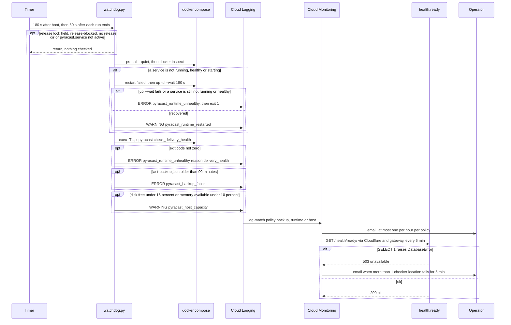

# Host watchdog, health probes and alerts

A systemd timer runs `deploy/watchdog.py` about once a minute on the production VM. It restarts failed Compose services, runs the delivery health command, flags a stale backup and low disk or memory, and writes structured events to Cloud Logging. Cloud Monitoring turns those events into rate-limited operator emails and runs an independent HTTPS uptime check on `/health/ready/`.

## Entry points

- `pyracast-watchdog.timer` and `.service` run `deploy/watchdog.py` `main`, then `supervise`. `pyracast.service` (oneshot, `RemainAfterExit`) starts Compose and drains it on stop. The startup script `infra/terraform/templates/startup.sh.tftpl` rewrites all units on every VM boot.
- `GET /health/live/` and `GET /health/ready/`: `pyracast.health.live` and `pyracast.health.ready` in `pyracast.urls`. Real consumers all use `ready`: Compose `api` healthcheck, `deploy/install-release.sh`, `deploy/smoke.sh`, the uptime check.
- `deploy/operations_log.py` `report` (the only event writer, also used by `deploy/backup.py`) and `infra/terraform/monitoring.tf` (notification channel, uptime check, four alert policies). No frontend screen.

## Sequence

## Data

| Table or file | R/W | What |
|---|---|---|
| `forecasts_dispatcherstatus` | R | Phase freshness, read by `check_delivery_health` through `forecasts.monitoring.delivery_health`. Written by the dispatcher, not by this flow |
| `CollectionJob`, `NotificationDelivery`, `EpiasCollectionJob`, `ProviderAccount`, `Region`, `ForecastSnapshot`, `ReminderSchedule` and their joins | R | Same command, backlog and failure counters (flow `delivery-health-check`) |
| `/var/lib/pyracast/release-blocked`, `last-backup.json`, `/proc/meminfo`, disk usage of `/` and `/var/lib/pyracast` | R | Release block, backup recency (marker mtime, else `release.env` mtime), capacity |
| Cloud Logging log `pyracast-operations` | W | One `entries:write` per event (`gce_instance`, `jsonPayload.event`); the payload also goes to stderr |

## Authorization

- Probes are anonymous. Port 443 accepts only Cloudflare ranges, and the gateway routes `PathPrefix` `/health/` to `api` (`deploy/routes.yml`). `require_safe` allows GET and HEAD only (others 405). `SECURE_REDIRECT_EXEMPT` lets the plain-HTTP Compose probe skip the HTTPS redirect.
- The watchdog runs as root under systemd and reaches the database only through `exec api` with the runtime role. `report` uses the VM service account token (`roles/logging.logWriter` in `infra/terraform/iam.tf`). Alert email goes to `var.acme_email`.

## Failure paths

| Condition | Result |
|---|---|
| Database unreachable | `ready` 503 `unavailable`, no detail, `no-store`. Compose marks `api` unhealthy; the watchdog restarts it, `up --wait` fails and the generic runtime event repeats each run. The uptime alert fires after 5 min |
| Services not recovered, or a Compose command fails or times out (240 s) | `up --wait` failure gives only the generic `pyracast_runtime_unhealthy`; if it succeeds but a service is still down, a detailed event precedes the generic one. Exit 1, retried next run. A run past `TimeoutStartSec=300` is killed by systemd with no event |
| `check_delivery_health` exits non-zero | `pyracast_runtime_unhealthy` with `reason=delivery_health`, output discarded, no remediation |
| `check_delivery_health` exceeds 60 s | `TimeoutExpired`, generic event, backup and capacity checks skipped that run |
| Metadata server or Logging API unreachable | stderr `pyracast_operations_log_failed`, the alert is lost, the run continues. Other exceptions from `report` propagate |

## Rules and invariants

- One lock, `/run/lock/pyracast-release.lock`. The watchdog takes it non-blocking and exits 0 when busy. Backup also exits 0 on conflict, so a collision silently skips an hourly backup. `install-release.sh` waits 300 s and `ExecStop` waits for it, then drains with `compose stop --timeout 660` inside `TimeoutStopSec=960`.
- The release block is honoured twice: `ConditionPathExists=!` on the units and in `supervise`. While blocked or stopped, every watchdog check is off and only the uptime alert remains.
- Before recovery `starting` counts as healthy, afterwards only `running` and `healthy`; `restarting` counts as failed. `SERVICES` is a fixed list without `migrate`. Failed existing containers are restarted first to reset the `on-failure:5` budget, then `up -d` recreates missing ones.
- Event names are the contract with `monitoring.tf`: one notification per 3600 s per policy, auto-close after 86400 s, while events repeat every minute. `pyracast_runtime_restarted` and `pyracast_backup_succeeded` match no policy. The readiness policy counts failing checker locations (more than 1 for 300 s).

## Tests

- `tests/test_health.py` (live, ready, 503 body, 405), `tests/test_deployment_watchdog.py` (capacity thresholds, recovery only while `pyracast.service` is `active`, release-blocked no-op), `tests/test_deployment_backup.py` (`report` fallback and propagation), `tests/test_deployment_helpers.py` (Python 3.12 syntax), `deploy/smoke.sh` (`ready` through the gateway), `deploy/test-release.sh` (installer lock wait and readiness gate).
- Gaps: `inspect_services`, delivery failure event, backup staleness, unrecovered services, `main` locking, `report` payload, unit files and `monitoring.tf` filters are untested.
