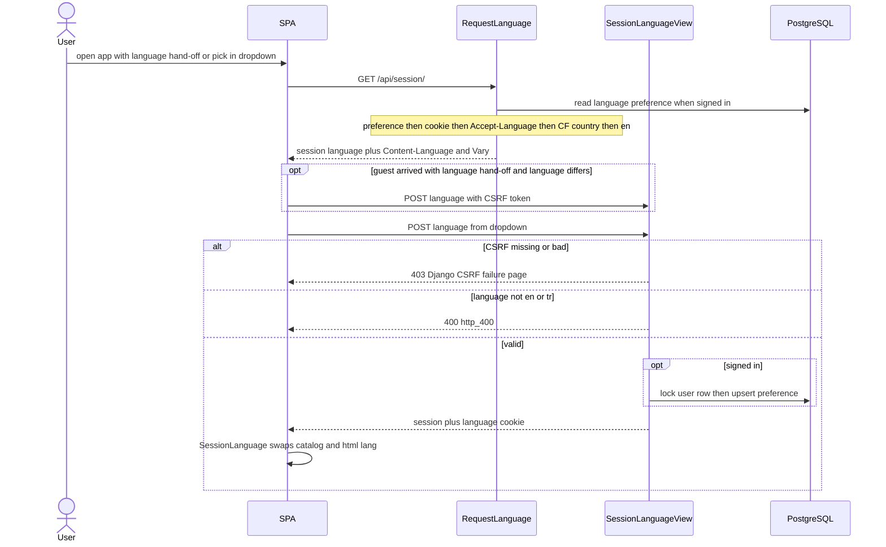

# Language selection, persistence and rendering

A visitor, a signed-in user or a platform administrator picks English or Turkish in the app dropdown, the console switcher or a public-site link. The choice is stored in the `pyracast_language` cookie and, for signed-in users, in `accounts_userlanguagepreference`. Every later request resolves one language that drives API errors, Django templates, mail and the SPA catalogs.

## Entry points

- `POST /api/session/language/`: `pyracast.api.session.SessionLanguageView` (anonymous or signed-in, CSRF required).
- `POST /admin/language/`: `pyracast.admin.PlatformAdminSite.language`, form buttons in `admin/workspace/base.html` (active staff superuser with verified MFA).
- Every request: `pyracast.accounts.language.RequestLanguage` middleware, resolves `request.LANGUAGE_CODE` and `Content-Language`.
- SPA: `web/src/components/language-select.tsx` `LanguageSelect` (sidebar in `dashboard.tsx`, form panel in `auth.tsx`), `web/src/components/session-language.tsx` `SessionLanguage`, and the `?language=` hand-off effect in `Dashboard` (`dashboard.tsx`, also rendered by `app/invitations/accept/page.tsx`) fed by the login link in `public-site/site-shell.tsx` and the signup link in `public-site/home-page.tsx`.
- Next.js render: `web/src/i18n/request.ts` (server locale), `web/src/app/layout.tsx` (`<html lang>`), `web/src/app/app/layout.tsx` (re-exported by `app/invitations/accept/layout.tsx`), `web/src/proxy.ts` (public path language header), `web/src/i18n/browser.ts` `browserErrors` (client error strings from `<html lang>`).
- Shared web modules: `web/src/i18n/language.ts` (`languages`, `isLanguage`, the `en`/`tr` guard used by `request.ts`, `browser.ts`, `LanguageSelect`, `SessionLanguage`, the `Dashboard` hand-off and `lib/production.ts`) and `web/src/i18n/messages.ts` (`messages`, the per-language catalogs).
- Mail: `AccountAdapter.send_mail`, `accounts.invitations.invite_workspace_member`, `notifications.mail.build_message` and `build_unavailable_message`.
- Operator: `scripts/translations.py` (compile or `--check` the `.po` catalogs; `scripts/check.py` runs `--check`).

## Sequence

## Data

| Table | R/W | What |
| --- | --- | --- |
| `accounts_userlanguagepreference` | R | One query per authenticated request in `RequestLanguage`, again in `SessionUserOutput`, mail adapters |
| `accounts_userlanguagepreference` | W | `save_user_language` (API, console), `CompanySignupForm.signup` creates it from the cookie |
| `auth_user` | lock | `select_for_update` inside `save_user_language` |
| `notifications_notificationdelivery` | R | `language` selects the reminder catalog; the scheduler copies it from `notifications_reminderschedule` |

## Authorization

- API: `SessionLanguageView` is `AllowAny` (overrides the workspace permissions). DRF views are `csrf_exempt`, so `CsrfViewMiddleware` skips them; the `csrf_protect` decorator on `dispatch` enforces CSRF before DRF runs. The target is always `request.user`, never a payload id.
- Console: `admin_view` wraps the view in `csrf_protect` (and `CsrfViewMiddleware` runs first), so CSRF is checked before `has_permission` (active staff, superuser, verified MFA); `next` is limited by `url_has_allowed_host_and_scheme`.
- Database: `supported_user_language` check constraint, one-to-one `user` key. `proxy.ts` deletes any inbound `x-pyracast-public-language` header, so clients cannot force a public language.

## Failure paths

| Condition | Result |
| --- | --- |
| Missing or wrong CSRF token (API or console) | 403 from Django's CSRF failure view (HTML, not `http_403` JSON), localized, `Content-Language` still set |
| Unsupported or missing `language` | API 400 `{"code":"http_400","detail":{"language":[...]}}`, console 400 empty body, nothing written |
| Console non-POST / caller not a verified superuser | 405 `Allow: POST` / 302 to `/admin/login/`, which redirects to `/app/?next=/admin/` |
| `auth_user` row lock not granted within the 5 s `lock_timeout` | API 503 `workspace_busy`, `Retry-After: 1`; console unhandled error (500) |
| Session advisory lock busy for 5 s (request carries a well-formed session cookie) | 429 `session_busy`, `Retry-After: 1`, English `detail`, returned outside `RequestLanguage` |
| `?language=` POST fails / value not `en` or `tr` | `entry.status` `failed`, `Language.failed` text and a retry button / ignored, no POST, parameter stays in the URL |
| Dropdown POST fails | select keeps the old locale, `role="alert"` `Language.failed` |
| Accept-Language over 8192 bytes (no preference or cookie) | treated as rejecting `*`, result `en` |

## Rules and invariants

- Precedence is account preference, cookie, `Accept-Language` best q, `CF-IPCountry` `TR`, `en`. `tr;q=0` or `*;q=0` suppresses the Turkish country fallback. `TrustedProxyHeaders` pops `CF-IPCountry` and restores it only when the peer is a trusted proxy, upstream CIDRs are configured and the last `X-Forwarded-For` hop is in them.
- Automatic detection is never persisted. Only the dropdown, the guest `?language=` hand-off (skipped for signed-in users and matching sessions), the console switcher and signup (from an explicit cookie) write.
- API and console writes lock the `auth_user` row first so concurrent devices serialize on one preference row; `update_or_create` is last-write-wins. Signup inserts without the lock.
- Cookie: one year, `Secure` unless DEBUG, `HttpOnly`, `SameSite=Lax`, so only server code (Django and `request.ts`) reads it. The SPA learns the language from `Session.language`.
- Next.js server locale uses the public path header, else the cookie, else `en`; it never reads the account preference. The SPA overrides it from the session in `SessionLanguage` before any workspace content renders (`DashboardView` shows a neutral spinner until `current` exists).
- `lib/api.ts` `request` queues `/api/session/` mutations, so a language POST waits behind other session calls.
- Mail pins its language at send time: auth mail uses the user's preference or the request language and runs in `transaction.on_commit`; invitation mail uses the inviting administrator's preference, else `en`, and is delivered on commit; reminder mail renders under the delivery's `language`.
- Catalogs: `.po` files live in `accounts`, `notifications` and `regions` `locale/tr`; `.mo` files are committed. The check fails on untranslated or fuzzy entries, changed `%(name)` placeholders and a `.mo` that differs from the compiled `.po`. Web catalogs are `web/messages/{en,tr}/*.json`, merged shallowly in `i18n/messages.ts`.

## Tests

- `tests/test_language.py`: priority, q-values, cookie flags, CSRF, ownership, concurrency, trusted country, signup copy, mail pinning, console switcher and redirect safety. Also `tests/test_admin_language_controls.py`, `test_api_localization.py`, `test_translations.py` (catalog check, over-long header), `test_transactional_mail.py`, `test_notification_language.py`, `test_session.py`, and `test_workspaces.py` (invitation mail).
- Playwright: `web/tests/localization.spec.ts` (hand-off, stale cookie, failure, ICU parity, and a coded forecast error resolved by `browserErrors` in Turkish, then in English after a switch), `web/tests/public-site.spec.ts` (path language, spoofed header), `web/integration/language.spec.ts` (preference on a new browser).
- Gaps: no test of `i18n/request.ts` precedence against a real preference, none for the language of `session_busy`, none for the invitation fallback to `en`, none for the `auth_user` lock timeout.
