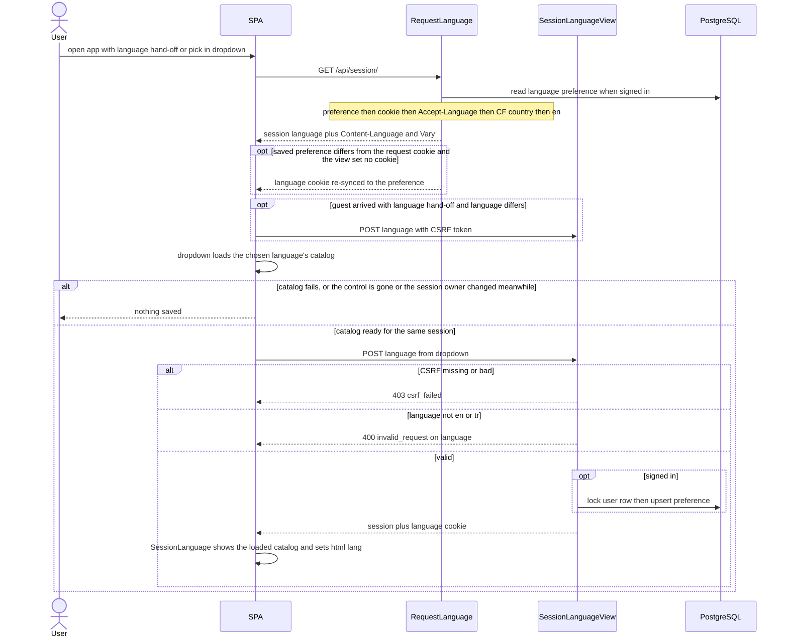

# Language selection, persistence and rendering

A visitor, a signed-in user or a platform administrator picks English or Turkish in the app dropdown, the console switcher or a public-site link. The choice is stored in the `pyracast_language` cookie and, for signed-in users, in `accounts_userlanguagepreference`. Every later request resolves one language that drives API errors, Django templates, mail and the SPA catalogs.

## Entry points

- `POST /api/session/language/`: `pyracast.api.session.SessionLanguageView` (anonymous or signed-in, CSRF required, JSON body only).
- `POST /admin/language/`: `pyracast.platform_admin.access.language` (route `workspace_language` of `PlatformAdminSite`), form buttons in `admin/workspace/base.html`; a console write, so it needs a platform administrator session and a recent confirmation with the authenticator.
- Every request: `pyracast.accounts.language.RequestLanguage` middleware, resolves `request.LANGUAGE_CODE` and `Content-Language`.
- SPA: `web/src/ui/language-select.tsx` `LanguageSelect` (sidebar in `features/workspace/workspace-shell.tsx`, form panel in `features/auth/auth.tsx`), `web/src/features/session/session-language.tsx` `SessionLanguage` and the `?language=` hand-off `useLanguageHandoff` (`features/session/language-handoff.ts`), both mounted by `AppRoot` (`features/session/app-root.tsx`, the `/app` layout), fed by `routes.signIn` and `routes.signUp` (`lib/routes.ts`) in `features/public-site/site-shell.tsx` and `home-page.tsx`.
- Next.js render: `web/src/i18n/request.ts` (server locale), `web/src/app/layout.tsx` (`<html lang>`), `web/src/app/app/layout.tsx` (outer provider with `messages={null}`; only `SessionLanguage` supplies the catalog), `web/src/proxy.ts` (public path language header), `web/src/i18n/browser.ts` `browserErrors` (client error strings from `<html lang>` and the shell catalog), `web/src/app/global-error.tsx` (shell catalog).
- Shared web modules: `web/src/i18n/language.ts` (`languages`, `isLanguage`, the `en`/`tr` guard), `web/src/i18n/catalogue.ts` (`loadCatalogue`, `useCatalogues`: the browser's on-demand full catalog per language), `web/src/i18n/en.ts` `english` and `web/src/i18n/tr.ts` `turkish` (the full catalogs), `web/src/i18n/shell.ts` `shell` (the shell catalog of both languages) and `web/src/i18n/messages.ts` (`messages`, both full catalogs, server render only).
- Mail: `AccountAdapter.send_mail`, `accounts.invitations.invite_workspace_member`, `accounts.event_mail.recipient_language`, `purge_warning`, `notifications.mail.build_message` and `build_unavailable_message`.
- Operator: `scripts/translations.py` (compile or `--check` the `.po` catalogs).

## Sequence

## Data

| Table | R/W | What |
| --- | --- | --- |
| `accounts_userlanguagepreference` | R | One query per authenticated request in `RequestLanguage`, again in `SessionUserOutput`, mail adapters and workers |
| `accounts_userlanguagepreference` | W | `save_user_language` (API, console); `register_account` (called by `AccountSignupForm.signup`) creates it from the request language |
| `auth_user` | lock | `save_user_language` takes the row `FOR NO KEY UPDATE` |
| `notifications_outboundmail` | W | `language` and `owner_language`, stored with the intent |
| `notifications_notificationdelivery` | R | `language` selects the reminder catalog; the scheduler copies it from `notifications_reminderschedule` |

## Authorization

- API: `SessionLanguageView` is a public route of the route policy (`RoutePolicy`), so no workspace permission applies. DRF views are `csrf_exempt`, so `CsrfViewMiddleware` skips them; the `csrf_protect` decorator on `dispatch` enforces CSRF before DRF runs. The target is always `request.user`, never a payload id.
- Console: `admin_view` wraps the view in `csrf_protect`, then `has_permission` (active staff superuser with MFA evidence), then the confirmation gate for unsafe methods; `next` is limited to a same-origin console path by `console_destination`.
- Database: `userlanguagepreference_language_chk` check constraint, one-to-one `user` key. `proxy.ts` deletes any inbound `x-pyracast-public-language` header, so clients cannot force a public language.

## Failure paths

| Condition | Result |
| --- | --- |
| Missing or wrong CSRF token (API) | 403 `csrf_failed` JSON from `api.error_pages.csrf_failure`, localized, `Content-Language` still set |
| Missing or wrong CSRF token (console) | Django's HTML CSRF failure page |
| Unsupported or missing `language` | API 400 `invalid_request` with `fields.language`, console 400 empty body, nothing written |
| Console non-POST / caller without a console session | 405 `Allow: POST` / 302 to `/admin/login/`, which sends the browser to `/app/` |
| Console POST without a recent authenticator confirmation | 403 confirmation page; neither the preference nor the cookie is stored |
| `auth_user` row lock not granted within the 5 s `lock_timeout` | API 503 `busy`, `Retry-After: 1`; console redirect with a retry message (JSON `message` for a JSON caller) |
| Session advisory lock busy for 5 s (request carries a well-formed session cookie) | 429 `session_busy`, `Retry-After: 1`, message in the language the cookie, `Accept-Language` or country gives (the preference is not read), returned outside `RequestLanguage` |
| `?language=` POST fails / value not `en` or `tr` | Retry screen with the `Language.failed` text in the session's language and a retry button / ignored, no POST, parameter stays in the URL |
| Dropdown POST fails | select keeps the old locale, `role="alert"` `Language.failed` until the shown language is the one it tried to save (for example after another tab saved it); nothing is shown when the session owner changed meanwhile |
| Dropdown catalog cannot load, or the catalog of a language another tab chose for this session | nothing saved, the shown language stays, `role="alert"` `Language.unavailable` with a `Language.reload` button that reloads the page |
| Session owner changed or the control unmounted while the catalog loads | nothing saved, nothing shown |
| Catalog cannot load before the first screen (also after a hand-off) | bootstrap screen with `AppError.description` and a retry that reloads the page |
| Accept-Language over 8192 bytes (no preference or cookie) | treated as rejecting `*`, result `en` |

## Rules and invariants

- Precedence is account preference, cookie, `Accept-Language` best q, `CF-IPCountry` `TR`, `en`. `tr;q=0` or `*;q=0` suppresses the Turkish country fallback. `pyracast.proxy.TrustedProxyHeaders` removes `CF-IPCountry` and restores it only when the peer is a trusted gateway, upstream CIDRs are configured and the last `X-Forwarded-For` hop is in them.
- Supported languages are `accounts.models.Language`, `settings.LANGUAGES` and the `Language` literal of `pyracast.languages`; `tests/test_vocabularies.py` pins them together. `save_user_language` refuses any other code.
- Only the dropdown, the guest `?language=` hand-off (skipped for signed-in users and matching sessions), the console switcher and signup write the account preference. Signup saves the language the form was shown in, so a detected language becomes the new account's preference.
- API and console writes lock the `auth_user` row first so concurrent devices serialize on one preference row; `update_or_create` is last-write-wins. Signup inserts without the lock.
- `RequestLanguage` reads the preference once before the view; after it, when the preference differs from the request cookie and the response sets no language cookie, it writes the preference as the cookie, so the next full load renders the saved language on the server.
- Cookie: one year, `Secure` unless DEBUG, `HttpOnly`, `SameSite=Lax`, so only server code (Django and `request.ts`) reads it. The SPA learns the language from `Session.language`.
- Next.js server locale uses the public path header, else the cookie, else `en`; it never reads the account preference. The SPA overrides it from the session before any workspace content renders: `useSessionLanguage` (`session-language.tsx`) keeps `AppRoot` on the bootstrap screen with the shell catalog until the first session read and any `?language=` hand-off have settled (a pending hand-off loads no catalog), then loads the session language's catalog before the first screen. A later change keeps the shown catalog until the next one has loaded, so a screen never mixes languages.
- The dropdown loads the chosen catalog before it saves, and saves only when, once the catalog has arrived, the control is still mounted and `sessionOwner` is unchanged; a choice made on the sign-in screen is never saved for the account that signed in meanwhile. A failed catalog chunk stays failed for the document, so only a page reload retries it.
- The API client lane (`lib/api/lane.ts`) queues `/api/session/` and `/api/auth/` calls one after another, so a language POST waits behind other session calls.
- Mail pins its language in the stored `OutboundMail` intent, never at send time, and the notification worker renders under it. Account mail uses the context user's preference, else the request language; mail asked without a signed-in account (`owner_language`) uses the preference of the account owning the address when the worker reads it. Invitation mail uses the console form's language, else the administrator's preference, else the request language. Event mail (plant review, administrator role and purge-warning notices) uses the recipient's preference, else `settings.LANGUAGE_CODE`. An unsaved reminder schedule offers the request language; reminder mail renders under the delivery's `language`.
- Catalogs: `.po` files live in `accounts`, `notifications` and `regions` `locale/tr`; `.mo` files are generated, ignored by git and never committed. `scripts/translations.py` compiles them; `--check` validates the `.po` sources only and fails on untranslated or fuzzy entries and changed `%(name)` placeholders. `scripts/check.py`, the CI jobs that run pytest, the dev launcher and the backend image build (`compilemessages`) compile them.
- Web catalogs are `web/messages/{en,tr}/*.json`, merged shallowly in `i18n/en.ts` and `i18n/tr.ts`, with equal key sets in both languages. The browser loads only the active language's full catalog, as an on-demand chunk; `shell.json` (`Bootstrap`, `AppError`, `Language`, `Errors`) is bundled for both languages and serves the bootstrap screen, `browserErrors` and `global-error.tsx`. Every enumeration label lives once in `Enums.<group>` of `core.json`, keyed by the generated OpenAPI enumeration; reason and quality-flag texts the API returns as codes are catalog objects keyed by code (for example `Calibrations.reasons`, `Forecast.qualityFlags`).

## Tests

- `tests/test_language.py`: priority, q-values, cookie flags, CSRF, ownership, concurrency, trusted country, cookie re-sync and its guard, signup language, mail pinning, console switcher and redirect safety. Also `tests/test_admin_language_controls.py`, `test_api_localization.py`, `test_translations.py` (catalog check, generated catalogs, over-long header), `test_notification_language.py`, `test_session.py`, `test_workspaces.py` (invitation mail, request-language fallback) and `test_notifications.py` (unsaved reminder language).
- Playwright: `web/tests/localization.spec.ts` (hand-off, stale cookie, failure, ICU and key parity, a coded forecast error shown in the selected language), `web/tests/vocabulary.spec.ts` (enumeration labels in both languages), `web/tests/catalogue-loading.spec.ts` (only the server and the active-language loader reach the full catalogs, shell contents), `web/tests/on-demand-sections.spec.ts` (one catalog per visit, hand-off without another language, unloadable catalogs, saves across sign-in and sign-out, a failed save cleared by another tab), `web/tests/public-site.spec.ts` (path language), `web/tests/security-headers.spec.ts` (spoofed header), `web/integration/language.spec.ts` (preference on a new browser).
- Gaps: no test of `i18n/request.ts` precedence against a real preference, none for the language of `session_busy`, none for the `auth_user` lock timeout, none for a stale-confirmation console POST.
