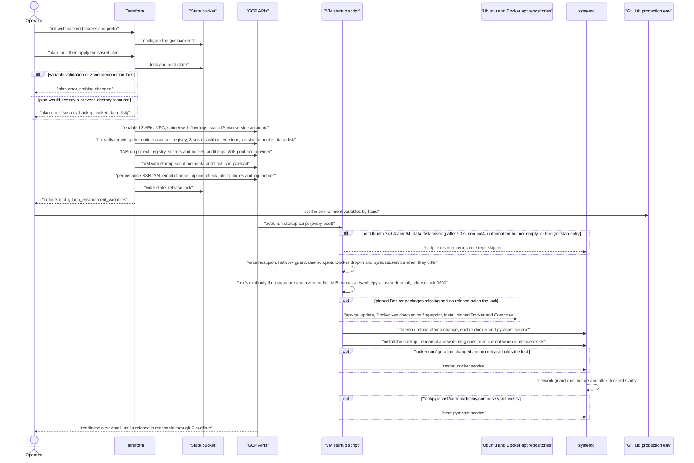

# Provision the Google Cloud environment with Terraform

An operator runs `terraform plan` and `apply` in `infra/terraform` (normally from Cloud Shell) against a private GCS state bucket created by hand. The result is one shielded Ubuntu VM with a static IPv4 address and a separate data disk, network and firewalls, Artifact Registry, three empty Secret Manager secrets, a backup bucket, service accounts and IAM, GitHub Workload Identity Federation and Cloud Monitoring alerts; the VM startup script then prepares Docker, the data disk, `/etc/pyracast/host.json`, `pyracast.service` and the Docker drop-in, and each release installs the backup, rehearsal and watchdog units from `deploy/systemd/`. The operator copies the `github_environment_variables` output into the GitHub `production` environment and the `instance_ip` output into a Cloudflare A record by hand.

## Entry points

- Operator commands `terraform -chdir=infra/terraform init -backend-config=...`, `plan -out=production.tfplan`, `apply production.tfplan`, `output -json github_environment_variables` (procedure in `docs/DEPLOYMENT.md`, "Create the infrastructure").
- Inputs: `infra/terraform/variables.tf` (validated variables), `terraform.tfvars.example`, `backend.hcl.example` (partial `backend "gcs" {}` in `versions.tf`). The local `terraform.tfvars`, `backend.hcl`, `*.tfplan` and `.terraform/` are git-ignored.
- Resources: `main.tf` (APIs, network, firewalls, registry, secrets, bucket, disk, optional disk snapshots, VM), `iam.tf` (service accounts, roles, audit logs, WIF, optional image-rescan identity), `monitoring.tf` (email channel, uptime check, log-based metrics, alert policies, security log bucket and sink), `outputs.tf`.
- VM trigger: Compute Engine runs `metadata.startup-script` (`infra/terraform/templates/startup.sh.tftpl`, with `infra/terraform/templates/network-guard.sh` embedded) on every boot.
- CI: `.github/workflows/ci.yml`, job "Deployment configuration and containers", steps "Validate Terraform without cloud credentials or backend access" and "Verify the boot script on a stubbed host without cloud access" (`deploy/test-boot.sh`). Dependabot (`.github/dependabot.yml`) proposes provider pin changes in `versions.tf` and `.terraform.lock.hcl`.

## Sequence

## Data

No PostgreSQL table is read or written. The stores that carry this flow's state:

| Table | R/W | What |
| --- | --- | --- |
| Terraform state (GCS bucket created by hand, prefix from `-backend-config`) | R/W | Resource IDs and the rendered startup script; no secret values |
| Local `terraform.tfvars`, `production.tfplan`, `.terraform/` (git-ignored) | R/W | Inputs, the saved plan that `apply` executes, provider cache |
| Secret Manager `<name>-runtime`, `-migration`, `-database` | W (secret resources only) | Created without versions; versions are added by hand in flow `secret-provisioning` |
| Instance metadata `startup-script` | W | Rendered template with `host.json` and network guard |
| `/etc/pyracast/host.json` (0600) | W (each boot, when it differs) | The keys of `deploy/host_contract.py` (domain, ACME email, backup bucket, pinned secret versions, `origin_pull_ca`; `daily_backups` only with the daily backup tier) |
| `/etc/fstab`, `/var/lib/pyracast/{postgres,rabbitmq,gateway,release.lock}`, `/opt/pyracast/releases` | W | Data disk mount `nodev,nosuid,nofail`; owned data directories; the release lock 0600 |
| `/etc/docker/daemon.json`, Docker apt source and key, `/usr/local/sbin/pyracast-network-guard` | W (when they differ) | Docker settings (iptables backend, `live-restore`); the guard script |
| `/etc/systemd/system/pyracast.service`, `/etc/systemd/system/docker.service.d/pyracast-data.conf` | W (when they differ) | Application unit, Docker mount and guard hooks |
| `/etc/systemd/system/pyracast-{backup,rehearsal,watchdog}.{service,timer}` | W (each release and boot) | Copied from `deploy/systemd/` |
| iptables chains `DOCKER-USER`, `PYRACAST_METADATA` | W (each Docker and application start) | Drop rule for `169.254.169.254` |
| GitHub `production` environment variables | W (by hand) | The `GCP_*` values and `PYRACAST_PUBLIC_ORIGIN` from the output (`GCP_MIGRATION_SECRET` is the short secret ID); a release treats `GCP_MIGRATION_SECRET_VERSION` and `PYRACAST_PUBLIC_ORIGIN` as optional (`latest` version, public probe skipped with a warning) |

## Authorization

- Operator: needs project-level rights to create every resource and access to the state bucket; nothing in the repository encodes or checks this.
- Runtime service account (`iam.tf`, VM identity, scope `cloud-platform` so IAM is the only limit): `logging.logWriter` (project), registry reader, `secretAccessor` on runtime and database secrets only, bucket `objectCreator` and `objectViewer` (no delete).
- Deploy service account: registry writer plus custom role with `artifactregistry.tags.delete`, `secretAccessor` on the migration secret only, custom discovery role, and per-instance `compute.osAdminLogin`, IAP tunnel (condition port 22) and `iam.serviceAccountUser` on the runtime account.
- `operator_members`: same per-instance SSH set as the deploy account (root through OS Login) plus a discovery role.
- GitHub: WIF provider `attribute_condition` requires the repository and owner numeric IDs, `refs/heads/main`, the exact `<repository>/.github/workflows/release.yml@refs/heads/main` workflow and environment `production`; `github_deploy` binds the deploy account to the repository ID. `GCP_DEPLOY_ENABLED` is a repository variable outside the output. With `image_rescan_reader`, a separate pool, provider and service account (registry reader only) serve the `image-rescan.yml` workflow alone.
- Network: 443 only from the hard-coded Cloudflare IPv4 list, 80 from anywhere (ACME), 22 only from the IAP range; all target the runtime service account; no egress rule. OS Login on, project SSH keys blocked, serial port off.
- Audit: Cloud Storage `DATA_READ` and `DATA_WRITE` and Secret Manager `DATA_READ` access logs are enabled project-wide.
- Containers: `pyracast-network-guard` drops forwarded traffic to `169.254.169.254` so only host processes can use the VM identity.

## Failure paths

| Condition | Result |
| --- | --- |
| An invalid variable (`name`, `domain`, `acme_email`, `data_disk_gb < 10`, a secret version, a retention period, a GitHub id, `origin_pull_ca`) | Plan error with the variable's `error_message` |
| `zone` not inside `region` | Plan error "zone must be within region." |
| Change would destroy a secret, the backup bucket or the data disk | Plan error from `prevent_destroy` |
| `init` with another prefix than the one holding the state (`backend.hcl.example` and `DEPLOYMENT.md` use `production`) | Empty state: the plan proposes creating everything and apply fails on existing names (not run) |
| VM replacement or delete while `deletion_protection = true` | Apply error |
| `machine_type` change (resize), or another field that needs a stop (service account, scopes, minimum CPU platform), on a running VM | The plan shows an in-place update; apply stops the VM, changes it and starts it again (`allow_stopping_for_update = true`), so the service is down meanwhile; a failed apply can leave it stopped, so check the VM's actual state before recovery |
| Host is not Ubuntu 24.04 amd64 | Script exits 1, nothing changed |
| Data disk not visible within 90 s | Startup script exits; first boot leaves no units |
| Disk has a non-ext4 filesystem, or no filesystem but a signature or a nonzero first MiB | Script exits 1 without formatting |
| `/var/lib/pyracast` already mapped to another device in fstab | Script exits 1 |
| apt, Docker key or repository failure, a key without the published fingerprint, or a pinned version the apt repository does not carry | Script stops at the failing line, later steps unchanged; previously enabled units still start at boot with the old files |
| The pinned packages or the Docker configuration need a change while a release holds the lock | Script exits 1 (run it again); a pending marker keeps the Docker restart due |
| Network guard exits non-zero | `docker.service` fails in `ExecStartPre`, so `pyracast.service` (`Requires=`) does not start: fail closed |
| `/var/lib/pyracast/release-blocked` present | `pyracast.service` is skipped by `ConditionPathExists`; the backup skips its run and the watchdog checks capacity and the block's age only; `pyracast_release_blocked` alerts once the block is older than an hour |
| Pinned runtime or database secret version missing or unreadable | `runtime_secrets.py` fails and the `pyracast_secrets_failed` alert fires; the first release aborts in `install-release.sh` before maintenance, later `pyracast.service` fails in `ExecStartPre` |
| Readiness unreachable (no release yet, DNS-only record, outage) | Uptime alert email after two or more checker locations fail for 5 minutes (inferred) |
| A `GCP_*` variable empty in GitHub, a malformed `GCP_ARTIFACT_REPOSITORY`, `GCP_INSTANCE`, `GCP_ZONE` or `GCP_MIGRATION_SECRET_VERSION` | Release step "Validate deployment configuration" exits 1 before cloud authentication. Other values are only checked for emptiness and fail later at authentication or Secret Manager access |
| OIDC token from another branch, workflow, environment or repository, or after a repository rename | Token exchange refused, release cannot authenticate |
| `fmt`, `init -lockfile=readonly` or `validate` fails in CI, or the boot script test fails | CI job fails, blocking release authorization |

## Rules and invariants

- Terraform never holds secret values: secrets are created without versions, and `host.json` carries only version resource names pinned to positive integers. The migration secret is outside `host.json`: `migration_secret_version` only feeds the `GCP_MIGRATION_SECRET_VERSION` output, and an empty variable in GitHub makes the release read `latest`.
- The startup script runs on every boot and changes the host only where what it would write differs. A metadata change is applied in place but takes effect only at the next boot or a manual rerun. `host.json` keys are typed by `deploy/host_contract.py`; a release refuses a bad key.
- Docker restarts only for its own changed configuration, never while a release holds the lock, and a pending restart stays due until it ran. The restart propagates to the `Requires=`-bound `pyracast.service` even though `daemon.json` sets `live-restore` (from unit semantics; not observed on a host). The script never restarts `pyracast.service`; the unit restarts a failed start itself (`Restart=on-failure`).
- The `device_name` from `local.data_device_name` in `main.tf` and `/dev/disk/by-id/google-pyracast-data` in the script must stay in step.
- Only `pyracast.service` carries `ConditionPathExists=!/var/lib/pyracast/release-blocked`; it starts only when `/opt/pyracast/current/deploy/compose.yaml` exists, and its stop takes `/var/lib/pyracast/release.lock`. The backup, rehearsal and watchdog units come from the release, not from the boot script; the backup and the watchdog check the marker themselves.
- The network guard runs before and after Docker starts and before the application starts (marker `/etc/pyracast/network-guard-pending` when it must wait for packages), so the metadata drop rule is present whenever containers run.
- Docker, containerd and Compose are exact apt versions for Ubuntu 24.04 `noble` amd64, installed only when missing and held with `apt-mark hold`; the repository key must carry its published fingerprint. `vm_image` defaults to an unpinned image family. Terraform and the provider are pinned exactly.
- Registry cleanup starts in dry-run (`artifact_cleanup_dry_run`); it deletes versions older than 30 days but keeps the 20 newest versions and all `production*` tags. Tags are mutable.
- Backup bucket: versioning on and one `Delete` rule at age 7 days for every generation, so no backup outlives seven days; soft delete disabled; the runtime account cannot delete. Off by default: `backup_retention_days`, `backup_daily_tier` (`daily/` objects kept 30 days, the 7-day rule limited to `postgres/`, `daily_backups` in `host.json`) and `data_disk_snapshot_days`.
- Each alerted `pyracast_*` event in log `pyracast-operations` has its own log-match policy (`local.operations_alerts`, following `deploy/operations_events.py`); repeated container restarts, a missing watchdog heartbeat and seven thresholds on the `pyracast.security` lines of the application containers alert too, and so does any Admin Activity audit entry of a change of the project's IAM policy or of a custom role (`access_changes`). A sink routes those security lines to the log bucket `pyracast-security`, kept 365 days. The single email channel uses `acme_email`.
- APIs are never disabled on destroy (`disable_on_destroy = false`).

## Tests

- `.github/workflows/ci.yml`: `terraform fmt -check -recursive`, `init -backend=false -input=false -lockfile=readonly`, `validate`, `deploy/test-boot.sh` (the rendered boot script on a stubbed host: first, unchanged, changed and upgraded boots) and `systemd-analyze verify` of the release units.
- `tests/test_boot_script.py` reads the template as text. `tests/test_host_contract.py`: what Terraform writes into `host.json` equals the contract. `tests/test_operations_contracts.py` reads `infra/terraform` as text (alert policies match host events, firewall ranges match the gateway).
- Gaps: no Playwright test touches `infra/terraform` and nothing plans it; `infra/terraform/templates/network-guard.sh` is stubbed in the boot test and neither template is shellchecked; `docs/DEPLOYMENT.md` ("Verification boundary") states that `deploy/smoke.sh` does not prove GCP IAM, the metadata firewall rules, ACME or public DNS.
