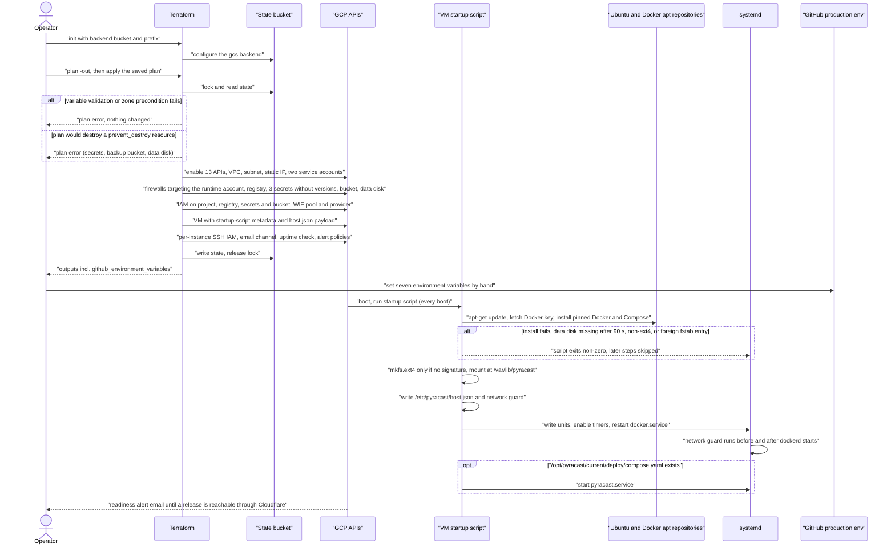

# Provision the Google Cloud environment with Terraform

An operator runs `terraform plan` and `apply` in `infra/terraform` (normally from Cloud Shell) against a private GCS state bucket created by hand. The result is one shielded Ubuntu VM with a static IPv4 address and a separate data disk, network and firewalls, Artifact Registry, three empty Secret Manager secrets, a backup bucket, service accounts and IAM, GitHub Workload Identity Federation and Cloud Monitoring alerts; the VM startup script then prepares Docker, the data disk, `/etc/pyracast/host.json` and the systemd units that later releases rely on. The operator copies the `github_environment_variables` output into the GitHub `production` environment and the `instance_ip` output into a Cloudflare A record by hand.

## Entry points

- Operator commands `terraform -chdir=infra/terraform init -backend-config=...`, `plan -out=production.tfplan`, `apply production.tfplan`, `output -json github_environment_variables` (procedure in `docs/DEPLOYMENT.md`, "Create the infrastructure").
- Inputs: `infra/terraform/variables.tf` (validated variables), `terraform.tfvars.example`, `backend.hcl.example` (partial `backend "gcs" {}` in `versions.tf`). The local `terraform.tfvars`, `backend.hcl`, `*.tfplan` and `.terraform/` are git-ignored.
- Resources: `main.tf` (APIs, network, firewalls, registry, secrets, bucket, disk, VM), `iam.tf` (service accounts, roles, WIF), `monitoring.tf` (email channel, uptime check, four alert policies), `outputs.tf`.
- VM trigger: Compute Engine runs `metadata.startup-script` (`templates/startup.sh.tftpl`, with `templates/network-guard.sh` embedded) on every boot.
- CI: `.github/workflows/ci.yml`, job "Deployment configuration and containers", step "Validate Terraform without cloud credentials or backend access". Dependabot (`.github/dependabot.yml`, `terraform` ecosystem, weekly) proposes provider pin changes in `versions.tf` and `.terraform.lock.hcl`.
- No web screen, Django view or database table is involved.

## Sequence

## Data

No PostgreSQL table is read or written. The stores that carry this flow's state:

| Table | R/W | What |
| --- | --- | --- |
| Terraform state (GCS bucket created by hand, prefix from `-backend-config`) | R/W | Resource IDs and the rendered startup script; no secret values |
| Local `terraform.tfvars`, `production.tfplan`, `.terraform/` (git-ignored) | R/W | Inputs, the saved plan that `apply` executes, provider cache |
| Secret Manager `<name>-runtime`, `-migration`, `-database` | W (secret resources only) | Created without versions; versions are added by hand in flow `secret-provisioning` |
| Instance metadata `startup-script` | W | Rendered template with base64 `host.json` and network guard |
| `/etc/pyracast/host.json` (0600) | W (each boot) | `domain`, `acme_email`, `backup_bucket`, pinned runtime and database secret version resource names; also unused `project_id`, `runtime_secret_id` |
| `/etc/fstab`, `/var/lib/pyracast/{postgres,rabbitmq,gateway}`, `/opt/pyracast/releases` | W | Data disk mount `nodev,nosuid`, owned data directories (UID 70, 999, 10001), release root |
| `/etc/docker/daemon.json`, Docker apt source and key, `/usr/local/sbin/pyracast-network-guard` | W (each boot) | `local` log driver, iptables backend, IPv6 off, `live-restore`; the guard script |
| `/etc/systemd/system/pyracast*.{service,timer}`, `docker.service.d/pyracast-data.conf` | W (each boot) | Application, backup and watchdog units, Docker mount and guard hooks |
| iptables chains `DOCKER-USER`, `PYRACAST_METADATA` | W (each Docker and application start) | Drop rule for `169.254.169.254` |
| GitHub `production` environment variables | W (by hand) | Seven `GCP_*` values from the output; `GCP_MIGRATION_SECRET` is the short secret ID |

## Authorization

- Operator: needs project-level rights to create every resource and access to the state bucket; nothing in the repository encodes or checks this.
- Runtime service account (`iam.tf`, VM identity, scope `cloud-platform` so IAM is the only limit): `logging.logWriter` (project), registry reader, `secretAccessor` on runtime and database secrets only, bucket `objectCreator` and `objectViewer` (no delete).
- Deploy service account: registry writer plus custom role with `artifactregistry.tags.delete`, `secretAccessor` on the migration secret only, custom discovery role, and per-instance `compute.osAdminLogin`, IAP tunnel (condition port 22) and `iam.serviceAccountUser` on the runtime account.
- `operator_members`: same per-instance SSH set as the deploy account (root through OS Login) plus a discovery role.
- GitHub: WIF provider `attribute_condition` requires the repository and owner numeric IDs, `refs/heads/main`, the exact `<repository>/.github/workflows/release.yml@refs/heads/main` workflow and environment `production`; `github_deploy` binds the deploy account to the repository ID. `GCP_DEPLOY_ENABLED` is a repository variable outside the output.
- Network: 443 only from the hard-coded Cloudflare IPv4 list, 80 from anywhere (ACME), 22 only from the IAP range; all target the runtime service account; no egress rule. OS Login on, project SSH keys blocked, serial port off.
- Containers: `pyracast-network-guard` drops forwarded traffic to `169.254.169.254` so only host processes can use the VM identity.

## Failure paths

| Condition | Result |
| --- | --- |
| `name`, `domain`, `acme_email`, `data_disk_gb < 10` or a secret version that is not a positive integer | Plan error with the variable's `error_message` |
| `zone` not inside `region` | Plan error "zone must be within region." |
| Change would destroy a secret, the backup bucket or the data disk | Plan error from `prevent_destroy` |
| `init` with another prefix than the one holding the state (`DEPLOYMENT.md`: `production`; `backend.hcl.example`: `pyracast/production`) | Empty state: the plan proposes creating everything and apply fails on existing names (standard Terraform behavior, not run) |
| VM replacement or delete while `deletion_protection = true` | Apply error |
| `machine_type` change (resize) on a running VM | Apply fails: `allow_stopping_for_update` is not set (error text present in the pinned provider; not run) |
| Data disk not visible within 90 s | Startup script exits; first boot leaves no units or `host.json` |
| Disk has a non-ext4 filesystem | "The application data disk must use ext4.", exit 1 |
| Unformatted disk with a partition or other signature | `wipefs` check fails, no format, exit 1 |
| `/var/lib/pyracast` already mapped to another device in fstab | "A different data disk is already configured; inspect fstab before continuing.", exit 1 |
| apt, Docker key or repository failure, or the pinned version no longer published | Script aborts under `set -e`; previously enabled units still start at boot with the old `host.json` |
| Network guard exits non-zero | `docker.service` fails in `ExecStartPre`, so `pyracast.service` (`Requires=`) does not start: fail closed |
| `/var/lib/pyracast/release-blocked` present | `pyracast.service`, backup and watchdog services are skipped by `ConditionPathExists`; no alert event |
| Pinned runtime or database secret version missing or unreadable | `runtime_secrets.py` "Secret preparation failed; check configuration, IAM and secret format."; the first release aborts in `install-release.sh` before maintenance, later `pyracast.service` fails in `ExecStartPre` |
| Readiness unreachable (no release yet, DNS-only record, outage) | Uptime alert email after two or more checker locations fail for 5 minutes (inferred from the configuration) |
| A `GCP_*` variable empty in GitHub, or a malformed `GCP_ARTIFACT_REPOSITORY`, `GCP_INSTANCE` or `GCP_ZONE` | Release step "Validate deployment configuration" exits 1 before cloud authentication. Other values (project, WIF provider, service account, migration secret) are only checked for emptiness and fail later at authentication or Secret Manager access |
| OIDC token from another branch, workflow, environment or repository, or after a repository rename | Token exchange refused, release cannot authenticate |
| `fmt`, `init -lockfile=readonly` or `validate` fails in CI | CI job fails, blocking release authorization |

## Rules and invariants

- Terraform never holds secret values: secrets are created without versions, and `host.json` carries only version resource names pinned to positive integers (`runtime_secret_version`, `database_secret_version`). The migration secret is not pinned; the release job reads `latest`.
- The startup script runs on every boot and rewrites `host.json` and all units from metadata. A metadata change is applied in place without recreating the VM, but takes effect only at the next boot or a manual rerun.
- Every run ends with `systemctl restart docker.service`; systemd propagates that restart to an active `Requires=`-bound `pyracast.service` (Compose stop, then up) even though `daemon.json` sets `live-restore` (from unit semantics; not observed on a host).
- The startup script formats the data disk only when it has no filesystem and no signature. The `device_name = "pyracast-data"` in `main.tf` and `/dev/disk/by-id/google-pyracast-data` in the script must stay in step.
- `pyracast.service`, backup and watchdog services start only when their file under `/opt/pyracast/current/deploy/` exists and `/var/lib/pyracast/release-blocked` is absent; stop and backup take `/run/lock/pyracast-release.lock`.
- The network guard runs before and after Docker starts and before the application starts, so the metadata drop rule is present whenever containers run. It relies on the `iptables` firewall backend set in `daemon.json`.
- Docker, containerd and Compose are exact apt versions for Ubuntu 24.04 `noble` amd64, held with `apt-mark hold` (the script itself installs with `--allow-change-held-packages`); `vm_image` defaults to an unpinned image family. Terraform `= 1.17.2` and provider `= 8.11.0` are exact, with a committed lock file.
- Registry cleanup starts in dry-run (`artifact_cleanup_dry_run`): delete versions older than 30 days, but keep the 20 newest and all `production*` tags. Tags are mutable.
- Backup objects expire after 7 days with soft delete disabled; the bucket has no versioning and the runtime account cannot delete.
- Log-based alerts fire on `pyracast_backup_failed`, `pyracast_runtime_unhealthy` and `pyracast_host_capacity` in log `pyracast-operations`, at most one notification per hour, auto-closed after 24 hours. The single email channel uses `acme_email`.
- APIs are never disabled on destroy (`disable_on_destroy = false`).

## Tests

- `.github/workflows/ci.yml`: `terraform fmt -check -recursive`, `init -backend=false -input=false -lockfile=readonly`, `validate`. No plan against a real project.
- Adjacent pytest (consumers only): `tests/test_deployment_secrets.py` (payload validation and env-file writers of `deploy/runtime_secrets.py`; not `access_secret` or `main`, so the `host.json` keys and the numeric-version check are untested), `tests/test_deployment_backup.py` (`deploy/operations_log.py` `report`), `tests/test_deployment_watchdog.py` (`pyracast_host_capacity` event), `tests/test_deployment_helpers.py` (host helpers parse as Python 3.12, the Ubuntu 24.04 `python3`).
- `deploy/test-release.sh` uses a hand-written `host.json` with only `domain`, `acme_email`, `backup_bucket`.
- Gaps: no Playwright or pytest test touches `infra/terraform`; `startup.sh.tftpl` and `network-guard.sh` are not shellchecked or executed in CI; nothing checks that `host.json` keys match their consumers or that alert event names match the emitters; `docs/DEPLOYMENT.md` ("Verification boundary") states that `deploy/smoke.sh` does not prove GCP IAM, the metadata firewall rules, ACME or public DNS.
