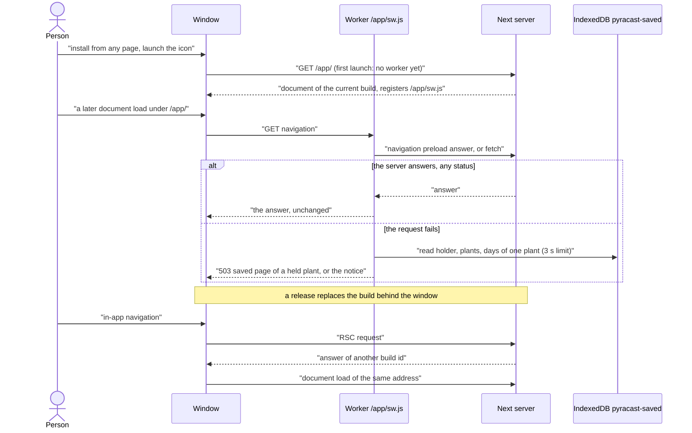

# Install and run the app: manifest, worker and releases

A person installs Pyracast from any page of the web application, or uses it in a browser tab. Every page advertises
the same application, whose identity, start address and scope are `/app/`. Inside that scope a service worker passes
every page load on to the server and answers only a load the server did not answer, with a notice or a page of figures
saved on the device. A release replaces the build behind open windows; the next navigation of a window loads the new
build, and the browser asks first while something typed is unsaved. The server holds no state for any of this.

## Entry points

- Every page rendered in the root layout (`web/src/app/layout.tsx`: the public pages, both 404 pages, sign-in and the
  workspace) links `/app/manifest.webmanifest` without `crossorigin`, the touch icon `/app/icons/apple-touch-icon.png`
  and `application-name` and `apple-mobile-web-app-title` "Pyracast", as direct children of the served `head`. A page
  that links no manifest names only itself (Chromium derives a default manifest whose identity and start address are
  that page), so an icon made from it would reopen that page. With the link every page names one identity and one
  start address, `/app/`, wherever the person started; whether the chosen menu action makes an app or a shortcut is
  the browser's decision, which the device checklist records. The root failure screen (`web/src/app/global-error.tsx`) replaces the root layout and links none of them; the Django
  pages (console, provider steps, maintenance) link nothing.
- `web/public/app/manifest.webmanifest`: `id`, `start_url` and `scope` `/app/`, `display: standalone`, the brand as
  `name` and `short_name`, one theme and background colour, icons `icons/{any,maskable}-{192,512}.png`. The browser
  fetches it without cookies.
- `web/src/app/app/layout.tsx` keeps what belongs to the application only: the mounted title "Pyracast", `robots`
  noindex, the `theme-color` viewport and `WorkerRegistration` (`web/src/lib/worker-registration.tsx`), which in a
  production build registers `/app/sw.js` for scope `/app/` with `updateViaCache: "none"` where
  `navigator.serviceWorker` exists and ignores a failure.
- The install entry: `AppRoot` (`web/src/features/session/app-root.tsx`) calls `captureInstallPrompt`
  (`web/src/lib/install-prompt.ts`), which keeps `beforeinstallprompt` (default prevented, so no mini-infobar) and
  `appinstalled`. The workspace sidebar (`web/src/features/workspace/workspace-shell.tsx`) shows `InstallApp`
  (`web/src/features/workspace/install-app.tsx`, texts in the `InstallApp` namespace of `web/messages/en/core.json`
  and `web/messages/tr/core.json`): the saved prompt once, otherwise the steps for Chromium (the menu command with
  Install in its name), WebKit with touch (Share, Add to Home Screen) or WebKit without touch (File, Add to Dock).
  It is absent in `display-mode: standalone`, after acceptance or `appinstalled`, and where neither the event nor
  WebKit exists. The public pages carry no install control.
- `web/public/app/sw.js`, the worker. `web/testing/sw-withdraw.js` is the script that unregisters itself; tests and a
  withdrawal use it (`docs/DEPLOYMENT.md`, "App worker").

## Sequence

## Data

| Store | R/W | What |
| --- | --- | --- |
| Worker registration | W | Scope `/app/`, script `/app/sw.js`, made by `WorkerRegistration`; the browser checks the script at every document load under `/app/` and at every `register()` call |
| `pyracast-saved` (IndexedDB) | R, W | The application (`web/src/lib/saved/store.ts`) sets the holder's `confirmedAt` to the moment of every signed-in session it adopts, also on focus or a visibility change (`AppRoot`), and clears the figures of a copy that had expired. The switch "Keep figures on this device" and its offer create the copy, and the refresh writes its plants and days (flow `saved-figures`). The worker reads it only after a navigation failed and writes it in two cases, each one transaction: a copy whose `confirmedAt` is more than 90 days old or more than a day ahead of the clock loses `plants` and `days` and keeps its holder unchanged; `/app/?saved=remove&token=<removal>` with the stored token empties `plants` and `days` and sets the holder's `active` false (`web/public/app/sw.js`) |

No database table, Cache Storage entry, stored document, script or API answer is involved.

## Authorization

- The worker reads no session and sends no API request. It handles only GET navigations whose address is inside
  `/app/` (`request.mode === "navigate"`); every other request goes to the network untouched.
- A saved page needs no session: it is shown while the holder is active and its `confirmedAt` lies at most 90 days
  back, that is, for 90 days after the last signed-in session the application adopted on the device. Its removal link
  carries the copy's token, so no other site can trigger it.
- `web/src/proxy.ts` gives every page the policy with `worker-src 'self'`; `/app/sw.js` is the only same-origin
  JavaScript answer with a page inside its directory, and a scope cannot exceed that directory. The matcher skips the
  manifest, `/app/sw.js` and the icons by exact name; `web/next.config.ts` serves the manifest and icons with
  `Cache-Control: no-cache` and `/app/sw.js` as `text/javascript` with `no-store` and the CSP
  `default-src 'none'; connect-src 'self'`, with no `Service-Worker-Allowed`. A file-like address under `/app/` with a
  trailing slash redirects (308) to the address without it.

## Failure paths

| Condition | Result |
| --- | --- |
| The navigation request fails (no connection, edge or host down) | The worker answers 503 with `no-store` and the CSP `default-src 'none'; style-src 'unsafe-inline'; form-action 'none'; base-uri 'none'; frame-ancestors 'none'`: a saved page where the copy holds the plant of the address, otherwise the notice in both languages (in the holder's language where a copy exists) with "Try again", a link to the same address without its fragment. The notice says the server cannot be reached, lists saved plants, tells a person who came from an invitation link to open it again from the email, and carries no script and no reload |
| The server answers with an error page, the gateway's maintenance 503 included | Passed on as served |
| The worker cannot read the copy within 3 s, or the copy is of another format | The notice without saved figures |
| The first visit ever is without a connection | The browser's own page; nothing is registered yet |
| A new worker script fails to install | The previous one stays |
| A release while a window is open | The window keeps its build; its next in-app navigation meets an answer of another build id (or a non-RSC answer) and loads a document instead, so the new build runs from then on |
| A release while a value is typed and unsaved | The leave guard (`web/src/lib/leave-guard.ts`) turns every navigation the person starts into a document load, so the browser asks first; after "Stay" the window keeps the old build's document with the value, the save goes to the new release, and the next navigation loads the new build without a question |
| A sign-in completed on a sign-in screen older than the release | The document reloads at the same address (`AppRoot`), so the workspace comes from the new build |

## Rules and invariants

- One identity: `id`, `start_url` and `scope` stay `/app/` across releases, reverts and install paths, whichever page
  advertised the manifest. A fresh launch targets `/app/`, which decides from the session at every launch. What a
  browser makes of an install (an app or a shortcut), of the installing tab and of a resumed window is not promised.
- A release keeps no compatibility while the product is in development: request shapes, stored formats and the
  manifest change in place (`docs/DEPLOYMENT.md`, "Releases under open windows").
- The pinned Next router (`next` 16.4.6, `dist/client/components/router-reducer/fetch-server-response.js`) loads a
  document instead of a soft change when the navigation answer is not a successful (2xx) Flight answer
  (`text/x-component`) with a body, or when the build id in it differs from its own. No deployment id, release header or "new version" notice exists. Two builds
  of one source share their static file names; a file of a replaced build that is gone shows the section's error
  screen with Reload.
- The worker calls `skipWaiting()` on install and enables navigation preload on activate; it never calls
  `clients.claim()` or `update()`. A new script serves the navigations after the one that fetched it.
- Every release serves `/app/sw.js`: a browser keeps an installed worker until an update check installs another
  script, and a 404 would leave it in place for ever. Withdrawal and rollback: `docs/DEPLOYMENT.md`, "App worker".
- A screen of an installed window (display mode `standalone`, `minimal-ui` or `window-controls-overlay`) is titled
  with its name alone; a tab adds "| Pyracast" (`web/src/ui/page-title.ts`).
- Device checklist, for every release that touches the manifest, the worker or sign-in, on Edge (Windows), Chrome
  (Android) and Safari (iOS, iPadOS, macOS): install from the public home page, from a public page and from an `/app/`
  page and launch fresh, signed in and signed out (sign-in or the plants, standalone, the right icon); each sign-in
  method inside the window; a launch and a navigation in airplane mode show the notice, and "Try again" returns once
  the connection is back; a release under an open window; a second account; a step out of the app and back through
  history; a download and a CSV import in the window; once, through the public address, that the edge does not serve
  `/app/sw.js` from its cache. Record the browser and its version, the menu entry chosen and the first screen.

## Tests

- Playwright, mocked API: `web/tests/app-install.spec.ts` (which pages carry the manifest, touch icon, names and theme
  colour, in the served `head`; the browser's processed manifest; the install entry),
  `web/tests/install-prompt.spec.ts` (the saved install event), `web/tests/app-manifest.spec.ts` (manifest members and icon files), `web/tests/app-worker.spec.ts` and
  `web/tests/saved-pages.spec.ts` (both worker scripts run in Node), `web/tests/browser-workers.spec.ts` (the mocked
  and integration suites block workers), `web/tests/security-headers.spec.ts` (headers of the manifest, icons and
  worker; the page policy), `web/tests/document-title.spec.ts` (titles in a tab and an installed window),
  `web/tests/leave-guard.spec.ts` (questions before a document load), `web/tests/keep-figures.spec.ts` (the switch, its
  offer and the refresh).
- Playwright, production build (`web/playwright.production.config.ts`, workers allowed): two `next start` servers, of
  `.next` and of a second build of the same source into `.next-second` (the build ids differ by themselves), behind
  `web/testing/front.ts`, which switches the build behind one origin (`PUT /__front/build`), sends `/api/` to the API
  mock of the selected build (`API_PORTS` in `web/testing/builds.ts`), names the build that answered in the
  `x-front-build` header and chooses what `/app/sw.js` answers (`PUT /__front/script`).
  `web/production-tests/app-worker.spec.ts` (scope, notice, policy, replacement by the withdrawal script),
  `web/production-tests/saved-pages.spec.ts` (saved pages from a seeded copy),
  `web/production-tests/round-trip.spec.ts` (switch on, offline pages, renewal, removal; flow `saved-figures`) and
  `web/production-tests/release.spec.ts`: after a release a navigation takes the new build's Flight answer and then
  loads its document; with an unsaved value the browser asks on a shell entry and on the Actuals to Comparison switch
  before any router request, Stay keeps the old build's document at its address with the editor usable, its save goes
  through the front to the new build's API mock, which refuses another session tag as the server does, and the next
  navigation loads the new build; a sign-in on an old sign-in screen at a deep address ends on the new build. CI job
  `web_production` builds twice before it runs them.
- `tests/test_operations_contracts.py` checks that `deploy/smoke.sh` holds the `app_file` statements for the worker,
  manifest, icons and pages, and runs the worker and icon statements against a fake `curl` (POSIX only). The gateway
  check itself is `deploy/smoke.sh` after a deployment.
