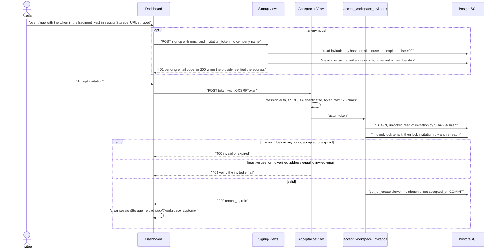

# Accept a workspace invitation

An invitee opens the mailed link `/app/#token=...`, signs up (password or Google/Microsoft) with the invited address or signs in, proves ownership of that address and presses accept. The outcome is a `viewer` membership in the inviting workspace and a consumed invitation. Signup never grants access by itself; `member-invitation` issues the token.

## Entry points

- Screen: `web/src/components/dashboard.tsx` `DashboardView` routes on `web/src/components/workspace-invitation.ts` `useWorkspaceInvitation` (token from fragment or `?token=`, kept in `sessionStorage` key `pyracast.workspaceInvitation`, stripped from the URL): anonymous goes to `web/src/components/auth.tsx` `Auth` (prop `invitationToken`), signed in goes to `web/src/components/workspace-members.tsx` `AcceptInvitation`.
- `/invitations/accept/` (`web/src/app/invitations/accept/page.tsx` `InvitationPage`, layout re-exports the app layout) renders the same `Dashboard`; the mail never links to it.
- `POST /api/invitations/accept/` -> `pyracast.api.workspaces.InvitationAcceptanceView` -> `pyracast.accounts.invitations.accept_workspace_invitation`. Actor: any authenticated user.
- Signup branch: `POST /api/auth/browser/v1/auth/signup` (`pyracast.accounts.signup.CompanySignupView`) and `.../auth/provider/signup` (`pyracast.accounts.social_views.ProviderSignupView`) validate the token in `pyracast.accounts.forms.CompanySignupForm.clean` through `pending_invitation`; the token is not consumed there and `CompanySignupForm.signup` skips tenant and membership creation. No command, script or Dramatiq job.

## Sequence

## Data

| Table | R/W | What |
| --- | --- | --- |
| `accounts_workspaceinvitation` | R/W | Lookup by unique `token_hash`; `FOR UPDATE`; sets `accepted_at`. Signup only reads (`pending_invitation`). |
| `accounts_tenant` | R (`FOR UPDATE`) | Tenant lock before the invitation row. |
| `accounts_membership` | R/W | `get_or_create` on (`tenant`, `user`) with role `viewer`; constraints `unique_tenant_membership`, `one_workspace_admin`. |
| `account_emailaddress` | R/W | Accept reads a verified address equal (case-insensitive) to `invitation.email`; signup inserts it, unverified unless a Google provider vouches for it. |
| `auth_user`, `accounts_userlanguagepreference`, `socialaccount_socialaccount` | R/W | Accept re-reads `is_active`; signup inserts the user, a language preference from the cookie and, on social signup, the provider link. |
| `django_session` | R | Session authentication. |

## Authorization

- View: `SessionAuthentication` (CSRF enforced) and `IsAuthenticated` from `REST_FRAMEWORK`; `WorkspaceWritePermission` passes because the URL has no `tenant_id`. No role check: the token is the capability.
- Operation: the invitation must be unaccepted and unexpired; the actor must be active and own a verified `EmailAddress` matching the invitation. The check is on the verified address list, not on `User.email`.
- Signup: `pending_invitation` requires the submitted email to equal the invitation email; the later accept re-checks ownership through a verified address (`ACCOUNT_EMAIL_VERIFICATION = "mandatory"`; only Gmail or Google Workspace provider addresses arrive verified).
- Database: `unique_tenant_membership` and `one_workspace_admin`; nothing ties the accepting user to the invitation row.

## Failure paths

| Condition | Result |
| --- | --- |
| Not signed in, or missing or wrong CSRF token | 403 `http_403` |
| Unknown field, missing or over-long token | 400 field or "Unknown fields are not accepted." |
| Unknown token, already accepted, expired, cancelled, superseded, or expired by member removal or administrator transfer | 400 "The invitation is invalid or expired." (identical for all) |
| Actor inactive or without a verified address equal to the invited one (including a different signed-in account) | 403 "Verify the invited email address before accepting."; the screen offers "Use another account", which signs out and keeps the token |
| Tenant or invitation lock not obtained within 5 s | 503 `workspace_busy`, `Retry-After: 1` |
| Signup with an invalid token or another email, or over the signup limit (5 per hour per IP, password and provider) | 400 non-field "The invitation is invalid or expired.", no account created; 429 for the limit |
| `sessionStorage` unavailable | Token lives only in the current page load; lost on reload |

## Rules and invariants

- Lock order is tenant row, then invitation row, the same as reissue, revoke, removal and transfer, so acceptance serializes with them. The first lookup is unlocked and only finds the tenant id; state is re-read after the lock.
- Single use: `accepted_at` is set under the row lock, so concurrent accepts yield one success and one 400.
- Role is always `viewer`. A user who is already a member keeps the existing membership and role (an administrator stays administrator) and the invitation is still consumed.
- Signup and acceptance are separate steps: an invited signup creates only a user, so an invitation that expires between them leaves an account without any workspace.
- Expiry is the only revocation (7 days, cancel, reissue, member removal, administrator transfer); rows are never deleted and no accepting user is recorded.
- The token lives in a URL fragment so it is not sent to the server; the `?token=` query form is still read and stripped client-side. `?account=security` hides the token without clearing it. A token also suppresses the platform-staff redirect to `/admin/`.

## Tests

- `tests/test_workspaces.py`: verified-matching-email, inactive user, other account and single use; reissue revokes the old secret; two concurrent accepts; invited signup then verify then accept; API accept after cancel and with an invalid token; administrator transfer revokes the grant; invalid signup creates no account.
- `tests/test_social_accounts.py` (social signup with invalid then valid token, then explicit accept), `tests/test_workspace_member_removal.py` (removal expires invitations for every known address; removal, transfer and acceptance serialize, where an existing viewer accepts successfully at operation level), `tests/test_transactional_mail.py` (`#token=` link).
- `web/tests/workspace-roles.spec.ts` (mocked API): token hand-off and URL strip, accept success and error, dismiss, account switch, expired signup; `web/tests/social-auth.spec.ts` (social signup restores the token).
- Gaps: no real-backend Playwright run (`web/integration/` has no invitation spec); mocked error strings are not the backend's; no test for signup with a different email or an expired token, acceptance by an existing administrator (role kept), acceptance by an existing member over HTTP, unauthenticated or CSRF-less accept, or unavailable `sessionStorage`.
