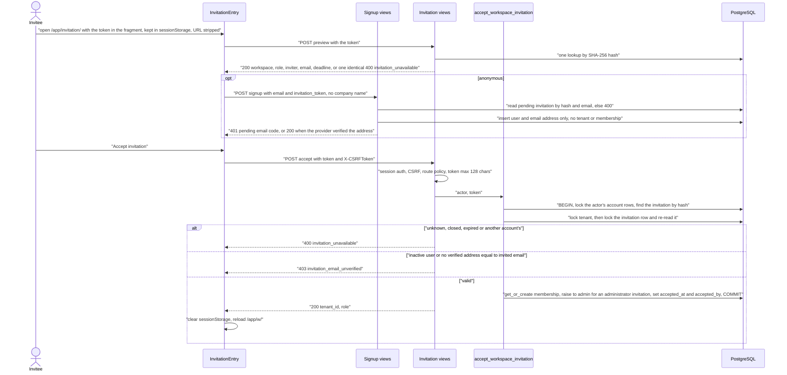

# Accept a workspace invitation

An invitee opens the mailed link `/app/invitation/#token=...`, sees the workspace, role and inviter, signs up (password or Google/Microsoft) with the invited address or signs in, proves ownership of that address and presses accept. The outcome is a membership in the inviting workspace with the invited role (`viewer`, or `admin` for an administrator invitation) and a consumed invitation. Signup never grants access by itself; `member-invitation` issues the token.

## Entry points

- Screen: `web/src/app/app/invitation/page.tsx` -> `web/src/features/workspace/invitation-entry.tsx` `InvitationEntry`. `takeFragmentToken` moves the token from the address fragment into `sessionStorage` (key `pyracast.workspaceInvitation`, see `workspace-invitation.ts`) and strips it from the address. `useInvitationPreview` reads `POST /api/invitations/preview/`. Anonymous visitors see the preview banner and `web/src/features/auth/auth.tsx` `Auth` (prop `invitationToken`); signed-in users get `web/src/features/workspace/accept-invitation.tsx` `AcceptInvitation`.
- `POST /api/invitations/preview/` -> `pyracast.api.workspaces.InvitationPreviewView` -> `pyracast.accounts.invitations.preview_workspace_invitation`. Public, throttled under `invitation`.
- `POST /api/invitations/accept/` -> `InvitationAcceptanceView` -> `accept_workspace_invitation`. Actor: any authenticated user; an `ACCOUNT` route of the route policy, throttled under `submission`.
- Signup branch: `POST /api/auth/browser/v1/auth/signup` (`pyracast.accounts.signup.CompanySignupView`) and `.../auth/provider/signup` (`pyracast.accounts.social_views.ProviderSignupView`) validate the token in `pyracast.accounts.forms.AccountSignupForm.clean` through `pending_invitation`. The token is not consumed there and `AccountSignupForm.signup` creates no tenant or membership. No command, script or Dramatiq job.

## Sequence

## Data

| Table | R/W | What |
| --- | --- | --- |
| `accounts_workspaceinvitation` | R/W | Lookup by unique `token_hash`; `FOR UPDATE`; sets `accepted_at` and `accepted_by`. Preview and signup only read. |
| `accounts_tenant` | R (`FOR UPDATE`) | Tenant lock before the invitation row. |
| `accounts_membership` | R/W | `get_or_create` on (`tenant`, `user`) with the invited role; an administrator invitation sets `admin`. |
| `accounts_workspaceadminchange` | W | Administrator invitations only: `actor` is the issuer. |
| `account_emailaddress` | R/W | Accept reads a verified address equal (case-insensitive) to `invitation.email`; signup inserts it, unverified unless a Google provider vouches for it. |
| `auth_user`, `socialaccount_socialaccount`, `mfa_authenticator`, `accounts_userlanguagepreference` | R/W | Accept locks the actor's rows (`lock_account`) and re-reads `is_active`; signup inserts the user, a language preference and, on social signup, the provider link. |
| `django_session` | R | Session authentication. |

## Authorization

- View: `SessionAuthentication` (CSRF enforced) and `RoutePolicy`: the accept route needs any signed-in user, the preview route is public. No role check: the token is the capability.
- Operation: the invitation must be pending (`state_at`); the actor must be active and own a verified `EmailAddress` matching the invitation, not merely `User.email`. An administrator invitation is refused once the workspace has an administrator.
- Signup: `pending_invitation` requires the submitted email to equal the invitation email; the later accept re-checks ownership through a verified address (only Gmail or Google Workspace provider addresses arrive verified).
- Database: `membership_tenant_user_uniq`, `membership_tenant_administrator_uniq`, `workspaceinvitation_accepted_by_chk` and `workspaceinvitation_revoked_at_chk` (an accepted invitation is never revoked).

## Failure paths

| Condition | Result |
| --- | --- |
| Not signed in | 401 `not_authenticated` with `WWW-Authenticate: Session` |
| Missing or wrong CSRF token | 403 `csrf_failed` |
| Unknown field, missing or over-long token | 400 `invalid_request` |
| Unknown token, expired, cancelled, superseded, closed by member removal or administrator change, accepted by another account, administrator invitation while an administrator exists | 400 `invitation_unavailable` (identical for all) |
| Actor inactive or without a verified address equal to the invited one (including a different signed-in account) | 403 `invitation_email_unverified`; "Use another account" signs out and keeps the token |
| Tenant or invitation lock not obtained within 5 s; same-session request still running | 503 `busy` / 429 `session_busy`, `Retry-After: 1` |
| More than 30 acceptances an hour, or 60 previews an hour | 429 `throttled` |
| Signup with an invalid token or another email, or over the signup limit (5 per hour per IP, password and provider) | 400 non-field `invitation_unavailable`, no account created; 429 for the limit |
| Preview of an unusable or malformed token | 400 `invitation_unavailable`; a failed preview still lets the invitee accept |
| `sessionStorage` unavailable | Token lives only in the current page load; lost on reload |

## Rules and invariants

- Lock order is the actor's account rows (`lock_account`: addresses, provider identities, user, authenticators), tenant row, invitation row. The first lookup is unlocked and only finds the ids; state is re-read after the locks. Removal and administrator reassignment lock the tenant too, so acceptance serializes with them.
- Single use: `accepted_at` and `accepted_by` are set under the row lock. A retry by the accepting account while it is still a member answers like the first call; every other account gets 400.
- Role: the invitation's. A user who is already a member keeps the existing membership and role for a viewer invitation and the invitation is still consumed. An administrator invitation raises the account to `admin` and writes a `WorkspaceAdminChange`.
- Signup and acceptance are separate: an invited signup creates only a user, so an invitation that closes between them leaves an account without any workspace.
- Closed invitations stay as rows; no code path of this flow deletes them (see `member-invitation`).
- Security log: acceptance writes `invitation_accepted` (and `workspace_admin_reassigned` for an administrator invitation). A refusal of a known invitation writes `invitation_denied` with the reason, at most once a minute per actor, invitation and reason; an unknown token writes none.
- The token lives in a URL fragment so it is not sent to the server; the query form is not read.
- The preview names the inviter only while that account is an active member, and shows an accepted invitation only to the account that accepted it, so it does not reveal whether an address has an account.

## Tests

- `tests/test_invitation_acceptance.py` (retry, other accounts, existing member keeps role, concurrent accepts), `tests/test_workspaces.py` (verified matching address, single use, invited signup then accept), `tests/test_invitation_preview.py`, `tests/test_workspace_admin_invitations.py`, `tests/test_invitation_limits.py`, `tests/test_workspace_member_removal.py`.
- `web/tests/workspace-invitations.spec.ts`, `web/tests/workspace-roles.spec.ts`, `web/tests/app-routes.spec.ts` (all mocked API).
- Gaps: no real-backend Playwright run (`web/integration/` has no invitation spec); no test for signup with a different email or an expired token over HTTP, or for unauthenticated or CSRF-less accept.
