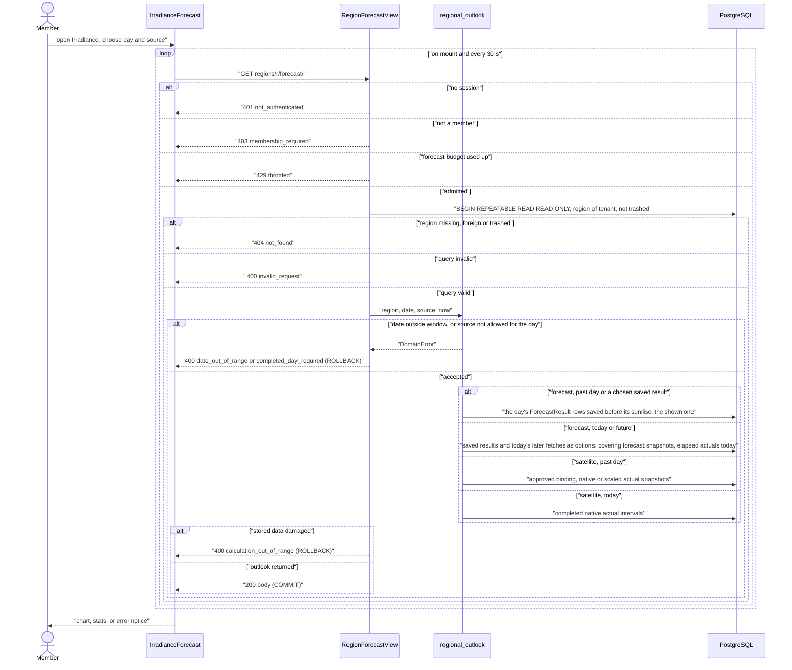

# View the regional irradiance forecast

A workspace member (administrator or viewer) opens the Irradiance sub-view of a plant's Forecast tab and picks a day, a data source and, for a forecast, optionally one of the day's forecast times. The browser reads one region endpoint, which composes the answer from saved provider results only and returns horizontal irradiance (W/m2, kWh/m2) with coverage, freshness and quality flags. No domain row is written, nothing is queued or sent to a provider; only session bookkeeping is written. The screen polls every 30 seconds.

## Entry points

- Screen: `web/src/features/plant/workspace/forecast-section.tsx` `ForecastSection` (date, the same two choices Forecast and Satellite data and the same chosen forecast time as the generation view, `forecast-view`; default date tomorrow, default Forecast in automatic mode, `view=irradiance` in the URL) and `forecast-reading.tsx` `PlantForecast` (`useForecastRead`, 30 s poll from yesterday on), rendering `features/forecast/forecast-panel.tsx` `ForecastPanel` (`electrical=false`) with `ForecastIntervals`. Reachable only once the site has a plant (`features/plant/plant-site.tsx` `PlantSite`).
- `GET /api/tenants/{t}/regions/{r}/forecast/?date=&data_source=forecast|satellite&forecast_id=` -> `pyracast.api.views.RegionForecastView.get` -> `pyracast.forecasts.outlook.regional_outlook` (API default source is `forecast`; `forecast_id` as in `forecast-view`; `HEAD` runs the same code, `OPTIONS` answers 405). Actors: administrator and viewer; no command, script or worker. Data is written by `forecast-collection-execution`; the generation view of the same tab is `forecast-view`.

## Sequence

## Data

| Table | R/W | What |
| --- | --- | --- |
| `accounts_membership`, `auth_user`, `regions_region` | R | login and membership; region scoped to the tenant, not trashed; `approved_binding`, `status`, `timezone`, `revision` |
| `django_session`, `usersessions_usersession` | R/W | `SessionLifetime` records activity at most once a minute; other requests only read the session |
| `connections_sitebinding`, `connections_provideraccount` | R | approved binding (timezone, location, capacity) and older bindings of the region for saved forecast results; enabled, authorized and credential revision for `binding_is_current` |
| `forecasts_forecastsnapshot`, `forecasts_collectionjob` | R | intervals, coverage, `collected_at`, `available_at`, `issued_at`; `status=succeeded`, `endpoint`, `reference_import_id` |
| `forecasts_forecastresult` | R | `published_at` gate; the day's saved results: options and the payload of a shown saved forecast |
| `forecasts_referencecapacitynormalization` | R | source priority of scaled actuals and their provenance |

## Authorization

- Route policy: `ROUTE_POLICIES` in `pyracast.api.permissions` marks the route member access with the `forecast` throttle; `RoutePolicy` runs before the view and refuses a missing session (401) or membership (403). Any role reads. The view then scopes the region to the tenant and hides trashed regions (`tenant_region`); region status (pending, suspended) does not block reading. There is no further check in `regional_outlook` and no row-level security; the endpoint is read-only.
- `CustomerJSONRenderer` with `pyracast.api.public.public_source_data` drops provider and credential fields, rewrites provider names and passes capacity-normalization provenance only as an allowlist (policy, capacities, factor, time) at delivery; stored payloads stay untouched.

## Failure paths

| Condition | Result |
| --- | --- |
| No session | 401 `not_authenticated` with `WWW-Authenticate: Session` |
| Not a member | 403 `membership_required` |
| More than 60 reads a minute in the `forecast` scope (shared with the plant forecast and performance reads) | 429 `throttled` with `retry_after` |
| Region of another tenant, unknown or trashed | 404 `not_found` |
| Missing or malformed `date`, a source other than `forecast` or `satellite`, unknown query key (`as_of` included) | 400 `invalid_request`; `fields` names the input (an unknown key has a message only) |
| `forecast_id` with `satellite`, or not one of the day's options | 400 `invalid_request`, field `forecast_id` |
| Date outside today - 366 .. today + 14 days (region timezone) | 400 `date_out_of_range` |
| `satellite` for a future day (the UI limits the date by source) | 400 `completed_day_required` |
| Stored actuals, saved payloads or the calculation raise `ValueError`, `ArithmeticError` (the intraday actuals step also `KeyError`, `TypeError`) | 400 `calculation_out_of_range`; one `forecast_read_fault` warning with the error class only |
| `local_day_bounds` for a local date the timezone skips, outside a guarded step | 500 `server_error` with `request_id` (read from code, not reproduced) |
| Same session has another request running for over 5 s | 429 `session_busy`, `Retry-After: 1`; the client waits at most 2 s and repeats once |
| Statement over 60 s | 503 `request_timeout` with `request_id` |
| No eligible saved source or no approved binding (a live or actuals read needs the approved binding; a saved forecast result can still return an older binding's data) | 200, `result: null`, `freshness: missing`, `unavailable_reason` `forecast_unavailable` or `estimated_actuals_unavailable` |
| Binding not current, or a used source collected over 24 h before now | 200 `freshness: stale` with `stale_reason` `connection_inactive` or `collection_overdue` |
| First request fails in the browser | error notice replaces the panel |
| Later poll fails | the panel stays with a "Could not refresh" alert and a retry; polling continues |

## Rules and invariants

- The view reads the region and every source in one `REPEATABLE READ, READ ONLY` transaction (`pyracast.db.read_snapshot`) without row locks, so the selection reads see the same rows and a concurrent write appears from the next poll on; the only lock is the per-session PostgreSQL advisory lock that `SessionRequestSerialization` holds for the whole request. Source eligibility comes from a cutoff (`now`): a source counts only when `collected_at`, `available_at`, `issued_at` and, for forecasts, `published_at` are at or before it. A saved forecast result of the day is an option only when it was fetched and published before the day's sunrise per binding and holds a result for that day (`daily_payloads` key or main payload date; `forecasts.history.saved_region_results`); it does not check `available_at`. A past-day actual read whole from one snapshot (`forecasts.actuals.single_snapshot_actual_queryset`) must also be collected after the day ended; native snapshots composed interval by interval contribute only intervals ended before the cutoff.
- "Today" is the region's local date; day bounds use the binding timezone. `REGION_POLICIES` in `forecasts/outlook.py` maps source and day kind to one policy, and `REGION_DAYS` bounds the window. Newer coverage owns its window and older forecasts fill only the rest (`latest-forecast-coverage-v2`; mixes with actuals use `estimated-actuals-then-forecast-v1`).
- `forecast` (`day_ahead`, `live_with_actuals`, `live`): a past day shows the latest eligible saved result (fetched since the previous day's sunrise and not by the approval job), else the latest saved one, else the missing answer (rule `latest`); today mixes completed actuals with the newest forecast and drops the forecast once actuals cover daylight; a future day is the newest forecast. `satellite` (`archived_actuals`, `live_actuals`): today composes completed native intervals only; a past day reads archived native or capacity-scaled actuals with no forecast filling; a future day is refused. The options and `selection` follow `forecast-view`: today adds every fetch collected or published from sunrise on; a chosen later fetch is composed only from itself and fetches collected before it; satellite answers carry `selection` null. Only `region.approved_binding` is current: after a binding replacement archived actual days read `missing`, while saved forecast results may still come from earlier bindings of the region.
- The envelope (`ForecastOutput`, shared `ForecastEnvelope`) carries `freshness`: `fresh` needs a current binding and every used snapshot collected within 24 h; `stale` names its reason; `archived` marks a completed day, past actuals and saved forecast results; `missing` has no result.

## Tests

- pytest, endpoint: `tests/test_historical_region_api.py`, `test_regional_current_forecast.py`, `test_forecast_after_midnight.py`, `test_outlook_preparation.py`, `test_outlook_dispatch.py` (every source, day and cutoff answers as pinned), `test_forecast_freshness.py`, `test_forecast_read_faults.py` (damaged actuals answer 400 with one warning), `test_forecast_read_cost.py`, `test_forecast_read_contract.py` (viewer body, foreign region 404, unknown key and empty date 400, satellite data today), `test_forecast_choice.py` (the region's saved results as options, the removed sources and `as_of`), `test_forecast_read_locks.py` (one read-only snapshot, a Region lock held elsewhere does not delay the read), `test_archived_actual_composition_api.py`, `test_historical_outlook.py`, `test_capacity_normalization.py`, `test_public_data.py` (provenance allowlist), `test_api_throttling.py` (429 `throttled`), `test_api.py` (non-member 403, foreign region 404, signed-out 401); operations: `test_intraday_outlook.py`.
- Playwright (API mocked with `page.route`): `web/tests/daylight-forecast.spec.ts`, `forecast-coverage.spec.ts`, `forecast-intervals.spec.ts`, `forecast-date-bounds.spec.ts`, `query-layer.spec.ts` (a failed poll keeps the chart), `responsive.spec.ts`. Gaps: no test for the 500 path of a skipped local date; no Playwright test against the real API.
