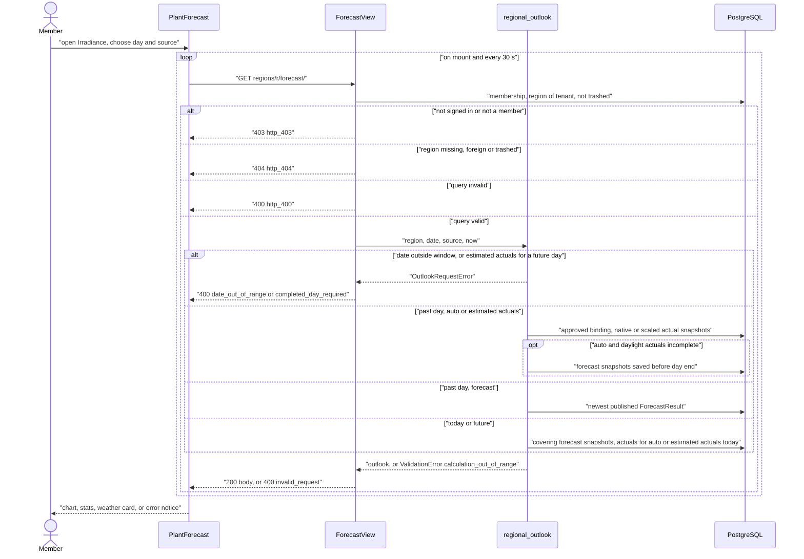

# View the regional irradiance forecast and weather reference

A workspace member (administrator or viewer) opens the Irradiance sub-view of a plant's Forecast tab and picks a day and a data source. The browser reads one region endpoint, which composes the answer from saved provider results only and returns horizontal irradiance (W/m2, kWh/m2) with coverage, freshness, quality flags and an independent Open-Meteo weather reference. No domain row is written, nothing is queued or sent to a provider; only session bookkeeping is written. The screen polls every 30 seconds.

## Entry points

- Screen: `web/src/components/plant-workspace.tsx` `PlantWorkspace` (date and source controls, default date tomorrow, default source `auto`) and `PlantForecast` (`useResource` in `web/src/components/ui.tsx`, 30 s poll), rendering `forecast-panel.tsx` `ForecastPanel` (`electrical=false`), `weather-reference.tsx` `WeatherReferenceCard` and `forecast-intervals.tsx` `ForecastIntervals`. Reachable only once the region has a plant (`region-workspace.tsx` `RegionWorkspace`).
- `GET /api/tenants/{t}/regions/{r}/forecast/?date=&data_source=auto|forecast|estimated_actuals` -> `pyracast.api.views.ForecastView.get` -> `pyracast.forecasts.history.regional_outlook` (API default source is `forecast`; `HEAD` runs the same code, `OPTIONS` answers DRF metadata). Actors: administrator and viewer; no command, script or worker. Data is written by `forecast-collection-execution`; the generation view of the same tab is `forecast-view`.

## Sequence

## Data

| Table | R/W | What |
| --- | --- | --- |
| `accounts_membership`, `auth_user`, `regions_region` | R | login and membership; region scoped to the tenant, not trashed; `approved_binding`, `status`, `timezone`, `revision` |
| `django_session`, `usersessions_usersession` | R/W | `last_activity_at` refreshed at most once a minute (`SessionLifetime`); allauth `last_seen_at` on every authenticated request |
| `connections_sitebinding`, `connections_provideraccount` | R | approved binding (timezone, location, capacity) and older bindings of the region for the saved fallback and past `forecast`; enabled, authorized and credential revision for `binding_is_current` |
| `forecasts_forecastsnapshot`, `forecasts_collectionjob` | R | intervals, coverage, `collected_at`, `available_at`, `issued_at`, weather payload; `status=succeeded`, `endpoint`, `reference_import_id`, `scheduled_slot` (gives `late`) |
| `forecasts_forecastresult` | R | `published_at` gate; payload returned verbatim for a past `forecast` day |
| `forecasts_referencecapacitynormalization` | R | source priority of scaled actuals and their provenance |

## Authorization

- Authentication: DRF `SessionAuthentication` plus `IsAuthenticated` (`pyracast/settings.py`); `WorkspaceWritePermission` passes safe methods. Tenant membership of any role: `require_member` in `RegionsView.get_queryset`, which also scopes the region to the tenant and hides trashed regions; region status (pending, suspended) does not block reading. No further check exists in `regional_outlook` and there is no row-level security; the endpoint is read-only. `OPTIONS` never calls `get_queryset`, so it skips the membership check. `CustomerJSONRenderer` with `pyracast.api.public.public_source_data` drops provider and credential fields and rewrites Solcast names at delivery; stored payloads stay untouched.

## Failure paths

| Condition | Result |
| --- | --- |
| Not signed in, not a member, inactive user | 403 `http_403`; region of another tenant, unknown or trashed: 404 `http_404` |
| Missing or malformed `date`, unknown `data_source` (also `archived_forecast`), unknown query key | 400 `http_400` with DRF field details (`non_field_errors` for unknown keys) |
| Date outside today-366 days to today+14 days (region timezone), or `estimated_actuals` after today (UI blocks only the latter) | 400 `{"code": "date_out_of_range"}` or `completed_day_required`, shown via `codes.*` |
| Calculation raises `ValueError`/`ArithmeticError` (intraday step also `KeyError`/`TypeError`); covering snapshots change between two reads | 400 `invalid_request` with the `calculation_out_of_range` message; the race gives detail `["forecast_sources_changed"]`, which the browser shows only as a generic request failure |
| Damaged stored actuals on the past-day path, or `KeyError`/`TypeError` in plain forecast composition | unmapped, HTTP 500 (read from code, not reproduced) |
| Same session has another request running for over 5 s | 429 `session_busy`, `Retry-After: 1`; English detail shown in every locale |
| No eligible saved source; a missing approved binding suffices only for today, future days, past `estimated_actuals` and past `auto` without a saved fallback (past `forecast` and the past `auto` fallback can still return an older binding's data) | 200, `result: null`, `freshness: missing`, `unavailable_reason` `forecast_unavailable` or `estimated_actuals_unavailable` |
| Binding no longer current, or a used source older than 24 h (age not checked on the past-day actuals path) | 200 `freshness: stale` |
| Request fails in the browser | error notice replaces the panel; the next poll retries |

## Rules and invariants

- Every domain read is an independent autocommit query without row locks; the only lock is the per-session PostgreSQL advisory lock that `SessionRequestSerialization` holds for the whole request. Consistency comes from a cutoff (`now`, or the end of the day for the saved fallback): a source counts only when `collected_at`, `available_at`, `issued_at` and, for forecasts, `published_at` are at or before it (the past `forecast` path does not check `available_at`). Legacy and scaled past-day actuals must also be collected after the day ended; native ones contribute only intervals ended before the cutoff.
- "Today" is the region's local date; day bounds use the binding timezone. Newer coverage owns its window and older forecasts fill only the rest (`latest-forecast-coverage-v2`; mixes with actuals use `estimated-actuals-then-forecast-v1`).
- `forecast`: today and future compose current forecasts; a past day returns the newest published `ForecastResult.payload` unchanged. `estimated_actuals`: today composes completed native intervals only; a past day reads archived native or capacity-scaled actuals with no forecast filling. `auto`: future days are forecast; today mixes completed actuals with forecast and drops the forecast once actuals cover daylight; a past day uses actuals and falls back to the forecast saved before the day ended (flag `forecast_fallback`, `provenance.selection_cutoff`) until daylight is covered. Only `region.approved_binding` is current: after a binding replacement archived actual days read `missing`, while the saved fallback and the past `forecast` path may still read earlier bindings of the region.
- `fresh` needs a current binding and every used snapshot collected within 24 h; past estimated actuals ignore age, a past `forecast` result is judged by its own age. `weather_reference` comes from the newest covering forecast snapshot, also inside mixed results and today's explicit actuals, never fills irradiance gaps and is absent from past-day actuals.

## Tests

- pytest, endpoint: `tests/test_historical_region_api.py`, `test_regional_current_forecast.py`, `test_midnight_forecast_fallback.py`, `test_outlook_preparation.py` (includes the `forecast_sources_changed` race), `test_archived_actual_composition_api.py`, `test_historical_outlook.py`, `test_capacity_normalization.py`, `test_public_data.py`, `test_api.py` (foreign region 404); operations: `test_intraday_outlook.py`.
- Playwright (API mocked with `page.route`): `web/tests/weather-reference.spec.ts`, `daylight-forecast.spec.ts`, `forecast-coverage.spec.ts`, `forecast-intervals.spec.ts`, `responsive.spec.ts`. Gaps: no endpoint test for an unknown query key or `data_source=archived_forecast`, for corrupt actuals on the region past-day path or as a viewer; no Playwright test for the date window or against the real API.
