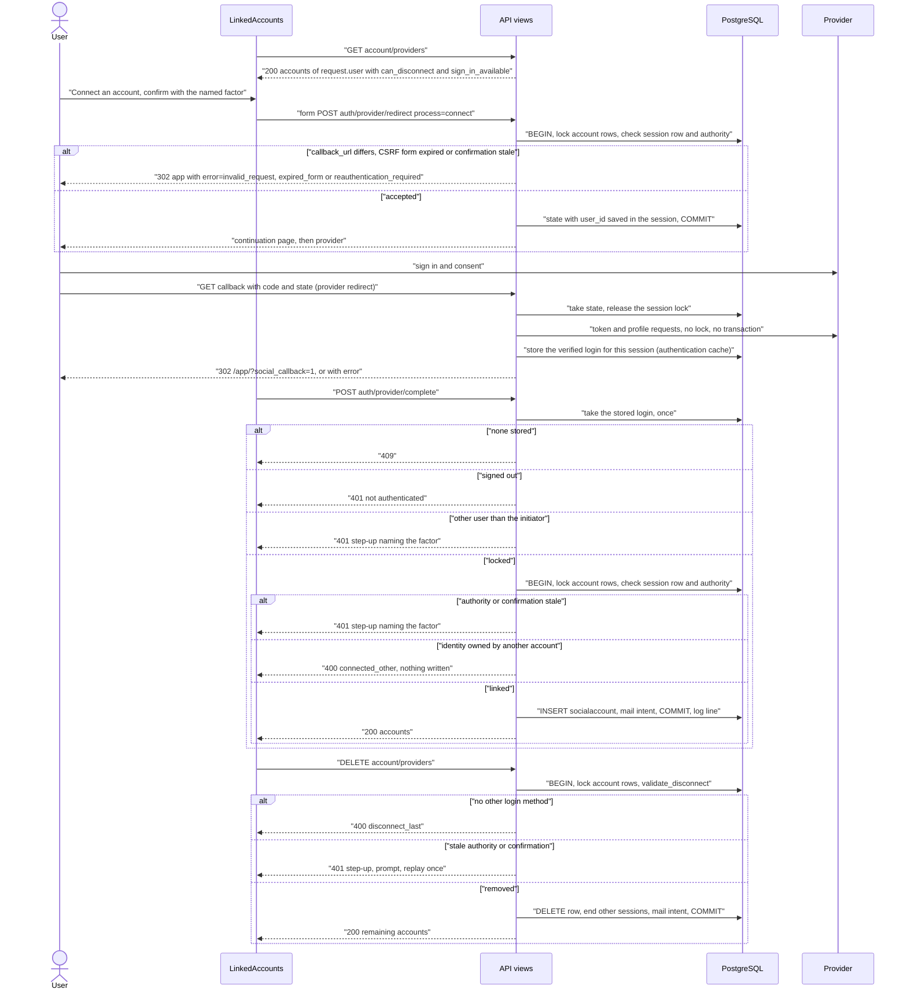

# Connect or disconnect a social account

A signed-in user opens Account settings, lists the Google or Microsoft identities linked to the account, links another one through the provider redirect, or removes one. Connecting needs a recent confirmation with the account's strongest factor before the redirect and again when the connection completes; both changes run in one transaction that locks the account's rows, and both send a notice mail and a security log line.

## Entry points

- Screen: `web/src/features/account/linked-accounts.tsx` `LinkedAccounts`, mounted by `account-security.tsx` `AccountSecurity` on `/app/account/`. Buttons: `features/auth/social-provider-buttons.tsx` `SocialProviderButtons` with `process="connect"`, shown only after a confirmation through the shared prompt (`features/account/step-up.tsx`). The page consumes the provider return (`?social_callback=1`, `error`) once and sends `POST auth/provider/complete`.
- `GET|DELETE /api/auth/browser/v1/account/providers` -> `pyracast.accounts.social_views.ManageProvidersView` (list, disconnect).
- `POST .../auth/provider/redirect` (native form post, `process=connect`) -> `social_views.RedirectToProviderView`, shared with social sign-in; then `GET /api/accounts/{google,microsoft}/login/callback/` -> `social_views.provider_callback`; then `POST .../auth/provider/complete` -> `CompleteProviderLoginView`, `social_views.connect` and `social.connect_identity`.

## Sequence

## Data

| Table | R/W | What |
| --- | --- | --- |
| `socialaccount_socialaccount` | R/W | Listed per user, looked up by `(provider, uid)` at the completion. Insert on connect, `extra_data` (email only) refreshed for an owned identity, delete on disconnect. Unique `(provider, uid)`. |
| `auth_user`, `account_emailaddress`, `mfa_authenticator` | R, lock | `account_state(lock=True)` locks them for every connect redirect, completion and disconnect; `has_usable_password` and verified addresses feed `can_disconnect`. |
| `django_session` | R/W | OAuth state (`socialaccount_states`), the authority record `pyracast_session_authority`; disconnect deletes the other sessions of the account (with `usersessions_usersession`). |
| `pyracast_authentication_cache` | R/W | The verified login of the callback, keyed by a digest of the session key and taken once. |
| `notifications_outboundmail` | W | The connect or disconnect notice intent. |
| `socialaccount_socialapp`, `socialaccount_socialtoken` | none | Apps come from environment credentials (`list_apps`); tokens are discarded. |

## Authorization

- Session and CSRF: `CsrfViewMiddleware`; the account views answer 401 when anonymous.
- Confirmation (300 s): `RedirectToProviderView` (connect), `social_views.connect` (again at the completion) and allauth's disconnect flow. A confirmation accepts only the account's strongest factor, and the 401 names that flow (`step-up-reauthentication`). The session's authority record must equal the account's locked credential state, else the 401 comes.
- Ownership: allauth's `DeleteProviderAccountInput` finds only accounts of `request.user`; the callback state carries `user_id`, which must equal the session user at the completion. `callback_url` is pinned to one value; `provider_callback` refuses unconfigured providers. Unique `(provider, uid)` is the last guard against two users claiming one identity.

## Failure paths

| Condition | Result |
| --- | --- |
| Anonymous GET or DELETE | 401, the UI refreshes the session |
| Wrong CSRF token | 403 `csrf_failed` JSON; on the native form post 302 `error=expired_form` |
| Disconnect or completion without a current confirmation or authority | 401 naming the strongest factor's flow; the prompt follows, then the disconnect replays once |
| Last sign-in method | 400 `disconnect_last`, answered before the confirmation check |
| Identity held by another account | 400 `connected_other`, shown above the list |
| No stored login (expired, used, or its session ended) | 409; generic `callbackError` notice |
| Session ended during the write | 400 `session_ended` |
| Session lock wait over 5 s (redirect, callback, completion, list) | 429 `session_busy` JSON, one client retry for fetches |
| Provider not configured; cancelled at the provider, provider or network error; missing or used state | 302 `error=provider_unavailable`, `cancelled`, or `unknown` when no state is found; connect errors show one generic notice |
| Notice mail cannot be sent | The mail worker retries the stored intent; the committed change stays (`account-mail-notifications`) |

## Rules and invariants

- Lock order: per-session advisory lock (`SessionRequestSerialization`), then the account's rows (`credential_write`: addresses, identities, user, authenticators), then the session row. The callback releases the session lock before the provider exchange and holds no transaction.
- A credential change during the provider round trip, or a slow provider screen past the 300 s window, makes the completion answer the step-up 401 and store nothing.
- Connect and disconnect end every pending code or sign-in step of the account and stop other sessions' confirmations counting. Only disconnect ends the other sessions (`sessions_revoked`, reason `social_account_removed`).
- Disconnect needs a usable password with a verified address, or another identity whose provider is still enabled. Identities of a disabled provider stay listed and removable but do not count as a login method.
- Reconnecting an owned identity only refreshes `extra_data`: no insert, mail or log line. Audit is two JSON log lines (`social_account_connected`, `social_account_disconnected`), no table.

## Tests

- `tests/test_social_accounts.py` (link, unlink, audit, last-provider rule, concurrent disconnect, provider errors), `tests/test_provider_completion.py` (callback verifies only, completion refusals, rollback leaves no line or mail), `tests/test_provider_identities.py`; `web/tests/social-auth.spec.ts`, `web/integration/social-auth.spec.ts`.
