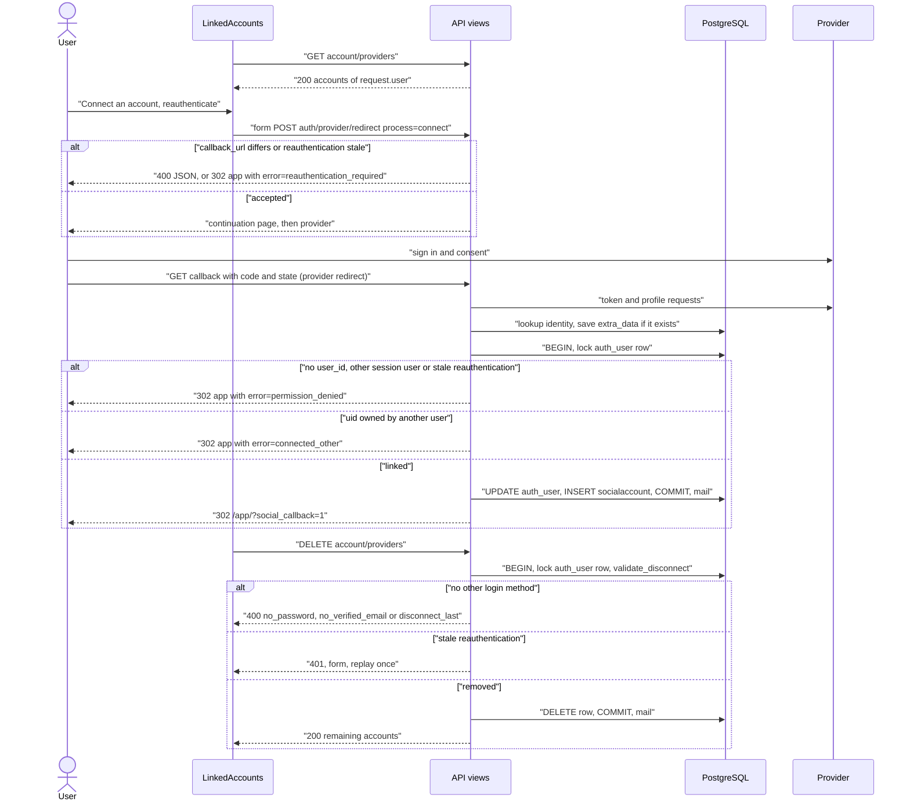

# Connect or disconnect a social account

A signed-in user opens Account settings, lists the Google or Microsoft identities linked to the account, links another one through the provider redirect, or removes one. Connecting needs recent reauthentication twice (before the redirect and again at the callback), both changes run under a user row lock, and both send allauth's stock notification mail and a security log line.

## Entry points

- Screen: `web/src/components/linked-accounts.tsx` `LinkedAccounts`, mounted by `account-security.tsx` `AccountSecurity` in the dashboard profile view (`?account=security`). Buttons: `social-provider-buttons.tsx` `SocialProviderButtons` with `process="connect"` (providers from allauth `GET config`). The `dashboard.tsx` `DashboardView` effect handles the return (sessionStorage `pyracast.socialConnect`, forces `?account=security`). Reauthentication uses the step-up endpoints.
- `GET|DELETE /api/auth/browser/v1/account/providers` -> `pyracast.accounts.social_views.ManageProvidersView` (list, disconnect), routed before allauth's include.
- `POST /api/auth/browser/v1/auth/provider/redirect` (native form post, `process=connect`) -> `social_views.RedirectToProviderView`, shared with social sign-in; then `GET /api/accounts/{google,microsoft}/login/callback/` -> `social_views.provider_callback`, `social.SocialAccountAdapter.pre_social_login` and `connect_account`.

## Sequence

## Data

| Table | R/W | What |
| --- | --- | --- |
| `socialaccount_socialaccount` | R/W | Listed per user, looked up by `(provider, uid)` at the callback. Insert on connect, `extra_data` (email only) update for any existing identity before the ownership check, delete on disconnect. Unique `(provider, uid)`. |
| `auth_user` | R/W, lock | `SELECT ... FOR UPDATE` serializes connect and disconnect per user; `SocialLogin.save` re-saves the whole user row on connect; `has_usable_password` feeds the disconnect rules. |
| `account_emailaddress` | R | Verified address for the password branch of the disconnect rules. |
| `django_session` | R/W | OAuth state (`socialaccount_states`, 10 min; the oldest is pruned only above 10 before a new one is added, so up to 11 remain), authentication records. |
| `socialaccount_socialapp`, `socialaccount_socialtoken` | none | Apps come from environment credentials (`list_apps`); tokens are discarded. |

## Authorization

- Session and CSRF: `CsrfViewMiddleware` (form field or `X-CSRFToken`, 403 on failure); `AuthenticatedAPIView` and `locked_social_user` answer 401 when anonymous.
- Reauthentication (300 s): `RedirectToProviderView` (connect), `SocialAccountAdapter.connect_account` and allauth `do_connect` (again at the callback), allauth `flows.connect.disconnect`.
- Ownership: `DeleteProviderAccountInput` finds only accounts of `request.user`; the callback state carries `user_id`, which `locked_social_user` must match to the current session user. `callback_url` is pinned to one value; `provider_callback` refuses unconfigured providers. Unique `(provider, uid)` is the last guard against two users claiming one identity.

## Failure paths

| Condition | Result |
| --- | --- |
| Anonymous GET or DELETE; wrong CSRF token | 401, UI refreshes the session, `sessionExpired`; 403 shows a generic request error (Django's 403 page on the form post) |
| Disconnect with stale reauthentication | 401, `ReauthenticationForm`, one replay, then `reauthStillRequired` |
| Last account without usable password or verified email; remaining accounts all disabled; unknown account | 400 `no_password`, `no_verified_email`, `disconnect_last` or `account_not_found`, alert with retry |
| Session lock wait over 5 s, or another `callback_url` | 429 `session_busy`, or 400 JSON on the native form post |
| Provider not configured; cancelled at the provider, provider or network error; missing or used state | 302 `error=provider_unavailable` (no `error_process`); `error=cancelled` or another code with `error_process=connect`; `error=unknown` with `error_process=login`, since no state is found. Every connect error shows one generic `callbackError` notice; `error_process` is not read |

## Rules and invariants

- Lock order: per-session advisory lock (`SessionRequestSerialization`), then the `auth_user` row. The provider token exchange runs while the session lock is held.
- Connect revalidates the session user (`get_user`) after the lock, so a password change or deactivation during the provider round trip aborts it. Reauthentication (300 s) is shorter than the state lifetime (600 s): a slow provider screen fails at the callback.
- Disconnect needs password plus verified email, or another account whose provider is still enabled. Disabled-provider accounts stay listed and removable but do not count as a login method.
- Reconnecting an owned identity only updates `extra_data`: no insert, mail or audit event. Audit is two JSON log lines (`social_account_connected`, `social_account_disconnected`), no table. Mail is deferred with `transaction.on_commit` and sent synchronously after `locked_social_user` commits.

## Tests

- `tests/test_social_accounts.py` (link, unlink, audit, last-provider rule, disabled provider removal, concurrent disconnect and claim, lock recheck, callback user binding, callback URL, provider errors), `tests/test_configured_social_apps.py` (apps from environment); `web/tests/social-auth.spec.ts` (email-code disconnect, callback error consumed once); `web/integration/social-auth.spec.ts` (connect up to the provider redirect).
- Gaps: no assertion on the connect or disconnect mails or on the 400 error codes (tests check status only), no non-Google/Microsoft row in the list, no frontend test of the success return or of `connected_other`.
