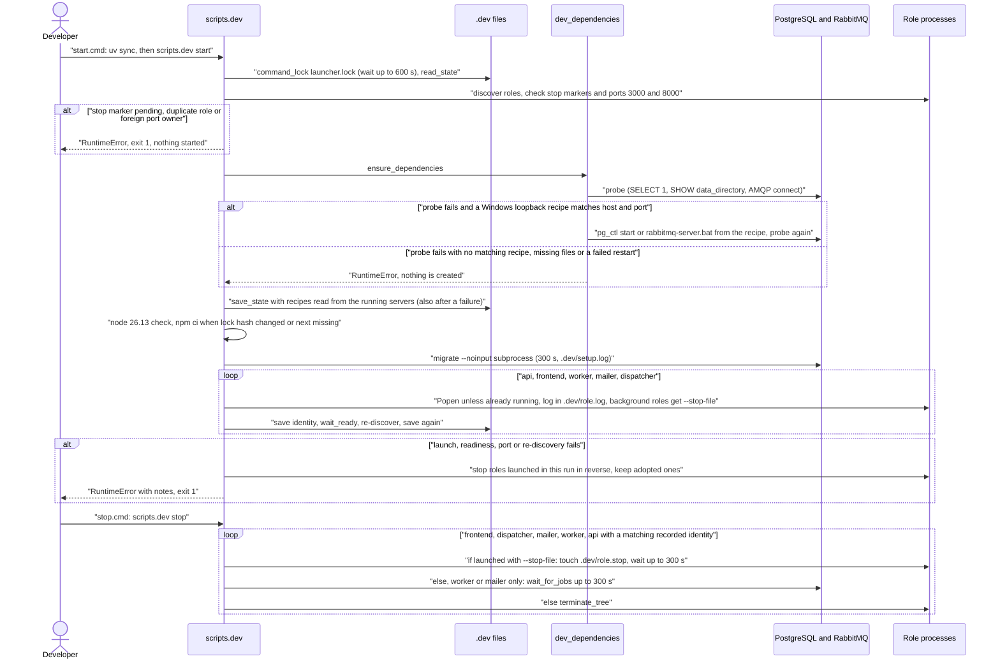

# Start, stop and inspect the local development stack

A developer runs `start.cmd`, `stop.cmd` or `status.cmd` (or `python -m scripts.dev <action>`). `start` verifies PostgreSQL and RabbitMQ, installs frontend packages, migrates and launches the API, frontend, worker, mailer and dispatcher as detached processes tracked in `.dev/state.json`. `stop` ends them cooperatively and leaves PostgreSQL and RabbitMQ running.

## Entry points

- `start.cmd` runs `uv sync --locked`, then `uv run --locked python -m scripts.dev start`, then opens `http://127.0.0.1:3000` unless the first argument is `--no-browser`; it pauses only on failure. `stop.cmd` (pauses on failure) and `status.cmd` (always pauses) run `scripts.dev stop` and `status`. Only `python -m scripts.dev stop --frontend-only` reaches the frontend-only stop; `start` and `status` accept and ignore the flag. `scripts/dev_dependencies.py` `ensure_dependencies`, called only by `start`, probes PostgreSQL and RabbitMQ and, on Windows with a recipe recorded for the same loopback host and port, restarts them.
- `scripts/start_postgres.py` `main` (Windows: pinned EDB zip or `PYRACAST_POSTGRES_ARCHIVE`, checksum-verified, in a new temp dir, then `initdb`, `pg_ctl start`, `createdb`; Linux: pinned Docker image in container `pyracast-postgres`; default port 55432; the opt-in `--non-durable` flag starts the server with `fsync`, `synchronous_commit` and `full_page_writes` off, which CI passes for its throwaway clusters and a developer cluster never uses). `scripts/start_rabbitmq.py` `main` (Windows only, refuses a busy 5672, pinned Erlang and RabbitMQ zips in a new temp dir, writes `GITHUB_ENV` in CI). `.github/workflows/ci.yml` runs both; Ubuntu developers use the RabbitMQ `docker run` line in `README.md`.
- Children: `python -m django runserver 127.0.0.1:8000 --noreload`, `django worker --threads 4`, `django worker --threads 2 --queues notifications`, `django dispatch --loop` (the last three with `--stop-file .dev/<role>.stop`), and `node next dev` on 127.0.0.1:3000 in `web/`.

## Sequence

## Data

| Table | R/W | What |
| --- | --- | --- |
| `django_migrations` and app tables | R/W | `migrate --noinput` subprocess on every `start`: schema changes and data migrations that read and update rows (see `database-migration`). |
| `forecasts_collectionjob`, `metering_epiascollectionjob`, `plants_calibrationrun`, `notifications_notificationdelivery` | R | `wait_for_jobs` polls for any `status="running"` (`"sending"` for deliveries), all tenants, before terminating a legacy worker or mailer. |
| `.dev/` files | R/W | `state.json` (via `state.tmp`; identities, restart recipes), `launcher.lock`, `<role>.log`, `setup.log`, `postgres.log`, `rabbitmq.log`, `<role>.stop` markers, `npm-lock.sha256`. Git-ignored. |

## Authorization

- No application authorization; isolation is by binding. API and `next dev` bind 127.0.0.1; helper PostgreSQL trusts every connection on 127.0.0.1 (Windows `--auth=trust`, Docker `POSTGRES_HOST_AUTH_METHOD=trust` published on 127.0.0.1); helper RabbitMQ configures its AMQP listener on 127.0.0.1:5672.
- `main` sets `DJANGO_SETTINGS_MODULE`, forces `PYRACAST_DEBUG=1` and adds the localhost:3000 origins to `PYRACAST_CSRF_ORIGINS`; children inherit the whole environment. `.env` never overrides existing variables. `stop` and `status` act on a process only when pid, creation time, exe and command hash match the record and `process_role` agrees. `stop_file_path` keeps markers inside the workspace. `read_state` rejects another workspace. Dependency recovery replays only a recipe recorded from a running local instance for the same host and port.

## Failure paths

| Condition | Result |
| --- | --- |
| Lock held over 600 s | `RuntimeError` "Timed out waiting for another launcher command", exit 1 |
| State of another workspace or wrong shape | "Launcher state belongs to another workspace or is invalid"; malformed JSON is a `ValueError`: "Launcher could not complete" |
| Running background role still has its stop marker; more than one parent process of a role | "`<role>` is still shutting down" or "Multiple `<role>` processes exist" before dependency work; the duplicate check after a launch triggers rollback |
| Foreign process on 3000 or 8000 | "Port N belongs to another process", before setup (after setup with rollback: "`<role>` was not started") |
| Any `psycopg.Error` (also wrong password or missing database) or unreachable RabbitMQ, with no matching Windows loopback recipe, missing recipe files, or a failed or timed-out restart (`pg_ctl -t 30`, broker 90 s) | "PostgreSQL is unavailable", "The recorded ... files are missing", "could not be restarted", "did not become available"; invalid `PYRACAST_RABBITMQ_URL`: "The configured RabbitMQ connection is invalid" |
| Node or npm missing or too old, `npm-cli.js` not found, `npm ci` or `migrate` fails or exceeds 300 s, frontend lock changed while it runs | install hint; "Setup failed" or "Setup timed out; see .dev/setup.log"; "Run stop.cmd, then start.cmd" |
| Role exits or is not ready in 90 s, or any exception (Ctrl+C included) in the launch loop | "see .dev/`<role>`.log"; roles launched in this run stopped in reverse, retained identities noted |
| Cooperative stop over 300 s; legacy worker or mailer with running jobs after 300 s | "`<role>` is still shutting down and was left running" or "Jobs are still running"; identity kept, later roles not stopped |
| `OSError`, `ValueError` (non-numeric `PGPORT`, odd Node version), `psutil.Error` | "Launcher could not complete", exit 1. Other exceptions, such as a database error in `wait_for_jobs` or a failing `node --version`, escape as tracebacks. |

## Rules and invariants

- One launcher command at a time per workspace: OS lock on `.dev/launcher.lock` (`msvcrt` or `fcntl`), freed by the OS on a crash. `status` waits for it too; `uv sync` in `start.cmd` runs before it.
- Order is fixed: preflight, dependencies, frontend install, migrate, then api, frontend, worker, mailer, dispatcher. A role leaves state only after it is gone. `api` and `frontend` have no cooperative path: `terminate_tree` terminates, waits 10 s, then kills.
- Background roles stop through `.dev/<role>.stop`, polled by `pyracast.shutdown.ShutdownRequest`; a worker that finds the marker at startup exits at once. A stale marker is deleted only when `start` launches that role. The launcher waits 300 s while the worker's `Worker.stop()` drains up to 600 000 ms (Dramatiq 2.2.1 default), so a timeout leaves the worker draining and `start` refuses until it exits.
- `start` adopts any matching process of this workspace via `discover`, recorded or not, and re-records the real parent after readiness because the venv launcher may spawn the interpreter. Worker, mailer and dispatcher count as ready after surviving one second; only api (`GET /api/session/` with `csrf_token`) and frontend (`GET /`) are probed, 3 s per request.
- Every successful dependency check overwrites both recipes, with `{}` off Windows, for a remote host, or when `SHOW data_directory` is not permitted. The RabbitMQ recipe hard-codes `rabbitmq_server-4.4.0` beside the Erlang directory, matching `start_rabbitmq.py`. Helper workspaces are new `tempfile.mkdtemp` directories on every run; OS temp cleanup can delete them (`docs/agents/PROGRESS.md`).

## Tests

- `tests/test_dev_launcher.py`: identity and stale pid, cooperative stop and timeouts, pending-marker refusal, legacy job drain, foreign workspace, `command_lock` across OS processes, `main` lock order, port preflight, start rollback, all against hand-written `python -m django` stand-ins. `tests/test_dev_dependencies.py` (recovery with mocked Windows; one native Windows test), `tests/test_postgres_workspace.py` (`windows_workspace` only), `tests/test_start_postgres.py` (`start_postgres.main` with its commands recorded on both platforms, with and without `--non-durable`), `tests/test_shutdown.py`, `tests/test_shutdown_process.py` (stop file ends real worker and dispatch commands). No Playwright. Gaps: `wait_ready`, `listener_pid`, `owns_port`, the frontend branch of `process_role` and the exact `start` command vectors, `status`, `--frontend-only`, the `except` blocks of `main`, `start_rabbitmq.main`, the real start of `start_postgres.main` and the cmd wrappers.
