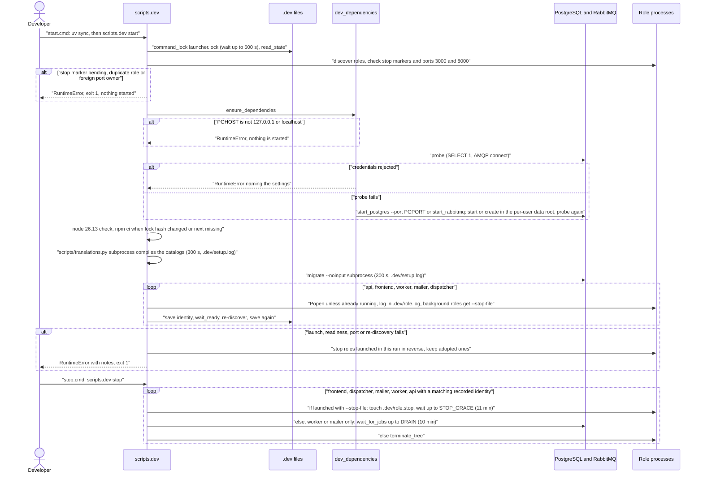

# Start, stop and inspect the local development stack

A developer runs `start.cmd`, `stop.cmd` or `status.cmd` (or `python -m scripts.dev <action>`). `start` verifies PostgreSQL and RabbitMQ, installs frontend packages, migrates and launches the API, frontend, worker, mailer and dispatcher as detached processes tracked in `.dev/state.json`. `stop` ends them cooperatively and leaves PostgreSQL and RabbitMQ running.

## Entry points

- `start.cmd` runs `uv sync --locked`, then `uv run --locked python -m scripts.dev start`, then opens `http://127.0.0.1:3000` unless the first argument is `--no-browser`; it pauses only on failure. `stop.cmd` (pauses on failure) and `status.cmd` (always pauses) run `scripts.dev stop` and `status`. Only `python -m scripts.dev stop --frontend-only` reaches the frontend-only stop; `start` and `status` accept and ignore the flag. `scripts/dev_dependencies.py` `ensure_dependencies`, called only by `start`, prints both targets, refuses a `PGHOST` other than `127.0.0.1` or `localhost`, probes PostgreSQL and RabbitMQ and provisions a missing one through the two helpers below: PostgreSQL on the probed `PGPORT` (default 5432, as in the settings), RabbitMQ only on Windows and only for the helper's `127.0.0.1:5672`.
- `python -m scripts.start_postgres [--port N]` (port: `--port`, else `PGPORT`, else 55432; idempotent: a running cluster is reported, a stopped one started, a missing one created, and on Windows a missing `pyracast` database is created on every run; a non-empty data directory that is not a cluster is refused. Windows: pinned EDB zip or `PYRACAST_POSTGRES_ARCHIVE`, checksum-verified, under `%LOCALAPPDATA%\pyracast\postgres` (`pgsql`, `data`, `postgres.log`); Linux: pinned Docker image in container `pyracast-postgres` with volume `pyracast-postgres-data`, and an existing container without that volume, with non-durable settings or not publishing only the loopback port is refused). The development cluster runs PostgreSQL 18.6. `python -m scripts.start_rabbitmq` (Windows only, idempotent the same way, pinned Erlang and RabbitMQ zips and broker state under `%LOCALAPPDATA%\pyracast\rabbitmq`, writes `GITHUB_ENV` in CI). Neither keeps data under the OS temp directory; CI passes `--ephemeral` for a throwaway cluster running production's 18.7 (Windows: a temp directory and the 18.7 EDB archive; Linux: a uniquely named `pyracast-postgres-ephemeral-*` container from the image of `deploy/postgres/Dockerfile`), and only with it `--non-durable` (`fsync`, `synchronous_commit` and `full_page_writes` off). Ubuntu developers use the RabbitMQ `docker run` line in `README.md`.
- Children: `python -m django runserver 127.0.0.1:8000 --noreload`, `django worker --threads 4`, `django worker --threads 2 --queues notifications`, `django dispatch --loop` (the last three with `--stop-file .dev/<role>.stop`), and `node next dev` on 127.0.0.1:3000 in `web/`.

## Sequence

## Data

| Table | R/W | What |
| --- | --- | --- |
| `django_migrations` and app tables | R/W | `migrate --noinput` subprocess on every `start` (after the catalog compile): schema changes and data migrations that read and update rows (see `database-migration`). |
| `forecasts_collectionjob`, `metering_epiascollectionjob`, `plants_calibrationrun`, `notifications_notificationdelivery`, `notifications_outboundmail` | R | `wait_for_jobs` polls for any `status="running"` (`"sending"` for deliveries and outbound mail), all tenants, before terminating a legacy worker or mailer. |
| `.dev/` files | R/W | `state.json` (via `state.tmp`; role identities), `.dev/launcher.lock`, `<role>.log`, `setup.log`, `<role>.stop` markers, `npm-lock.sha256`. Git-ignored. Dependency data and logs live in the per-user data root, not in `.dev/`. |

## Authorization

- No application authorization; isolation is by binding. API and `next dev` bind 127.0.0.1; helper PostgreSQL trusts every connection on 127.0.0.1 (Windows `--auth=trust`, Docker `POSTGRES_HOST_AUTH_METHOD=trust` published on 127.0.0.1); helper RabbitMQ configures its AMQP listener on 127.0.0.1:5672.
- `main` sets `DJANGO_SETTINGS_MODULE`, forces `PYRACAST_DEBUG=1` and adds the localhost:3000 origins to `PYRACAST_CSRF_ORIGINS`; children inherit the whole environment. `.env` never overrides existing variables. `stop` and `status` act on a process only when pid, creation time, exe and command hash match the record and `process_role` agrees. `stop_file_path` keeps markers inside the workspace. `read_state` rejects another workspace. Dependencies are started only on 127.0.0.1 (see Entry points).

## Failure paths

| Condition | Result |
| --- | --- |
| Lock held over 600 s | `RuntimeError` "Timed out waiting for another launcher command", exit 1 |
| State of another workspace or wrong shape | "Launcher state belongs to another workspace or is invalid"; malformed JSON is a `ValueError`: "Launcher could not complete" |
| Running background role still has its stop marker; more than one parent process of a role | "`<role>` is still shutting down" or "Multiple `<role>` processes exist" before dependency work; the duplicate check after a launch triggers rollback |
| Foreign process on 3000 or 8000 | "Port N belongs to another process", before setup (after setup with rollback: "`<role>` was not started") |
| `PGHOST` other than 127.0.0.1 or localhost; rejected PostgreSQL or RabbitMQ credentials; a dependency still unavailable after provisioning (`pg_ctl -t 60`, broker 90 s); a broker down off Windows, at another target than 127.0.0.1:5672 or with credentials, virtual host or TLS other than the helper's; a data directory that is not a cluster; a Docker container without the durable volume or with non-durable settings | "The launcher uses only a loopback database on 127.0.0.1 or localhost", "... rejected the configured credentials; check ... in .env", "did not become available", "start it with the README Docker command", "the helper starts a broker only on 127.0.0.1:5672", "Automatic RabbitMQ provisioning supports only guest credentials, the / virtual host and plain AMQP", "is not a PostgreSQL cluster; nothing was changed", "does not keep durable data in volume ...; nothing was changed"; invalid `PYRACAST_RABBITMQ_URL`: "The configured RabbitMQ connection is invalid" |
| Node or npm missing or too old, `npm-cli.js` not found beside the `npm` entry, beside `node` or in the `lib` directory of `node` (the message lists the paths tried), `npm ci`, the catalog compile (an incomplete or placeholder-mismatched catalog fails it) or `migrate` fails or exceeds 300 s, frontend lock changed while it runs | install hint; "Setup failed" or "Setup timed out; see .dev/setup.log"; "Run stop.cmd, then start.cmd" |
| Role exits or is not ready in 90 s, or any exception (Ctrl+C included) in the launch loop | "see .dev/`<role>`.log"; roles launched in this run stopped in reverse, retained identities noted |
| Cooperative stop over `STOP_GRACE` (11 minutes); legacy worker or mailer with running jobs after `DRAIN` (10 minutes) | "`<role>` is still shutting down and was left running" or "Jobs are still running"; identity kept, later roles not stopped |
| `OSError`, `ValueError` (non-numeric `PGPORT`, odd Node version), `psutil.Error` | "Launcher could not complete", exit 1. Other exceptions, such as a database error in `wait_for_jobs` or a failing `node --version`, escape as tracebacks. |

## Rules and invariants

- One launcher command at a time per workspace: OS lock on `.dev/launcher.lock` (`msvcrt` or `fcntl`), freed by the OS on a crash. `status` waits for it too; `uv sync` in `start.cmd` runs before it.
- Order is fixed: preflight, dependencies, frontend install, catalog compile, migrate, then api, frontend, worker, mailer, dispatcher. A role leaves state only after it is gone. `api` and `frontend` have no cooperative path: `terminate_tree` terminates, waits 10 s, then kills.
- Background roles stop through `.dev/<role>.stop`, polled by `pyracast.shutdown.ShutdownRequest`; a worker that finds the marker at startup exits at once. A stale marker is deleted only when `start` launches that role. The launcher waits `STOP_GRACE` (11 minutes) while the worker's `Worker.stop()` drains for up to `DRAIN` (10 minutes, `pyracast.background.deadlines`), so a timeout leaves the worker draining and `start` refuses until it exits.
- `start` adopts any matching process of this workspace via `discover`, recorded or not, and re-records the real parent after readiness because the venv launcher may spawn the interpreter. Worker, mailer and dispatcher count as ready after surviving one second; only api (`GET /api/session/` with `csrf_token`) and frontend (`GET /`) are probed, 3 s per request.
- The helpers install binaries once and never delete a directory, a container or a volume.

## Tests

- `tests/test_dev_launcher.py`: identity and stale pid, cooperative stop and timeouts, pending-marker refusal, legacy job, notification and outbound-mail drain, foreign workspace, `command_lock` across OS processes, `main` lock order, port preflight, the catalog compile before migrate, start rollback, all against hand-written `python -m django` stand-ins. `tests/test_dev_dependencies.py` (targets, host and broker-target refusal, credential errors, provisioning on the probed port; one native Windows test of the server start), `tests/test_postgres_workspace.py` (`windows_workspace` only), `tests/test_start_postgres.py` and `tests/test_start_rabbitmq.py` (durable root, temp refusal, created, started and running states, database creation after an interrupted initialization, foreign directory, Docker volume and refused containers, `--ephemeral`, `--non-durable` and `--port`), npm resolution in `tests/test_dev_launcher.py`, `tests/test_shutdown.py`, `tests/test_shutdown_process.py` (stop file ends real worker and dispatch commands). No Playwright. Gaps: `wait_ready`, `listener_pid`, `owns_port`, the frontend branch of `process_role` and the exact `start` command vectors, `status`, `--frontend-only`, the `except` blocks of `main`, `start_broker`, the real start of both helpers and the cmd wrappers.
