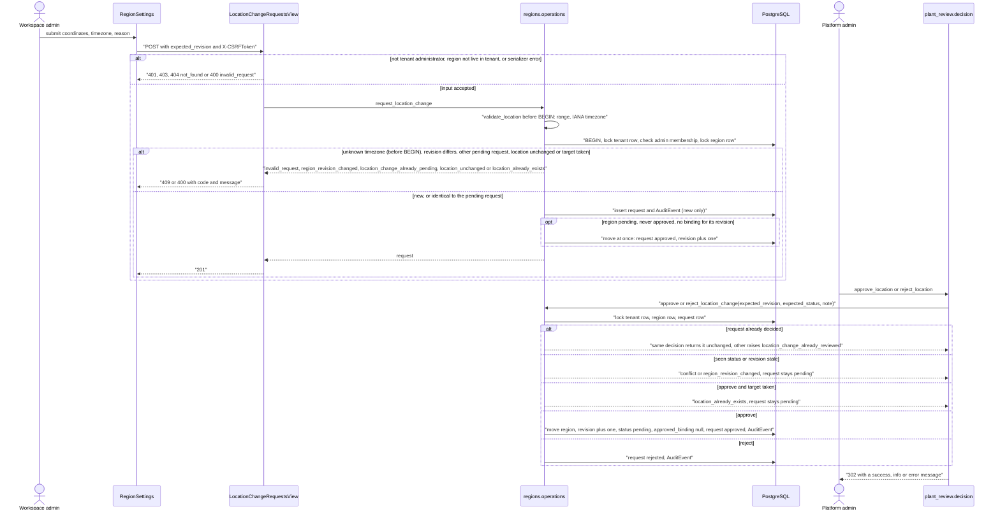

# Request a site location change and review it

A workspace administrator asks to move a plant's `Region` (coordinates and IANA timezone) from the plant's Location settings and may withdraw the request while it is pending. A platform administrator approves or rejects it in the operator console. Rejection and withdrawal change only the request. Approval rewrites the region, bumps its `revision`, resets it to `pending` and drops `approved_binding`, so setup, validation and approval must be repeated before collection resumes. A plant that was never approved and has no connection for its location moves at once, without review.

## Entry points

- Screen: `RegionSettings` and `LocationRequests` (`web/src/features/plant/region-settings.tsx`), reached from Settings > Location in `PlantWorkspace`; `ActionForm` (`web/src/ui/form.tsx`) is read-only unless `useCanManageWorkspace()` is true. The screen shows the latest outcome with the operator's note and a Withdraw button while a request is pending.
- `GET|POST /api/tenants/{t}/regions/{r}/location-change-requests/` -> `LocationChangeRequestsView` (`pyracast/api/views.py`) with `LocationChangeInput` and `LocationChangeOutput`. Actor: workspace administrator (POST, throttled under `submission`), any member (GET). The view calls `request_location_change` (`pyracast/regions/operations.py`).
- `POST .../location-change-requests/{id}/withdraw/` -> `LocationChangeWithdrawView` -> `withdraw_location_change`. Actor: workspace administrator.
- Review: panel "Location change requests" on the plant page (`regions/templates/admin/regions/region/setup.html`, filled by `review_context`) with an optional note, Approve and Reject buttons that post `approve_location` or `reject_location` to `POST /admin/plants/{region}/decision/` -> `pyracast/platform_admin/plant_review.py` `decision` -> `approve_location_change` / `reject_location_change`. The overview queue (`overview_context`) and the plant list filter only link to that page. The changelist of `RegionLocationChangeRequest` is read-only.
- Console correction: `correct_location` (platform administrator) runs a request and its approval in one transaction from the plant details page (`plant-configuration-revision`); it is refused while a request is pending.

## Sequence

## Data

| Table | R/W | What |
| --- | --- | --- |
| `regions_regionlocationchangerequest` | R/W | Insert with `base_revision`, canonical coordinates, `reason`; a binding replacement moves `base_revision` of the pending row; a decision or withdrawal sets `status`, `reviewed_at`, `decision_reason` and, for approve or reject, `reviewed_by` |
| `regions_region` | R/W | Locked. Approval rewrites location, timezone, `revision`, `status`, `approved_binding`; `revision` is the guard. Other active regions of the tenant are read for the occupancy check |
| `regions_auditevent` | R/W | `location_change_requested`, `_approved`, `_rejected`, `_withdrawn`, each naming the request in `details.request_id`, and `_rebased` (binding replacement); each carries the region revision as it stands after the step. A `region_approved` row marks a plant as once approved |
| `accounts_tenant`, `accounts_membership` | R | Tenant row locked by every request, withdrawal and decision; administrator membership read by the route policy and `authorize_workspace_admin` |
| `connections_sitebinding` | R | Read for the first-setup check only; the old binding keeps its coordinates and stops matching `region_revision` |

## Authorization

- View: `RoutePolicy` (`pyracast/api/permissions.py`) lists the request route as `GET` member and `POST` admin, the withdraw route as `POST` admin; session CSRF applies. `tenant_region` needs a live region of that tenant.
- Operation: `authorize_workspace_admin` (tenant row lock, active administrator membership) opens request and withdrawal; `require_platform_admin` (active staff superuser) opens approve, reject and `correct_location`. The console adds a verified authenticator session (`PlatformAdminSite.has_permission`) and a recent confirmation for every unsafe request (`_confirmed`).
- Database: unique `regionlocationchangerequest_region_uniq` (one pending request per region), check `regionlocationchangerequest_review_chk`, and `region_tenant_location_uniq` (6-decimal rounding, active regions) as backstop.

## Failure paths

| Condition | Result |
| --- | --- |
| Anonymous | 401 `not_authenticated` |
| Non-member, viewer on POST or withdraw, missing CSRF token | 403 `membership_required`, `workspace_admin_required`, `csrf_failed` |
| Region of another tenant, trashed or unknown; withdraw of an unknown or foreign request | 404 `not_found` |
| Unknown or missing field, coordinate out of range, timezone over 100 or reason over 1000 characters, `expected_revision` below 1 | 400 `invalid_request` with `fields` |
| Unknown IANA timezone | 400 `invalid_request`, `fields.timezone` |
| Stale `expected_revision` / other pending request | 409 `region_revision_changed` / `location_change_already_pending` |
| Unchanged location / target held by another active location or requested by another pending request | 400 `location_unchanged` / `location_already_exists` |
| Withdraw of an approved or rejected request | 409 `location_change_already_reviewed` |
| Lock wait over 5 s | API 503 `busy` with `Retry-After: 1`; the console redirects with "Another change to this record is in progress" |
| Console decision: invalid form, unknown or foreign request id | 302 with "Choose a review action..." or "The review could not be applied..." |
| Console decision: seen status or revision stale, request already decided the other way, approval onto an occupied location | 302 with that refusal's own message; the request stays as it was |
| Console decision: trashed or unknown plant | 404 |
| Console write without a recent authenticator confirmation | 403 confirmation page; nothing is saved |

## Rules and invariants

- Lock order is tenant row, region row, request row for request, withdrawal, approve and reject alike. `configure_binding` and `approve_region` lock only the region and so serialize with a review. A target is checked against other active regions and pending requests of the tenant at request time, and against active regions again at approval, after the status and revision checks.
- When `configure_binding` replaces a binding it bumps `revision` and moves the pending request's `base_revision` along (`location_change_rebased`), so the request stays approvable and the customer's replay at the new revision returns it; a pending request therefore always matches its region. A decision on a page opened before that sees `region_revision_changed` with the setup-changed message.
- Idempotency: an identical pending request (values, reason, revision) returns the existing row with 201; a repeated decision or withdrawal returns the stored row and the console says "already approved/rejected". A request moved at once (never-approved plant) is approved by its own administrator. Coordinates are rounded half-up to 6 decimals before storing and comparing; the decision note is trimmed and limited to 500 characters.
- Approval always sets `pending`, including from `rejected` and `suspended`. Everything gated by `binding_is_current` (`pyracast/connections/currency.py`: status `approved`, the binding's `region_revision`, `approved_binding_id`, provider account enabled and authorized) stops: forecast dispatch (`forecasts/scheduler.py`), reminder dispatch (`binding_can_notify`) and EPIAS dispatch (`configuration_is_current`). Queued work is not cancelled: a forecast job turns `stale` (`binding_not_current`) at claim or instead of publishing, an EPIAS job turns `superseded` at claim, failure or publish, and a pending reminder delivery becomes `skipped` (`schedule_or_authority_changed`) when processed. `approve_region` accepts only bindings of the current revision, created by `configure_binding` with the new coordinates. A request has no expiry; it stays pending until an operator decides or the administrator withdraws it.

## Tests

- `tests/test_region_editing.py`: API boundary and validation, idempotent replay, trashed region, request rebased by a binding replacement (also concurrently on PostgreSQL), approval guards against a revision mismatch, new-binding requirement, concurrent requests and approvals on PostgreSQL, purge. `tests/test_location_change_workflow.py`: occupied and requested targets, withdrawal, decision refusals and their order, direct move of a never-approved plant, decision note. `tests/test_location_correction.py`: console correction. Also `tests/test_admin_workspace.py` (panel and queue), `tests/test_console_actions.py` (decision form), `tests/test_console_step_up.py` (recent confirmation), `tests/test_site_onboarding.py`, `tests/test_domain.py`, `tests/test_workspace_authorization.py`. `tests/e2e/test_admin_csp_spec.py` runs `web/integration/admin-csp.spec.ts` on a request seeded by `tests/support/browser.py` and asserts the rejection. Playwright: `web/tests/regions.spec.ts` (mocked API, retry, pending tag, withdraw).
- Gaps: nothing asserts that queued work stops after approval; approval from `rejected` or `suspended` is untested.
