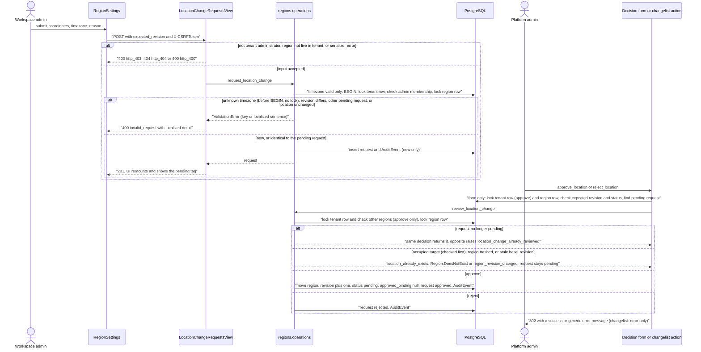

# Request a site location change and review it

A workspace administrator asks to move a plant's `Region` (coordinates and IANA timezone) from the plant's Location settings. A platform administrator approves or rejects the request in the operator console. Rejection changes only the request. Approval rewrites the region, bumps its `revision`, resets it to `pending` and drops `approved_binding`, so setup, validation and approval must be repeated before collection resumes.

## Entry points

- Screen: `RegionSettings` and `LocationRequests` (`web/src/components/region-settings.tsx`), reached from Settings > Location in `PlantWorkspace`; `ActionForm` (`web/src/components/ui.tsx`) is read-only unless `useCanManageWorkspace()` is true.
- `GET|POST /api/tenants/{t}/regions/{r}/location-change-requests/` -> `LocationChangeRequestsView` (`pyracast/api/views.py`) with `LocationChangeInput` and `LocationChangeOutput`. Actor: workspace administrator (POST), any member (GET). The view calls `request_location_change` (`pyracast/regions/operations.py`).
- Review: panel "Location change requests" on the plant page (`regions/templates/admin/regions/region/setup.html`, filled by `review_context`) with Approve and Reject buttons that post `approve_location` or `reject_location` to `POST /admin/plants/{id}/decision/` -> `PlatformAdminSite.decision` (`pyracast/admin.py`) -> `ReviewDecisionForm.apply` (`pyracast/admin_workspace.py`). The overview queue (`overview_context`) only links to that page. Unguarded duplicate: changelist actions `approve` and `reject` of `RegionLocationChangeRequestAdmin` (`POST /admin/regions/regionlocationchangerequest/`). Both review paths call `review_location_change`; no command, job or external call.

## Sequence

## Data

| Table | R/W | What |
| --- | --- | --- |
| `regions_regionlocationchangerequest` | R/W | Insert with `base_revision`, canonical coordinates, `reason`; a binding replacement moves `base_revision` of the pending row; review sets `status`, `reviewed_by`, `reviewed_at` |
| `regions_region` | R/W | Locked. Approval rewrites location, timezone, `revision`, `status`, `approved_binding`; `revision` is the guard. Other active regions of the tenant are read for the duplicate check |
| `regions_auditevent` | W | `location_change_requested`, `_approved`, `_rejected`, `_rebased` (binding replacement), each with the region revision as it stands after the step |
| `accounts_tenant`, `accounts_membership` | R | Tenant row locked for every request and for approvals; administrator membership read by the permission class and `require_workspace_admin` |
| `connections_sitebinding` | none | Never touched; the old binding keeps its coordinates and stops matching `region_revision` |

## Authorization

- View: default `IsAuthenticated` and `WorkspaceWritePermission` (`pyracast/api/permissions.py`, via `REST_FRAMEWORK`) need an active administrator membership of the URL tenant for POST, plus session CSRF. `get_region` needs membership (`require_member`) and a live region of that tenant. GET is open to every member.
- Operation: `require_workspace_admin` (locks the tenant row, reads `accounts_membership`) opens the request transaction; `require_admin` (active superuser, no MFA check) opens `review_location_change` and `ReviewDecisionForm.apply`. The admin site adds active staff, superuser and verified MFA (`PlatformAdminSite.has_permission`); changelist actions declare only `permissions=["view"]`.
- Database: unique `one_pending_region_location_request`, check `location_request_review_state`, and `one_active_region_per_tenant_location` (6-decimal rounding) as backstop.

## Failure paths

| Condition | Result |
| --- | --- |
| Anonymous or non-administrator POST (checked before the region), GET by a non-member / region of another tenant, trashed or unknown | 403 `http_403` / 404 `http_404` from `get_object_or_404` (`not_found` only if the region vanishes before the operation) |
| Unknown or missing field, coordinate out of range, timezone over 100 or reason over 1000 characters | 400 `http_400` from `LocationChangeInput` |
| Unknown IANA timezone, stale `expected_revision`, other pending request, unchanged location | 400 `invalid_request`; `detail` holds the localized sentence, never the key |
| Lock wait over 5 s | API 503 `workspace_busy` with `Retry-After: 1`; the admin has no handler (500, inferred) |
| Approval onto an occupied location, stale `base_revision`, trashed region, opposite decision | Request unchanged; both admin paths show only a generic message |
| Decision form: stale revision or status, unknown or non-pending request id, bad fields. Changelist: any error | 302 with "The review could not be applied." or "Choose a review action..."; trashed or unknown plant 404. Changelist "The request is stale or already reviewed...", success silent, trashed regions skipped silently |

## Rules and invariants

- Lock order is tenant row, then region row. A reject takes only the region lock; `configure_binding` and `approve_region` lock only the region and so serialize with a review. The target coordinates are checked against other active regions only at approval, never at request time. When `configure_binding` replaces a binding it bumps `revision` and moves the pending request's `base_revision` along (`location_change_rebased`), so the request stays approvable and the customer's replay at the new revision returns it; a pending request therefore always matches its region.
- Idempotency: an identical pending request (values, reason, revision) returns the existing row with 201; a repeated review returns the stored row. The duplicate-location check runs before the status check. Coordinates are rounded half-up to 6 decimals before storing and comparing.
- Approval always sets `pending`, including from `rejected` and `suspended`. Everything gated by `binding_is_current` (`pyracast/forecasts/jobs.py`: status `approved`, the binding's `region_revision`, `approved_binding_id`) stops: forecast dispatch, reminder dispatch (`binding_can_notify`) and EPIAS dispatch (`configuration_is_current`). Queued work is not cancelled: a forecast job turns `stale` at claim or instead of publishing, an EPIAS job turns `superseded` at claim, failure or publish, and a pending reminder delivery becomes `skipped` (`schedule_or_authority_changed`) when processed. `approve_region` accepts only bindings of the current revision, which `configure_binding` creates with the new coordinates. No withdraw, expiry or reviewer note exists; a request stays pending until an operator decides.

## Tests

- `tests/test_region_editing.py`: API boundary and validation, idempotent replay, trashed region, stale revision, request rebased by a binding replacement (also concurrently on PostgreSQL), approval guard against a revision mismatch, new-binding requirement, changelist actions, concurrent requests and approvals on PostgreSQL, purge. Also `tests/test_admin_workspace.py` (decision form, panel and queue), `tests/test_site_onboarding.py` (occupied target), `tests/test_domain.py`, `tests/test_api_localization.py`, `tests/test_workspace_authorization.py`, `tests/test_browser.py` (seeds a request, asserts the live reject). Playwright: `web/tests/regions.spec.ts` (mocked API, retry, pending tag); `web/integration/admin-csp.spec.ts` only clicks reject.
- Gaps: nothing asserts that dispatch and collection stop after approval; approval from `rejected` or `suspended`, a stale decision form for location actions, the 404 error codes and the real server messages in the UI are untested.
