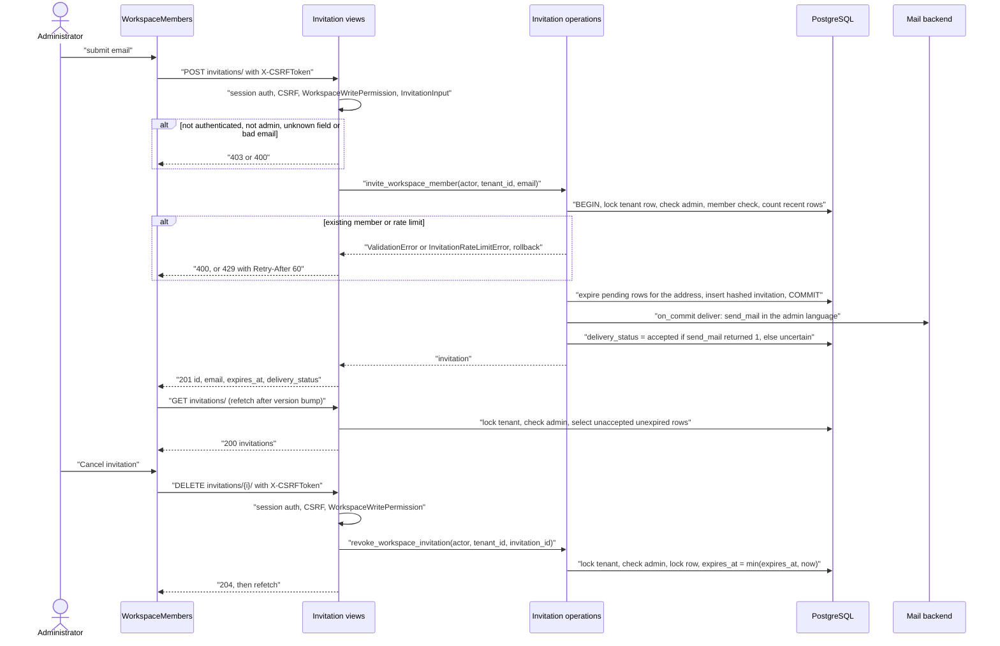

# Invite a member by email, list and cancel pending invitations

A workspace administrator submits an email address on the Members screen. The backend stores a hashed, seven-day, single-use invitation (superseding any earlier pending one for that address) and mails a link `{PYRACAST_PUBLIC_ORIGIN}/app/#token=...` after commit. The administrator can list and cancel pending invitations; acceptance is the separate `invitation-acceptance` flow.

## Entry points

- `web/src/components/dashboard.tsx` `Dashboard` renders `web/src/components/workspace-members.tsx` `WorkspaceMembers` only when the tenant role is `admin` and the view is `members`.
- `GET|POST /api/tenants/{t}/invitations/` -> `pyracast.api.workspaces.WorkspaceInvitationsView`; `DELETE /api/tenants/{t}/invitations/{i}/` -> `WorkspaceInvitationView` (`src/pyracast/urls.py`). Actor: workspace administrator. They are the only callers of `pyracast.accounts.invitations.invite_workspace_member` and `revoke_workspace_invitation`.
- Mail templates `src/pyracast/accounts/templates/mail/workspace_invitation.txt` and `.html`. No command, script or Dramatiq job: the mail is sent synchronously in the request through the configured backend (SMTP, or the Gmail API over HTTPS in `pyracast.gmail`), timeout 15 s.

## Sequence

## Data

| Table | R/W | What |
| --- | --- | --- |
| `accounts_workspaceinvitation` | R/W | Insert with SHA-256 `token_hash` (unique), `created_by`, `expires_at = now + 7 days`; update `delivery_status`; supersede and revoke set `expires_at`; list reads unaccepted unexpired rows; rate limit counts rows by `created_at` |
| `accounts_tenant` | R (`FOR UPDATE`) | Tenant lock in `require_workspace_admin`; workspace name for the mail |
| `accounts_membership`, `auth_user`, `accounts_userlanguagepreference` | R | Administrator checks (permission class and operation); existing-member check through `user__email`; active flag; administrator's mail language |
| `django_session`, `usersessions_usersession` | R/W | Session middleware on every request (session read, `last_activity_at` refresh, activity tracking) under a per-session advisory lock. `pyracast_authentication_cache`, listed in `flows.json`, is not touched: limits are database counts |

## Authorization

- Authentication and CSRF: `SessionAuthentication` plus `IsAuthenticated` (`REST_FRAMEWORK` in `settings.py`); CSRF is enforced on `POST` and `DELETE`, and the SPA sends `X-CSRFToken` from the session payload.
- View: `WorkspaceWritePermission` (`pyracast.api.permissions`) admits non-safe methods only for an active administrator of `tenant_id`, without a lock. `GET` skips it.
- Operation: `require_workspace_admin` (`pyracast.accounts.operations`) locks the tenant row and re-checks the administrator; it is the only workspace check on `GET`. A missing tenant and a non-admin both give 403.
- Database: only `token_hash` is unique; no constraint limits pending invitations per tenant and address, which rests on the tenant lock and the update-then-insert. The Members screen is admin-only in the UI as a convenience.

## Failure paths

| Condition | Result |
| --- | --- |
| Not authenticated (any method), or missing or wrong CSRF token (`POST`, `DELETE`) | 403 `http_403` |
| Non-admin or foreign tenant, any method | 403 "Workspace administrator required." |
| Unknown JSON field such as `role` | 400 "Unknown fields are not accepted." |
| Invalid email, or email already a member (`user.email`, case-insensitive, inactive users included) | 400 `http_400`, "This account already belongs to the workspace." for members |
| 20 invitations in the last hour for the tenant, or same address within one minute (cancelled rows count) | 429 `http_429`, `Retry-After: 60` in both cases |
| Tenant or invitation row lock not acquired within 5 s; same-session request still running after 5 s | 503 `workspace_busy` / 429 `session_busy`, both `Retry-After: 1` |
| Mail backend raises or reports other than one sent | Still 201, `delivery_status = uncertain`, UI hint `deliveryUncertain` |
| Mail template fails to render, or email of 255 to 320 characters passes both validators (both inferred) | 500; the first after commit, leaving the row `pending`; the second on the `varchar(254)` column |
| Cancel with unknown id or id of another tenant | 400 "The invitation is invalid or expired." |
| Cancel of an already expired or accepted row | 204; `expires_at` never moves later |

## Rules and invariants

- Lock order: tenant row, then invitation row (revoke). The tenant lock serializes issuance per tenant, so the rate-limit count is race-free. Only the SHA-256 digest is stored; the plaintext token exists only in the mail, in a URL fragment. Reissue first expires every unaccepted, unexpired row for the same lower-cased address.
- Expiry is the revocation mechanism: reissue, member removal and administrator transfer set `expires_at` to now, cancel to `min(expires_at, now)`. No code path deletes rows.
- The mail runs in `transaction.on_commit`, so a rolled-back invitation sends nothing. `delivery_status` is `pending` until the callback ends, then `accepted` (the backend took the message, not the invitation) or `uncertain`.
- Mail language is the administrator's saved language (fallback `en`), not the invitee's. The role is always viewer; no role choice, no resend. Limits are literals in `invite_workspace_member`: 20 per hour per tenant, 1 per minute per address, 7 days. The templates repeat "seven days".

## Tests

- `tests/test_workspaces.py`: operation rules, reissue, API scoping (400, 403, 429, 204), email failure, hourly limit, admin-language mail, transfer expiry; `tests/test_workspace_authorization.py` (viewer 403), `tests/test_transactional_mail.py` (content, escaping, `#token=` link), `tests/test_workspace_member_removal.py` (removal expires invitations), `web/tests/workspace-roles.spec.ts` (invite, error, cancel against a mocked API).
- Gaps: no real-backend Playwright run; no parallel-issuance test; nothing for emails over 254 characters, `Retry-After` on 429 or `workspace_busy` here; the mocked 400 "An invitation is already pending." is never returned by the backend.
