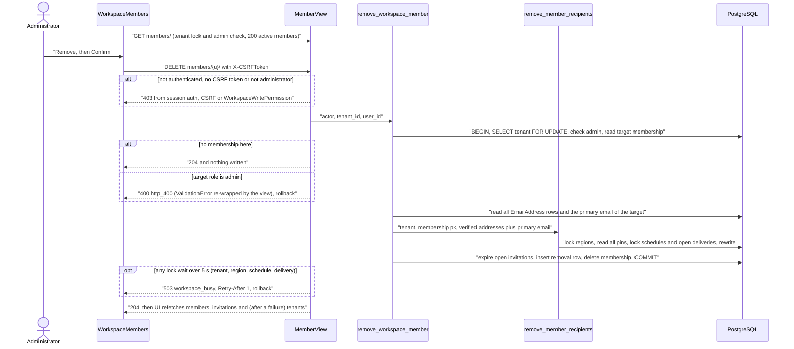

# List workspace members and remove a viewer

A workspace administrator opens the Members screen, sees the active members and removes a viewer through a confirm panel. Removal ends the viewer's access to that workspace at once, strips the member from reminder recipients, expires matching pending invitations and writes an audit row. The user account, other memberships and workspace resources are kept.

## Entry points

- `web/src/components/dashboard.tsx` `Workspace` mounts `web/src/components/workspace-members.tsx` `WorkspaceMembers` only when the tenant role is `admin` and the view is `members`. The remove panel is one `removal` union (idle, confirming, pending, success, error); the button shows only for viewers other than the signed-in user.
- Actor workspace administrator: `GET /api/tenants/{t}/members/` -> `pyracast.api.workspaces.WorkspaceMembersView`; `DELETE /api/tenants/{t}/members/{u}/` -> `WorkspaceMemberView`, which calls `pyracast.accounts.operations.remove_workspace_member` (routes in `src/pyracast/urls.py`).
- `pyracast.notifications.recipients.remove_member_recipients` is called only by that operation; no command, script, admin page or job removes members.

## Sequence

## Data

| Table | R/W | What |
| --- | --- | --- |
| `accounts_tenant` | R (lock) | `FOR UPDATE` row; serializes with admin transfer, invitation acceptance and mail transmission |
| `accounts_membership` | R/W | admin check, target lookup, delete of the target row |
| `auth_user` | R | `is_active` in list and admin check; target's primary email |
| `account_emailaddress` | R | all addresses expire invitations; verified ones strip recipients |
| `regions_region` | R (lock) | tenant regions locked in pk order |
| `notifications_reminderschedule` | R/W | all rows (retired too) are read for pins; non-retired schedules lose the member's recipients and pins |
| `notifications_notificationdelivery` | R/W | pending, retry, sending and uncertain rows get `revoked_recipients`; all rows are read for pins |
| `accounts_workspaceinvitation` | W | open invitations to the member's addresses get `expires_at` set to now |
| `accounts_workspacememberremoval` | W | append-only audit row; no code reads it |

## Authorization

- Authentication: DRF `SessionAuthentication` (`REST_FRAMEWORK` in `src/pyracast/settings.py`); inactive users fail, DELETE needs the CSRF header.
- View: default `IsAuthenticated` plus `pyracast.api.permissions.WorkspaceWritePermission` (non-safe methods need an active administrator membership of the tenant, no lock). GET instead calls `require_workspace_admin` inside `transaction.atomic`, so listing also takes the tenant row lock.
- Operation: `require_workspace_admin` repeats the check under the tenant lock; platform superusers and administrators of other tenants are rejected. Target lookup is filtered by `tenant_id`.
- Database: `one_workspace_admin` and `unique_tenant_membership` only; nothing forbids deleting the administrator row. The hidden UI controls are convenience, not enforcement.

## Failure paths

| Condition | Result |
| --- | --- |
| Not signed in, inactive user, missing CSRF token, actor not administrator of that tenant, tenant unknown | 403 `http_403`; DELETE fails in `WorkspaceWritePermission` first, GET only in `require_workspace_admin` (Django `PermissionDenied`, generic DRF text) |
| Target is the administrator or the actor | 400 `http_400`, "The workspace administrator cannot be removed." |
| Target has no membership in the tenant, or unknown user id | 204, no audit row, no side effect |
| Any row lock (tenant, region, schedule, delivery) not acquired within `lock_timeout` 5 s | 503 `workspace_busy`, `Retry-After: 1` (`pyracast.api.errors.exception_handler`), rollback |
| Another request of the same session holds the session advisory lock over 5 s | 429 `session_busy`, `Retry-After: 1` (`pyracast.accounts.session_lock`) |
| Other exception in the operation, including the 60 s `statement_timeout` | 500; rollback leaves invitations, recipients and membership unchanged |
| Concurrent DELETE | second request waits for the tenant lock, finds no membership, returns 204 (503 if the wait exceeds 5 s) |
| UI receives an error | error Notice with the server message or `Request failed (status)`; lists and tenant role are refetched |

## Rules and invariants

- Lock order is Tenant, Region (pk order), ReminderSchedule, NotificationDelivery. Mail transmission in `pyracast.notifications.jobs` takes Tenant first, so removal cannot interleave with the transmit marker. The marker only fixes the recipients of the current attempt, whose send happens after it commits and may still reach the removed member; the revocation is still written, and a retry after a known not-sent outcome excludes the revoked address.
- Removal is idempotent and writes the audit row only when a membership was deleted. A workspace has one administrator, so "not the administrator" and "not yourself" are one rule.
- Invitation expiry uses every `EmailAddress` row (verified or not) plus the primary email, case-insensitively. Recipient stripping uses verified addresses, the primary email and addresses pinned to the membership, but a pin decides when present (an address pinned only to another membership stays); an unverified alias saved as an external recipient stays.
- Recipients are pinned to the membership pk, so a rejoin gets a new pk and cannot revive an old slot. Retired schedules and terminal deliveries keep their history; the member's change requests stay pending for administrator review.
- Sessions are not ended. Access disappears because each request re-reads the membership; open tabs of the removed user see 403 until the tenant list refetch (30 s poll via `useCollection`).

## Tests

- `tests/test_workspace_member_removal.py`: CSRF, live-session access loss, preservation of account and resources, rejected actors, administrator target, unknown target, invitation expiry, audit rollback; concurrent removal and serialization with transfer and acceptance call the operation directly, not HTTP.
- Recipient effects: `tests/test_notification_groups.py`, `test_notification_group_boundaries.py`, `test_notification_recipient_history.py`, `test_notification_revocations.py`. Proposals: `tests/test_change_request_boundaries.py`, `test_change_request_concurrency.py`. GET shape and viewer GET 403: `tests/test_workspaces.py` `test_workspace_invitation_api_is_scoped_and_never_returns_secrets`.
- `web/tests/workspace-member-removal.spec.ts` (mocked API): 320 and 390 px panel, cancel, buttons disabled while pending (one DELETE), 400 refetch, 403 role loss, workspace switch. Gaps: no HTTP test of GET 403 for outsiders, the `is_active` listing filter, 503 `workspace_busy` on this route or the 400 body; no browser test against the real backend.
