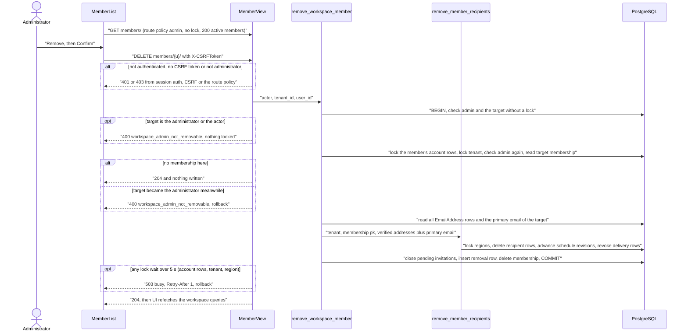

# List workspace members and remove a viewer

A workspace administrator opens the Members screen, sees the active members and removes a viewer through a confirm panel. Removal ends the viewer's access to that workspace at once, strips the member from reminder recipients, closes matching pending invitations and writes an audit row. The user account, other memberships and workspace resources are kept.

## Entry points

- `web/src/features/workspace/workspace-members.tsx` `WorkspaceMembers` at `/app/w/<tenant>/members/` (`MembersPage`, administrators only) renders `web/src/features/workspace/members/member-list.tsx` `MemberList`. The remove panel is one `removal` union (idle, confirming, pending, success, error) around `web/src/ui/action.tsx` `ConfirmAction`; the button shows only for viewers other than the signed-in user.
- Actor workspace administrator: `GET /api/tenants/{t}/members/` -> `pyracast.api.workspaces.WorkspaceMembersView` (active members and `plants_at_recipient_limit`); `DELETE /api/tenants/{t}/members/{u}/` -> `WorkspaceMemberView`, which calls `pyracast.accounts.operations.remove_workspace_member` (routes in `src/pyracast/urls.py`, both `ADMIN` in `ROUTE_POLICIES`).
- Platform console: `GET|POST /admin/workspaces/{id}/members/{user_id}/removal/` (`pyracast.platform_admin.tenant_views.member_removal`) shows a confirmation page and calls the same operation with `platform=True`; the administrator is refused there, and a GET on someone who is no longer a member answers 404.
- `pyracast.notifications.recipients.remove_member_recipients` is called only by that operation; no command, script or job removes members.

## Sequence

## Data

| Table | R/W | What |
| --- | --- | --- |
| `accounts_tenant` | R (lock) | `FOR UPDATE` row; serializes with administrator reassignment, invitation acceptance and mail transmission |
| `accounts_membership` | R/W | admin check, target lookup, delete of the target row |
| `auth_user`, `socialaccount_socialaccount`, `mfa_authenticator` | R (lock) | The member's account rows (`lock_account`), taken before the tenant; `auth_user` also gives `is_active` in the list and the primary email |
| `account_emailaddress` | R (lock) | all addresses close invitations; verified ones strip recipients |
| `regions_region` | R (lock) | tenant regions locked in pk order |
| `notifications_reminderrecipient`, `notifications_reminderrecipienttie` | R/W | rows tied to the membership, or untied with the key of one of its addresses (any schedule of the workspace), are deleted |
| `notifications_reminderschedule` | W | `revision` advances for each schedule that lost a recipient |
| `notifications_deliveryrecipient` | R/W | rows of open deliveries (`pending`, `retry`, `sending`, `uncertain`) for those keys get `revoked` when their schedule no longer authorizes them without the membership |
| `accounts_workspaceinvitation` | W | pending invitations to the member's addresses get `revoked_at` and `revoked_reason` `member_removed`; the deadline is kept |
| `accounts_workspacememberremoval` | W | append-only audit row; the console reads it to tell a repeated removal from an unknown member |

## Authorization

- Authentication: `SessionAuthentication` (`REST_FRAMEWORK` in `src/pyracast/settings.py`); inactive users count as anonymous, DELETE needs the CSRF header.
- Route: `RoutePolicy` (`pyracast.api.permissions`) requires an active administrator membership of the tenant for both methods, read without a lock; the list takes no tenant lock either.
- Operation: `authorize_workspace_admin` repeats the check without a lock, then under the tenant lock after the account rows are locked; platform superusers and administrators of other tenants are rejected on the API (a platform administrator uses the console route). Target lookup is filtered by `tenant_id`.
- Database: `membership_tenant_administrator_uniq` and `membership_tenant_user_uniq` only; nothing forbids deleting the administrator row. The hidden UI controls are convenience, not enforcement.

## Failure paths

| Condition | Result |
| --- | --- |
| Not signed in or inactive user | 401 `not_authenticated` with `WWW-Authenticate: Session` |
| Missing CSRF token | 403 `csrf_failed` |
| Actor is not a member of that tenant, or the tenant is unknown | 403 `membership_required` |
| Actor is a viewer | 403 `workspace_admin_required` |
| Target is the administrator or the actor | 400 `workspace_admin_not_removable` |
| Target has no membership in the tenant, or unknown user id | 204, no audit row, no side effect |
| Any row lock (account rows, tenant, region) not acquired within `lock_timeout` 5 s | 503 `busy`, `Retry-After: 1`, rollback |
| Another request of the same session holds the session advisory lock over 5 s | 429 `session_busy`, `Retry-After: 1` (`pyracast.accounts.session_lock`) |
| The 60 s `statement_timeout`, or a deadlock | 503 `request_timeout` / `database_conflict`; rollback leaves invitations, recipients and membership unchanged |
| Other exception in the operation | 500 `server_error`, rollback |
| Concurrent DELETE | second request waits for the tenant lock, finds no membership, returns 204 (503 if the wait exceeds 5 s) |
| UI receives an error | error Notice with the server message; the workspace queries (members, invitations, tenant list) are refetched after every attempt |

## Rules and invariants

- Removing the administrator, or oneself, is refused before any lock is taken, and checked again under the account and tenant locks. Lock order is the member's account rows (`FOR NO KEY UPDATE`), Tenant, Region (pk order), the backend's one order for a person and a workspace (`docs/ARCHITECTURE.md`). Mail transmission in `pyracast.notifications.jobs` takes Tenant first, then Region and delivery, so removal cannot interleave with the transmit marker. The marker only fixes the recipients of the current attempt, whose send happens after it commits and may still reach the removed member; the revocation is still written, and a retry after a known not-sent outcome excludes the revoked address. Account rows come first so an address verified or an acceptance committed meanwhile is among the addresses read.
- Removal is idempotent and writes the audit row only when a membership was deleted. A workspace has one administrator, so "not the administrator" and "not yourself" are one rule. The `workspace_member_removed` security event is written after commit.
- Invitation closing uses every `EmailAddress` row (verified or not) plus the primary email, case-insensitively, over the workspace's pending (open, unexpired) invitations. Recipient stripping uses verified addresses and the primary email (`recipient_key`, case-folded; a blank address is no key) and the rows tied to the membership; an address another active member holds stays on open deliveries, and an unverified alias saved as an external recipient stays.
- Recipients are tied to the membership pk, so a rejoin gets a new pk and cannot revive an old slot. Terminal deliveries keep their history; the member's change requests stay pending for administrator review, and a rejoined member does not see them again.
- Sessions are not ended. Access disappears because each request re-reads the membership; open tabs of the removed user see 403 `membership_required` on workspace routes and lose the workspace at the next tenant list read (every 120 s).

## Tests

- `tests/test_workspace_member_removal.py`: CSRF, live-session access loss, preservation of account and resources, rejected actors, administrator target, unknown target, invitation closing, audit rollback, concurrent removal, serialization with transfer and acceptance (operation level, not HTTP), the two administrators removing each other, addresses verified or accepted while the removal runs.
- Recipient effects: `tests/test_reminder_recipient_rows.py`, `test_reminder_revision.py`, `test_notification_groups.py`, `test_notification_group_boundaries.py`, `test_notification_recipient_history.py`, `test_notification_revocations.py`. Proposals: `tests/test_change_request_boundaries.py`, `test_change_request_concurrency.py`. HTTP failures: `tests/test_workspace_http_failures.py`; lists without a tenant lock and viewer 403: `tests/test_workspace_authorization.py`; response shape: `tests/test_workspaces.py` `test_workspace_invitation_api_is_scoped_and_never_returns_secrets`. Console: `tests/test_admin_workspace_management.py`, `tests/test_platform_workspace_authority.py`.
- `web/tests/workspace-member-removal.spec.ts` (mocked API): 320 and 390 px panel, cancel, buttons disabled while pending (one DELETE), 400 refetch, 403 role loss, workspace switch.
- Gaps: no test of the `is_active` listing filter; no browser test against the real backend.
