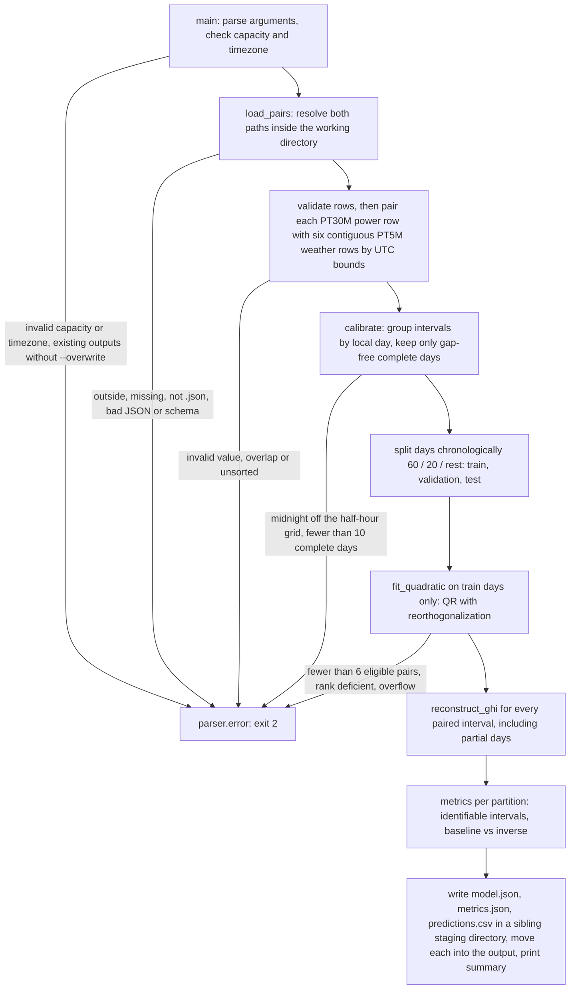

# Calibrate the irradiance inverse model offline from exported files

A developer or operator runs `scripts/calibrate_irradiance.py` from the repository root with a Solcast Historical Rooftop PV `PT30M` power export and a `PT5M` weather export. The script pairs them on UTC bounds, fits a six-coefficient quadratic power model on the first 60% of complete local days and writes `model.json`, `metrics.json` and `predictions.csv`. It is a research tool: it uses no Django, database, queue or network, and no production code reads its output.

## Entry points

- Command: `uv run --locked python scripts/calibrate_irradiance.py --power P --weather W --capacity-kw C [--timezone TZ] --output DIR [--overwrite]` (`main`). `--timezone` defaults to `Europe/Istanbul`.
- Library: `pyracast.irradiance.calibration.calibrate`, `pyracast.irradiance.pairs.load_pairs`, `pyracast.irradiance.fitting.fit_quadratic`, `pyracast.irradiance.inverse.reconstruct_ghi`. Outside tests, only the script imports `calibrate` and `load_pairs`, and only `calibrate` imports `fit_quadratic` and `reconstruct_ghi`. The strict JSON loader `load_json_file` and the power types live in `pyracast.irradiance.solcast_export`, shared with the historical reference import, which this flow does not cover.
- Actor: a person at a shell. No screen, endpoint, worker, scheduler or CI job calls it. Runtime on the 40 MB reference case is about 4 s.

## Sequence

## Data

| Table | R/W | What |
| --- | --- | --- |
| none | none | No database access. The flow reads two JSON files and writes three files. |
| `--power` JSON | R | `estimated_actuals[]` with `period` `PT30M`, `period_end`, `pv_power_rooftop` (kW, at least 0). |
| `--weather` JSON | R | `estimated_actuals[]` with `period` `PT5M`, `period_end`, `ghi`, `air_temp`, `snow_soiling_rooftop` (0 to 100, stored as a fraction). |
| `model.json` | W | `schema_version` 1, coefficients, training temperature range, GHI support limit, snow transmission floor, model version, literal `source_kind`, `capacity_kw`, source SHA-256 digests, training partition, `training_sample_count`. |
| `metrics.json` | W | Timezone, capacity, digests, partition dates, omitted partial days, unmatched counts, `fit_sample_count`, per-partition baseline and inverse statistics, validity flags. |
| `predictions.csv` | W | One row per paired interval with partition, reference and predicted GHI, errors and JSON-encoded `quality_flags`. |

## Authorization

- No user, tenant or role check: filesystem access of the invoking account is the only control.
- `load_json_file` resolves each input with symlinks and requires it to sit under the working directory (`Path.cwd()`) and end in `.json`. The script cannot pass another trusted root; library callers can.
- The output directory is not restricted; existing outputs are replaced only with `--overwrite`.

## Failure paths

| Condition | Result |
| --- | --- |
| Input missing, outside the working directory, symlink out, not a regular `.json` file | Exit 2: `Input must be an existing JSON file within the trusted directory` |
| `--capacity-kw` not a finite positive number; `--timezone` not an IANA zone | Exit 2 before any input is read |
| An output file already exists and `--overwrite` is missing | Exit 2 naming the existing files; nothing read or written |
| Malformed JSON (also duplicate keys, nonfinite numbers, NUL characters, nesting too deep), missing `estimated_actuals`, wrong `period`, naive or bad `period_end`, non-numeric or non-finite value, negative `pv_power_rooftop`, `ghi` or `snow_soiling_rooftop` (or soiling above 100; `air_temp` has no bounds), overlapping or unsorted rows | Exit 2 with the `ValueError` message; no output directory is created |
| A zone whose local midnight is off the half-hour grid (such as `Asia/Kathmandu`), fewer than ten complete local days, fewer than six eligible training pairs, rank-deficient features, coefficient overflow | Exit 2 with the `ValueError` message, no output |
| Output path not writable, or a failure while staging | `OSError` (or `ValueError` from `allow_nan=False`) traceback; the staging directory is removed and earlier outputs stay as they were |

## Rules and invariants

- Pairing matches explicit UTC bounds, never positions. A power row is kept only when six consecutive weather rows exactly tile its 30 minutes; anything else is counted in `unmatched_power_intervals` and `unmatched_weather_intervals`, never filled. Weather is averaged weighted by duration.
- A local day is complete only when its first interval starts at local midnight, its last ends at the next local midnight (`local_day_bounds`, so DST days are 23 or 25 hours) and there is no gap. Other days are labelled `partial`, listed in `omitted_partial_days`, and still receive predictions but no metrics. The split is over the list of complete days, so days missing between them do not shift the percentages; test receives the remainder.
- The model is fitted on train days only and is never refitted on validation or test. Validation is reported but selects nothing.
- Fit rows need positive power, all six native GHI values above 25 W/m² and snow transmission of at least 0.05. `training_sample_count` counts these pairs, not days.
- `reconstruct_ghi` uses power, temperature and snow only; reference GHI is never an input. A paired interval is "identifiable" only with positive power, positive reference GHI and an inverse estimate. Daily error is partial energy over those intervals; the report hard-codes `full_day_total_validated` and `forecast_transfer_validated` to false.
- Output is published whole: all three files are written in a staging directory beside the output and each is moved into place with `os.replace`, so an interrupted write leaves no mix of runs. It is not versioned: `schema_version` 1 sits only in `model.json`.

## Tests

- `tests/test_irradiance_calibration.py`: split and no-refit property, partial and DST days, ten-day and rank-deficiency failures, missing-reason counts, and two subprocess tests of the script (file contents, and exit 2 for inputs outside the working directory with no output created). `tests/test_calibration_cli.py`: outputs and summary, `--overwrite`, capacity and timezone refusals before reading, the off-grid zone named, staging beside a relative output, refusals without outputs.
- `tests/test_irradiance_pairs.py`: UTC alignment, weighted means, hashes, gaps, field validation, missing, directory and non-JSON inputs, working-directory and symlink confinement.
- `tests/test_irradiance_fitting.py` and `tests/test_irradiance_inverse.py`: fit accuracy, scaling, overflow and rank guards; every inverse rejection reason and the forward round trip.
- Gaps: a write failure while staging, and the documented reference case, whose input files are git-ignored. No Playwright coverage applies.
