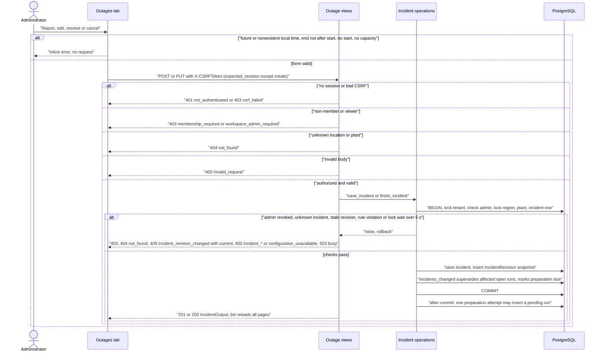

# Report, edit, resolve and cancel plant outages

A workspace administrator records actual operating periods of a plant (cause, start, optional end, remaining DC, inverter and export capacity in MW) on the plant's Outages tab, edits them, resolves them with an end time, or cancels them as recorded in error. Every write adds an immutable revision, supersedes calibration work whose incident evidence it changes, and feeds the outage scenario of the plant forecast. Viewers cannot write here; they use `change-request-submission`. Approval (`change-request-review`) validates with `prepare_incident` or `prepare_incident_finish` and then applies through the same `save_incident` and `finish_incident`.

## Entry points

- `web/src/features/plant/outages.tsx` `Outages` (tab of `plant-workspace.tsx` `PlantWorkspace`, loaded on demand as in `plant-portfolio`) with `web/src/features/plant/outage/outage-editor.tsx` `OutageEditor`, `web/src/features/plant/outage/outage-card.tsx` `OutageCard` (inline resolve and cancel forms), `web/src/features/plant/outage/stale-changes.tsx` and `web/src/features/plant/outage/model.ts` `submitOutageChange`. Role from `useCanManageWorkspace`; the viewer branch posts proposals instead.
- `GET`, `POST /api/tenants/{t}/regions/{r}/plants/{p}/outages/` -> `pyracast.incidents.api.IncidentsView` (list ordered `-starts_at`, `-id`, 50 per page, answered as `IncidentPage`: the page plus `can_propose` and `proposal_unavailable_reason` from `change_requests.policy.outage_proposal_refusal`, rows `IncidentListOutput` with the actor's own latest pending request as `pending_request_id`); `PUT .../outages/{i}/` -> `IncidentView` (full replacement); `POST .../{i}/resolve/` -> `ResolveView`; `POST .../{i}/cancel/` -> `CancelView`. Routed in `pyracast.plants.urls`; writes are admin routes and the list a member route of `ROUTE_POLICIES`.
- Operations `pyracast.incidents.operations.save_incident` and `finish_incident` (also called by `change_requests.operations.approve_request`); side effect `pyracast.plants.preparation.incidents_changed`. Actor: workspace administrator. No command, job or external call.
- Readers: `pyracast.incidents.evidence` (`select_incidents`, `pinned_incidents`) feeds `plants/incident_forecasts.py` `incident_scenario`, measurement selection in `plants/measurements.py` (overlapping `valid` meter intervals become `outage`), calibration fingerprints (`plants/incident_policy.py`, `plants/calibration_runs.py`) and `notifications/report_data.py`.

## Sequence

## Data

| Table | R/W | What |
| --- | --- | --- |
| `incidents_plantincident` | R/W | Current state: kind, title, notes, `starts_at`, `ends_at` (null = active), three capacities, `cancelled_at`, `revision`, `declared_configuration_id` |
| `incidents_incidentrevision` | R/W | One snapshot per revision; `created_at` is the knowledge time for `as_of`; `incidents_changed` rereads it to compare open runs' pinned revisions |
| `accounts_tenant`, `accounts_membership`, `regions_region`, `plants_plant` | R (`FOR UPDATE` on tenant, region, plant); R | Locked in that order by `tenant_membership` and `lock_incident_plant`; member check by the route policy, administrator check in the policy and again in the operation |
| `plants_plantconfiguration` | R | Current or declared configuration gives the capacity ceilings |
| `change_requests_changerequest`, `change_requests_incidentchange` | R | The actor's own pending requests on the outages a list or a stale-write conflict returns; the proposal flag counts the member's pending requests on the plant, production requests included |
| `plants_calibrationrun`, `plants_plantevent` | R/W | Pending or running runs superseded, one `calibration_completed` event each; after commit a preparation attempt may insert a pending run with a `calibration_scheduled` event |
| `plants_plant` | W | `calibration_preparation_due_at`: the durable request for preparation |
| `plants_productionobservation`, `metering_epiasconnection`, `metering_epiassnapshot`, `forecasts_forecastsnapshot`, `plants_calibrationactivation`, provider binding | R | After commit, in its own transaction: `prepare_calibration` reads these to decide whether a run is needed |

## Authorization

- Route policy: `RoutePolicy` (`pyracast.api.permissions`) runs before validation: writes admit only active administrators of `tenant_id`, so a viewer gets 403 `workspace_admin_required` even for an invalid body; reads admit any member (`membership_required` otherwise). `SessionAuthentication` enforces CSRF on writes (403 `csrf_failed`). Region and plant must belong to the tenant and the region must not be trashed (`ScopedView.plant_queryset`).
- Operation: `tenant_membership(role=admin, lock=True)` re-checks under `FOR UPDATE` on the tenant (serializes with administrator reassignment). The incident is fetched with `plant=plant`, so an id from another plant or tenant is a 404.
- Database backstops: exclusion constraint `plantincident_plant_interval_excl` (per plant, uncancelled rows), checks `plantincident_ends_at_chk`, `plantincident_kind_chk` and `plantincident_available_*_mw_chk`, unique `incidentrevision_incident_revision_uniq`, deferred composite FK `plantincident_declared_configuration_plant_fk` (declared configuration belongs to the same plant).

## Failure paths

| Condition | Result |
| --- | --- |
| No session | 401 `not_authenticated` with `WWW-Authenticate: Session` |
| Bad CSRF | 403 `csrf_failed` |
| Viewer write; non-member | 403 `workspace_admin_required`, `membership_required` (also for an administrator role revoked before the operation's tenant lock) |
| Unknown or trashed location or plant; unknown incident id for the plant | 404 `not_found` (also when trashed after the view check) |
| Unknown field | 400 `invalid_request`, reason in `message` without `fields` |
| Naive timestamp, bad kind, negative or non-finite capacity, blank or long title, long notes, missing or non-positive `expected_revision`, missing resolve `ends_at` | 400 `invalid_request` with `fields` |
| Start in the future; end not after start; end after now; capacity above the configuration's ceiling; overlap; edit of a cancelled outage, resolve of a resolved or cancelled one, cancel of a cancelled one; no current configuration to report or reopen against | 400 `incident_starts_in_future`, `incident_ends_before_start`, `incident_ends_in_future`, `incident_capacity_exceeded`, `incident_overlap`, `incident_closed`, `configuration_unavailable` |
| `expected_revision` differs (checked before the closed checks) | 409 `incident_revision_changed` with the stored outage as `current`, as the actor's list row (`IncidentListOutput`) |
| Lock wait over 5 s (`lock_timeout`); deadlock | 503 `busy`; 503 `database_conflict`; both with `Retry-After: 1` |
| Statement over 60 s | 503 `request_timeout` with `request_id` |
| Database constraint violation | Unmapped, 500 `server_error` with `request_id` |
| UI: future time, nonexistent local time (DST gap), end not after start, no start, reduced capacity without a value | Inline form error, no request |
| UI: stale edit, resolution or cancellation | The form keeps what was typed, lists what changed and saves only on a second explicit save, or discards; the list reloads |

## Rules and invariants

- Lock order is Tenant, Region, Plant, incident row. The plant lock makes the application overlap check race-free; the exclusion constraint is only the backstop.
- Intervals are half-open and touching periods are allowed. An open period overlaps everything that ends after its start, so one active outage blocks any new open one. Simultaneous faults share one period (`multiple`). Times must be aware, start not in the future, end no later than the server clock. A null capacity means unknown, never zero. `PUT` replaces all fields: omitted optional fields fall back to defaults (null capacities, empty notes, null `ends_at`).
- Outage times are entered and shown on the plant's wall clock (the plant header states the zone); a time the plant zone skips is refused. Both roles need a current plant configuration to report an outage, and "reduced" capacity needs at least one value. Capacity inputs carry the ceilings of the configuration the server validates against; the status tag shows a translated label, with a warning tone for an active outage, and cancelled entries are collapsed.
- A write whose `ends_at` is null (a new outage, or an edit that leaves or reopens one open) is declared and validated against the current plant configuration; an edit with an end keeps the declared configuration; resolve and cancel never change it. The scenario applies the reported capacities while the declared configuration's DC, inverter and export capacities and meter basis equal those of the outlook's configuration (`reported-operating-limits-v2`); otherwise the status is `unknown_impact` and the outlook is flagged `outage_configuration_changed`.
- A member's outage controls follow the list: the new-outage button and its explanation follow `can_propose` and `proposal_unavailable_reason` (`outage_proposal_refusal`); the administrator's follow the configuration. An outage holding the member's own pending request shows "Waiting for approval – view" in place of change, resolution and cancellation; at `pending_request_limit` every card hides them and the explanation names them. A card offers no proposal while an editor is open on its outage. An open editor whose outage disappears or is cancelled (for a resolution: is no longer active), or, for a member, whose outage comes to hold the member's own pending request or whose member reaches the limit, cannot send, says so and stays held until it is closed. The "Sent" notice clears on the next action.
- `select_incidents` takes, per incident, the newest revision with `created_at` at or before `known_at` and drops cancelled ones, so an `as_of` before a cancellation still sees the outage. `pinned_incidents` replays exact revision ids.
- Every write calls `incidents_changed`: open runs whose pinned revision set differs from the set for their window become `superseded` (reason `outage_history_changed`, one `calibration_completed` event each) and lose their lease; the plant is marked due for preparation and one preparation attempt runs after commit. A failure of that attempt does not fail the write; the dispatcher's calibration phase prepares what remains through `prepare_requested_calibrations`, skipped while a pending or running run exists. Nothing else is enqueued here.
- The scenario applies while an outage is active at `known_at` or once the target day is complete; archived issuances keep their frozen scenario. An outlook whose calibration's incident set changed is recomputed without it, under the outlook's recorded `model_version`, and flagged `calibration_invalidated_by_outage_history`; the scenario built on it uses the same version.

## Tests

- `tests/test_incidents.py` (API lifecycle, revisions and `as_of`, validation, overlap, concurrent create, reconfirmation, restore and purge), `tests/test_outage_evidence.py` (reopening declares and validates the current configuration, another plant's or tenant's outage answers 404, a write behind a held lock answers 503 `busy`, the scenario and invalidated calibration through the live outlook, saved report and archive), `tests/test_outage_stale_edit.py` (409 `incident_revision_changed` with `current` for edit, resolve, cancel and proposals; typed in the schema), `tests/test_incident_calibration.py` (supersede, preparation, scenario output), `tests/test_calibration_requests.py` (an outage write commits while preparation raises; a crash after the write loses no request), `tests/test_forecast_read_locks.py` (an incident saved while an outlook read is open commits at once; the open read keeps its calibration factor without a scenario, and the next read drops the calibration and shows the scenario), `tests/test_operating_limits.py` (operating-limit arithmetic used by the scenario), `tests/test_timeseries_integrity.py` (cross-tenant declared configuration rejected by `plantincident_declared_configuration_plant_fk`; that FK validated and deferred), `tests/test_route_policy.py` (each role meets the policy of the four routes), `tests/test_workspace_authorization.py` (viewer 403 on all four routes and both operations), `tests/test_error_contract.py` (incident codes), `tests/test_own_pending_markers.py` and `tests/test_outage_proposal_clarity.py` (own pending markers, the conflict's `current`, the proposal flag), `web/tests/outages.spec.ts` (Playwright, fully mocked API: lifecycle, stale edits, plant-time entry, ceilings, status tag), `web/tests/outage-screen-model.spec.ts` (every screen state against every event and control), `web/tests/format.spec.ts` (a skipped local time yields no instant), `web/tests/change-requests.spec.ts` (viewer proposals), `web/integration/workspace.spec.ts` (one real create).
- Gaps: the exclusion, check and unique constraints are never violated directly (only `plantincident_declared_configuration_plant_fk` is); the inline DST error of the form has no browser test.
