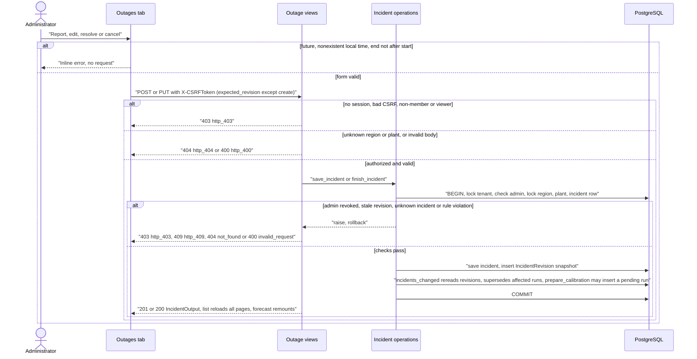

# Report, edit, resolve and cancel plant outages

A workspace administrator records actual operating periods of a plant (cause, start, optional end, remaining DC, inverter and export capacity in MW) on the plant's Outages tab, edits them, resolves them with an end time, or cancels them as recorded in error. Every write adds an immutable revision, supersedes calibration work whose incident evidence it changes, and feeds the outage scenario of the plant forecast. Viewers cannot write here; they use `change-request-submission`. Approval (`change-request-review`) validates with `prepare_incident` or `prepare_incident_finish` and then applies through the same `save_incident` and `finish_incident`.

## Entry points

- `web/src/components/outages.tsx` `Outages` (tab of `plant-workspace.tsx` `PlantWorkspace`) with `OutageForm` and the inline resolve and cancel forms. Role from `useCanManageWorkspace`; the viewer branch posts proposals instead.
- `GET`, `POST /api/tenants/{t}/regions/{r}/plants/{p}/outages/` -> `pyracast.incidents.api.IncidentsView` (list ordered `-starts_at`, `-id`, 50 per page); `PUT .../outages/{i}/` -> `IncidentView` (full replacement); `POST .../{i}/resolve/` -> `ResolveView`; `POST .../{i}/cancel/` -> `CancelView`. Routed in `pyracast.plants.urls`.
- Operations `pyracast.incidents.operations.save_incident` and `finish_incident` (also called by `change_requests.operations.approve_request`); side effect `pyracast.plants.incident_policy.incidents_changed`. Actor: workspace administrator. No command, job or external call.
- Readers: every write itself rereads revisions through `select_incidents` in `incidents_changed`; outside the write, `select_incidents` and `pinned_incidents` feed `plants/incident_forecasts.py` `incident_scenario`, measurement selection in `plants/measurements.py` (overlapping `valid` meter intervals become `outage`), calibration fingerprints and `notifications/report_data.py`.

## Sequence

## Data

| Table | R/W | What |
| --- | --- | --- |
| `incidents_plantincident` | R/W | Current state: kind, title, notes, `starts_at`, `ends_at` (null = active), three capacities, `cancelled_at`, `revision`, `declared_configuration_id` |
| `incidents_incidentrevision` | R/W | One snapshot per revision; `recorded_at` is the knowledge time for `as_of`; `incidents_changed` rereads it to compare pending or running runs' pinned revisions |
| `accounts_tenant`, `regions_region`, `plants_plant`; `accounts_membership` | R (`FOR UPDATE`); R | Locked in that order by `require_workspace_admin` and `lock_incident_plant`; member check in the view, administrator check in permission and operation |
| `plants_plantconfiguration` | R | Current or declared configuration gives the capacity ceilings |
| `plants_calibrationrun` | R/W | Pending or running runs superseded; `prepare_calibration` may insert one |
| `plants_plantevent`; `plants_productionobservation`, `metering_epiasconnection`, `metering_epiassnapshot`, `forecasts_forecastsnapshot`, `plants_calibrationactivation`, provider binding | W; R | `calibration_scheduled` event when a run is inserted; inputs `prepare_calibration` reads to decide whether a run is needed |

## Authorization

- View, writes: `SessionAuthentication` with CSRF, `IsAuthenticated`, then the default `WorkspaceWritePermission` (`REST_FRAMEWORK` in `settings.py`) admits only active administrators of `tenant_id`; it runs before validation, so a viewer gets 403 even for an invalid body.
- View, reads and scope: `ScopedView.plant_queryset` calls `require_member`, so any active member may list outages; region and plant must belong to the tenant and not be trashed.
- Operation: `require_workspace_admin` re-checks under `FOR UPDATE` on the tenant (serializes with administrator reassignment). The incident is fetched with `plant=plant`, so an id from another plant or tenant is a 404.
- Database backstops: exclusion constraint `incident_no_overlap` (per plant, uncancelled rows), checks `incident_valid_interval`, `incident_kind_valid`, `incident_*_finite`, unique `incident_revision_unique`, deferred composite FK `incident_declared_config_owner_fk` (declared configuration belongs to the same plant).

## Failure paths

| Condition | Result |
| --- | --- |
| No session, bad CSRF, viewer or non-member write, non-member read, administrator role revoked before the operation's tenant lock | 403 `http_403` (DRF credentials or CSRF message, "Workspace administrator required." or "Tenant membership required.") |
| Unknown or trashed region or plant | 404 `http_404` (404 `not_found` if trashed after the view check) |
| Unknown incident id for the plant | 404 `not_found` |
| Unknown field, naive timestamp, bad kind, negative or non-finite capacity, blank or long title, long notes, missing or non-positive `expected_revision`, missing resolve `ends_at` | 400 `http_400` with field errors |
| Start in the future, end not after start or after now, capacity above ceiling, no configuration, overlap, edit of a cancelled incident, resolve of a resolved or cancelled one, cancel of a cancelled one | 400 `invalid_request` |
| `expected_revision` differs (checked before the closed checks) | 409 `http_409`, "Incident revision changed." |
| Lock wait over 5 s (`lock_timeout`) | 503 `workspace_busy`, `Retry-After: 1` |
| Database constraint violation or 60 s `statement_timeout` | Unmapped, 500 |
| UI: future time, nonexistent local time (DST gap), end not after start, no start | Inline form error, no request |

## Rules and invariants

- Lock order is Tenant, Region, Plant, incident row; `prepare_calibration` retakes Region and Plant in the same transaction. The plant lock makes the application overlap check race-free; the exclusion constraint is only the backstop.
- Intervals are half-open and touching periods are allowed. An open period overlaps everything that ends after its start, so one active outage blocks any new open one. Simultaneous faults share one period (`multiple`). Times must be aware, start not in the future, end no later than the server clock. A null capacity means unknown, never zero. `PUT` replaces all fields: omitted optional fields fall back to defaults (null capacities, empty notes, null `ends_at`).
- Editing a stored-active outage re-declares it against the current plant configuration and validates ceilings against it; editing a resolved one (even when reopening it) keeps its declared configuration; resolve and cancel never change it. The scenario uses capacities only when `declared_configuration_id` equals the configuration of the outlook, otherwise its status is `unknown_impact`.
- `select_incidents` takes, per incident, the newest revision with `recorded_at` at or before `known_at` and drops cancelled ones, so an `as_of` before a cancellation still sees the outage. `pinned_incidents` replays exact revision ids.
- Every write calls `incidents_changed`: runs whose pinned revision set differs from the set for their window become `superseded` and lose their lease, then `prepare_calibration` may create a pending run (skipped while a pending or running run remains). Nothing is enqueued here; the dispatcher picks it up via `pending_calibration_ids` and `run_calibration`.
- The scenario applies while an outage is active at `known_at` or once the target day is complete; archived issuances keep their frozen scenario. An outlook whose calibration's incident set changed is recomputed without it and flagged `calibration_invalidated_by_outage_history`.

## Tests

- `tests/test_incidents.py` (API lifecycle, revisions and `as_of`, validation, overlap, concurrent create, reconfirmation, restore and purge), `tests/test_incident_calibration.py` (supersede, preparation, scenario output), `tests/test_incident_concurrency.py` (outlook reads serialize with incident writes), `tests/test_operating_limits.py` (operating-limit arithmetic used by the scenario), `tests/test_timeseries_integrity.py` (cross-tenant declared configuration rejected by `incident_declared_config_owner_fk`; that FK validated and deferred), `tests/test_workspace_authorization.py` (viewer 403 on all four routes and both operations), `tests/test_api_localization.py`, `web/tests/outages.spec.ts` (Playwright, fully mocked API), `web/tests/change-requests.spec.ts` (viewer proposals), `web/integration/workspace.spec.ts` (one real create).
- Gaps: the exclusion, check and unique constraints are never violated directly (only `incident_declared_config_owner_fk` is); the 404, 503 and viewer `GET` paths, reopening a resolved outage by `PUT` and the DST error branch are untested; the Playwright mock's 409 body differs from the real response.
