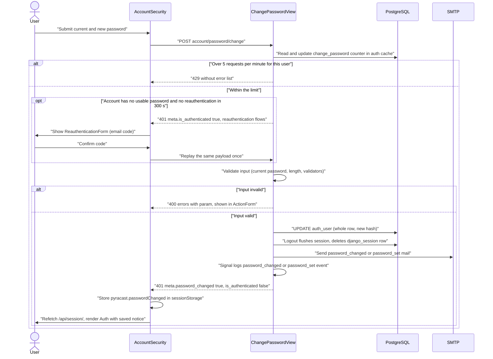

# Change or set the account password while signed in

A signed-in user opens the account settings page and submits a new password, together with the current one if the account has a usable password. Accounts created through a social provider have no usable password; they set a first one after step-up reauthentication. Success replaces the password hash, ends the current session, invalidates every other session of the user, mails a notice and returns the browser to the login screen.

## Entry points

- `web/src/components/account-security.tsx` `AccountSecurity` (password disclosure) in the `dashboard.tsx` account view, opened from the sidebar "Account" button or `/app/?account=security`.
- `POST /api/auth/browser/v1/account/password/change` served by `pyracast.accounts.headless.ChangePasswordView` (routed in `src/pyracast/urls.py`).
- `/admin/password_change/` (`pyracast.admin.PlatformAdminSite`) only redirects to `/app/?account=security`.
- Reauthentication UI: `ReauthenticationForm` in `web/src/components/security-reauthentication.tsx` (flow `step-up-reauthentication`).

## Sequence

## Data

| Table | R/W | What |
| --- | --- | --- |
| `auth_user` | R/W | Hash read to check the current password (a hasher upgrade saves `password` only); whole row saved (no `update_fields`) with the new Argon2 hash |
| `django_session` | R/W | Current session row deleted by logout; other sessions of the user fail the session-auth-hash check on their next request and are flushed then |
| `usersessions_usersession` | R/W | Activity row of the current session is touched by `UserSessionsMiddleware` and left behind; other rows are not ended |
| `account_emailaddress`, `mfa_authenticator` | R | Primary address for the notification; for accounts without a password also the reauthentication flows (verified addresses, TOTP or recovery codes) |
| `accounts_userlanguagepreference` | R | Read by `RequestLanguage` middleware; the mail uses that active language because the notification context carries no `user` |
| `pyracast_authentication_cache` | R/W | `change_password` rate-limit history and its lock key per user (separate `auth_cache` connection) |

## Authorization

- Authentication: allauth `AuthenticatedAPIView` returns 401 with login flows for anonymous requests; the view works only on `request.user`. `CsrfViewMiddleware` checks `X-CSRFToken` (the browser view is not CSRF-exempt); `pyracast.accounts.middleware.SessionLifetime` enforces 12 h absolute and 30 min idle before the view.
- Knowledge proof: `ChangePasswordInput.clean_current_password` (view input layer) when the account has a usable password; recent reauthentication (`ACCOUNT_REAUTHENTICATION_TIMEOUT` 300 s) in `ChangePasswordView.handle` when it has none.
- Rate limit: allauth `rate_limit(action="change_password")` on `handle`, default `5/m/user` (not overridden in `ACCOUNT_RATE_LIMITS`); it runs before the reauthentication check, so reauthentication 401s also count. No tenant, role or MFA check applies to any signed-in user, staff included; the database enforces nothing here.

## Failure paths

| Condition | Result |
| --- | --- |
| Anonymous or expired session | 401 with login flows, no `password_changed`; UI refreshes the session and shows `sessionExpired` |
| CSRF token wrong, or body not a JSON object | 403 from Django, or 400 with empty body; UI shows the generic `request` message (non-JSON body) |
| More than 5 requests per minute, or rate-limit lock not obtained | 429 without error list; `authentication_request_throttled` event logged; UI shows generic `request` message |
| Another request of the same session still running for over 5 s | 429 `session_busy`, `Retry-After: 1` (`SessionRequestSerialization`); also logged as `authentication_request_throttled` |
| No usable password, no fresh reauthentication | 401 with `is_authenticated` true; UI opens `ReauthenticationForm`, replays once, then `reauthStillRequired` |
| Current password wrong, or missing for an account that has one | 400 on `current_password` (`enter_current_password` or required) |
| New password under 12 characters, common, too similar, or over 1024 characters | 400 on `new_password` (for example `password_too_short`) |
| Mail delivery raises | Contained and logged by the account mail adapter (`account-mail-notifications`); the change completes as on success: hash saved, session flushed, `password_changed`/`password_set` event logged, 401 with `meta.password_changed` true; the notice is not resent |
| Success | 401, `meta.password_changed` true, `meta.is_authenticated` false |

## Rules and invariants

- The success response is deliberately a 401: the session is gone. Only `ChangePasswordView.post` adds `meta.password_changed`, and `post` runs after validation, so the flag cannot appear on an expiry or reauthentication 401.
- Set versus change is decided server side: `current_password` is required exactly when `has_usable_password()` is true at request time; an empty one means "set" and sends `password_set` instead of `password_changed`. For accounts without a password the reauthentication check runs before input validation, so a weak new password is reported only after the user has reauthenticated.
- Other sessions are not revoked by `pyracast.accounts.sessions.revoke_other_sessions` (it is connected to MFA and email-change signals only). Invalidation relies on Django's session auth hash changing with the password, plus logout of the current session.
- `PasswordInput` disables stripping and caps password fields at 1024 characters before hashing; whitespace is part of the password.
- Order on success: save hash, logout (`logout` audit event), mail, then the `password_changed`/`password_set` signal (audit event). The mail goes through `transaction.on_commit`; with no open transaction it is sent synchronously inside the request. The `pyracast.passwordChanged` flag is consumed by the `Auth` effect only after `auth/session` answers.

## Tests

- `tests/test_session.py` `test_password_change_requires_current_password_and_invalidates_all_sessions`, `test_expired_session_cannot_report_a_successful_password_change` (an anonymous client, not a timed-out session); `tests/test_auth_lifecycle.py` `test_password_change_requires_at_least_twelve_characters`, `test_password_whitespace_is_preserved_across_login_reauthentication_and_change`; `tests/test_social_accounts.py` `test_last_enabled_provider_cannot_be_removed` (set password after email reauthentication, status and hash only), `tests/test_transactional_mail.py` (templates only), `tests/test_admin_mfa_bootstrap.py` (admin redirect), `tests/test_account_mail_failures.py` `test_password_change_with_failing_mail_completes_and_is_audited` (401, flag, new hash and `password_changed` event with a failing mailer).
- Playwright: `web/tests/social-auth.spec.ts` (first password, expired session; mocked API), `web/integration/auth-security.spec.ts` (full change, then login). Gaps: no test of the notification mail after a real change, the rate limit, the 1024-character cap on `new_password`, the `password_set` event or the reauthentication replay.
